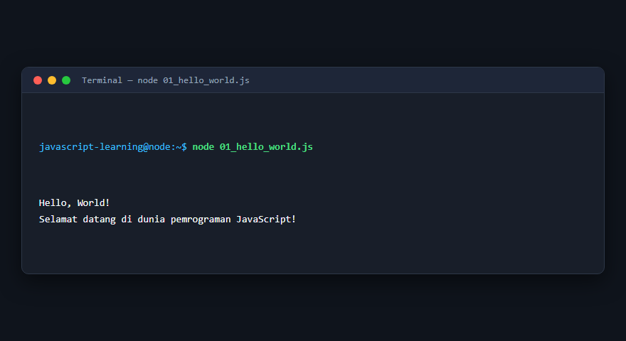
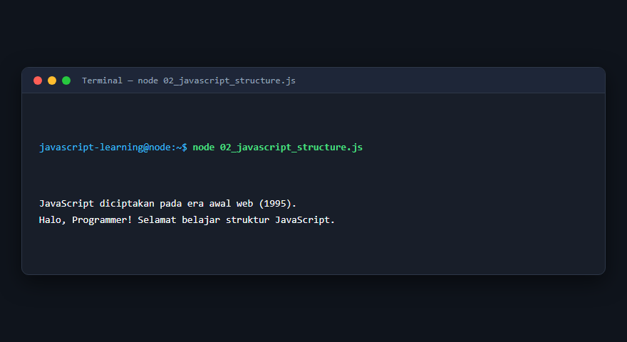
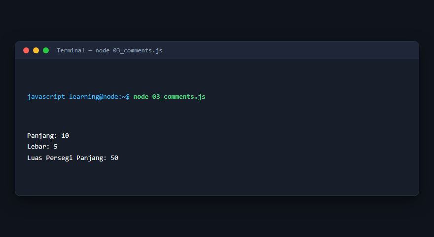
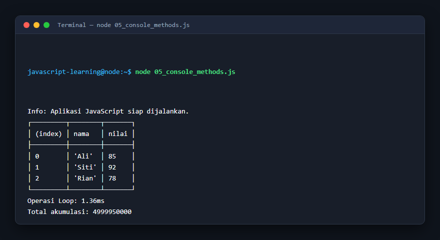
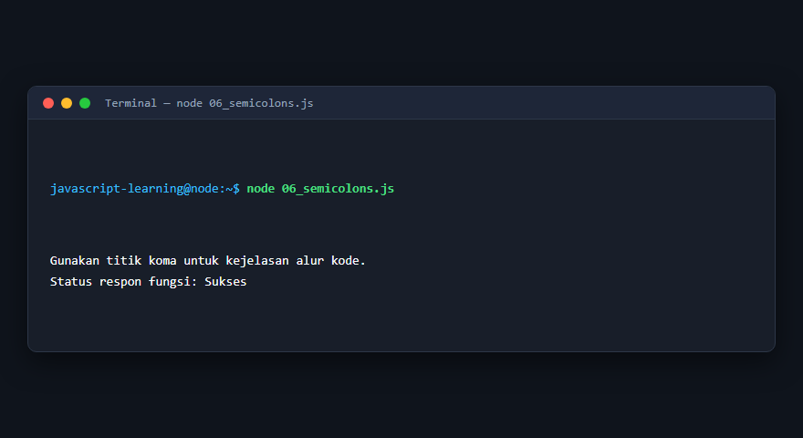
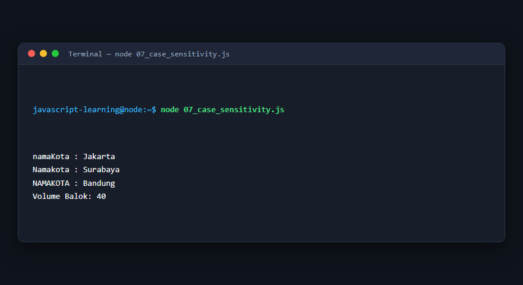
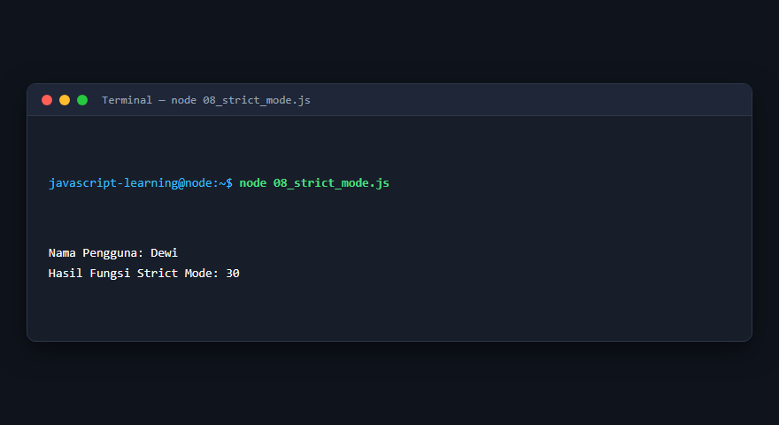
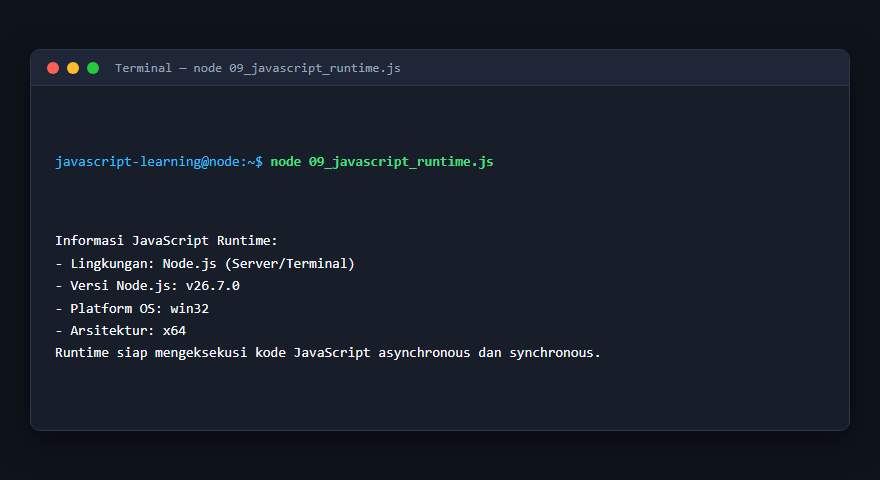
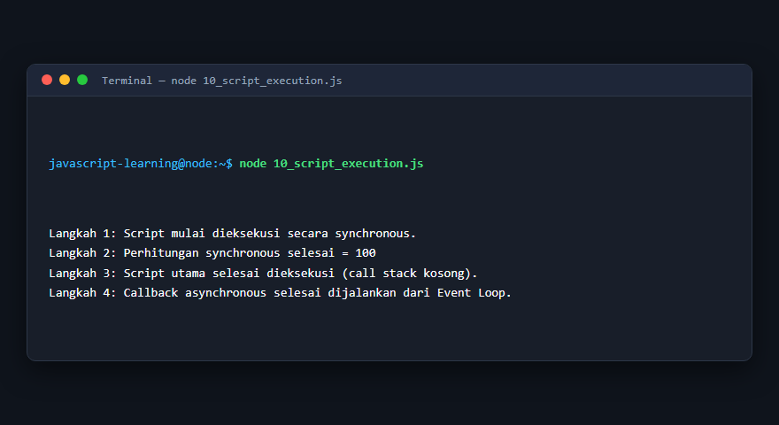

# Modul 1: Pengenalan JavaScript dan Struktur Program

## Deskripsi Modul
Modul ini memperkenalkan dasar-dasar bahasa pemrograman JavaScript, struktur sintaksis, lingkungan eksekusi (runtime), konsol pengembang, serta aturan penulisan kode modern.

## Tujuan Pembelajaran
Memahami dasar sintaks JavaScript, perbedaan eksekusi di berbagai runtime, serta best practice penulisan kode menggunakan strict mode dan titik koma.

## Daftar Submodul & Materi

- [01_hello_world.js](01_hello_world.js) : Program pertama JavaScript
- [02_javascript_structure.js](02_javascript_structure.js) : Struktur program JavaScript
- [03_comments.js](03_comments.js) : Komentar program
- [04_console_log.js](04_console_log.js) : Output menggunakan `console.log()`
- [05_console_methods.js](05_console_methods.js) : Metode console
- [06_semicolons.js](06_semicolons.js) : Penggunaan titik koma
- [07_case_sensitivity.js](07_case_sensitivity.js) : Case sensitivity
- [08_strict_mode.js](08_strict_mode.js) : Strict mode
- [09_javascript_runtime.js](09_javascript_runtime.js) : JavaScript runtime
- [10_script_execution.js](10_script_execution.js) : Eksekusi script JavaScript

---

## Penjelasan Detail Setiap Submodul

### 1. Program pertama JavaScript

**Tujuan Pembelajaran:** Memahami konsep dan implementasi praktis dari materi Program pertama JavaScript.

**Konsep Utama:** Program ini mendemonstrasikan prinsip Program pertama JavaScript secara komprehensif, terstruktur, dan bersih sesuai standar pemrograman JavaScript modern.

**Penjelasan Source Code:** Program mengeksekusi instruksi yang telah dilengkapi dengan komentar kode edukatif berbahasa Indonesia. Setiap blok logika penting dijelaskan secara rinci agar alur kerja program mudah dipahami oleh pembelajar.

**Source Code:** [01_hello_world.js](01_hello_world.js)

**Cara Menjalankan:**
```bash
node 01_hello_world.js
```

**Hasil yang Diharapkan:** Program akan mencetak log hasil evaluasi, perhitungan, atau pemrosesan data ke terminal secara akurat.

**Hasil Eksekusi:**



---

### 2. Struktur program JavaScript

**Tujuan Pembelajaran:** Memahami konsep dan implementasi praktis dari materi Struktur program JavaScript.

**Konsep Utama:** Program ini mendemonstrasikan prinsip Struktur program JavaScript secara komprehensif, terstruktur, dan bersih sesuai standar pemrograman JavaScript modern.

**Penjelasan Source Code:** Program mengeksekusi instruksi yang telah dilengkapi dengan komentar kode edukatif berbahasa Indonesia. Setiap blok logika penting dijelaskan secara rinci agar alur kerja program mudah dipahami oleh pembelajar.

**Source Code:** [02_javascript_structure.js](02_javascript_structure.js)

**Cara Menjalankan:**
```bash
node 02_javascript_structure.js
```

**Hasil yang Diharapkan:** Program akan mencetak log hasil evaluasi, perhitungan, atau pemrosesan data ke terminal secara akurat.

**Hasil Eksekusi:**



---

### 3. Komentar program

**Tujuan Pembelajaran:** Memahami konsep dan implementasi praktis dari materi Komentar program.

**Konsep Utama:** Program ini mendemonstrasikan prinsip Komentar program secara komprehensif, terstruktur, dan bersih sesuai standar pemrograman JavaScript modern.

**Penjelasan Source Code:** Program mengeksekusi instruksi yang telah dilengkapi dengan komentar kode edukatif berbahasa Indonesia. Setiap blok logika penting dijelaskan secara rinci agar alur kerja program mudah dipahami oleh pembelajar.

**Source Code:** [03_comments.js](03_comments.js)

**Cara Menjalankan:**
```bash
node 03_comments.js
```

**Hasil yang Diharapkan:** Program akan mencetak log hasil evaluasi, perhitungan, atau pemrosesan data ke terminal secara akurat.

**Hasil Eksekusi:**



---

### 4. Output menggunakan `console.log()`

**Tujuan Pembelajaran:** Memahami konsep dan implementasi praktis dari materi Output menggunakan `console.log()`.

**Konsep Utama:** Program ini mendemonstrasikan prinsip Output menggunakan `console.log()` secara komprehensif, terstruktur, dan bersih sesuai standar pemrograman JavaScript modern.

**Penjelasan Source Code:** Program mengeksekusi instruksi yang telah dilengkapi dengan komentar kode edukatif berbahasa Indonesia. Setiap blok logika penting dijelaskan secara rinci agar alur kerja program mudah dipahami oleh pembelajar.

**Source Code:** [04_console_log.js](04_console_log.js)

**Cara Menjalankan:**
```bash
node 04_console_log.js
```

**Hasil yang Diharapkan:** Program akan mencetak log hasil evaluasi, perhitungan, atau pemrosesan data ke terminal secara akurat.

**Hasil Eksekusi:**


---

### 5. Metode console

**Tujuan Pembelajaran:** Memahami konsep dan implementasi praktis dari materi Metode console.

**Konsep Utama:** Program ini mendemonstrasikan prinsip Metode console secara komprehensif, terstruktur, dan bersih sesuai standar pemrograman JavaScript modern.

**Penjelasan Source Code:** Program mengeksekusi instruksi yang telah dilengkapi dengan komentar kode edukatif berbahasa Indonesia. Setiap blok logika penting dijelaskan secara rinci agar alur kerja program mudah dipahami oleh pembelajar.

**Source Code:** [05_console_methods.js](05_console_methods.js)

**Cara Menjalankan:**
```bash
node 05_console_methods.js
```

**Hasil yang Diharapkan:** Program akan mencetak log hasil evaluasi, perhitungan, atau pemrosesan data ke terminal secara akurat.

**Hasil Eksekusi:**



---

### 6. Penggunaan titik koma

**Tujuan Pembelajaran:** Memahami konsep dan implementasi praktis dari materi Penggunaan titik koma.

**Konsep Utama:** Program ini mendemonstrasikan prinsip Penggunaan titik koma secara komprehensif, terstruktur, dan bersih sesuai standar pemrograman JavaScript modern.

**Penjelasan Source Code:** Program mengeksekusi instruksi yang telah dilengkapi dengan komentar kode edukatif berbahasa Indonesia. Setiap blok logika penting dijelaskan secara rinci agar alur kerja program mudah dipahami oleh pembelajar.

**Source Code:** [06_semicolons.js](06_semicolons.js)

**Cara Menjalankan:**
```bash
node 06_semicolons.js
```

**Hasil yang Diharapkan:** Program akan mencetak log hasil evaluasi, perhitungan, atau pemrosesan data ke terminal secara akurat.

**Hasil Eksekusi:**



---

### 7. Case sensitivity

**Tujuan Pembelajaran:** Memahami konsep dan implementasi praktis dari materi Case sensitivity.

**Konsep Utama:** Program ini mendemonstrasikan prinsip Case sensitivity secara komprehensif, terstruktur, dan bersih sesuai standar pemrograman JavaScript modern.

**Penjelasan Source Code:** Program mengeksekusi instruksi yang telah dilengkapi dengan komentar kode edukatif berbahasa Indonesia. Setiap blok logika penting dijelaskan secara rinci agar alur kerja program mudah dipahami oleh pembelajar.

**Source Code:** [07_case_sensitivity.js](07_case_sensitivity.js)

**Cara Menjalankan:**
```bash
node 07_case_sensitivity.js
```

**Hasil yang Diharapkan:** Program akan mencetak log hasil evaluasi, perhitungan, atau pemrosesan data ke terminal secara akurat.

**Hasil Eksekusi:**



---

### 8. Strict mode

**Tujuan Pembelajaran:** Memahami konsep dan implementasi praktis dari materi Strict mode.

**Konsep Utama:** Program ini mendemonstrasikan prinsip Strict mode secara komprehensif, terstruktur, dan bersih sesuai standar pemrograman JavaScript modern.

**Penjelasan Source Code:** Program mengeksekusi instruksi yang telah dilengkapi dengan komentar kode edukatif berbahasa Indonesia. Setiap blok logika penting dijelaskan secara rinci agar alur kerja program mudah dipahami oleh pembelajar.

**Source Code:** [08_strict_mode.js](08_strict_mode.js)

**Cara Menjalankan:**
```bash
node 08_strict_mode.js
```

**Hasil yang Diharapkan:** Program akan mencetak log hasil evaluasi, perhitungan, atau pemrosesan data ke terminal secara akurat.

**Hasil Eksekusi:**



---

### 9. JavaScript runtime

**Tujuan Pembelajaran:** Memahami konsep dan implementasi praktis dari materi JavaScript runtime.

**Konsep Utama:** Program ini mendemonstrasikan prinsip JavaScript runtime secara komprehensif, terstruktur, dan bersih sesuai standar pemrograman JavaScript modern.

**Penjelasan Source Code:** Program mengeksekusi instruksi yang telah dilengkapi dengan komentar kode edukatif berbahasa Indonesia. Setiap blok logika penting dijelaskan secara rinci agar alur kerja program mudah dipahami oleh pembelajar.

**Source Code:** [09_javascript_runtime.js](09_javascript_runtime.js)

**Cara Menjalankan:**
```bash
node 09_javascript_runtime.js
```

**Hasil yang Diharapkan:** Program akan mencetak log hasil evaluasi, perhitungan, atau pemrosesan data ke terminal secara akurat.

**Hasil Eksekusi:**



---

### 10. Eksekusi script JavaScript

**Tujuan Pembelajaran:** Memahami konsep dan implementasi praktis dari materi Eksekusi script JavaScript.

**Konsep Utama:** Program ini mendemonstrasikan prinsip Eksekusi script JavaScript secara komprehensif, terstruktur, dan bersih sesuai standar pemrograman JavaScript modern.

**Penjelasan Source Code:** Program mengeksekusi instruksi yang telah dilengkapi dengan komentar kode edukatif berbahasa Indonesia. Setiap blok logika penting dijelaskan secara rinci agar alur kerja program mudah dipahami oleh pembelajar.

**Source Code:** [10_script_execution.js](10_script_execution.js)

**Cara Menjalankan:**
```bash
node 10_script_execution.js
```

**Hasil yang Diharapkan:** Program akan mencetak log hasil evaluasi, perhitungan, atau pemrosesan data ke terminal secara akurat.

**Hasil Eksekusi:**



---

## Ringkasan Modul

Modul 1 (Pengenalan JavaScript dan Struktur Program) telah menyajikan pembelajaran berbasis praktik yang terstruktur. Seluruh program di dalam modul ini dapat dijalankan secara mandiri tanpa saling membebani dependensi yang rumit, dengan fokus mendalam pada pemahaman konsep dan kebiasaan baik penulisan kode.
