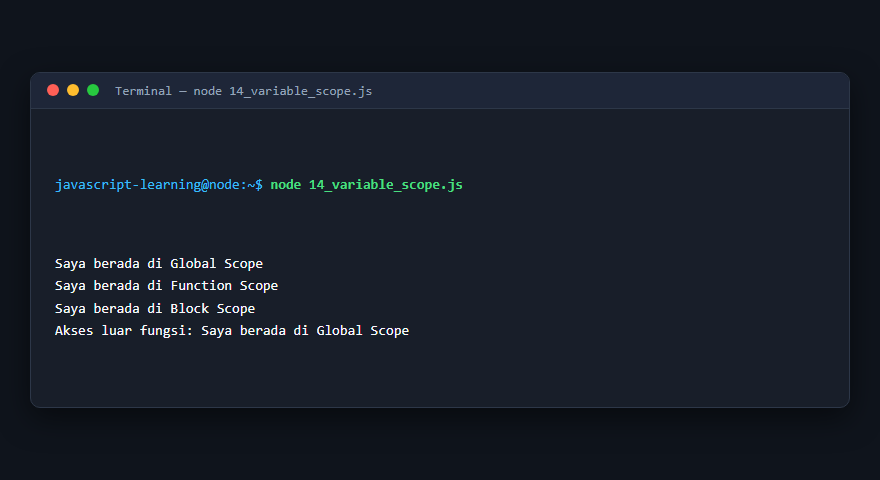
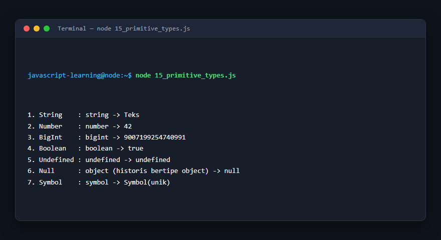
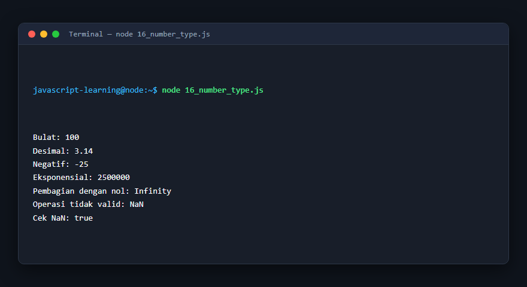
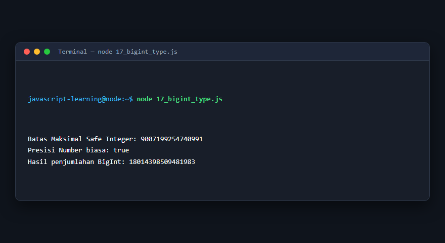
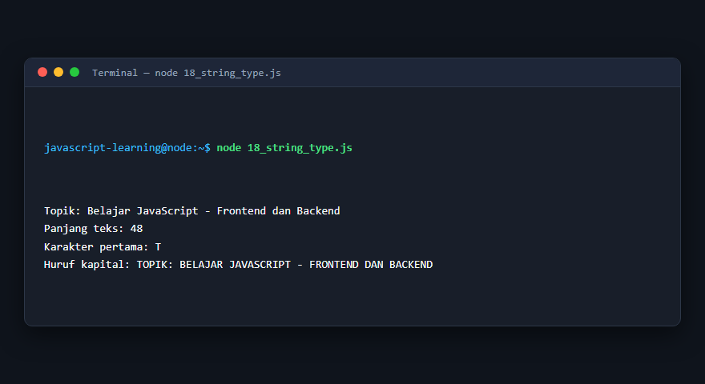
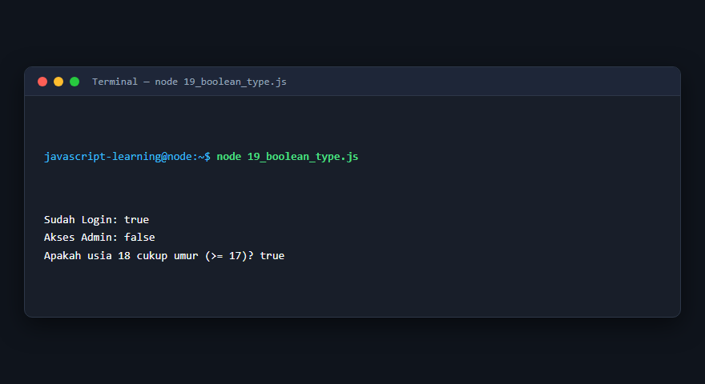
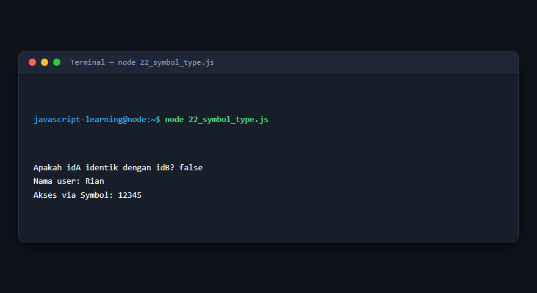
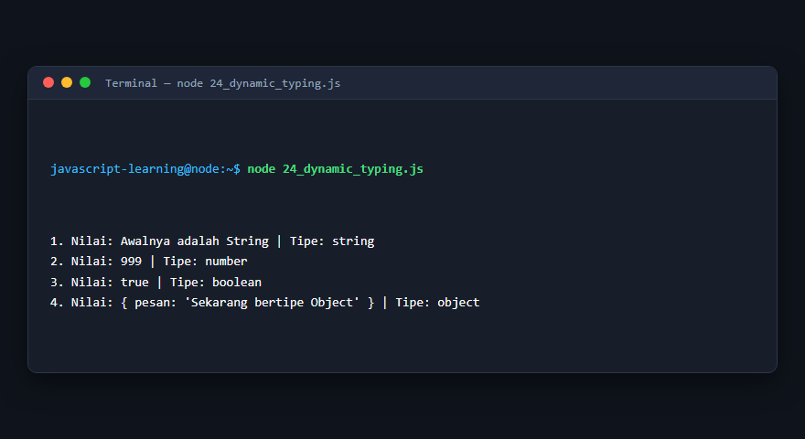

# Modul 2: Variabel dan Tipe Data

## Deskripsi Modul
Modul ini membahas sistem penamaan, deklarasi variabel menggunakan var, let, const, lingkup variabel (scope), dan 7 tipe data primitif dalam JavaScript.

## Tujuan Pembelajaran
Menguasai manajemen memori variabel, pemahaman dynamic typing, serta karakteristik masing-masing tipe data primitif dan symbol.

## Daftar Submodul & Materi

- [11_var_keyword.js](11_var_keyword.js) : Deklarasi variabel dengan `var`
- [12_let_keyword.js](12_let_keyword.js) : Deklarasi variabel dengan `let`
- [13_const_keyword.js](13_const_keyword.js) : Deklarasi konstanta dengan `const`
- [14_variable_scope.js](14_variable_scope.js) : Scope variabel
- [15_primitive_types.js](15_primitive_types.js) : Tipe data primitif
- [16_number_type.js](16_number_type.js) : Tipe data Number
- [17_bigint_type.js](17_bigint_type.js) : Tipe data BigInt
- [18_string_type.js](18_string_type.js) : Tipe data String
- [19_boolean_type.js](19_boolean_type.js) : Tipe data Boolean
- [20_undefined_type.js](20_undefined_type.js) : Nilai `undefined`
- [21_null_type.js](21_null_type.js) : Nilai `null`
- [22_symbol_type.js](22_symbol_type.js) : Tipe data Symbol
- [23_typeof_operator.js](23_typeof_operator.js) : Operator `typeof`
- [24_dynamic_typing.js](24_dynamic_typing.js) : Dynamic typing

---

## Penjelasan Detail Setiap Submodul

### 11. Deklarasi variabel dengan `var`

**Tujuan Pembelajaran:** Memahami konsep dan implementasi praktis dari materi Deklarasi variabel dengan `var`.

**Konsep Utama:** Program ini mendemonstrasikan prinsip Deklarasi variabel dengan `var` secara komprehensif, terstruktur, dan bersih sesuai standar pemrograman JavaScript modern.

**Penjelasan Source Code:** Program mengeksekusi instruksi yang telah dilengkapi dengan komentar kode edukatif berbahasa Indonesia. Setiap blok logika penting dijelaskan secara rinci agar alur kerja program mudah dipahami oleh pembelajar.

**Source Code:** [11_var_keyword.js](11_var_keyword.js)

**Cara Menjalankan:**
```bash
node 11_var_keyword.js
```

**Hasil yang Diharapkan:** Program akan mencetak log hasil evaluasi, perhitungan, atau pemrosesan data ke terminal secara akurat.

**Hasil Eksekusi:**


---

### 12. Deklarasi variabel dengan `let`

**Tujuan Pembelajaran:** Memahami konsep dan implementasi praktis dari materi Deklarasi variabel dengan `let`.

**Konsep Utama:** Program ini mendemonstrasikan prinsip Deklarasi variabel dengan `let` secara komprehensif, terstruktur, dan bersih sesuai standar pemrograman JavaScript modern.

**Penjelasan Source Code:** Program mengeksekusi instruksi yang telah dilengkapi dengan komentar kode edukatif berbahasa Indonesia. Setiap blok logika penting dijelaskan secara rinci agar alur kerja program mudah dipahami oleh pembelajar.

**Source Code:** [12_let_keyword.js](12_let_keyword.js)

**Cara Menjalankan:**
```bash
node 12_let_keyword.js
```

**Hasil yang Diharapkan:** Program akan mencetak log hasil evaluasi, perhitungan, atau pemrosesan data ke terminal secara akurat.

**Hasil Eksekusi:**


---

### 13. Deklarasi konstanta dengan `const`

**Tujuan Pembelajaran:** Memahami konsep dan implementasi praktis dari materi Deklarasi konstanta dengan `const`.

**Konsep Utama:** Program ini mendemonstrasikan prinsip Deklarasi konstanta dengan `const` secara komprehensif, terstruktur, dan bersih sesuai standar pemrograman JavaScript modern.

**Penjelasan Source Code:** Program mengeksekusi instruksi yang telah dilengkapi dengan komentar kode edukatif berbahasa Indonesia. Setiap blok logika penting dijelaskan secara rinci agar alur kerja program mudah dipahami oleh pembelajar.

**Source Code:** [13_const_keyword.js](13_const_keyword.js)

**Cara Menjalankan:**
```bash
node 13_const_keyword.js
```

**Hasil yang Diharapkan:** Program akan mencetak log hasil evaluasi, perhitungan, atau pemrosesan data ke terminal secara akurat.

**Hasil Eksekusi:**


---

### 14. Scope variabel

**Tujuan Pembelajaran:** Memahami konsep dan implementasi praktis dari materi Scope variabel.

**Konsep Utama:** Program ini mendemonstrasikan prinsip Scope variabel secara komprehensif, terstruktur, dan bersih sesuai standar pemrograman JavaScript modern.

**Penjelasan Source Code:** Program mengeksekusi instruksi yang telah dilengkapi dengan komentar kode edukatif berbahasa Indonesia. Setiap blok logika penting dijelaskan secara rinci agar alur kerja program mudah dipahami oleh pembelajar.

**Source Code:** [14_variable_scope.js](14_variable_scope.js)

**Cara Menjalankan:**
```bash
node 14_variable_scope.js
```

**Hasil yang Diharapkan:** Program akan mencetak log hasil evaluasi, perhitungan, atau pemrosesan data ke terminal secara akurat.

**Hasil Eksekusi:**



---

### 15. Tipe data primitif

**Tujuan Pembelajaran:** Memahami konsep dan implementasi praktis dari materi Tipe data primitif.

**Konsep Utama:** Program ini mendemonstrasikan prinsip Tipe data primitif secara komprehensif, terstruktur, dan bersih sesuai standar pemrograman JavaScript modern.

**Penjelasan Source Code:** Program mengeksekusi instruksi yang telah dilengkapi dengan komentar kode edukatif berbahasa Indonesia. Setiap blok logika penting dijelaskan secara rinci agar alur kerja program mudah dipahami oleh pembelajar.

**Source Code:** [15_primitive_types.js](15_primitive_types.js)

**Cara Menjalankan:**
```bash
node 15_primitive_types.js
```

**Hasil yang Diharapkan:** Program akan mencetak log hasil evaluasi, perhitungan, atau pemrosesan data ke terminal secara akurat.

**Hasil Eksekusi:**



---

### 16. Tipe data Number

**Tujuan Pembelajaran:** Memahami konsep dan implementasi praktis dari materi Tipe data Number.

**Konsep Utama:** Program ini mendemonstrasikan prinsip Tipe data Number secara komprehensif, terstruktur, dan bersih sesuai standar pemrograman JavaScript modern.

**Penjelasan Source Code:** Program mengeksekusi instruksi yang telah dilengkapi dengan komentar kode edukatif berbahasa Indonesia. Setiap blok logika penting dijelaskan secara rinci agar alur kerja program mudah dipahami oleh pembelajar.

**Source Code:** [16_number_type.js](16_number_type.js)

**Cara Menjalankan:**
```bash
node 16_number_type.js
```

**Hasil yang Diharapkan:** Program akan mencetak log hasil evaluasi, perhitungan, atau pemrosesan data ke terminal secara akurat.

**Hasil Eksekusi:**



---

### 17. Tipe data BigInt

**Tujuan Pembelajaran:** Memahami konsep dan implementasi praktis dari materi Tipe data BigInt.

**Konsep Utama:** Program ini mendemonstrasikan prinsip Tipe data BigInt secara komprehensif, terstruktur, dan bersih sesuai standar pemrograman JavaScript modern.

**Penjelasan Source Code:** Program mengeksekusi instruksi yang telah dilengkapi dengan komentar kode edukatif berbahasa Indonesia. Setiap blok logika penting dijelaskan secara rinci agar alur kerja program mudah dipahami oleh pembelajar.

**Source Code:** [17_bigint_type.js](17_bigint_type.js)

**Cara Menjalankan:**
```bash
node 17_bigint_type.js
```

**Hasil yang Diharapkan:** Program akan mencetak log hasil evaluasi, perhitungan, atau pemrosesan data ke terminal secara akurat.

**Hasil Eksekusi:**



---

### 18. Tipe data String

**Tujuan Pembelajaran:** Memahami konsep dan implementasi praktis dari materi Tipe data String.

**Konsep Utama:** Program ini mendemonstrasikan prinsip Tipe data String secara komprehensif, terstruktur, dan bersih sesuai standar pemrograman JavaScript modern.

**Penjelasan Source Code:** Program mengeksekusi instruksi yang telah dilengkapi dengan komentar kode edukatif berbahasa Indonesia. Setiap blok logika penting dijelaskan secara rinci agar alur kerja program mudah dipahami oleh pembelajar.

**Source Code:** [18_string_type.js](18_string_type.js)

**Cara Menjalankan:**
```bash
node 18_string_type.js
```

**Hasil yang Diharapkan:** Program akan mencetak log hasil evaluasi, perhitungan, atau pemrosesan data ke terminal secara akurat.

**Hasil Eksekusi:**



---

### 19. Tipe data Boolean

**Tujuan Pembelajaran:** Memahami konsep dan implementasi praktis dari materi Tipe data Boolean.

**Konsep Utama:** Program ini mendemonstrasikan prinsip Tipe data Boolean secara komprehensif, terstruktur, dan bersih sesuai standar pemrograman JavaScript modern.

**Penjelasan Source Code:** Program mengeksekusi instruksi yang telah dilengkapi dengan komentar kode edukatif berbahasa Indonesia. Setiap blok logika penting dijelaskan secara rinci agar alur kerja program mudah dipahami oleh pembelajar.

**Source Code:** [19_boolean_type.js](19_boolean_type.js)

**Cara Menjalankan:**
```bash
node 19_boolean_type.js
```

**Hasil yang Diharapkan:** Program akan mencetak log hasil evaluasi, perhitungan, atau pemrosesan data ke terminal secara akurat.

**Hasil Eksekusi:**



---

### 20. Nilai `undefined`

**Tujuan Pembelajaran:** Memahami konsep dan implementasi praktis dari materi Nilai `undefined`.

**Konsep Utama:** Program ini mendemonstrasikan prinsip Nilai `undefined` secara komprehensif, terstruktur, dan bersih sesuai standar pemrograman JavaScript modern.

**Penjelasan Source Code:** Program mengeksekusi instruksi yang telah dilengkapi dengan komentar kode edukatif berbahasa Indonesia. Setiap blok logika penting dijelaskan secara rinci agar alur kerja program mudah dipahami oleh pembelajar.

**Source Code:** [20_undefined_type.js](20_undefined_type.js)

**Cara Menjalankan:**
```bash
node 20_undefined_type.js
```

**Hasil yang Diharapkan:** Program akan mencetak log hasil evaluasi, perhitungan, atau pemrosesan data ke terminal secara akurat.

**Hasil Eksekusi:**


---

### 21. Nilai `null`

**Tujuan Pembelajaran:** Memahami konsep dan implementasi praktis dari materi Nilai `null`.

**Konsep Utama:** Program ini mendemonstrasikan prinsip Nilai `null` secara komprehensif, terstruktur, dan bersih sesuai standar pemrograman JavaScript modern.

**Penjelasan Source Code:** Program mengeksekusi instruksi yang telah dilengkapi dengan komentar kode edukatif berbahasa Indonesia. Setiap blok logika penting dijelaskan secara rinci agar alur kerja program mudah dipahami oleh pembelajar.

**Source Code:** [21_null_type.js](21_null_type.js)

**Cara Menjalankan:**
```bash
node 21_null_type.js
```

**Hasil yang Diharapkan:** Program akan mencetak log hasil evaluasi, perhitungan, atau pemrosesan data ke terminal secara akurat.

**Hasil Eksekusi:**


---

### 22. Tipe data Symbol

**Tujuan Pembelajaran:** Memahami konsep dan implementasi praktis dari materi Tipe data Symbol.

**Konsep Utama:** Program ini mendemonstrasikan prinsip Tipe data Symbol secara komprehensif, terstruktur, dan bersih sesuai standar pemrograman JavaScript modern.

**Penjelasan Source Code:** Program mengeksekusi instruksi yang telah dilengkapi dengan komentar kode edukatif berbahasa Indonesia. Setiap blok logika penting dijelaskan secara rinci agar alur kerja program mudah dipahami oleh pembelajar.

**Source Code:** [22_symbol_type.js](22_symbol_type.js)

**Cara Menjalankan:**
```bash
node 22_symbol_type.js
```

**Hasil yang Diharapkan:** Program akan mencetak log hasil evaluasi, perhitungan, atau pemrosesan data ke terminal secara akurat.

**Hasil Eksekusi:**



---

### 23. Operator `typeof`

**Tujuan Pembelajaran:** Memahami konsep dan implementasi praktis dari materi Operator `typeof`.

**Konsep Utama:** Program ini mendemonstrasikan prinsip Operator `typeof` secara komprehensif, terstruktur, dan bersih sesuai standar pemrograman JavaScript modern.

**Penjelasan Source Code:** Program mengeksekusi instruksi yang telah dilengkapi dengan komentar kode edukatif berbahasa Indonesia. Setiap blok logika penting dijelaskan secara rinci agar alur kerja program mudah dipahami oleh pembelajar.

**Source Code:** [23_typeof_operator.js](23_typeof_operator.js)

**Cara Menjalankan:**
```bash
node 23_typeof_operator.js
```

**Hasil yang Diharapkan:** Program akan mencetak log hasil evaluasi, perhitungan, atau pemrosesan data ke terminal secara akurat.

**Hasil Eksekusi:**


---

### 24. Dynamic typing

**Tujuan Pembelajaran:** Memahami konsep dan implementasi praktis dari materi Dynamic typing.

**Konsep Utama:** Program ini mendemonstrasikan prinsip Dynamic typing secara komprehensif, terstruktur, dan bersih sesuai standar pemrograman JavaScript modern.

**Penjelasan Source Code:** Program mengeksekusi instruksi yang telah dilengkapi dengan komentar kode edukatif berbahasa Indonesia. Setiap blok logika penting dijelaskan secara rinci agar alur kerja program mudah dipahami oleh pembelajar.

**Source Code:** [24_dynamic_typing.js](24_dynamic_typing.js)

**Cara Menjalankan:**
```bash
node 24_dynamic_typing.js
```

**Hasil yang Diharapkan:** Program akan mencetak log hasil evaluasi, perhitungan, atau pemrosesan data ke terminal secara akurat.

**Hasil Eksekusi:**



---

## Ringkasan Modul

Modul 2 (Variabel dan Tipe Data) telah menyajikan pembelajaran berbasis praktik yang terstruktur. Seluruh program di dalam modul ini dapat dijalankan secara mandiri tanpa saling membebani dependensi yang rumit, dengan fokus mendalam pada pemahaman konsep dan kebiasaan baik penulisan kode.
