# Modul 3: Input, Output, dan Operator

## Deskripsi Modul
Modul ini mempelajari interaksi input/output pengguna serta berbagai jenis operator matematika, perbandingan, logika, hingga operator modern seperti nullish coalescing dan optional chaining.

## Tujuan Pembelajaran
Mampu melakukan operasi aritmetika, evaluasi kondisi logika yang aman, type coercion, dan konversi tipe data.

## Daftar Submodul & Materi

- [25_console_input.js](25_console_input.js) : Input menggunakan Node.js
- [26_prompt_input.js](26_prompt_input.js) : Input menggunakan `prompt()`
- [27_string_to_number.js](27_string_to_number.js) : Konversi string ke angka
- [28_arithmetic_operators.js](28_arithmetic_operators.js) : Operator aritmetika
- [29_assignment_operators.js](29_assignment_operators.js) : Operator penugasan
- [30_comparison_operators.js](30_comparison_operators.js) : Operator perbandingan
- [31_logical_operators.js](31_logical_operators.js) : Operator logika
- [32_increment_decrement.js](32_increment_decrement.js) : Increment dan decrement
- [33_strict_equality.js](33_strict_equality.js) : Strict equality
- [34_type_coercion.js](34_type_coercion.js) : Type coercion
- [35_ternary_operator.js](35_ternary_operator.js) : Operator ternary
- [36_nullish_coalescing.js](36_nullish_coalescing.js) : Nullish coalescing
- [37_optional_chaining.js](37_optional_chaining.js) : Optional chaining
- [38_operator_precedence.js](38_operator_precedence.js) : Prioritas operator

---

## Penjelasan Detail Setiap Submodul

### 25. Input menggunakan Node.js

**Tujuan Pembelajaran:** Memahami konsep dan implementasi praktis dari materi Input menggunakan Node.js.

**Konsep Utama:** Program ini mendemonstrasikan prinsip Input menggunakan Node.js secara komprehensif, terstruktur, dan bersih sesuai standar pemrograman JavaScript modern.

**Penjelasan Source Code:** Program mengeksekusi instruksi yang telah dilengkapi dengan komentar kode edukatif berbahasa Indonesia. Setiap blok logika penting dijelaskan secara rinci agar alur kerja program mudah dipahami oleh pembelajar.

**Source Code:** [25_console_input.js](25_console_input.js)

**Cara Menjalankan:**
```bash
node 25_console_input.js
```

**Hasil yang Diharapkan:** Program akan mencetak log hasil evaluasi, perhitungan, atau pemrosesan data ke terminal secara akurat.

**Hasil Eksekusi:**

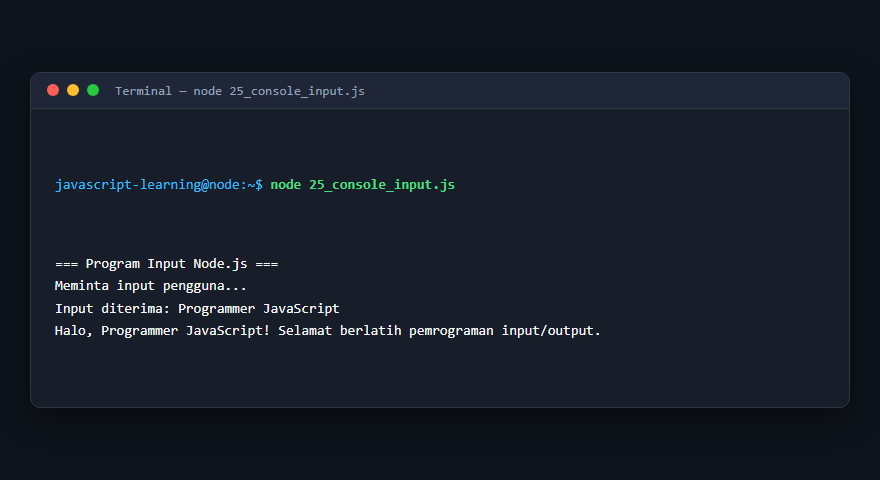

---

### 26. Input menggunakan `prompt()`

**Tujuan Pembelajaran:** Memahami konsep dan implementasi praktis dari materi Input menggunakan `prompt()`.

**Konsep Utama:** Program ini mendemonstrasikan prinsip Input menggunakan `prompt()` secara komprehensif, terstruktur, dan bersih sesuai standar pemrograman JavaScript modern.

**Penjelasan Source Code:** Program mengeksekusi instruksi yang telah dilengkapi dengan komentar kode edukatif berbahasa Indonesia. Setiap blok logika penting dijelaskan secara rinci agar alur kerja program mudah dipahami oleh pembelajar.

**Source Code:** [26_prompt_input.js](26_prompt_input.js)

**Cara Menjalankan:**
```bash
node 26_prompt_input.js
```

**Hasil yang Diharapkan:** Program akan mencetak log hasil evaluasi, perhitungan, atau pemrosesan data ke terminal secara akurat.

**Hasil Eksekusi:**


---

### 27. Konversi string ke angka

**Tujuan Pembelajaran:** Memahami konsep dan implementasi praktis dari materi Konversi string ke angka.

**Konsep Utama:** Program ini mendemonstrasikan prinsip Konversi string ke angka secara komprehensif, terstruktur, dan bersih sesuai standar pemrograman JavaScript modern.

**Penjelasan Source Code:** Program mengeksekusi instruksi yang telah dilengkapi dengan komentar kode edukatif berbahasa Indonesia. Setiap blok logika penting dijelaskan secara rinci agar alur kerja program mudah dipahami oleh pembelajar.

**Source Code:** [27_string_to_number.js](27_string_to_number.js)

**Cara Menjalankan:**
```bash
node 27_string_to_number.js
```

**Hasil yang Diharapkan:** Program akan mencetak log hasil evaluasi, perhitungan, atau pemrosesan data ke terminal secara akurat.

**Hasil Eksekusi:**

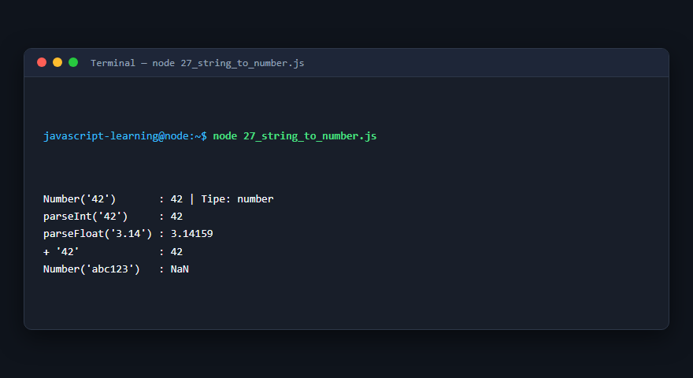

---

### 28. Operator aritmetika

**Tujuan Pembelajaran:** Memahami konsep dan implementasi praktis dari materi Operator aritmetika.

**Konsep Utama:** Program ini mendemonstrasikan prinsip Operator aritmetika secara komprehensif, terstruktur, dan bersih sesuai standar pemrograman JavaScript modern.

**Penjelasan Source Code:** Program mengeksekusi instruksi yang telah dilengkapi dengan komentar kode edukatif berbahasa Indonesia. Setiap blok logika penting dijelaskan secara rinci agar alur kerja program mudah dipahami oleh pembelajar.

**Source Code:** [28_arithmetic_operators.js](28_arithmetic_operators.js)

**Cara Menjalankan:**
```bash
node 28_arithmetic_operators.js
```

**Hasil yang Diharapkan:** Program akan mencetak log hasil evaluasi, perhitungan, atau pemrosesan data ke terminal secara akurat.

**Hasil Eksekusi:**

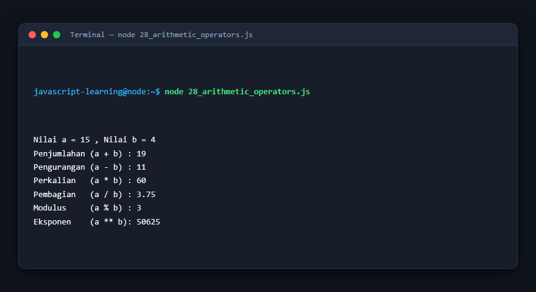

---

### 29. Operator penugasan

**Tujuan Pembelajaran:** Memahami konsep dan implementasi praktis dari materi Operator penugasan.

**Konsep Utama:** Program ini mendemonstrasikan prinsip Operator penugasan secara komprehensif, terstruktur, dan bersih sesuai standar pemrograman JavaScript modern.

**Penjelasan Source Code:** Program mengeksekusi instruksi yang telah dilengkapi dengan komentar kode edukatif berbahasa Indonesia. Setiap blok logika penting dijelaskan secara rinci agar alur kerja program mudah dipahami oleh pembelajar.

**Source Code:** [29_assignment_operators.js](29_assignment_operators.js)

**Cara Menjalankan:**
```bash
node 29_assignment_operators.js
```

**Hasil yang Diharapkan:** Program akan mencetak log hasil evaluasi, perhitungan, atau pemrosesan data ke terminal secara akurat.

**Hasil Eksekusi:**

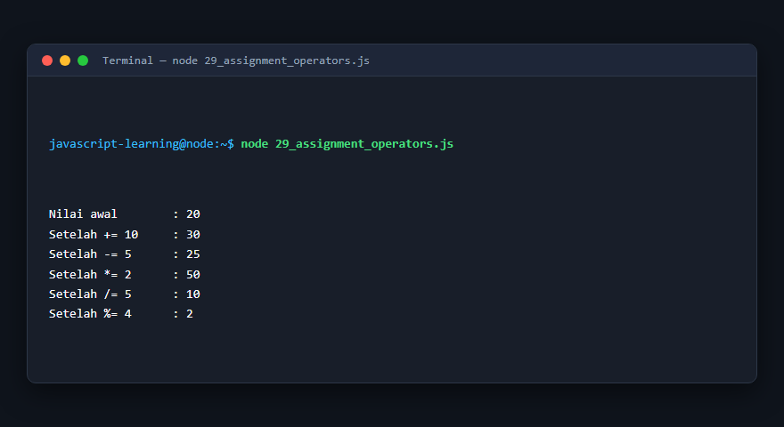

---

### 30. Operator perbandingan

**Tujuan Pembelajaran:** Memahami konsep dan implementasi praktis dari materi Operator perbandingan.

**Konsep Utama:** Program ini mendemonstrasikan prinsip Operator perbandingan secara komprehensif, terstruktur, dan bersih sesuai standar pemrograman JavaScript modern.

**Penjelasan Source Code:** Program mengeksekusi instruksi yang telah dilengkapi dengan komentar kode edukatif berbahasa Indonesia. Setiap blok logika penting dijelaskan secara rinci agar alur kerja program mudah dipahami oleh pembelajar.

**Source Code:** [30_comparison_operators.js](30_comparison_operators.js)

**Cara Menjalankan:**
```bash
node 30_comparison_operators.js
```

**Hasil yang Diharapkan:** Program akan mencetak log hasil evaluasi, perhitungan, atau pemrosesan data ke terminal secara akurat.

**Hasil Eksekusi:**

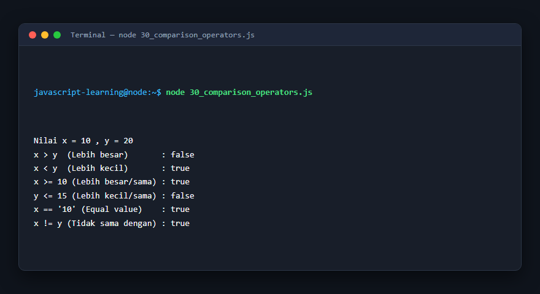

---

### 31. Operator logika

**Tujuan Pembelajaran:** Memahami konsep dan implementasi praktis dari materi Operator logika.

**Konsep Utama:** Program ini mendemonstrasikan prinsip Operator logika secara komprehensif, terstruktur, dan bersih sesuai standar pemrograman JavaScript modern.

**Penjelasan Source Code:** Program mengeksekusi instruksi yang telah dilengkapi dengan komentar kode edukatif berbahasa Indonesia. Setiap blok logika penting dijelaskan secara rinci agar alur kerja program mudah dipahami oleh pembelajar.

**Source Code:** [31_logical_operators.js](31_logical_operators.js)

**Cara Menjalankan:**
```bash
node 31_logical_operators.js
```

**Hasil yang Diharapkan:** Program akan mencetak log hasil evaluasi, perhitungan, atau pemrosesan data ke terminal secara akurat.

**Hasil Eksekusi:**

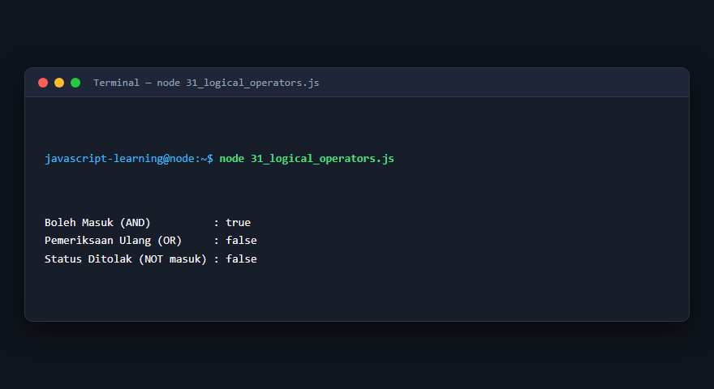

---

### 32. Increment dan decrement

**Tujuan Pembelajaran:** Memahami konsep dan implementasi praktis dari materi Increment dan decrement.

**Konsep Utama:** Program ini mendemonstrasikan prinsip Increment dan decrement secara komprehensif, terstruktur, dan bersih sesuai standar pemrograman JavaScript modern.

**Penjelasan Source Code:** Program mengeksekusi instruksi yang telah dilengkapi dengan komentar kode edukatif berbahasa Indonesia. Setiap blok logika penting dijelaskan secara rinci agar alur kerja program mudah dipahami oleh pembelajar.

**Source Code:** [32_increment_decrement.js](32_increment_decrement.js)

**Cara Menjalankan:**
```bash
node 32_increment_decrement.js
```

**Hasil yang Diharapkan:** Program akan mencetak log hasil evaluasi, perhitungan, atau pemrosesan data ke terminal secara akurat.

**Hasil Eksekusi:**

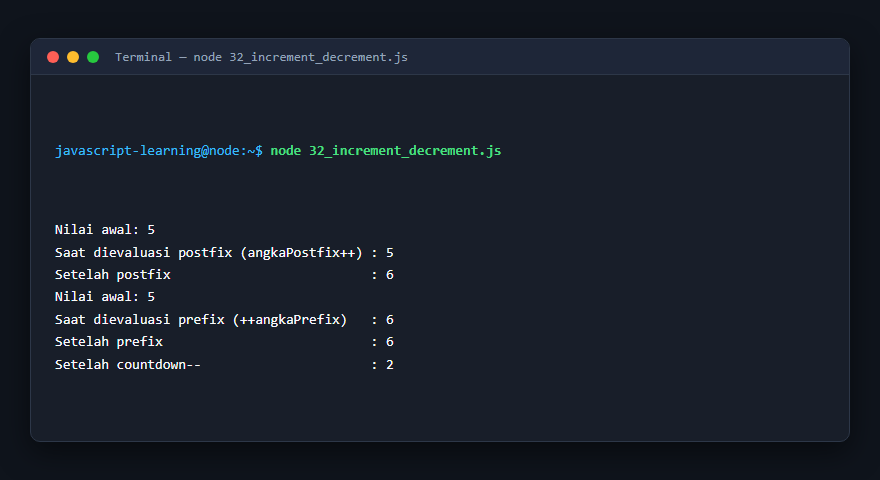

---

### 33. Strict equality

**Tujuan Pembelajaran:** Memahami konsep dan implementasi praktis dari materi Strict equality.

**Konsep Utama:** Program ini mendemonstrasikan prinsip Strict equality secara komprehensif, terstruktur, dan bersih sesuai standar pemrograman JavaScript modern.

**Penjelasan Source Code:** Program mengeksekusi instruksi yang telah dilengkapi dengan komentar kode edukatif berbahasa Indonesia. Setiap blok logika penting dijelaskan secara rinci agar alur kerja program mudah dipahami oleh pembelajar.

**Source Code:** [33_strict_equality.js](33_strict_equality.js)

**Cara Menjalankan:**
```bash
node 33_strict_equality.js
```

**Hasil yang Diharapkan:** Program akan mencetak log hasil evaluasi, perhitungan, atau pemrosesan data ke terminal secara akurat.

**Hasil Eksekusi:**

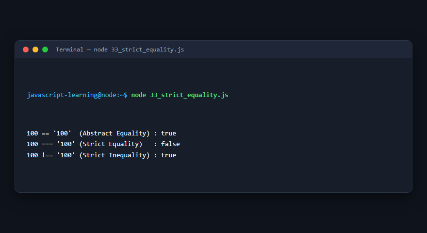

---

### 34. Type coercion

**Tujuan Pembelajaran:** Memahami konsep dan implementasi praktis dari materi Type coercion.

**Konsep Utama:** Program ini mendemonstrasikan prinsip Type coercion secara komprehensif, terstruktur, dan bersih sesuai standar pemrograman JavaScript modern.

**Penjelasan Source Code:** Program mengeksekusi instruksi yang telah dilengkapi dengan komentar kode edukatif berbahasa Indonesia. Setiap blok logika penting dijelaskan secara rinci agar alur kerja program mudah dipahami oleh pembelajar.

**Source Code:** [34_type_coercion.js](34_type_coercion.js)

**Cara Menjalankan:**
```bash
node 34_type_coercion.js
```

**Hasil yang Diharapkan:** Program akan mencetak log hasil evaluasi, perhitungan, atau pemrosesan data ke terminal secara akurat.

**Hasil Eksekusi:**

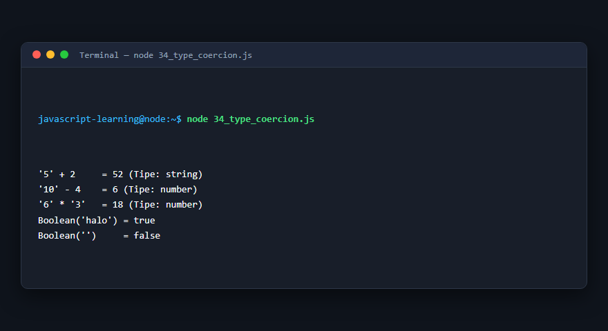

---

### 35. Operator ternary

**Tujuan Pembelajaran:** Memahami konsep dan implementasi praktis dari materi Operator ternary.

**Konsep Utama:** Program ini mendemonstrasikan prinsip Operator ternary secara komprehensif, terstruktur, dan bersih sesuai standar pemrograman JavaScript modern.

**Penjelasan Source Code:** Program mengeksekusi instruksi yang telah dilengkapi dengan komentar kode edukatif berbahasa Indonesia. Setiap blok logika penting dijelaskan secara rinci agar alur kerja program mudah dipahami oleh pembelajar.

**Source Code:** [35_ternary_operator.js](35_ternary_operator.js)

**Cara Menjalankan:**
```bash
node 35_ternary_operator.js
```

**Hasil yang Diharapkan:** Program akan mencetak log hasil evaluasi, perhitungan, atau pemrosesan data ke terminal secara akurat.

**Hasil Eksekusi:**

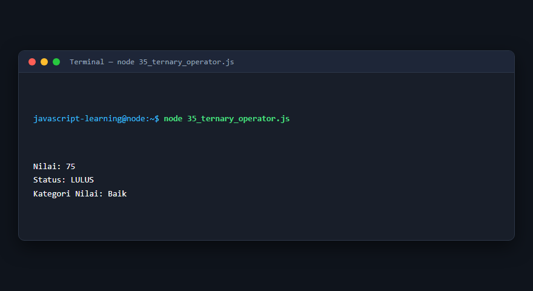

---

### 36. Nullish coalescing

**Tujuan Pembelajaran:** Memahami konsep dan implementasi praktis dari materi Nullish coalescing.

**Konsep Utama:** Program ini mendemonstrasikan prinsip Nullish coalescing secara komprehensif, terstruktur, dan bersih sesuai standar pemrograman JavaScript modern.

**Penjelasan Source Code:** Program mengeksekusi instruksi yang telah dilengkapi dengan komentar kode edukatif berbahasa Indonesia. Setiap blok logika penting dijelaskan secara rinci agar alur kerja program mudah dipahami oleh pembelajar.

**Source Code:** [36_nullish_coalescing.js](36_nullish_coalescing.js)

**Cara Menjalankan:**
```bash
node 36_nullish_coalescing.js
```

**Hasil yang Diharapkan:** Program akan mencetak log hasil evaluasi, perhitungan, atau pemrosesan data ke terminal secara akurat.

**Hasil Eksekusi:**

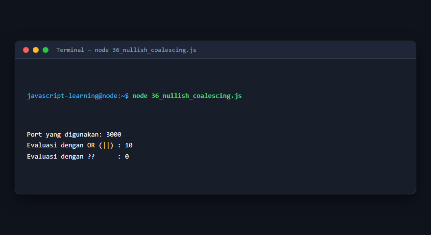

---

### 37. Optional chaining

**Tujuan Pembelajaran:** Memahami konsep dan implementasi praktis dari materi Optional chaining.

**Konsep Utama:** Program ini mendemonstrasikan prinsip Optional chaining secara komprehensif, terstruktur, dan bersih sesuai standar pemrograman JavaScript modern.

**Penjelasan Source Code:** Program mengeksekusi instruksi yang telah dilengkapi dengan komentar kode edukatif berbahasa Indonesia. Setiap blok logika penting dijelaskan secara rinci agar alur kerja program mudah dipahami oleh pembelajar.

**Source Code:** [37_optional_chaining.js](37_optional_chaining.js)

**Cara Menjalankan:**
```bash
node 37_optional_chaining.js
```

**Hasil yang Diharapkan:** Program akan mencetak log hasil evaluasi, perhitungan, atau pemrosesan data ke terminal secara akurat.

**Hasil Eksekusi:**

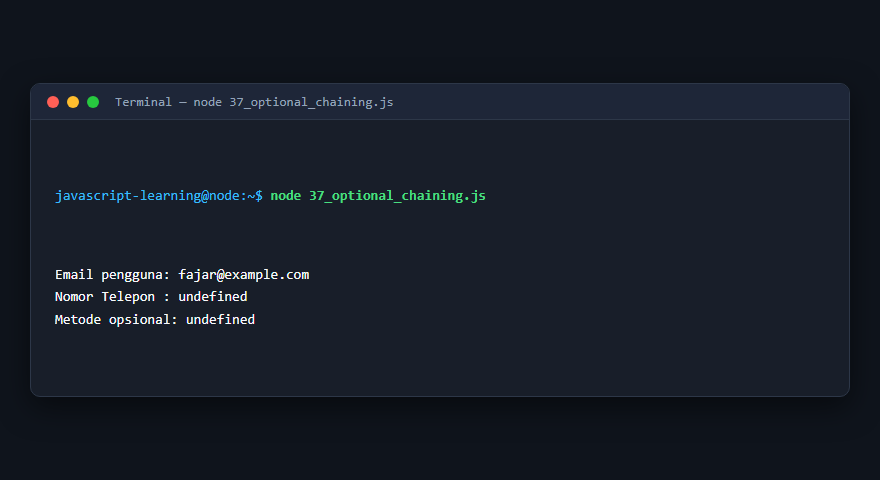

---

### 38. Prioritas operator

**Tujuan Pembelajaran:** Memahami konsep dan implementasi praktis dari materi Prioritas operator.

**Konsep Utama:** Program ini mendemonstrasikan prinsip Prioritas operator secara komprehensif, terstruktur, dan bersih sesuai standar pemrograman JavaScript modern.

**Penjelasan Source Code:** Program mengeksekusi instruksi yang telah dilengkapi dengan komentar kode edukatif berbahasa Indonesia. Setiap blok logika penting dijelaskan secara rinci agar alur kerja program mudah dipahami oleh pembelajar.

**Source Code:** [38_operator_precedence.js](38_operator_precedence.js)

**Cara Menjalankan:**
```bash
node 38_operator_precedence.js
```

**Hasil yang Diharapkan:** Program akan mencetak log hasil evaluasi, perhitungan, atau pemrosesan data ke terminal secara akurat.

**Hasil Eksekusi:**

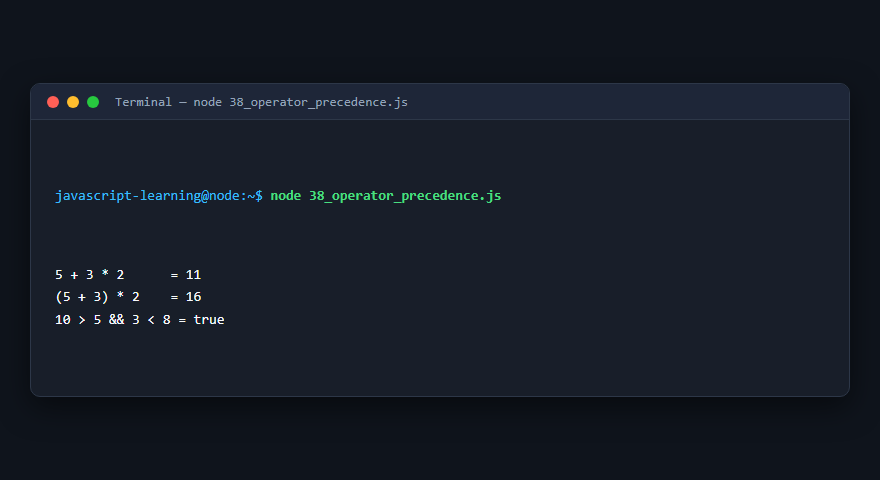

---

## Ringkasan Modul

Modul 3 (Input, Output, dan Operator) telah menyajikan pembelajaran berbasis praktik yang terstruktur. Seluruh program di dalam modul ini dapat dijalankan secara mandiri tanpa saling membebani dependensi yang rumit, dengan fokus mendalam pada pemahaman konsep dan kebiasaan baik penulisan kode.
