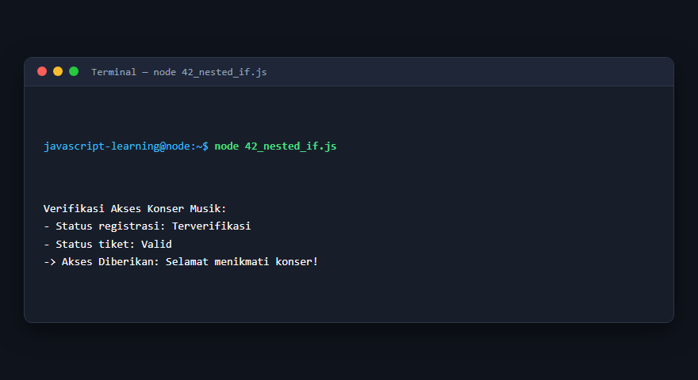
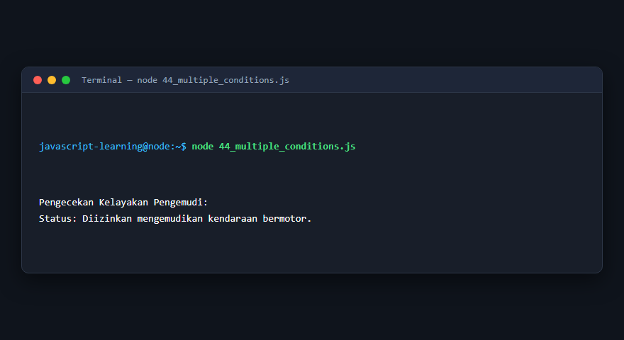
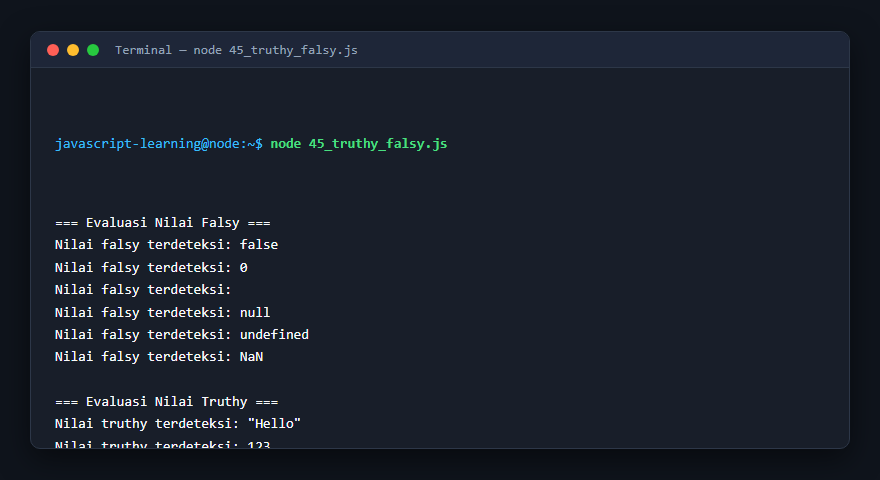
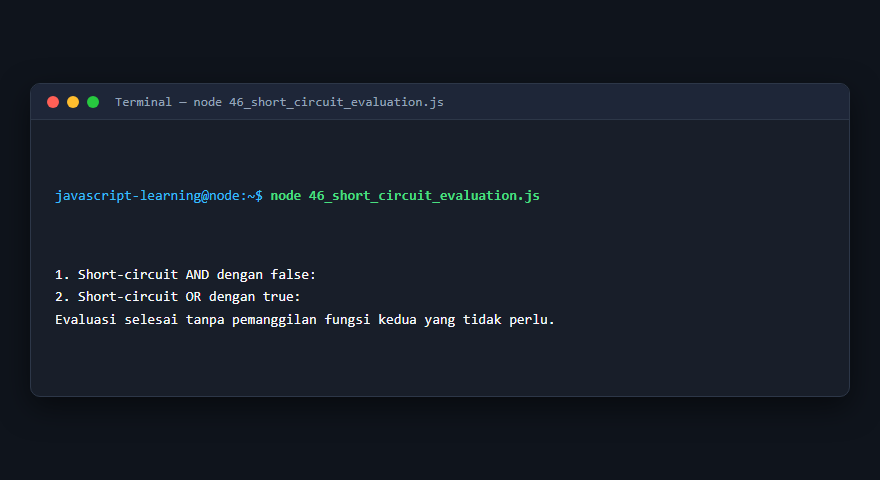
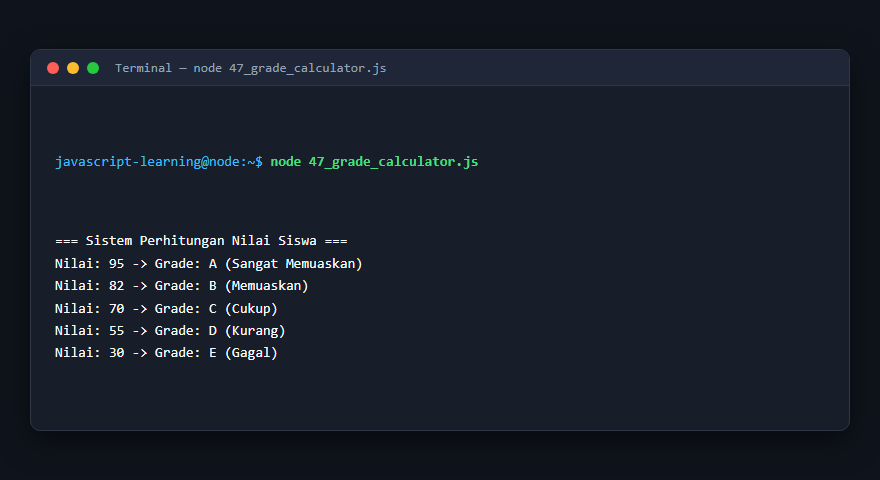
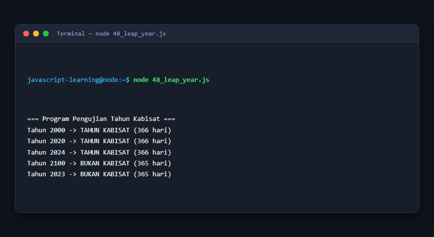
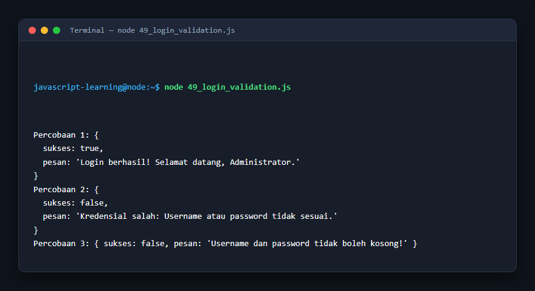
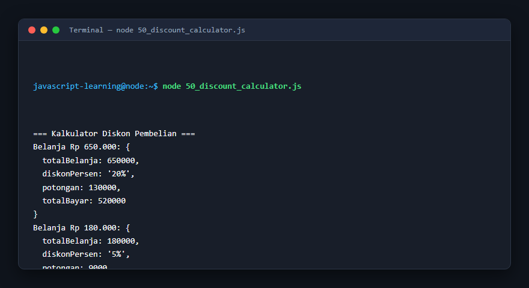

# Modul 4: Percabangan dan Pengambilan Keputusan

## Deskripsi Modul
Modul ini mendalami alur percabangan dan pengambilan keputusan menggunakan if, else if, switch, operator ternary, konsep truthy/falsy, serta studi kasus validasi bisnis.

## Tujuan Pembelajaran
Mampu merancang logika alur program yang adaptif terhadap berbagai kondisi masukan pengguna.

## Daftar Submodul & Materi

- [39_if_statement.js](39_if_statement.js) : Percabangan `if`
- [40_if_else.js](40_if_else.js) : Percabangan `if-else`
- [41_else_if.js](41_else_if.js) : Percabangan `else if`
- [42_nested_if.js](42_nested_if.js) : Nested if
- [43_switch_statement.js](43_switch_statement.js) : Percabangan `switch`
- [44_multiple_conditions.js](44_multiple_conditions.js) : Kondisi gabungan
- [45_truthy_falsy.js](45_truthy_falsy.js) : Truthy dan falsy
- [46_short_circuit_evaluation.js](46_short_circuit_evaluation.js) : Short-circuit evaluation
- [47_grade_calculator.js](47_grade_calculator.js) : Program penentuan nilai
- [48_leap_year.js](48_leap_year.js) : Program tahun kabisat
- [49_login_validation.js](49_login_validation.js) : Validasi login sederhana
- [50_discount_calculator.js](50_discount_calculator.js) : Kalkulator diskon

---

## Penjelasan Detail Setiap Submodul

### 39. Percabangan `if`

**Tujuan Pembelajaran:** Memahami konsep dan implementasi praktis dari materi Percabangan `if`.

**Konsep Utama:** Program ini mendemonstrasikan prinsip Percabangan `if` secara komprehensif, terstruktur, dan bersih sesuai standar pemrograman JavaScript modern.

**Penjelasan Source Code:** Program mengeksekusi instruksi yang telah dilengkapi dengan komentar kode edukatif berbahasa Indonesia. Setiap blok logika penting dijelaskan secara rinci agar alur kerja program mudah dipahami oleh pembelajar.

**Source Code:** [39_if_statement.js](39_if_statement.js)

**Cara Menjalankan:**
```bash
node 39_if_statement.js
```

**Hasil yang Diharapkan:** Program akan mencetak log hasil evaluasi, perhitungan, atau pemrosesan data ke terminal secara akurat.

**Hasil Eksekusi:**


---

### 40. Percabangan `if-else`

**Tujuan Pembelajaran:** Memahami konsep dan implementasi praktis dari materi Percabangan `if-else`.

**Konsep Utama:** Program ini mendemonstrasikan prinsip Percabangan `if-else` secara komprehensif, terstruktur, dan bersih sesuai standar pemrograman JavaScript modern.

**Penjelasan Source Code:** Program mengeksekusi instruksi yang telah dilengkapi dengan komentar kode edukatif berbahasa Indonesia. Setiap blok logika penting dijelaskan secara rinci agar alur kerja program mudah dipahami oleh pembelajar.

**Source Code:** [40_if_else.js](40_if_else.js)

**Cara Menjalankan:**
```bash
node 40_if_else.js
```

**Hasil yang Diharapkan:** Program akan mencetak log hasil evaluasi, perhitungan, atau pemrosesan data ke terminal secara akurat.

**Hasil Eksekusi:**


---

### 41. Percabangan `else if`

**Tujuan Pembelajaran:** Memahami konsep dan implementasi praktis dari materi Percabangan `else if`.

**Konsep Utama:** Program ini mendemonstrasikan prinsip Percabangan `else if` secara komprehensif, terstruktur, dan bersih sesuai standar pemrograman JavaScript modern.

**Penjelasan Source Code:** Program mengeksekusi instruksi yang telah dilengkapi dengan komentar kode edukatif berbahasa Indonesia. Setiap blok logika penting dijelaskan secara rinci agar alur kerja program mudah dipahami oleh pembelajar.

**Source Code:** [41_else_if.js](41_else_if.js)

**Cara Menjalankan:**
```bash
node 41_else_if.js
```

**Hasil yang Diharapkan:** Program akan mencetak log hasil evaluasi, perhitungan, atau pemrosesan data ke terminal secara akurat.

**Hasil Eksekusi:**


---

### 42. Nested if

**Tujuan Pembelajaran:** Memahami konsep dan implementasi praktis dari materi Nested if.

**Konsep Utama:** Program ini mendemonstrasikan prinsip Nested if secara komprehensif, terstruktur, dan bersih sesuai standar pemrograman JavaScript modern.

**Penjelasan Source Code:** Program mengeksekusi instruksi yang telah dilengkapi dengan komentar kode edukatif berbahasa Indonesia. Setiap blok logika penting dijelaskan secara rinci agar alur kerja program mudah dipahami oleh pembelajar.

**Source Code:** [42_nested_if.js](42_nested_if.js)

**Cara Menjalankan:**
```bash
node 42_nested_if.js
```

**Hasil yang Diharapkan:** Program akan mencetak log hasil evaluasi, perhitungan, atau pemrosesan data ke terminal secara akurat.

**Hasil Eksekusi:**



---

### 43. Percabangan `switch`

**Tujuan Pembelajaran:** Memahami konsep dan implementasi praktis dari materi Percabangan `switch`.

**Konsep Utama:** Program ini mendemonstrasikan prinsip Percabangan `switch` secara komprehensif, terstruktur, dan bersih sesuai standar pemrograman JavaScript modern.

**Penjelasan Source Code:** Program mengeksekusi instruksi yang telah dilengkapi dengan komentar kode edukatif berbahasa Indonesia. Setiap blok logika penting dijelaskan secara rinci agar alur kerja program mudah dipahami oleh pembelajar.

**Source Code:** [43_switch_statement.js](43_switch_statement.js)

**Cara Menjalankan:**
```bash
node 43_switch_statement.js
```

**Hasil yang Diharapkan:** Program akan mencetak log hasil evaluasi, perhitungan, atau pemrosesan data ke terminal secara akurat.

**Hasil Eksekusi:**


---

### 44. Kondisi gabungan

**Tujuan Pembelajaran:** Memahami konsep dan implementasi praktis dari materi Kondisi gabungan.

**Konsep Utama:** Program ini mendemonstrasikan prinsip Kondisi gabungan secara komprehensif, terstruktur, dan bersih sesuai standar pemrograman JavaScript modern.

**Penjelasan Source Code:** Program mengeksekusi instruksi yang telah dilengkapi dengan komentar kode edukatif berbahasa Indonesia. Setiap blok logika penting dijelaskan secara rinci agar alur kerja program mudah dipahami oleh pembelajar.

**Source Code:** [44_multiple_conditions.js](44_multiple_conditions.js)

**Cara Menjalankan:**
```bash
node 44_multiple_conditions.js
```

**Hasil yang Diharapkan:** Program akan mencetak log hasil evaluasi, perhitungan, atau pemrosesan data ke terminal secara akurat.

**Hasil Eksekusi:**



---

### 45. Truthy dan falsy

**Tujuan Pembelajaran:** Memahami konsep dan implementasi praktis dari materi Truthy dan falsy.

**Konsep Utama:** Program ini mendemonstrasikan prinsip Truthy dan falsy secara komprehensif, terstruktur, dan bersih sesuai standar pemrograman JavaScript modern.

**Penjelasan Source Code:** Program mengeksekusi instruksi yang telah dilengkapi dengan komentar kode edukatif berbahasa Indonesia. Setiap blok logika penting dijelaskan secara rinci agar alur kerja program mudah dipahami oleh pembelajar.

**Source Code:** [45_truthy_falsy.js](45_truthy_falsy.js)

**Cara Menjalankan:**
```bash
node 45_truthy_falsy.js
```

**Hasil yang Diharapkan:** Program akan mencetak log hasil evaluasi, perhitungan, atau pemrosesan data ke terminal secara akurat.

**Hasil Eksekusi:**



---

### 46. Short-circuit evaluation

**Tujuan Pembelajaran:** Memahami konsep dan implementasi praktis dari materi Short-circuit evaluation.

**Konsep Utama:** Program ini mendemonstrasikan prinsip Short-circuit evaluation secara komprehensif, terstruktur, dan bersih sesuai standar pemrograman JavaScript modern.

**Penjelasan Source Code:** Program mengeksekusi instruksi yang telah dilengkapi dengan komentar kode edukatif berbahasa Indonesia. Setiap blok logika penting dijelaskan secara rinci agar alur kerja program mudah dipahami oleh pembelajar.

**Source Code:** [46_short_circuit_evaluation.js](46_short_circuit_evaluation.js)

**Cara Menjalankan:**
```bash
node 46_short_circuit_evaluation.js
```

**Hasil yang Diharapkan:** Program akan mencetak log hasil evaluasi, perhitungan, atau pemrosesan data ke terminal secara akurat.

**Hasil Eksekusi:**



---

### 47. Program penentuan nilai

**Tujuan Pembelajaran:** Memahami konsep dan implementasi praktis dari materi Program penentuan nilai.

**Konsep Utama:** Program ini mendemonstrasikan prinsip Program penentuan nilai secara komprehensif, terstruktur, dan bersih sesuai standar pemrograman JavaScript modern.

**Penjelasan Source Code:** Program mengeksekusi instruksi yang telah dilengkapi dengan komentar kode edukatif berbahasa Indonesia. Setiap blok logika penting dijelaskan secara rinci agar alur kerja program mudah dipahami oleh pembelajar.

**Source Code:** [47_grade_calculator.js](47_grade_calculator.js)

**Cara Menjalankan:**
```bash
node 47_grade_calculator.js
```

**Hasil yang Diharapkan:** Program akan mencetak log hasil evaluasi, perhitungan, atau pemrosesan data ke terminal secara akurat.

**Hasil Eksekusi:**



---

### 48. Program tahun kabisat

**Tujuan Pembelajaran:** Memahami konsep dan implementasi praktis dari materi Program tahun kabisat.

**Konsep Utama:** Program ini mendemonstrasikan prinsip Program tahun kabisat secara komprehensif, terstruktur, dan bersih sesuai standar pemrograman JavaScript modern.

**Penjelasan Source Code:** Program mengeksekusi instruksi yang telah dilengkapi dengan komentar kode edukatif berbahasa Indonesia. Setiap blok logika penting dijelaskan secara rinci agar alur kerja program mudah dipahami oleh pembelajar.

**Source Code:** [48_leap_year.js](48_leap_year.js)

**Cara Menjalankan:**
```bash
node 48_leap_year.js
```

**Hasil yang Diharapkan:** Program akan mencetak log hasil evaluasi, perhitungan, atau pemrosesan data ke terminal secara akurat.

**Hasil Eksekusi:**



---

### 49. Validasi login sederhana

**Tujuan Pembelajaran:** Memahami konsep dan implementasi praktis dari materi Validasi login sederhana.

**Konsep Utama:** Program ini mendemonstrasikan prinsip Validasi login sederhana secara komprehensif, terstruktur, dan bersih sesuai standar pemrograman JavaScript modern.

**Penjelasan Source Code:** Program mengeksekusi instruksi yang telah dilengkapi dengan komentar kode edukatif berbahasa Indonesia. Setiap blok logika penting dijelaskan secara rinci agar alur kerja program mudah dipahami oleh pembelajar.

**Source Code:** [49_login_validation.js](49_login_validation.js)

**Cara Menjalankan:**
```bash
node 49_login_validation.js
```

**Hasil yang Diharapkan:** Program akan mencetak log hasil evaluasi, perhitungan, atau pemrosesan data ke terminal secara akurat.

**Hasil Eksekusi:**



---

### 50. Kalkulator diskon

**Tujuan Pembelajaran:** Memahami konsep dan implementasi praktis dari materi Kalkulator diskon.

**Konsep Utama:** Program ini mendemonstrasikan prinsip Kalkulator diskon secara komprehensif, terstruktur, dan bersih sesuai standar pemrograman JavaScript modern.

**Penjelasan Source Code:** Program mengeksekusi instruksi yang telah dilengkapi dengan komentar kode edukatif berbahasa Indonesia. Setiap blok logika penting dijelaskan secara rinci agar alur kerja program mudah dipahami oleh pembelajar.

**Source Code:** [50_discount_calculator.js](50_discount_calculator.js)

**Cara Menjalankan:**
```bash
node 50_discount_calculator.js
```

**Hasil yang Diharapkan:** Program akan mencetak log hasil evaluasi, perhitungan, atau pemrosesan data ke terminal secara akurat.

**Hasil Eksekusi:**



---

## Ringkasan Modul

Modul 4 (Percabangan dan Pengambilan Keputusan) telah menyajikan pembelajaran berbasis praktik yang terstruktur. Seluruh program di dalam modul ini dapat dijalankan secara mandiri tanpa saling membebani dependensi yang rumit, dengan fokus mendalam pada pemahaman konsep dan kebiasaan baik penulisan kode.
