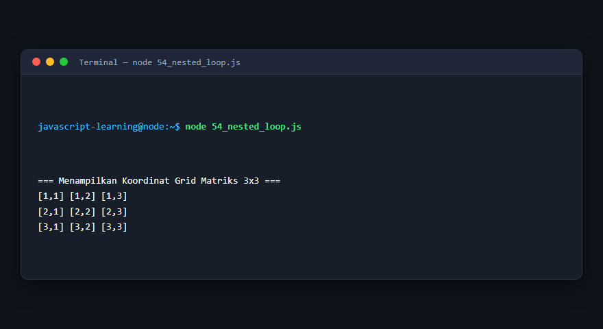
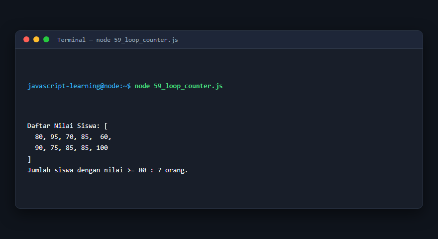
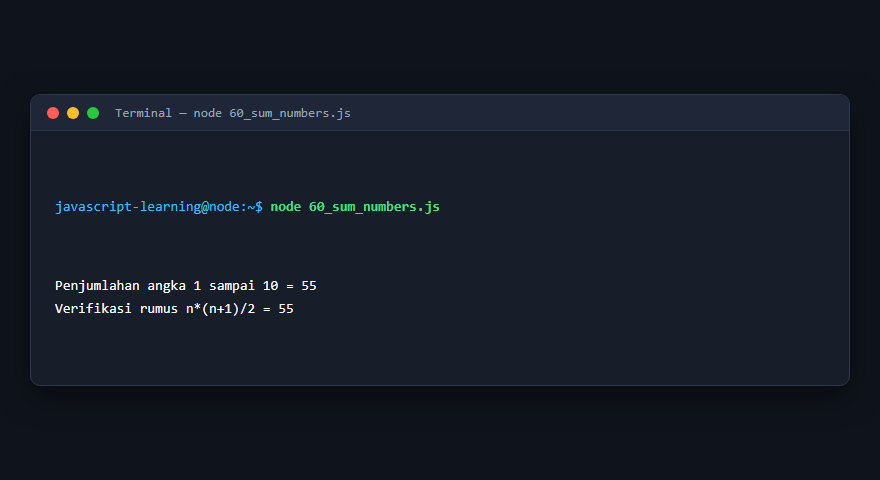
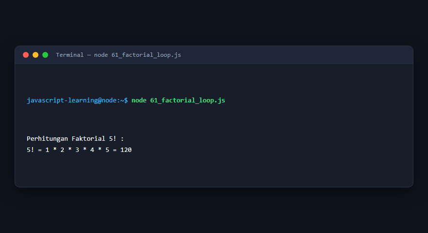
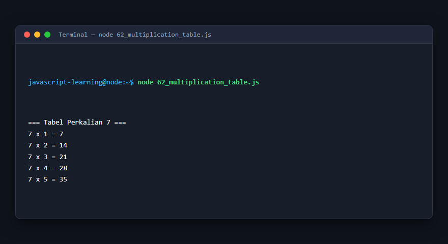
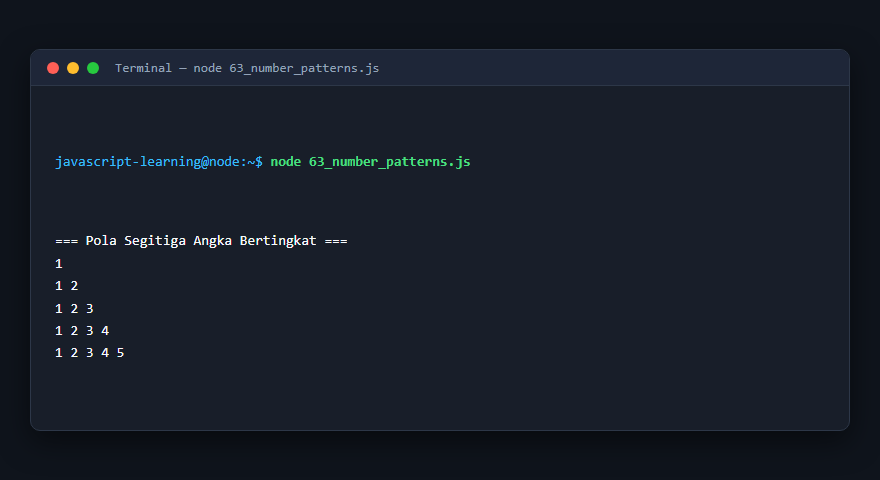
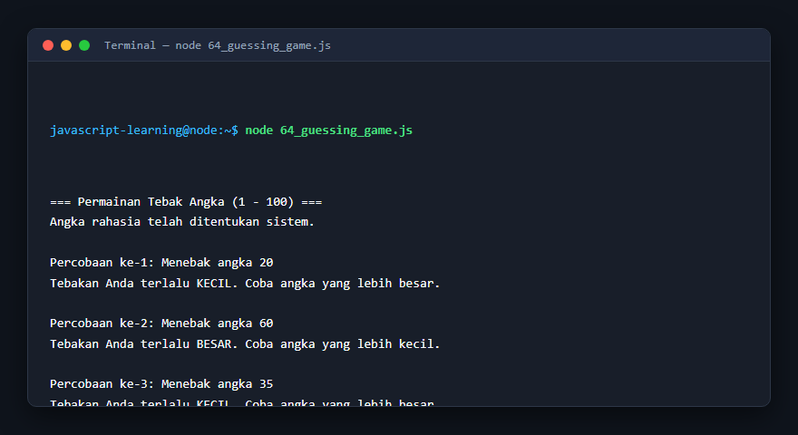

# Modul 5: Perulangan

## Deskripsi Modul
Modul ini mengulas struktur kontrol perulangan (for, while, do-while, for...of, for...in), pernyataan break/continue, serta algoritma pemrosesan deret angka.

## Tujuan Pembelajaran
Menguasai teknik iterasi data, otomasi tugas berulang, dan optimasi alur loop tanpa infinite loop.

## Daftar Submodul & Materi

- [51_for_loop.js](51_for_loop.js) : Perulangan `for`
- [52_while_loop.js](52_while_loop.js) : Perulangan `while`
- [53_do_while_loop.js](53_do_while_loop.js) : Perulangan `do-while`
- [54_nested_loop.js](54_nested_loop.js) : Nested loop
- [55_break_statement.js](55_break_statement.js) : Pernyataan `break`
- [56_continue_statement.js](56_continue_statement.js) : Pernyataan `continue`
- [57_for_of_loop.js](57_for_of_loop.js) : Perulangan `for...of`
- [58_for_in_loop.js](58_for_in_loop.js) : Perulangan `for...in`
- [59_loop_counter.js](59_loop_counter.js) : Penghitung perulangan
- [60_sum_numbers.js](60_sum_numbers.js) : Penjumlahan bilangan
- [61_factorial_loop.js](61_factorial_loop.js) : Faktorial menggunakan loop
- [62_multiplication_table.js](62_multiplication_table.js) : Tabel perkalian
- [63_number_patterns.js](63_number_patterns.js) : Pola angka
- [64_guessing_game.js](64_guessing_game.js) : Permainan tebak angka

---

## Penjelasan Detail Setiap Submodul

### 51. Perulangan `for`

**Tujuan Pembelajaran:** Memahami konsep dan implementasi praktis dari materi Perulangan `for`.

**Konsep Utama:** Program ini mendemonstrasikan prinsip Perulangan `for` secara komprehensif, terstruktur, dan bersih sesuai standar pemrograman JavaScript modern.

**Penjelasan Source Code:** Program mengeksekusi instruksi yang telah dilengkapi dengan komentar kode edukatif berbahasa Indonesia. Setiap blok logika penting dijelaskan secara rinci agar alur kerja program mudah dipahami oleh pembelajar.

**Source Code:** [51_for_loop.js](51_for_loop.js)

**Cara Menjalankan:**
```bash
node 51_for_loop.js
```

**Hasil yang Diharapkan:** Program akan mencetak log hasil evaluasi, perhitungan, atau pemrosesan data ke terminal secara akurat.

**Hasil Eksekusi:**


---

### 52. Perulangan `while`

**Tujuan Pembelajaran:** Memahami konsep dan implementasi praktis dari materi Perulangan `while`.

**Konsep Utama:** Program ini mendemonstrasikan prinsip Perulangan `while` secara komprehensif, terstruktur, dan bersih sesuai standar pemrograman JavaScript modern.

**Penjelasan Source Code:** Program mengeksekusi instruksi yang telah dilengkapi dengan komentar kode edukatif berbahasa Indonesia. Setiap blok logika penting dijelaskan secara rinci agar alur kerja program mudah dipahami oleh pembelajar.

**Source Code:** [52_while_loop.js](52_while_loop.js)

**Cara Menjalankan:**
```bash
node 52_while_loop.js
```

**Hasil yang Diharapkan:** Program akan mencetak log hasil evaluasi, perhitungan, atau pemrosesan data ke terminal secara akurat.

**Hasil Eksekusi:**


---

### 53. Perulangan `do-while`

**Tujuan Pembelajaran:** Memahami konsep dan implementasi praktis dari materi Perulangan `do-while`.

**Konsep Utama:** Program ini mendemonstrasikan prinsip Perulangan `do-while` secara komprehensif, terstruktur, dan bersih sesuai standar pemrograman JavaScript modern.

**Penjelasan Source Code:** Program mengeksekusi instruksi yang telah dilengkapi dengan komentar kode edukatif berbahasa Indonesia. Setiap blok logika penting dijelaskan secara rinci agar alur kerja program mudah dipahami oleh pembelajar.

**Source Code:** [53_do_while_loop.js](53_do_while_loop.js)

**Cara Menjalankan:**
```bash
node 53_do_while_loop.js
```

**Hasil yang Diharapkan:** Program akan mencetak log hasil evaluasi, perhitungan, atau pemrosesan data ke terminal secara akurat.

**Hasil Eksekusi:**


---

### 54. Nested loop

**Tujuan Pembelajaran:** Memahami konsep dan implementasi praktis dari materi Nested loop.

**Konsep Utama:** Program ini mendemonstrasikan prinsip Nested loop secara komprehensif, terstruktur, dan bersih sesuai standar pemrograman JavaScript modern.

**Penjelasan Source Code:** Program mengeksekusi instruksi yang telah dilengkapi dengan komentar kode edukatif berbahasa Indonesia. Setiap blok logika penting dijelaskan secara rinci agar alur kerja program mudah dipahami oleh pembelajar.

**Source Code:** [54_nested_loop.js](54_nested_loop.js)

**Cara Menjalankan:**
```bash
node 54_nested_loop.js
```

**Hasil yang Diharapkan:** Program akan mencetak log hasil evaluasi, perhitungan, atau pemrosesan data ke terminal secara akurat.

**Hasil Eksekusi:**



---

### 55. Pernyataan `break`

**Tujuan Pembelajaran:** Memahami konsep dan implementasi praktis dari materi Pernyataan `break`.

**Konsep Utama:** Program ini mendemonstrasikan prinsip Pernyataan `break` secara komprehensif, terstruktur, dan bersih sesuai standar pemrograman JavaScript modern.

**Penjelasan Source Code:** Program mengeksekusi instruksi yang telah dilengkapi dengan komentar kode edukatif berbahasa Indonesia. Setiap blok logika penting dijelaskan secara rinci agar alur kerja program mudah dipahami oleh pembelajar.

**Source Code:** [55_break_statement.js](55_break_statement.js)

**Cara Menjalankan:**
```bash
node 55_break_statement.js
```

**Hasil yang Diharapkan:** Program akan mencetak log hasil evaluasi, perhitungan, atau pemrosesan data ke terminal secara akurat.

**Hasil Eksekusi:**


---

### 56. Pernyataan `continue`

**Tujuan Pembelajaran:** Memahami konsep dan implementasi praktis dari materi Pernyataan `continue`.

**Konsep Utama:** Program ini mendemonstrasikan prinsip Pernyataan `continue` secara komprehensif, terstruktur, dan bersih sesuai standar pemrograman JavaScript modern.

**Penjelasan Source Code:** Program mengeksekusi instruksi yang telah dilengkapi dengan komentar kode edukatif berbahasa Indonesia. Setiap blok logika penting dijelaskan secara rinci agar alur kerja program mudah dipahami oleh pembelajar.

**Source Code:** [56_continue_statement.js](56_continue_statement.js)

**Cara Menjalankan:**
```bash
node 56_continue_statement.js
```

**Hasil yang Diharapkan:** Program akan mencetak log hasil evaluasi, perhitungan, atau pemrosesan data ke terminal secara akurat.

**Hasil Eksekusi:**


---

### 57. Perulangan `for...of`

**Tujuan Pembelajaran:** Memahami konsep dan implementasi praktis dari materi Perulangan `for...of`.

**Konsep Utama:** Program ini mendemonstrasikan prinsip Perulangan `for...of` secara komprehensif, terstruktur, dan bersih sesuai standar pemrograman JavaScript modern.

**Penjelasan Source Code:** Program mengeksekusi instruksi yang telah dilengkapi dengan komentar kode edukatif berbahasa Indonesia. Setiap blok logika penting dijelaskan secara rinci agar alur kerja program mudah dipahami oleh pembelajar.

**Source Code:** [57_for_of_loop.js](57_for_of_loop.js)

**Cara Menjalankan:**
```bash
node 57_for_of_loop.js
```

**Hasil yang Diharapkan:** Program akan mencetak log hasil evaluasi, perhitungan, atau pemrosesan data ke terminal secara akurat.

**Hasil Eksekusi:**


---

### 58. Perulangan `for...in`

**Tujuan Pembelajaran:** Memahami konsep dan implementasi praktis dari materi Perulangan `for...in`.

**Konsep Utama:** Program ini mendemonstrasikan prinsip Perulangan `for...in` secara komprehensif, terstruktur, dan bersih sesuai standar pemrograman JavaScript modern.

**Penjelasan Source Code:** Program mengeksekusi instruksi yang telah dilengkapi dengan komentar kode edukatif berbahasa Indonesia. Setiap blok logika penting dijelaskan secara rinci agar alur kerja program mudah dipahami oleh pembelajar.

**Source Code:** [58_for_in_loop.js](58_for_in_loop.js)

**Cara Menjalankan:**
```bash
node 58_for_in_loop.js
```

**Hasil yang Diharapkan:** Program akan mencetak log hasil evaluasi, perhitungan, atau pemrosesan data ke terminal secara akurat.

**Hasil Eksekusi:**


---

### 59. Penghitung perulangan

**Tujuan Pembelajaran:** Memahami konsep dan implementasi praktis dari materi Penghitung perulangan.

**Konsep Utama:** Program ini mendemonstrasikan prinsip Penghitung perulangan secara komprehensif, terstruktur, dan bersih sesuai standar pemrograman JavaScript modern.

**Penjelasan Source Code:** Program mengeksekusi instruksi yang telah dilengkapi dengan komentar kode edukatif berbahasa Indonesia. Setiap blok logika penting dijelaskan secara rinci agar alur kerja program mudah dipahami oleh pembelajar.

**Source Code:** [59_loop_counter.js](59_loop_counter.js)

**Cara Menjalankan:**
```bash
node 59_loop_counter.js
```

**Hasil yang Diharapkan:** Program akan mencetak log hasil evaluasi, perhitungan, atau pemrosesan data ke terminal secara akurat.

**Hasil Eksekusi:**



---

### 60. Penjumlahan bilangan

**Tujuan Pembelajaran:** Memahami konsep dan implementasi praktis dari materi Penjumlahan bilangan.

**Konsep Utama:** Program ini mendemonstrasikan prinsip Penjumlahan bilangan secara komprehensif, terstruktur, dan bersih sesuai standar pemrograman JavaScript modern.

**Penjelasan Source Code:** Program mengeksekusi instruksi yang telah dilengkapi dengan komentar kode edukatif berbahasa Indonesia. Setiap blok logika penting dijelaskan secara rinci agar alur kerja program mudah dipahami oleh pembelajar.

**Source Code:** [60_sum_numbers.js](60_sum_numbers.js)

**Cara Menjalankan:**
```bash
node 60_sum_numbers.js
```

**Hasil yang Diharapkan:** Program akan mencetak log hasil evaluasi, perhitungan, atau pemrosesan data ke terminal secara akurat.

**Hasil Eksekusi:**



---

### 61. Faktorial menggunakan loop

**Tujuan Pembelajaran:** Memahami konsep dan implementasi praktis dari materi Faktorial menggunakan loop.

**Konsep Utama:** Program ini mendemonstrasikan prinsip Faktorial menggunakan loop secara komprehensif, terstruktur, dan bersih sesuai standar pemrograman JavaScript modern.

**Penjelasan Source Code:** Program mengeksekusi instruksi yang telah dilengkapi dengan komentar kode edukatif berbahasa Indonesia. Setiap blok logika penting dijelaskan secara rinci agar alur kerja program mudah dipahami oleh pembelajar.

**Source Code:** [61_factorial_loop.js](61_factorial_loop.js)

**Cara Menjalankan:**
```bash
node 61_factorial_loop.js
```

**Hasil yang Diharapkan:** Program akan mencetak log hasil evaluasi, perhitungan, atau pemrosesan data ke terminal secara akurat.

**Hasil Eksekusi:**



---

### 62. Tabel perkalian

**Tujuan Pembelajaran:** Memahami konsep dan implementasi praktis dari materi Tabel perkalian.

**Konsep Utama:** Program ini mendemonstrasikan prinsip Tabel perkalian secara komprehensif, terstruktur, dan bersih sesuai standar pemrograman JavaScript modern.

**Penjelasan Source Code:** Program mengeksekusi instruksi yang telah dilengkapi dengan komentar kode edukatif berbahasa Indonesia. Setiap blok logika penting dijelaskan secara rinci agar alur kerja program mudah dipahami oleh pembelajar.

**Source Code:** [62_multiplication_table.js](62_multiplication_table.js)

**Cara Menjalankan:**
```bash
node 62_multiplication_table.js
```

**Hasil yang Diharapkan:** Program akan mencetak log hasil evaluasi, perhitungan, atau pemrosesan data ke terminal secara akurat.

**Hasil Eksekusi:**



---

### 63. Pola angka

**Tujuan Pembelajaran:** Memahami konsep dan implementasi praktis dari materi Pola angka.

**Konsep Utama:** Program ini mendemonstrasikan prinsip Pola angka secara komprehensif, terstruktur, dan bersih sesuai standar pemrograman JavaScript modern.

**Penjelasan Source Code:** Program mengeksekusi instruksi yang telah dilengkapi dengan komentar kode edukatif berbahasa Indonesia. Setiap blok logika penting dijelaskan secara rinci agar alur kerja program mudah dipahami oleh pembelajar.

**Source Code:** [63_number_patterns.js](63_number_patterns.js)

**Cara Menjalankan:**
```bash
node 63_number_patterns.js
```

**Hasil yang Diharapkan:** Program akan mencetak log hasil evaluasi, perhitungan, atau pemrosesan data ke terminal secara akurat.

**Hasil Eksekusi:**



---

### 64. Permainan tebak angka

**Tujuan Pembelajaran:** Memahami konsep dan implementasi praktis dari materi Permainan tebak angka.

**Konsep Utama:** Program ini mendemonstrasikan prinsip Permainan tebak angka secara komprehensif, terstruktur, dan bersih sesuai standar pemrograman JavaScript modern.

**Penjelasan Source Code:** Program mengeksekusi instruksi yang telah dilengkapi dengan komentar kode edukatif berbahasa Indonesia. Setiap blok logika penting dijelaskan secara rinci agar alur kerja program mudah dipahami oleh pembelajar.

**Source Code:** [64_guessing_game.js](64_guessing_game.js)

**Cara Menjalankan:**
```bash
node 64_guessing_game.js
```

**Hasil yang Diharapkan:** Program akan mencetak log hasil evaluasi, perhitungan, atau pemrosesan data ke terminal secara akurat.

**Hasil Eksekusi:**



---

## Ringkasan Modul

Modul 5 (Perulangan) telah menyajikan pembelajaran berbasis praktik yang terstruktur. Seluruh program di dalam modul ini dapat dijalankan secara mandiri tanpa saling membebani dependensi yang rumit, dengan fokus mendalam pada pemahaman konsep dan kebiasaan baik penulisan kode.
