# Modul 6: Fungsi

## Deskripsi Modul
Modul ini mengeksplorasi pembuatan fungsi, mulai dari function declaration, expression, arrow function, parameter default/rest, closure, hingga pure functions.

## Tujuan Pembelajaran
Mampu membangun arsitektur kode modular, memanfaatkan first-class functions, dan mengisolasi state dengan closure.

## Daftar Submodul & Materi

- [65_function_declaration.js](65_function_declaration.js) : Function declaration
- [66_function_expression.js](66_function_expression.js) : Function expression
- [67_arrow_function.js](67_arrow_function.js) : Arrow function
- [68_function_parameters.js](68_function_parameters.js) : Parameter fungsi
- [69_return_statement.js](69_return_statement.js) : Nilai balik fungsi
- [70_default_parameters.js](70_default_parameters.js) : Default parameters
- [71_rest_parameters.js](71_rest_parameters.js) : Rest parameters
- [72_arguments_object.js](72_arguments_object.js) : Arguments object
- [73_function_scope.js](73_function_scope.js) : Function scope
- [74_lexical_scope.js](74_lexical_scope.js) : Lexical scope
- [75_closure.js](75_closure.js) : Closure
- [76_nested_function.js](76_nested_function.js) : Nested function
- [77_callback_function.js](77_callback_function.js) : Callback function
- [78_higher_order_function.js](78_higher_order_function.js) : Higher-order function
- [79_recursive_function.js](79_recursive_function.js) : Fungsi rekursif
- [80_function_return_function.js](80_function_return_function.js) : Fungsi yang mengembalikan fungsi
- [81_pure_function.js](81_pure_function.js) : Pure function
- [82_iife.js](82_iife.js) : Immediately Invoked Function Expression

---

## Penjelasan Detail Setiap Submodul

### 65. Function declaration

**Tujuan Pembelajaran:** Memahami konsep dan implementasi praktis dari materi Function declaration.

**Konsep Utama:** Program ini mendemonstrasikan prinsip Function declaration secara komprehensif, terstruktur, dan bersih sesuai standar pemrograman JavaScript modern.

**Penjelasan Source Code:** Program mengeksekusi instruksi yang telah dilengkapi dengan komentar kode edukatif berbahasa Indonesia. Setiap blok logika penting dijelaskan secara rinci agar alur kerja program mudah dipahami oleh pembelajar.

**Source Code:** [65_function_declaration.js](65_function_declaration.js)

**Cara Menjalankan:**
```bash
node 65_function_declaration.js
```

**Hasil yang Diharapkan:** Program akan mencetak log hasil evaluasi, perhitungan, atau pemrosesan data ke terminal secara akurat.

**Hasil Eksekusi:**

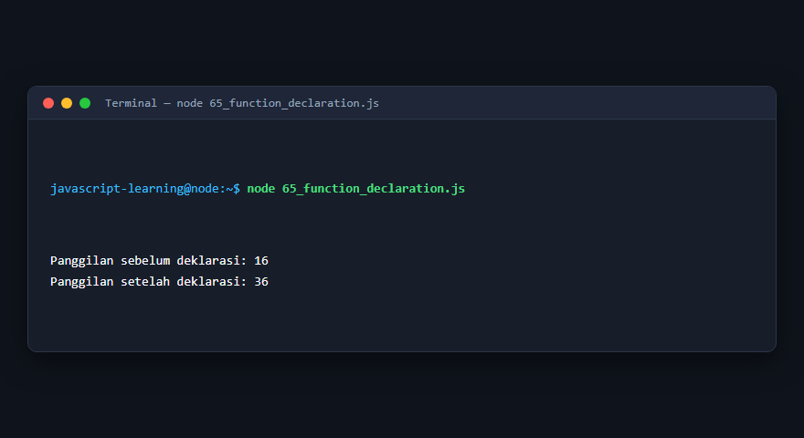

---

### 66. Function expression

**Tujuan Pembelajaran:** Memahami konsep dan implementasi praktis dari materi Function expression.

**Konsep Utama:** Program ini mendemonstrasikan prinsip Function expression secara komprehensif, terstruktur, dan bersih sesuai standar pemrograman JavaScript modern.

**Penjelasan Source Code:** Program mengeksekusi instruksi yang telah dilengkapi dengan komentar kode edukatif berbahasa Indonesia. Setiap blok logika penting dijelaskan secara rinci agar alur kerja program mudah dipahami oleh pembelajar.

**Source Code:** [66_function_expression.js](66_function_expression.js)

**Cara Menjalankan:**
```bash
node 66_function_expression.js
```

**Hasil yang Diharapkan:** Program akan mencetak log hasil evaluasi, perhitungan, atau pemrosesan data ke terminal secara akurat.

**Hasil Eksekusi:**

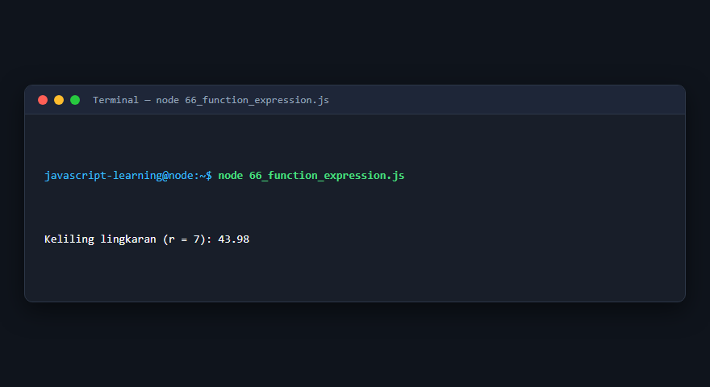

---

### 67. Arrow function

**Tujuan Pembelajaran:** Memahami konsep dan implementasi praktis dari materi Arrow function.

**Konsep Utama:** Program ini mendemonstrasikan prinsip Arrow function secara komprehensif, terstruktur, dan bersih sesuai standar pemrograman JavaScript modern.

**Penjelasan Source Code:** Program mengeksekusi instruksi yang telah dilengkapi dengan komentar kode edukatif berbahasa Indonesia. Setiap blok logika penting dijelaskan secara rinci agar alur kerja program mudah dipahami oleh pembelajar.

**Source Code:** [67_arrow_function.js](67_arrow_function.js)

**Cara Menjalankan:**
```bash
node 67_arrow_function.js
```

**Hasil yang Diharapkan:** Program akan mencetak log hasil evaluasi, perhitungan, atau pemrosesan data ke terminal secara akurat.

**Hasil Eksekusi:**

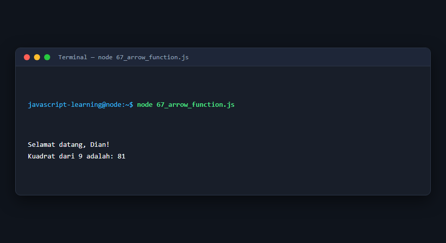

---

### 68. Parameter fungsi

**Tujuan Pembelajaran:** Memahami konsep dan implementasi praktis dari materi Parameter fungsi.

**Konsep Utama:** Program ini mendemonstrasikan prinsip Parameter fungsi secara komprehensif, terstruktur, dan bersih sesuai standar pemrograman JavaScript modern.

**Penjelasan Source Code:** Program mengeksekusi instruksi yang telah dilengkapi dengan komentar kode edukatif berbahasa Indonesia. Setiap blok logika penting dijelaskan secara rinci agar alur kerja program mudah dipahami oleh pembelajar.

**Source Code:** [68_function_parameters.js](68_function_parameters.js)

**Cara Menjalankan:**
```bash
node 68_function_parameters.js
```

**Hasil yang Diharapkan:** Program akan mencetak log hasil evaluasi, perhitungan, atau pemrosesan data ke terminal secara akurat.

**Hasil Eksekusi:**

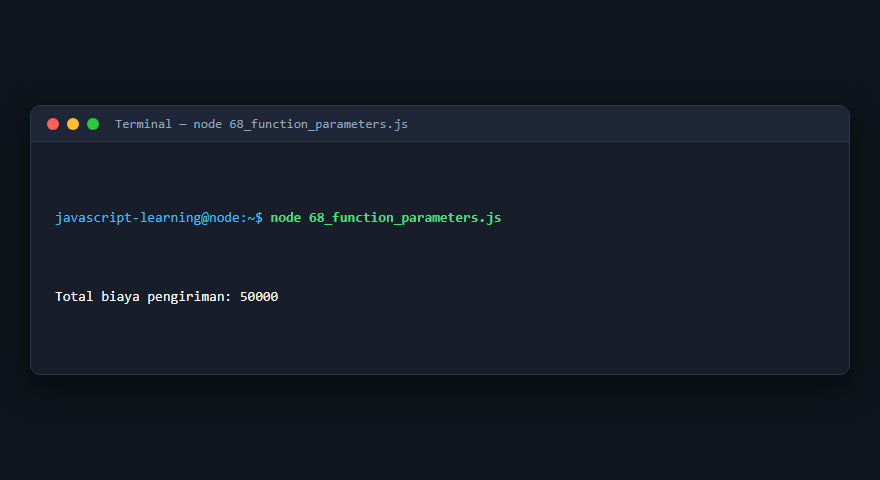

---

### 69. Nilai balik fungsi

**Tujuan Pembelajaran:** Memahami konsep dan implementasi praktis dari materi Nilai balik fungsi.

**Konsep Utama:** Program ini mendemonstrasikan prinsip Nilai balik fungsi secara komprehensif, terstruktur, dan bersih sesuai standar pemrograman JavaScript modern.

**Penjelasan Source Code:** Program mengeksekusi instruksi yang telah dilengkapi dengan komentar kode edukatif berbahasa Indonesia. Setiap blok logika penting dijelaskan secara rinci agar alur kerja program mudah dipahami oleh pembelajar.

**Source Code:** [69_return_statement.js](69_return_statement.js)

**Cara Menjalankan:**
```bash
node 69_return_statement.js
```

**Hasil yang Diharapkan:** Program akan mencetak log hasil evaluasi, perhitungan, atau pemrosesan data ke terminal secara akurat.

**Hasil Eksekusi:**

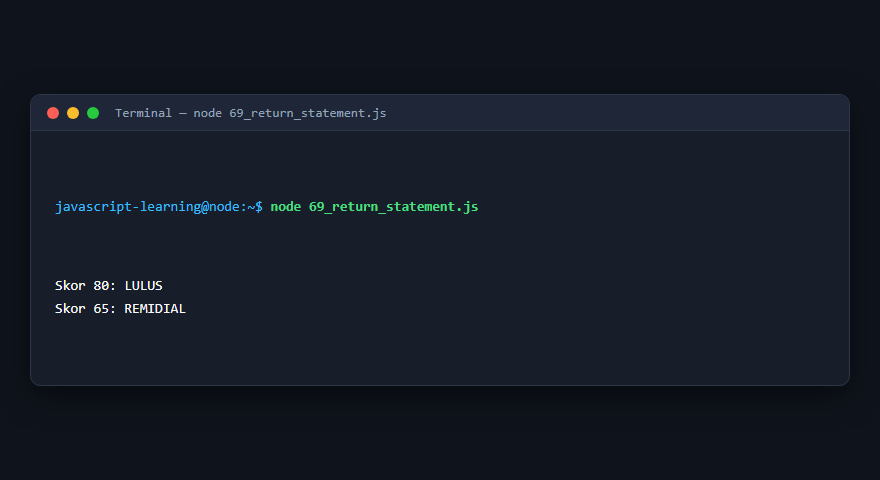

---

### 70. Default parameters

**Tujuan Pembelajaran:** Memahami konsep dan implementasi praktis dari materi Default parameters.

**Konsep Utama:** Program ini mendemonstrasikan prinsip Default parameters secara komprehensif, terstruktur, dan bersih sesuai standar pemrograman JavaScript modern.

**Penjelasan Source Code:** Program mengeksekusi instruksi yang telah dilengkapi dengan komentar kode edukatif berbahasa Indonesia. Setiap blok logika penting dijelaskan secara rinci agar alur kerja program mudah dipahami oleh pembelajar.

**Source Code:** [70_default_parameters.js](70_default_parameters.js)

**Cara Menjalankan:**
```bash
node 70_default_parameters.js
```

**Hasil yang Diharapkan:** Program akan mencetak log hasil evaluasi, perhitungan, atau pemrosesan data ke terminal secara akurat.

**Hasil Eksekusi:**

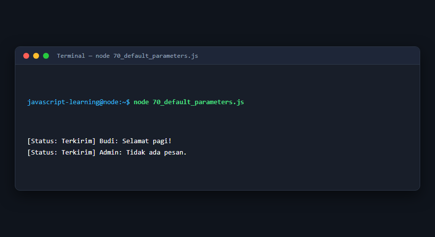

---

### 71. Rest parameters

**Tujuan Pembelajaran:** Memahami konsep dan implementasi praktis dari materi Rest parameters.

**Konsep Utama:** Program ini mendemonstrasikan prinsip Rest parameters secara komprehensif, terstruktur, dan bersih sesuai standar pemrograman JavaScript modern.

**Penjelasan Source Code:** Program mengeksekusi instruksi yang telah dilengkapi dengan komentar kode edukatif berbahasa Indonesia. Setiap blok logika penting dijelaskan secara rinci agar alur kerja program mudah dipahami oleh pembelajar.

**Source Code:** [71_rest_parameters.js](71_rest_parameters.js)

**Cara Menjalankan:**
```bash
node 71_rest_parameters.js
```

**Hasil yang Diharapkan:** Program akan mencetak log hasil evaluasi, perhitungan, atau pemrosesan data ke terminal secara akurat.

**Hasil Eksekusi:**

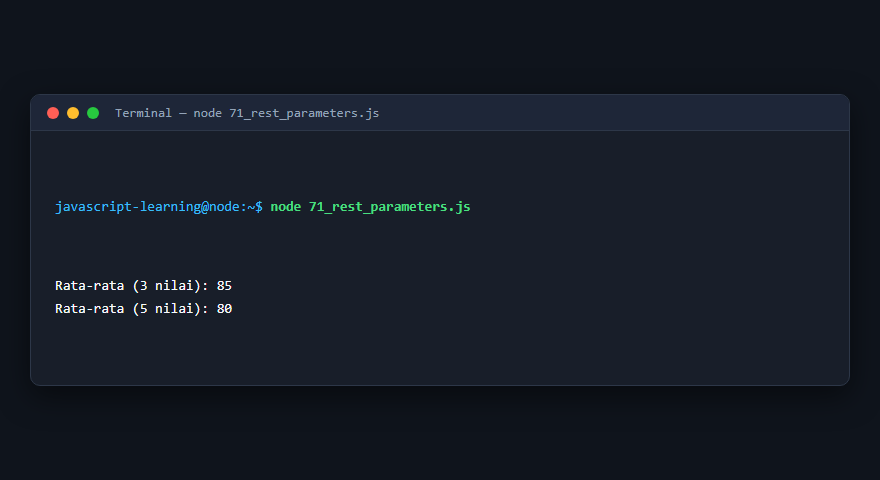

---

### 72. Arguments object

**Tujuan Pembelajaran:** Memahami konsep dan implementasi praktis dari materi Arguments object.

**Konsep Utama:** Program ini mendemonstrasikan prinsip Arguments object secara komprehensif, terstruktur, dan bersih sesuai standar pemrograman JavaScript modern.

**Penjelasan Source Code:** Program mengeksekusi instruksi yang telah dilengkapi dengan komentar kode edukatif berbahasa Indonesia. Setiap blok logika penting dijelaskan secara rinci agar alur kerja program mudah dipahami oleh pembelajar.

**Source Code:** [72_arguments_object.js](72_arguments_object.js)

**Cara Menjalankan:**
```bash
node 72_arguments_object.js
```

**Hasil yang Diharapkan:** Program akan mencetak log hasil evaluasi, perhitungan, atau pemrosesan data ke terminal secara akurat.

**Hasil Eksekusi:**

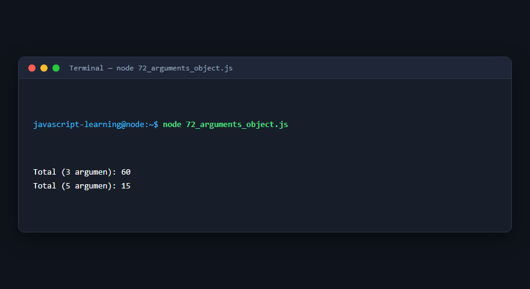

---

### 73. Function scope

**Tujuan Pembelajaran:** Memahami konsep dan implementasi praktis dari materi Function scope.

**Konsep Utama:** Program ini mendemonstrasikan prinsip Function scope secara komprehensif, terstruktur, dan bersih sesuai standar pemrograman JavaScript modern.

**Penjelasan Source Code:** Program mengeksekusi instruksi yang telah dilengkapi dengan komentar kode edukatif berbahasa Indonesia. Setiap blok logika penting dijelaskan secara rinci agar alur kerja program mudah dipahami oleh pembelajar.

**Source Code:** [73_function_scope.js](73_function_scope.js)

**Cara Menjalankan:**
```bash
node 73_function_scope.js
```

**Hasil yang Diharapkan:** Program akan mencetak log hasil evaluasi, perhitungan, atau pemrosesan data ke terminal secara akurat.

**Hasil Eksekusi:**

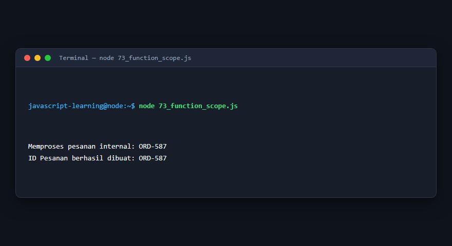

---

### 74. Lexical scope

**Tujuan Pembelajaran:** Memahami konsep dan implementasi praktis dari materi Lexical scope.

**Konsep Utama:** Program ini mendemonstrasikan prinsip Lexical scope secara komprehensif, terstruktur, dan bersih sesuai standar pemrograman JavaScript modern.

**Penjelasan Source Code:** Program mengeksekusi instruksi yang telah dilengkapi dengan komentar kode edukatif berbahasa Indonesia. Setiap blok logika penting dijelaskan secara rinci agar alur kerja program mudah dipahami oleh pembelajar.

**Source Code:** [74_lexical_scope.js](74_lexical_scope.js)

**Cara Menjalankan:**
```bash
node 74_lexical_scope.js
```

**Hasil yang Diharapkan:** Program akan mencetak log hasil evaluasi, perhitungan, atau pemrosesan data ke terminal secara akurat.

**Hasil Eksekusi:**

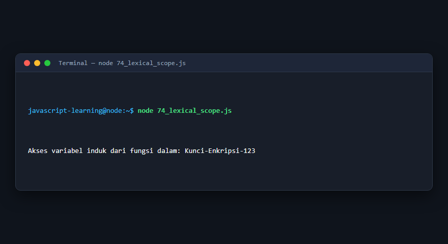

---

### 75. Closure

**Tujuan Pembelajaran:** Memahami konsep dan implementasi praktis dari materi Closure.

**Konsep Utama:** Program ini mendemonstrasikan prinsip Closure secara komprehensif, terstruktur, dan bersih sesuai standar pemrograman JavaScript modern.

**Penjelasan Source Code:** Program mengeksekusi instruksi yang telah dilengkapi dengan komentar kode edukatif berbahasa Indonesia. Setiap blok logika penting dijelaskan secara rinci agar alur kerja program mudah dipahami oleh pembelajar.

**Source Code:** [75_closure.js](75_closure.js)

**Cara Menjalankan:**
```bash
node 75_closure.js
```

**Hasil yang Diharapkan:** Program akan mencetak log hasil evaluasi, perhitungan, atau pemrosesan data ke terminal secara akurat.

**Hasil Eksekusi:**

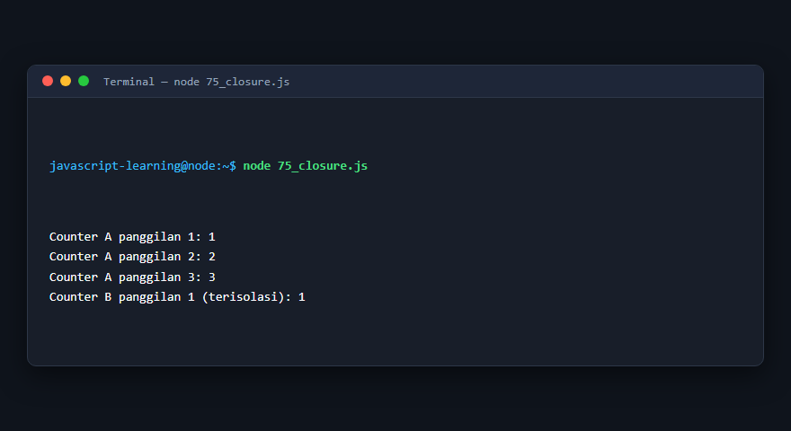

---

### 76. Nested function

**Tujuan Pembelajaran:** Memahami konsep dan implementasi praktis dari materi Nested function.

**Konsep Utama:** Program ini mendemonstrasikan prinsip Nested function secara komprehensif, terstruktur, dan bersih sesuai standar pemrograman JavaScript modern.

**Penjelasan Source Code:** Program mengeksekusi instruksi yang telah dilengkapi dengan komentar kode edukatif berbahasa Indonesia. Setiap blok logika penting dijelaskan secara rinci agar alur kerja program mudah dipahami oleh pembelajar.

**Source Code:** [76_nested_function.js](76_nested_function.js)

**Cara Menjalankan:**
```bash
node 76_nested_function.js
```

**Hasil yang Diharapkan:** Program akan mencetak log hasil evaluasi, perhitungan, atau pemrosesan data ke terminal secara akurat.

**Hasil Eksekusi:**

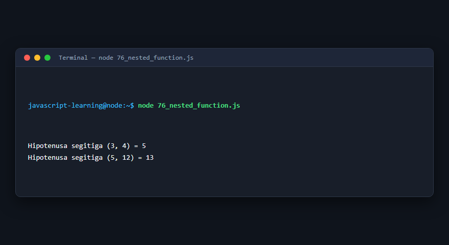

---

### 77. Callback function

**Tujuan Pembelajaran:** Memahami konsep dan implementasi praktis dari materi Callback function.

**Konsep Utama:** Program ini mendemonstrasikan prinsip Callback function secara komprehensif, terstruktur, dan bersih sesuai standar pemrograman JavaScript modern.

**Penjelasan Source Code:** Program mengeksekusi instruksi yang telah dilengkapi dengan komentar kode edukatif berbahasa Indonesia. Setiap blok logika penting dijelaskan secara rinci agar alur kerja program mudah dipahami oleh pembelajar.

**Source Code:** [77_callback_function.js](77_callback_function.js)

**Cara Menjalankan:**
```bash
node 77_callback_function.js
```

**Hasil yang Diharapkan:** Program akan mencetak log hasil evaluasi, perhitungan, atau pemrosesan data ke terminal secara akurat.

**Hasil Eksekusi:**

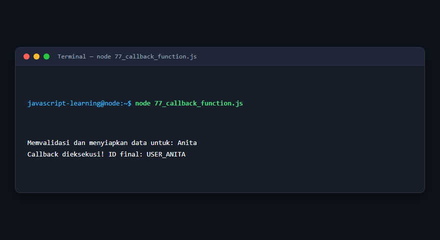

---

### 78. Higher-order function

**Tujuan Pembelajaran:** Memahami konsep dan implementasi praktis dari materi Higher-order function.

**Konsep Utama:** Program ini mendemonstrasikan prinsip Higher-order function secara komprehensif, terstruktur, dan bersih sesuai standar pemrograman JavaScript modern.

**Penjelasan Source Code:** Program mengeksekusi instruksi yang telah dilengkapi dengan komentar kode edukatif berbahasa Indonesia. Setiap blok logika penting dijelaskan secara rinci agar alur kerja program mudah dipahami oleh pembelajar.

**Source Code:** [78_higher_order_function.js](78_higher_order_function.js)

**Cara Menjalankan:**
```bash
node 78_higher_order_function.js
```

**Hasil yang Diharapkan:** Program akan mencetak log hasil evaluasi, perhitungan, atau pemrosesan data ke terminal secara akurat.

**Hasil Eksekusi:**

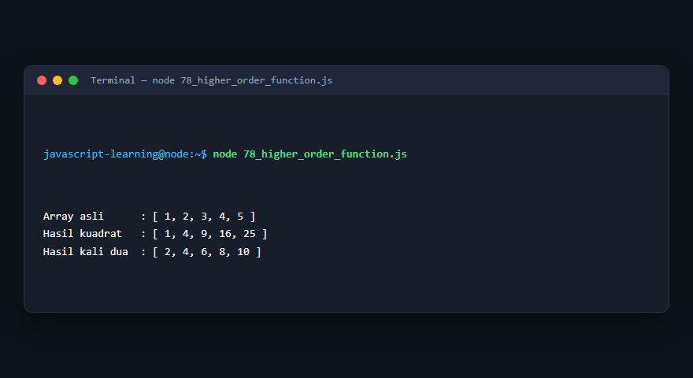

---

### 79. Fungsi rekursif

**Tujuan Pembelajaran:** Memahami konsep dan implementasi praktis dari materi Fungsi rekursif.

**Konsep Utama:** Program ini mendemonstrasikan prinsip Fungsi rekursif secara komprehensif, terstruktur, dan bersih sesuai standar pemrograman JavaScript modern.

**Penjelasan Source Code:** Program mengeksekusi instruksi yang telah dilengkapi dengan komentar kode edukatif berbahasa Indonesia. Setiap blok logika penting dijelaskan secara rinci agar alur kerja program mudah dipahami oleh pembelajar.

**Source Code:** [79_recursive_function.js](79_recursive_function.js)

**Cara Menjalankan:**
```bash
node 79_recursive_function.js
```

**Hasil yang Diharapkan:** Program akan mencetak log hasil evaluasi, perhitungan, atau pemrosesan data ke terminal secara akurat.

**Hasil Eksekusi:**

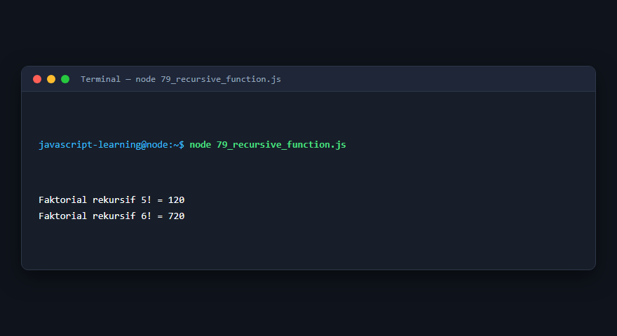

---

### 80. Fungsi yang mengembalikan fungsi

**Tujuan Pembelajaran:** Memahami konsep dan implementasi praktis dari materi Fungsi yang mengembalikan fungsi.

**Konsep Utama:** Program ini mendemonstrasikan prinsip Fungsi yang mengembalikan fungsi secara komprehensif, terstruktur, dan bersih sesuai standar pemrograman JavaScript modern.

**Penjelasan Source Code:** Program mengeksekusi instruksi yang telah dilengkapi dengan komentar kode edukatif berbahasa Indonesia. Setiap blok logika penting dijelaskan secara rinci agar alur kerja program mudah dipahami oleh pembelajar.

**Source Code:** [80_function_return_function.js](80_function_return_function.js)

**Cara Menjalankan:**
```bash
node 80_function_return_function.js
```

**Hasil yang Diharapkan:** Program akan mencetak log hasil evaluasi, perhitungan, atau pemrosesan data ke terminal secara akurat.

**Hasil Eksekusi:**

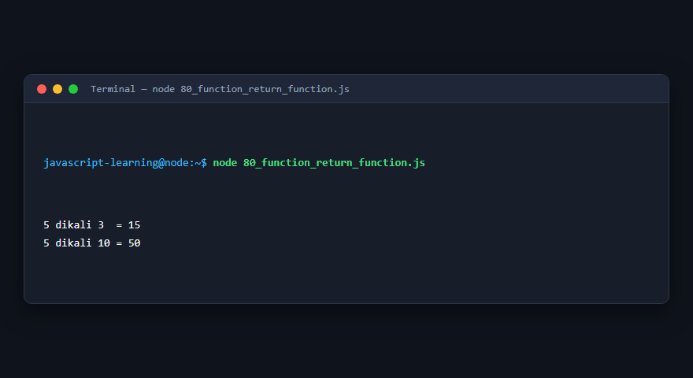

---

### 81. Pure function

**Tujuan Pembelajaran:** Memahami konsep dan implementasi praktis dari materi Pure function.

**Konsep Utama:** Program ini mendemonstrasikan prinsip Pure function secara komprehensif, terstruktur, dan bersih sesuai standar pemrograman JavaScript modern.

**Penjelasan Source Code:** Program mengeksekusi instruksi yang telah dilengkapi dengan komentar kode edukatif berbahasa Indonesia. Setiap blok logika penting dijelaskan secara rinci agar alur kerja program mudah dipahami oleh pembelajar.

**Source Code:** [81_pure_function.js](81_pure_function.js)

**Cara Menjalankan:**
```bash
node 81_pure_function.js
```

**Hasil yang Diharapkan:** Program akan mencetak log hasil evaluasi, perhitungan, atau pemrosesan data ke terminal secara akurat.

**Hasil Eksekusi:**

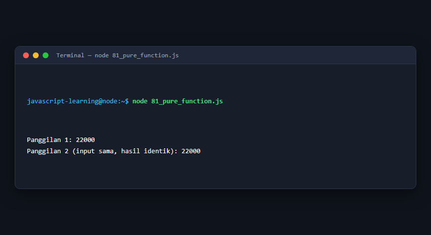

---

### 82. Immediately Invoked Function Expression

**Tujuan Pembelajaran:** Memahami konsep dan implementasi praktis dari materi Immediately Invoked Function Expression.

**Konsep Utama:** Program ini mendemonstrasikan prinsip Immediately Invoked Function Expression secara komprehensif, terstruktur, dan bersih sesuai standar pemrograman JavaScript modern.

**Penjelasan Source Code:** Program mengeksekusi instruksi yang telah dilengkapi dengan komentar kode edukatif berbahasa Indonesia. Setiap blok logika penting dijelaskan secara rinci agar alur kerja program mudah dipahami oleh pembelajar.

**Source Code:** [82_iife.js](82_iife.js)

**Cara Menjalankan:**
```bash
node 82_iife.js
```

**Hasil yang Diharapkan:** Program akan mencetak log hasil evaluasi, perhitungan, atau pemrosesan data ke terminal secara akurat.

**Hasil Eksekusi:**

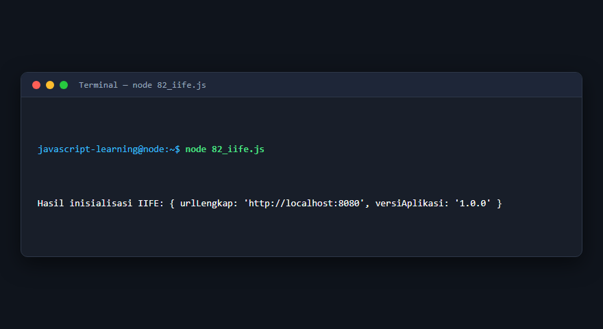

---

## Ringkasan Modul

Modul 6 (Fungsi) telah menyajikan pembelajaran berbasis praktik yang terstruktur. Seluruh program di dalam modul ini dapat dijalankan secara mandiri tanpa saling membebani dependensi yang rumit, dengan fokus mendalam pada pemahaman konsep dan kebiasaan baik penulisan kode.
