# Modul 7: Array dan Manipulasi String

## Deskripsi Modul
Modul ini mengupas tuntas struktur data Array dan manipulasi String menggunakan metode-metode modern seperti map, filter, reduce, slice, splice, dan template literals.

## Tujuan Pembelajaran
Menguasai pengolahan koleksi data berderet, transformasi array fungsional, dan pemformatan teks tingkat lanjut.

## Daftar Submodul & Materi

- [83_array_basic.js](83_array_basic.js) : Array dasar
- [84_array_indexing.js](84_array_indexing.js) : Akses indeks array
- [85_array_methods.js](85_array_methods.js) : Metode array
- [86_array_push_pop.js](86_array_push_pop.js) : `push()` dan `pop()`
- [87_array_shift_unshift.js](87_array_shift_unshift.js) : `shift()` dan `unshift()`
- [88_array_slice.js](88_array_slice.js) : Metode `slice()`
- [89_array_splice.js](89_array_splice.js) : Metode `splice()`
- [90_array_map.js](90_array_map.js) : Metode `map()`
- [91_array_filter.js](91_array_filter.js) : Metode `filter()`
- [92_array_reduce.js](92_array_reduce.js) : Metode `reduce()`
- [93_array_find.js](93_array_find.js) : Metode `find()`
- [94_array_some_every.js](94_array_some_every.js) : Metode `some()` dan `every()`
- [95_array_sort.js](95_array_sort.js) : Pengurutan array
- [96_array_flat.js](96_array_flat.js) : Metode `flat()` dan `flatMap()`
- [97_array_destructuring.js](97_array_destructuring.js) : Array destructuring
- [98_array_spread.js](98_array_spread.js) : Spread syntax pada array
- [99_string_methods.js](99_string_methods.js) : Metode string
- [100_string_slicing.js](100_string_slicing.js) : Pemotongan string
- [101_string_search.js](101_string_search.js) : Pencarian teks
- [102_string_replace.js](102_string_replace.js) : Penggantian teks
- [103_template_literals.js](103_template_literals.js) : Template literals
- [104_string_validation.js](104_string_validation.js) : Validasi string

---

## Penjelasan Detail Setiap Submodul

### 83. Array dasar

**Tujuan Pembelajaran:** Memahami konsep dan implementasi praktis dari materi Array dasar.

**Konsep Utama:** Program ini mendemonstrasikan prinsip Array dasar secara komprehensif, terstruktur, dan bersih sesuai standar pemrograman JavaScript modern.

**Penjelasan Source Code:** Program mengeksekusi instruksi yang telah dilengkapi dengan komentar kode edukatif berbahasa Indonesia. Setiap blok logika penting dijelaskan secara rinci agar alur kerja program mudah dipahami oleh pembelajar.

**Source Code:** [83_array_basic.js](83_array_basic.js)

**Cara Menjalankan:**
```bash
node 83_array_basic.js
```

**Hasil yang Diharapkan:** Program akan mencetak log hasil evaluasi, perhitungan, atau pemrosesan data ke terminal secara akurat.

**Hasil Eksekusi:**

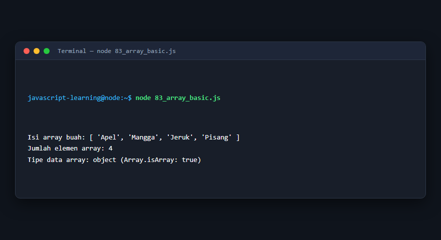

---

### 84. Akses indeks array

**Tujuan Pembelajaran:** Memahami konsep dan implementasi praktis dari materi Akses indeks array.

**Konsep Utama:** Program ini mendemonstrasikan prinsip Akses indeks array secara komprehensif, terstruktur, dan bersih sesuai standar pemrograman JavaScript modern.

**Penjelasan Source Code:** Program mengeksekusi instruksi yang telah dilengkapi dengan komentar kode edukatif berbahasa Indonesia. Setiap blok logika penting dijelaskan secara rinci agar alur kerja program mudah dipahami oleh pembelajar.

**Source Code:** [84_array_indexing.js](84_array_indexing.js)

**Cara Menjalankan:**
```bash
node 84_array_indexing.js
```

**Hasil yang Diharapkan:** Program akan mencetak log hasil evaluasi, perhitungan, atau pemrosesan data ke terminal secara akurat.

**Hasil Eksekusi:**

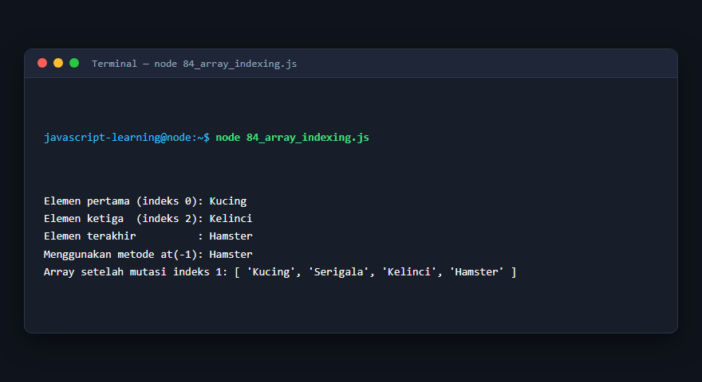

---

### 85. Metode array

**Tujuan Pembelajaran:** Memahami konsep dan implementasi praktis dari materi Metode array.

**Konsep Utama:** Program ini mendemonstrasikan prinsip Metode array secara komprehensif, terstruktur, dan bersih sesuai standar pemrograman JavaScript modern.

**Penjelasan Source Code:** Program mengeksekusi instruksi yang telah dilengkapi dengan komentar kode edukatif berbahasa Indonesia. Setiap blok logika penting dijelaskan secara rinci agar alur kerja program mudah dipahami oleh pembelajar.

**Source Code:** [85_array_methods.js](85_array_methods.js)

**Cara Menjalankan:**
```bash
node 85_array_methods.js
```

**Hasil yang Diharapkan:** Program akan mencetak log hasil evaluasi, perhitungan, atau pemrosesan data ke terminal secara akurat.

**Hasil Eksekusi:**

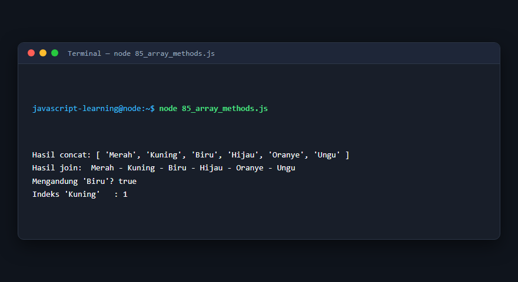

---

### 86. `push()` dan `pop()`

**Tujuan Pembelajaran:** Memahami konsep dan implementasi praktis dari materi `push()` dan `pop()`.

**Konsep Utama:** Program ini mendemonstrasikan prinsip `push()` dan `pop()` secara komprehensif, terstruktur, dan bersih sesuai standar pemrograman JavaScript modern.

**Penjelasan Source Code:** Program mengeksekusi instruksi yang telah dilengkapi dengan komentar kode edukatif berbahasa Indonesia. Setiap blok logika penting dijelaskan secara rinci agar alur kerja program mudah dipahami oleh pembelajar.

**Source Code:** [86_array_push_pop.js](86_array_push_pop.js)

**Cara Menjalankan:**
```bash
node 86_array_push_pop.js
```

**Hasil yang Diharapkan:** Program akan mencetak log hasil evaluasi, perhitungan, atau pemrosesan data ke terminal secara akurat.

**Hasil Eksekusi:**


---

### 87. `shift()` dan `unshift()`

**Tujuan Pembelajaran:** Memahami konsep dan implementasi praktis dari materi `shift()` dan `unshift()`.

**Konsep Utama:** Program ini mendemonstrasikan prinsip `shift()` dan `unshift()` secara komprehensif, terstruktur, dan bersih sesuai standar pemrograman JavaScript modern.

**Penjelasan Source Code:** Program mengeksekusi instruksi yang telah dilengkapi dengan komentar kode edukatif berbahasa Indonesia. Setiap blok logika penting dijelaskan secara rinci agar alur kerja program mudah dipahami oleh pembelajar.

**Source Code:** [87_array_shift_unshift.js](87_array_shift_unshift.js)

**Cara Menjalankan:**
```bash
node 87_array_shift_unshift.js
```

**Hasil yang Diharapkan:** Program akan mencetak log hasil evaluasi, perhitungan, atau pemrosesan data ke terminal secara akurat.

**Hasil Eksekusi:**


---

### 88. Metode `slice()`

**Tujuan Pembelajaran:** Memahami konsep dan implementasi praktis dari materi Metode `slice()`.

**Konsep Utama:** Program ini mendemonstrasikan prinsip Metode `slice()` secara komprehensif, terstruktur, dan bersih sesuai standar pemrograman JavaScript modern.

**Penjelasan Source Code:** Program mengeksekusi instruksi yang telah dilengkapi dengan komentar kode edukatif berbahasa Indonesia. Setiap blok logika penting dijelaskan secara rinci agar alur kerja program mudah dipahami oleh pembelajar.

**Source Code:** [88_array_slice.js](88_array_slice.js)

**Cara Menjalankan:**
```bash
node 88_array_slice.js
```

**Hasil yang Diharapkan:** Program akan mencetak log hasil evaluasi, perhitungan, atau pemrosesan data ke terminal secara akurat.

**Hasil Eksekusi:**


---

### 89. Metode `splice()`

**Tujuan Pembelajaran:** Memahami konsep dan implementasi praktis dari materi Metode `splice()`.

**Konsep Utama:** Program ini mendemonstrasikan prinsip Metode `splice()` secara komprehensif, terstruktur, dan bersih sesuai standar pemrograman JavaScript modern.

**Penjelasan Source Code:** Program mengeksekusi instruksi yang telah dilengkapi dengan komentar kode edukatif berbahasa Indonesia. Setiap blok logika penting dijelaskan secara rinci agar alur kerja program mudah dipahami oleh pembelajar.

**Source Code:** [89_array_splice.js](89_array_splice.js)

**Cara Menjalankan:**
```bash
node 89_array_splice.js
```

**Hasil yang Diharapkan:** Program akan mencetak log hasil evaluasi, perhitungan, atau pemrosesan data ke terminal secara akurat.

**Hasil Eksekusi:**


---

### 90. Metode `map()`

**Tujuan Pembelajaran:** Memahami konsep dan implementasi praktis dari materi Metode `map()`.

**Konsep Utama:** Program ini mendemonstrasikan prinsip Metode `map()` secara komprehensif, terstruktur, dan bersih sesuai standar pemrograman JavaScript modern.

**Penjelasan Source Code:** Program mengeksekusi instruksi yang telah dilengkapi dengan komentar kode edukatif berbahasa Indonesia. Setiap blok logika penting dijelaskan secara rinci agar alur kerja program mudah dipahami oleh pembelajar.

**Source Code:** [90_array_map.js](90_array_map.js)

**Cara Menjalankan:**
```bash
node 90_array_map.js
```

**Hasil yang Diharapkan:** Program akan mencetak log hasil evaluasi, perhitungan, atau pemrosesan data ke terminal secara akurat.

**Hasil Eksekusi:**


---

### 91. Metode `filter()`

**Tujuan Pembelajaran:** Memahami konsep dan implementasi praktis dari materi Metode `filter()`.

**Konsep Utama:** Program ini mendemonstrasikan prinsip Metode `filter()` secara komprehensif, terstruktur, dan bersih sesuai standar pemrograman JavaScript modern.

**Penjelasan Source Code:** Program mengeksekusi instruksi yang telah dilengkapi dengan komentar kode edukatif berbahasa Indonesia. Setiap blok logika penting dijelaskan secara rinci agar alur kerja program mudah dipahami oleh pembelajar.

**Source Code:** [91_array_filter.js](91_array_filter.js)

**Cara Menjalankan:**
```bash
node 91_array_filter.js
```

**Hasil yang Diharapkan:** Program akan mencetak log hasil evaluasi, perhitungan, atau pemrosesan data ke terminal secara akurat.

**Hasil Eksekusi:**


---

### 92. Metode `reduce()`

**Tujuan Pembelajaran:** Memahami konsep dan implementasi praktis dari materi Metode `reduce()`.

**Konsep Utama:** Program ini mendemonstrasikan prinsip Metode `reduce()` secara komprehensif, terstruktur, dan bersih sesuai standar pemrograman JavaScript modern.

**Penjelasan Source Code:** Program mengeksekusi instruksi yang telah dilengkapi dengan komentar kode edukatif berbahasa Indonesia. Setiap blok logika penting dijelaskan secara rinci agar alur kerja program mudah dipahami oleh pembelajar.

**Source Code:** [92_array_reduce.js](92_array_reduce.js)

**Cara Menjalankan:**
```bash
node 92_array_reduce.js
```

**Hasil yang Diharapkan:** Program akan mencetak log hasil evaluasi, perhitungan, atau pemrosesan data ke terminal secara akurat.

**Hasil Eksekusi:**


---

### 93. Metode `find()`

**Tujuan Pembelajaran:** Memahami konsep dan implementasi praktis dari materi Metode `find()`.

**Konsep Utama:** Program ini mendemonstrasikan prinsip Metode `find()` secara komprehensif, terstruktur, dan bersih sesuai standar pemrograman JavaScript modern.

**Penjelasan Source Code:** Program mengeksekusi instruksi yang telah dilengkapi dengan komentar kode edukatif berbahasa Indonesia. Setiap blok logika penting dijelaskan secara rinci agar alur kerja program mudah dipahami oleh pembelajar.

**Source Code:** [93_array_find.js](93_array_find.js)

**Cara Menjalankan:**
```bash
node 93_array_find.js
```

**Hasil yang Diharapkan:** Program akan mencetak log hasil evaluasi, perhitungan, atau pemrosesan data ke terminal secara akurat.

**Hasil Eksekusi:**


---

### 94. Metode `some()` dan `every()`

**Tujuan Pembelajaran:** Memahami konsep dan implementasi praktis dari materi Metode `some()` dan `every()`.

**Konsep Utama:** Program ini mendemonstrasikan prinsip Metode `some()` dan `every()` secara komprehensif, terstruktur, dan bersih sesuai standar pemrograman JavaScript modern.

**Penjelasan Source Code:** Program mengeksekusi instruksi yang telah dilengkapi dengan komentar kode edukatif berbahasa Indonesia. Setiap blok logika penting dijelaskan secara rinci agar alur kerja program mudah dipahami oleh pembelajar.

**Source Code:** [94_array_some_every.js](94_array_some_every.js)

**Cara Menjalankan:**
```bash
node 94_array_some_every.js
```

**Hasil yang Diharapkan:** Program akan mencetak log hasil evaluasi, perhitungan, atau pemrosesan data ke terminal secara akurat.

**Hasil Eksekusi:**


---

### 95. Pengurutan array

**Tujuan Pembelajaran:** Memahami konsep dan implementasi praktis dari materi Pengurutan array.

**Konsep Utama:** Program ini mendemonstrasikan prinsip Pengurutan array secara komprehensif, terstruktur, dan bersih sesuai standar pemrograman JavaScript modern.

**Penjelasan Source Code:** Program mengeksekusi instruksi yang telah dilengkapi dengan komentar kode edukatif berbahasa Indonesia. Setiap blok logika penting dijelaskan secara rinci agar alur kerja program mudah dipahami oleh pembelajar.

**Source Code:** [95_array_sort.js](95_array_sort.js)

**Cara Menjalankan:**
```bash
node 95_array_sort.js
```

**Hasil yang Diharapkan:** Program akan mencetak log hasil evaluasi, perhitungan, atau pemrosesan data ke terminal secara akurat.

**Hasil Eksekusi:**

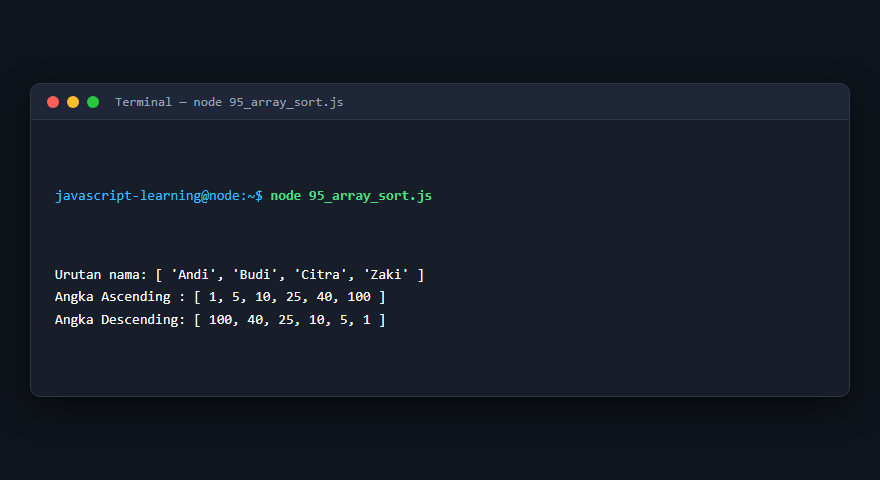

---

### 96. Metode `flat()` dan `flatMap()`

**Tujuan Pembelajaran:** Memahami konsep dan implementasi praktis dari materi Metode `flat()` dan `flatMap()`.

**Konsep Utama:** Program ini mendemonstrasikan prinsip Metode `flat()` dan `flatMap()` secara komprehensif, terstruktur, dan bersih sesuai standar pemrograman JavaScript modern.

**Penjelasan Source Code:** Program mengeksekusi instruksi yang telah dilengkapi dengan komentar kode edukatif berbahasa Indonesia. Setiap blok logika penting dijelaskan secara rinci agar alur kerja program mudah dipahami oleh pembelajar.

**Source Code:** [96_array_flat.js](96_array_flat.js)

**Cara Menjalankan:**
```bash
node 96_array_flat.js
```

**Hasil yang Diharapkan:** Program akan mencetak log hasil evaluasi, perhitungan, atau pemrosesan data ke terminal secara akurat.

**Hasil Eksekusi:**


---

### 97. Array destructuring

**Tujuan Pembelajaran:** Memahami konsep dan implementasi praktis dari materi Array destructuring.

**Konsep Utama:** Program ini mendemonstrasikan prinsip Array destructuring secara komprehensif, terstruktur, dan bersih sesuai standar pemrograman JavaScript modern.

**Penjelasan Source Code:** Program mengeksekusi instruksi yang telah dilengkapi dengan komentar kode edukatif berbahasa Indonesia. Setiap blok logika penting dijelaskan secara rinci agar alur kerja program mudah dipahami oleh pembelajar.

**Source Code:** [97_array_destructuring.js](97_array_destructuring.js)

**Cara Menjalankan:**
```bash
node 97_array_destructuring.js
```

**Hasil yang Diharapkan:** Program akan mencetak log hasil evaluasi, perhitungan, atau pemrosesan data ke terminal secara akurat.

**Hasil Eksekusi:**

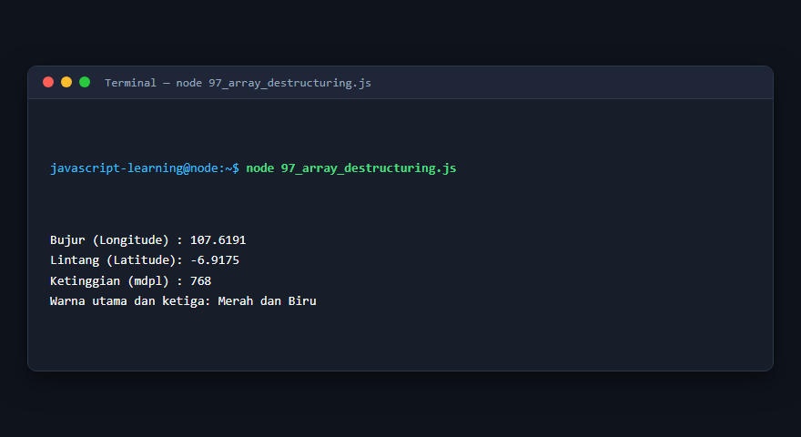

---

### 98. Spread syntax pada array

**Tujuan Pembelajaran:** Memahami konsep dan implementasi praktis dari materi Spread syntax pada array.

**Konsep Utama:** Program ini mendemonstrasikan prinsip Spread syntax pada array secara komprehensif, terstruktur, dan bersih sesuai standar pemrograman JavaScript modern.

**Penjelasan Source Code:** Program mengeksekusi instruksi yang telah dilengkapi dengan komentar kode edukatif berbahasa Indonesia. Setiap blok logika penting dijelaskan secara rinci agar alur kerja program mudah dipahami oleh pembelajar.

**Source Code:** [98_array_spread.js](98_array_spread.js)

**Cara Menjalankan:**
```bash
node 98_array_spread.js
```

**Hasil yang Diharapkan:** Program akan mencetak log hasil evaluasi, perhitungan, atau pemrosesan data ke terminal secara akurat.

**Hasil Eksekusi:**

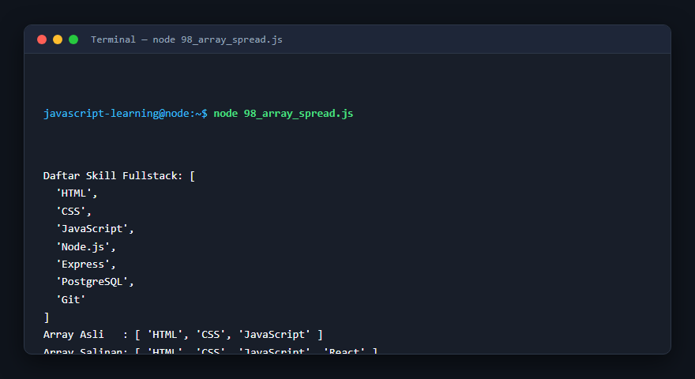

---

### 99. Metode string

**Tujuan Pembelajaran:** Memahami konsep dan implementasi praktis dari materi Metode string.

**Konsep Utama:** Program ini mendemonstrasikan prinsip Metode string secara komprehensif, terstruktur, dan bersih sesuai standar pemrograman JavaScript modern.

**Penjelasan Source Code:** Program mengeksekusi instruksi yang telah dilengkapi dengan komentar kode edukatif berbahasa Indonesia. Setiap blok logika penting dijelaskan secara rinci agar alur kerja program mudah dipahami oleh pembelajar.

**Source Code:** [99_string_methods.js](99_string_methods.js)

**Cara Menjalankan:**
```bash
node 99_string_methods.js
```

**Hasil yang Diharapkan:** Program akan mencetak log hasil evaluasi, perhitungan, atau pemrosesan data ke terminal secara akurat.

**Hasil Eksekusi:**

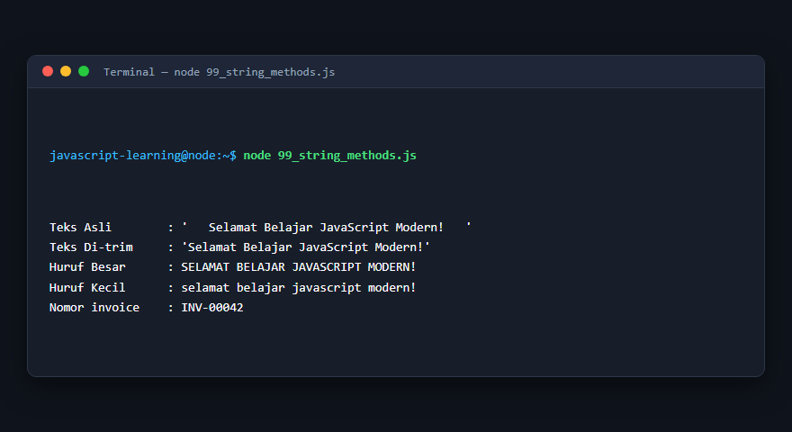

---

### 100. Pemotongan string

**Tujuan Pembelajaran:** Memahami konsep dan implementasi praktis dari materi Pemotongan string.

**Konsep Utama:** Program ini mendemonstrasikan prinsip Pemotongan string secara komprehensif, terstruktur, dan bersih sesuai standar pemrograman JavaScript modern.

**Penjelasan Source Code:** Program mengeksekusi instruksi yang telah dilengkapi dengan komentar kode edukatif berbahasa Indonesia. Setiap blok logika penting dijelaskan secara rinci agar alur kerja program mudah dipahami oleh pembelajar.

**Source Code:** [100_string_slicing.js](100_string_slicing.js)

**Cara Menjalankan:**
```bash
node 100_string_slicing.js
```

**Hasil yang Diharapkan:** Program akan mencetak log hasil evaluasi, perhitungan, atau pemrosesan data ke terminal secara akurat.

**Hasil Eksekusi:**

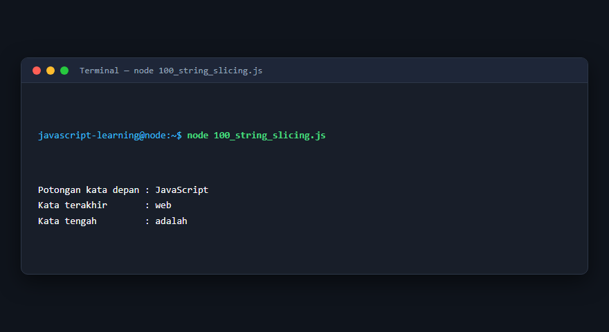

---

### 101. Pencarian teks

**Tujuan Pembelajaran:** Memahami konsep dan implementasi praktis dari materi Pencarian teks.

**Konsep Utama:** Program ini mendemonstrasikan prinsip Pencarian teks secara komprehensif, terstruktur, dan bersih sesuai standar pemrograman JavaScript modern.

**Penjelasan Source Code:** Program mengeksekusi instruksi yang telah dilengkapi dengan komentar kode edukatif berbahasa Indonesia. Setiap blok logika penting dijelaskan secara rinci agar alur kerja program mudah dipahami oleh pembelajar.

**Source Code:** [101_string_search.js](101_string_search.js)

**Cara Menjalankan:**
```bash
node 101_string_search.js
```

**Hasil yang Diharapkan:** Program akan mencetak log hasil evaluasi, perhitungan, atau pemrosesan data ke terminal secara akurat.

**Hasil Eksekusi:**

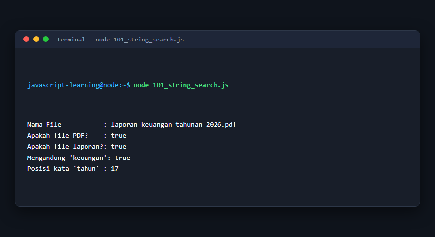

---

### 102. Penggantian teks

**Tujuan Pembelajaran:** Memahami konsep dan implementasi praktis dari materi Penggantian teks.

**Konsep Utama:** Program ini mendemonstrasikan prinsip Penggantian teks secara komprehensif, terstruktur, dan bersih sesuai standar pemrograman JavaScript modern.

**Penjelasan Source Code:** Program mengeksekusi instruksi yang telah dilengkapi dengan komentar kode edukatif berbahasa Indonesia. Setiap blok logika penting dijelaskan secara rinci agar alur kerja program mudah dipahami oleh pembelajar.

**Source Code:** [102_string_replace.js](102_string_replace.js)

**Cara Menjalankan:**
```bash
node 102_string_replace.js
```

**Hasil yang Diharapkan:** Program akan mencetak log hasil evaluasi, perhitungan, atau pemrosesan data ke terminal secara akurat.

**Hasil Eksekusi:**

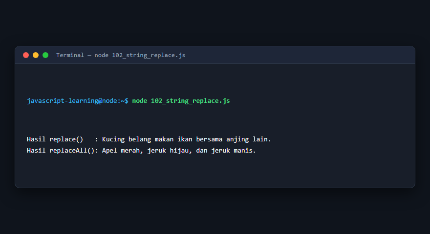

---

### 103. Template literals

**Tujuan Pembelajaran:** Memahami konsep dan implementasi praktis dari materi Template literals.

**Konsep Utama:** Program ini mendemonstrasikan prinsip Template literals secara komprehensif, terstruktur, dan bersih sesuai standar pemrograman JavaScript modern.

**Penjelasan Source Code:** Program mengeksekusi instruksi yang telah dilengkapi dengan komentar kode edukatif berbahasa Indonesia. Setiap blok logika penting dijelaskan secara rinci agar alur kerja program mudah dipahami oleh pembelajar.

**Source Code:** [103_template_literals.js](103_template_literals.js)

**Cara Menjalankan:**
```bash
node 103_template_literals.js
```

**Hasil yang Diharapkan:** Program akan mencetak log hasil evaluasi, perhitungan, atau pemrosesan data ke terminal secara akurat.

**Hasil Eksekusi:**

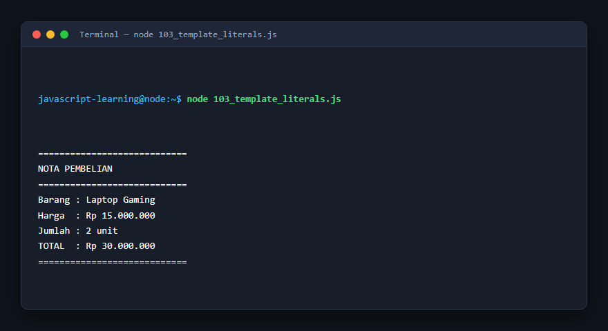

---

### 104. Validasi string

**Tujuan Pembelajaran:** Memahami konsep dan implementasi praktis dari materi Validasi string.

**Konsep Utama:** Program ini mendemonstrasikan prinsip Validasi string secara komprehensif, terstruktur, dan bersih sesuai standar pemrograman JavaScript modern.

**Penjelasan Source Code:** Program mengeksekusi instruksi yang telah dilengkapi dengan komentar kode edukatif berbahasa Indonesia. Setiap blok logika penting dijelaskan secara rinci agar alur kerja program mudah dipahami oleh pembelajar.

**Source Code:** [104_string_validation.js](104_string_validation.js)

**Cara Menjalankan:**
```bash
node 104_string_validation.js
```

**Hasil yang Diharapkan:** Program akan mencetak log hasil evaluasi, perhitungan, atau pemrosesan data ke terminal secara akurat.

**Hasil Eksekusi:**

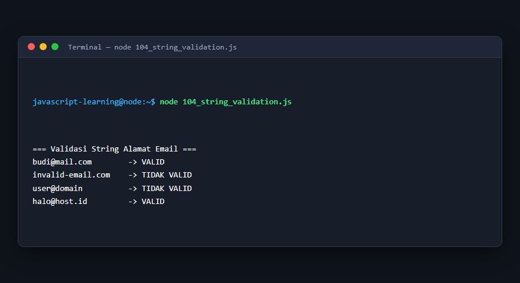

---

## Ringkasan Modul

Modul 7 (Array dan Manipulasi String) telah menyajikan pembelajaran berbasis praktik yang terstruktur. Seluruh program di dalam modul ini dapat dijalankan secara mandiri tanpa saling membebani dependensi yang rumit, dengan fokus mendalam pada pemahaman konsep dan kebiasaan baik penulisan kode.
