# Modul 8: Object dan Pengelolaan Data

## Deskripsi Modul
Modul ini membedah objek dalam JavaScript, manipulasi properti, method, destructuring, spread, shallow vs deep copy, serta struktur data Map dan Set.

## Tujuan Pembelajaran
Mampu memodelkan data entitas kompleks, mengelola immutability dengan freeze/seal, dan memilih struktur koleksi yang tepat.

## Daftar Submodul & Materi

- [105_object_basic.js](105_object_basic.js) : Object dasar
- [106_object_properties.js](106_object_properties.js) : Properti object
- [107_object_methods.js](107_object_methods.js) : Method pada object
- [108_object_destructuring.js](108_object_destructuring.js) : Object destructuring
- [109_object_spread.js](109_object_spread.js) : Spread syntax pada object
- [110_object_assign.js](110_object_assign.js) : `Object.assign()`
- [111_object_keys_values.js](111_object_keys_values.js) : `Object.keys()` dan `Object.values()`
- [112_object_entries.js](112_object_entries.js) : `Object.entries()`
- [113_object_freeze.js](113_object_freeze.js) : `Object.freeze()`
- [114_object_seal.js](114_object_seal.js) : `Object.seal()`
- [115_nested_objects.js](115_nested_objects.js) : Nested objects
- [116_object_reference.js](116_object_reference.js) : Referensi object
- [117_shallow_copy.js](117_shallow_copy.js) : Shallow copy
- [118_deep_copy.js](118_deep_copy.js) : Deep copy
- [119_map_collection.js](119_map_collection.js) : Struktur data `Map`
- [120_set_collection.js](120_set_collection.js) : Struktur data `Set`
- [121_weakmap_weakset.js](121_weakmap_weakset.js) : WeakMap dan WeakSet
- [122_object_dynamic_properties.js](122_object_dynamic_properties.js) : Properti object dinamis

---

## Penjelasan Detail Setiap Submodul

### 105. Object dasar

**Tujuan Pembelajaran:** Memahami konsep dan implementasi praktis dari materi Object dasar.

**Konsep Utama:** Program ini mendemonstrasikan prinsip Object dasar secara komprehensif, terstruktur, dan bersih sesuai standar pemrograman JavaScript modern.

**Penjelasan Source Code:** Program mengeksekusi instruksi yang telah dilengkapi dengan komentar kode edukatif berbahasa Indonesia. Setiap blok logika penting dijelaskan secara rinci agar alur kerja program mudah dipahami oleh pembelajar.

**Source Code:** [105_object_basic.js](105_object_basic.js)

**Cara Menjalankan:**
```bash
node 105_object_basic.js
```

**Hasil yang Diharapkan:** Program akan mencetak log hasil evaluasi, perhitungan, atau pemrosesan data ke terminal secara akurat.

**Hasil Eksekusi:**

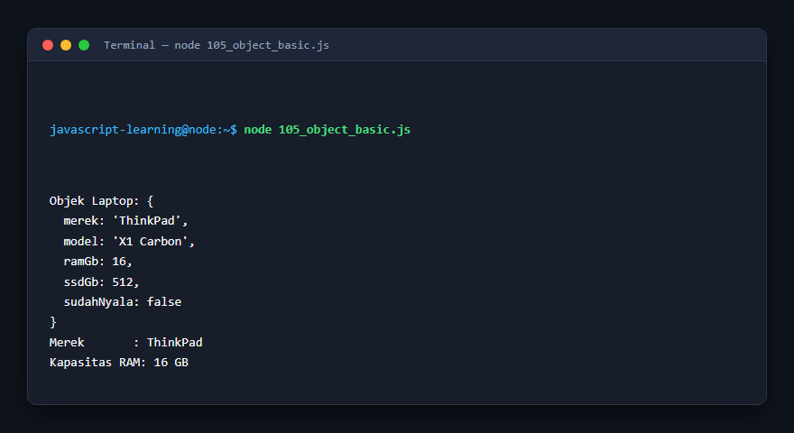

---

### 106. Properti object

**Tujuan Pembelajaran:** Memahami konsep dan implementasi praktis dari materi Properti object.

**Konsep Utama:** Program ini mendemonstrasikan prinsip Properti object secara komprehensif, terstruktur, dan bersih sesuai standar pemrograman JavaScript modern.

**Penjelasan Source Code:** Program mengeksekusi instruksi yang telah dilengkapi dengan komentar kode edukatif berbahasa Indonesia. Setiap blok logika penting dijelaskan secara rinci agar alur kerja program mudah dipahami oleh pembelajar.

**Source Code:** [106_object_properties.js](106_object_properties.js)

**Cara Menjalankan:**
```bash
node 106_object_properties.js
```

**Hasil yang Diharapkan:** Program akan mencetak log hasil evaluasi, perhitungan, atau pemrosesan data ke terminal secara akurat.

**Hasil Eksekusi:**

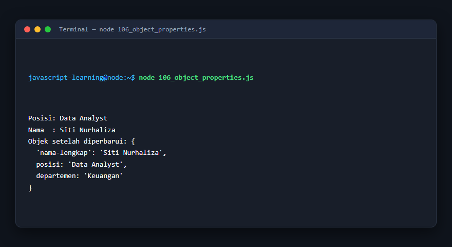

---

### 107. Method pada object

**Tujuan Pembelajaran:** Memahami konsep dan implementasi praktis dari materi Method pada object.

**Konsep Utama:** Program ini mendemonstrasikan prinsip Method pada object secara komprehensif, terstruktur, dan bersih sesuai standar pemrograman JavaScript modern.

**Penjelasan Source Code:** Program mengeksekusi instruksi yang telah dilengkapi dengan komentar kode edukatif berbahasa Indonesia. Setiap blok logika penting dijelaskan secara rinci agar alur kerja program mudah dipahami oleh pembelajar.

**Source Code:** [107_object_methods.js](107_object_methods.js)

**Cara Menjalankan:**
```bash
node 107_object_methods.js
```

**Hasil yang Diharapkan:** Program akan mencetak log hasil evaluasi, perhitungan, atau pemrosesan data ke terminal secara akurat.

**Hasil Eksekusi:**

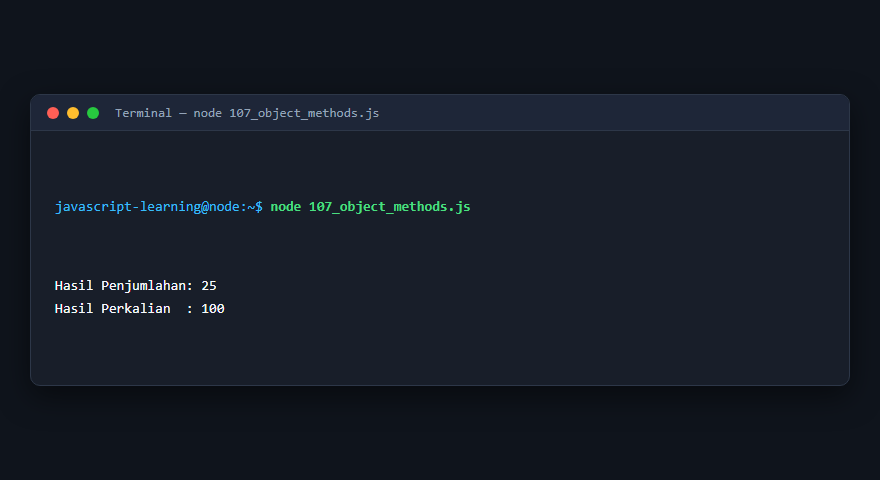

---

### 108. Object destructuring

**Tujuan Pembelajaran:** Memahami konsep dan implementasi praktis dari materi Object destructuring.

**Konsep Utama:** Program ini mendemonstrasikan prinsip Object destructuring secara komprehensif, terstruktur, dan bersih sesuai standar pemrograman JavaScript modern.

**Penjelasan Source Code:** Program mengeksekusi instruksi yang telah dilengkapi dengan komentar kode edukatif berbahasa Indonesia. Setiap blok logika penting dijelaskan secara rinci agar alur kerja program mudah dipahami oleh pembelajar.

**Source Code:** [108_object_destructuring.js](108_object_destructuring.js)

**Cara Menjalankan:**
```bash
node 108_object_destructuring.js
```

**Hasil yang Diharapkan:** Program akan mencetak log hasil evaluasi, perhitungan, atau pemrosesan data ke terminal secara akurat.

**Hasil Eksekusi:**

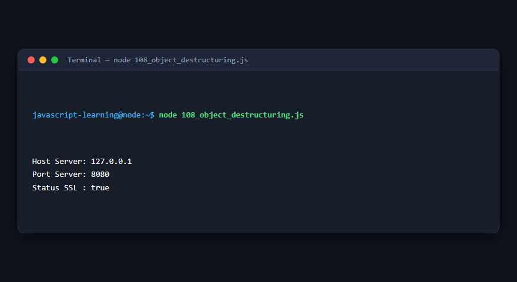

---

### 109. Spread syntax pada object

**Tujuan Pembelajaran:** Memahami konsep dan implementasi praktis dari materi Spread syntax pada object.

**Konsep Utama:** Program ini mendemonstrasikan prinsip Spread syntax pada object secara komprehensif, terstruktur, dan bersih sesuai standar pemrograman JavaScript modern.

**Penjelasan Source Code:** Program mengeksekusi instruksi yang telah dilengkapi dengan komentar kode edukatif berbahasa Indonesia. Setiap blok logika penting dijelaskan secara rinci agar alur kerja program mudah dipahami oleh pembelajar.

**Source Code:** [109_object_spread.js](109_object_spread.js)

**Cara Menjalankan:**
```bash
node 109_object_spread.js
```

**Hasil yang Diharapkan:** Program akan mencetak log hasil evaluasi, perhitungan, atau pemrosesan data ke terminal secara akurat.

**Hasil Eksekusi:**

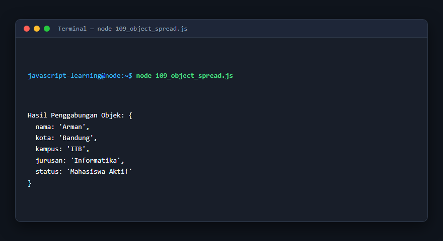

---

### 110. `Object.assign()`

**Tujuan Pembelajaran:** Memahami konsep dan implementasi praktis dari materi `Object.assign()`.

**Konsep Utama:** Program ini mendemonstrasikan prinsip `Object.assign()` secara komprehensif, terstruktur, dan bersih sesuai standar pemrograman JavaScript modern.

**Penjelasan Source Code:** Program mengeksekusi instruksi yang telah dilengkapi dengan komentar kode edukatif berbahasa Indonesia. Setiap blok logika penting dijelaskan secara rinci agar alur kerja program mudah dipahami oleh pembelajar.

**Source Code:** [110_object_assign.js](110_object_assign.js)

**Cara Menjalankan:**
```bash
node 110_object_assign.js
```

**Hasil yang Diharapkan:** Program akan mencetak log hasil evaluasi, perhitungan, atau pemrosesan data ke terminal secara akurat.

**Hasil Eksekusi:**


---

### 111. `Object.keys()` dan `Object.values()`

**Tujuan Pembelajaran:** Memahami konsep dan implementasi praktis dari materi `Object.keys()` dan `Object.values()`.

**Konsep Utama:** Program ini mendemonstrasikan prinsip `Object.keys()` dan `Object.values()` secara komprehensif, terstruktur, dan bersih sesuai standar pemrograman JavaScript modern.

**Penjelasan Source Code:** Program mengeksekusi instruksi yang telah dilengkapi dengan komentar kode edukatif berbahasa Indonesia. Setiap blok logika penting dijelaskan secara rinci agar alur kerja program mudah dipahami oleh pembelajar.

**Source Code:** [111_object_keys_values.js](111_object_keys_values.js)

**Cara Menjalankan:**
```bash
node 111_object_keys_values.js
```

**Hasil yang Diharapkan:** Program akan mencetak log hasil evaluasi, perhitungan, atau pemrosesan data ke terminal secara akurat.

**Hasil Eksekusi:**


---

### 112. `Object.entries()`

**Tujuan Pembelajaran:** Memahami konsep dan implementasi praktis dari materi `Object.entries()`.

**Konsep Utama:** Program ini mendemonstrasikan prinsip `Object.entries()` secara komprehensif, terstruktur, dan bersih sesuai standar pemrograman JavaScript modern.

**Penjelasan Source Code:** Program mengeksekusi instruksi yang telah dilengkapi dengan komentar kode edukatif berbahasa Indonesia. Setiap blok logika penting dijelaskan secara rinci agar alur kerja program mudah dipahami oleh pembelajar.

**Source Code:** [112_object_entries.js](112_object_entries.js)

**Cara Menjalankan:**
```bash
node 112_object_entries.js
```

**Hasil yang Diharapkan:** Program akan mencetak log hasil evaluasi, perhitungan, atau pemrosesan data ke terminal secara akurat.

**Hasil Eksekusi:**


---

### 113. `Object.freeze()`

**Tujuan Pembelajaran:** Memahami konsep dan implementasi praktis dari materi `Object.freeze()`.

**Konsep Utama:** Program ini mendemonstrasikan prinsip `Object.freeze()` secara komprehensif, terstruktur, dan bersih sesuai standar pemrograman JavaScript modern.

**Penjelasan Source Code:** Program mengeksekusi instruksi yang telah dilengkapi dengan komentar kode edukatif berbahasa Indonesia. Setiap blok logika penting dijelaskan secara rinci agar alur kerja program mudah dipahami oleh pembelajar.

**Source Code:** [113_object_freeze.js](113_object_freeze.js)

**Cara Menjalankan:**
```bash
node 113_object_freeze.js
```

**Hasil yang Diharapkan:** Program akan mencetak log hasil evaluasi, perhitungan, atau pemrosesan data ke terminal secara akurat.

**Hasil Eksekusi:**


---

### 114. `Object.seal()`

**Tujuan Pembelajaran:** Memahami konsep dan implementasi praktis dari materi `Object.seal()`.

**Konsep Utama:** Program ini mendemonstrasikan prinsip `Object.seal()` secara komprehensif, terstruktur, dan bersih sesuai standar pemrograman JavaScript modern.

**Penjelasan Source Code:** Program mengeksekusi instruksi yang telah dilengkapi dengan komentar kode edukatif berbahasa Indonesia. Setiap blok logika penting dijelaskan secara rinci agar alur kerja program mudah dipahami oleh pembelajar.

**Source Code:** [114_object_seal.js](114_object_seal.js)

**Cara Menjalankan:**
```bash
node 114_object_seal.js
```

**Hasil yang Diharapkan:** Program akan mencetak log hasil evaluasi, perhitungan, atau pemrosesan data ke terminal secara akurat.

**Hasil Eksekusi:**


---

### 115. Nested objects

**Tujuan Pembelajaran:** Memahami konsep dan implementasi praktis dari materi Nested objects.

**Konsep Utama:** Program ini mendemonstrasikan prinsip Nested objects secara komprehensif, terstruktur, dan bersih sesuai standar pemrograman JavaScript modern.

**Penjelasan Source Code:** Program mengeksekusi instruksi yang telah dilengkapi dengan komentar kode edukatif berbahasa Indonesia. Setiap blok logika penting dijelaskan secara rinci agar alur kerja program mudah dipahami oleh pembelajar.

**Source Code:** [115_nested_objects.js](115_nested_objects.js)

**Cara Menjalankan:**
```bash
node 115_nested_objects.js
```

**Hasil yang Diharapkan:** Program akan mencetak log hasil evaluasi, perhitungan, atau pemrosesan data ke terminal secara akurat.

**Hasil Eksekusi:**

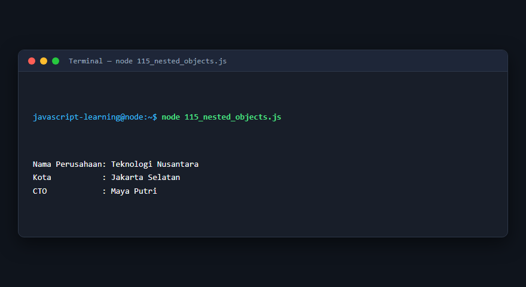

---

### 116. Referensi object

**Tujuan Pembelajaran:** Memahami konsep dan implementasi praktis dari materi Referensi object.

**Konsep Utama:** Program ini mendemonstrasikan prinsip Referensi object secara komprehensif, terstruktur, dan bersih sesuai standar pemrograman JavaScript modern.

**Penjelasan Source Code:** Program mengeksekusi instruksi yang telah dilengkapi dengan komentar kode edukatif berbahasa Indonesia. Setiap blok logika penting dijelaskan secara rinci agar alur kerja program mudah dipahami oleh pembelajar.

**Source Code:** [116_object_reference.js](116_object_reference.js)

**Cara Menjalankan:**
```bash
node 116_object_reference.js
```

**Hasil yang Diharapkan:** Program akan mencetak log hasil evaluasi, perhitungan, atau pemrosesan data ke terminal secara akurat.

**Hasil Eksekusi:**

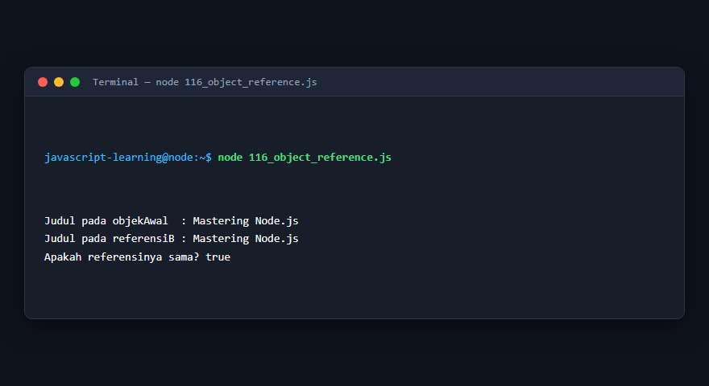

---

### 117. Shallow copy

**Tujuan Pembelajaran:** Memahami konsep dan implementasi praktis dari materi Shallow copy.

**Konsep Utama:** Program ini mendemonstrasikan prinsip Shallow copy secara komprehensif, terstruktur, dan bersih sesuai standar pemrograman JavaScript modern.

**Penjelasan Source Code:** Program mengeksekusi instruksi yang telah dilengkapi dengan komentar kode edukatif berbahasa Indonesia. Setiap blok logika penting dijelaskan secara rinci agar alur kerja program mudah dipahami oleh pembelajar.

**Source Code:** [117_shallow_copy.js](117_shallow_copy.js)

**Cara Menjalankan:**
```bash
node 117_shallow_copy.js
```

**Hasil yang Diharapkan:** Program akan mencetak log hasil evaluasi, perhitungan, atau pemrosesan data ke terminal secara akurat.

**Hasil Eksekusi:**

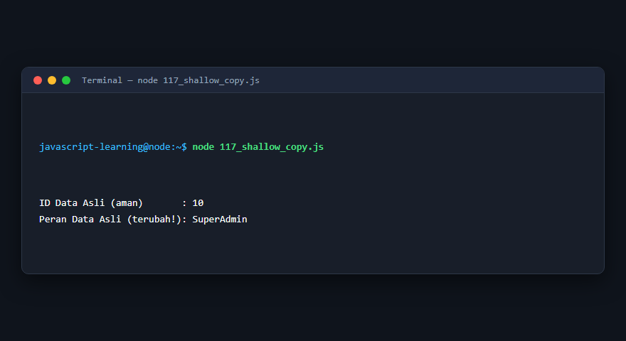

---

### 118. Deep copy

**Tujuan Pembelajaran:** Memahami konsep dan implementasi praktis dari materi Deep copy.

**Konsep Utama:** Program ini mendemonstrasikan prinsip Deep copy secara komprehensif, terstruktur, dan bersih sesuai standar pemrograman JavaScript modern.

**Penjelasan Source Code:** Program mengeksekusi instruksi yang telah dilengkapi dengan komentar kode edukatif berbahasa Indonesia. Setiap blok logika penting dijelaskan secara rinci agar alur kerja program mudah dipahami oleh pembelajar.

**Source Code:** [118_deep_copy.js](118_deep_copy.js)

**Cara Menjalankan:**
```bash
node 118_deep_copy.js
```

**Hasil yang Diharapkan:** Program akan mencetak log hasil evaluasi, perhitungan, atau pemrosesan data ke terminal secara akurat.

**Hasil Eksekusi:**

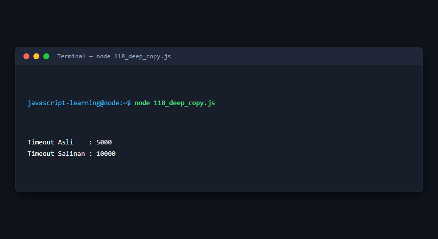

---

### 119. Struktur data `Map`

**Tujuan Pembelajaran:** Memahami konsep dan implementasi praktis dari materi Struktur data `Map`.

**Konsep Utama:** Program ini mendemonstrasikan prinsip Struktur data `Map` secara komprehensif, terstruktur, dan bersih sesuai standar pemrograman JavaScript modern.

**Penjelasan Source Code:** Program mengeksekusi instruksi yang telah dilengkapi dengan komentar kode edukatif berbahasa Indonesia. Setiap blok logika penting dijelaskan secara rinci agar alur kerja program mudah dipahami oleh pembelajar.

**Source Code:** [119_map_collection.js](119_map_collection.js)

**Cara Menjalankan:**
```bash
node 119_map_collection.js
```

**Hasil yang Diharapkan:** Program akan mencetak log hasil evaluasi, perhitungan, atau pemrosesan data ke terminal secara akurat.

**Hasil Eksekusi:**


---

### 120. Struktur data `Set`

**Tujuan Pembelajaran:** Memahami konsep dan implementasi praktis dari materi Struktur data `Set`.

**Konsep Utama:** Program ini mendemonstrasikan prinsip Struktur data `Set` secara komprehensif, terstruktur, dan bersih sesuai standar pemrograman JavaScript modern.

**Penjelasan Source Code:** Program mengeksekusi instruksi yang telah dilengkapi dengan komentar kode edukatif berbahasa Indonesia. Setiap blok logika penting dijelaskan secara rinci agar alur kerja program mudah dipahami oleh pembelajar.

**Source Code:** [120_set_collection.js](120_set_collection.js)

**Cara Menjalankan:**
```bash
node 120_set_collection.js
```

**Hasil yang Diharapkan:** Program akan mencetak log hasil evaluasi, perhitungan, atau pemrosesan data ke terminal secara akurat.

**Hasil Eksekusi:**


---

### 121. WeakMap dan WeakSet

**Tujuan Pembelajaran:** Memahami konsep dan implementasi praktis dari materi WeakMap dan WeakSet.

**Konsep Utama:** Program ini mendemonstrasikan prinsip WeakMap dan WeakSet secara komprehensif, terstruktur, dan bersih sesuai standar pemrograman JavaScript modern.

**Penjelasan Source Code:** Program mengeksekusi instruksi yang telah dilengkapi dengan komentar kode edukatif berbahasa Indonesia. Setiap blok logika penting dijelaskan secara rinci agar alur kerja program mudah dipahami oleh pembelajar.

**Source Code:** [121_weakmap_weakset.js](121_weakmap_weakset.js)

**Cara Menjalankan:**
```bash
node 121_weakmap_weakset.js
```

**Hasil yang Diharapkan:** Program akan mencetak log hasil evaluasi, perhitungan, atau pemrosesan data ke terminal secara akurat.

**Hasil Eksekusi:**

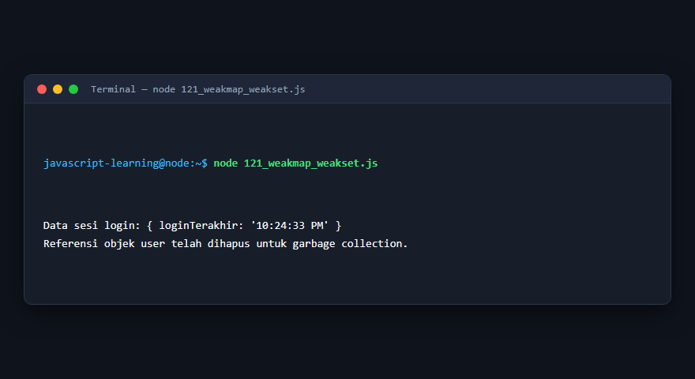

---

### 122. Properti object dinamis

**Tujuan Pembelajaran:** Memahami konsep dan implementasi praktis dari materi Properti object dinamis.

**Konsep Utama:** Program ini mendemonstrasikan prinsip Properti object dinamis secara komprehensif, terstruktur, dan bersih sesuai standar pemrograman JavaScript modern.

**Penjelasan Source Code:** Program mengeksekusi instruksi yang telah dilengkapi dengan komentar kode edukatif berbahasa Indonesia. Setiap blok logika penting dijelaskan secara rinci agar alur kerja program mudah dipahami oleh pembelajar.

**Source Code:** [122_object_dynamic_properties.js](122_object_dynamic_properties.js)

**Cara Menjalankan:**
```bash
node 122_object_dynamic_properties.js
```

**Hasil yang Diharapkan:** Program akan mencetak log hasil evaluasi, perhitungan, atau pemrosesan data ke terminal secara akurat.

**Hasil Eksekusi:**

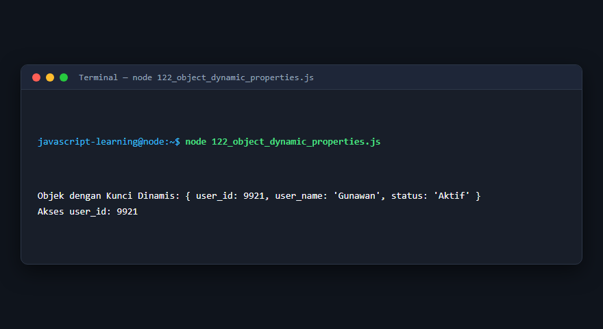

---

## Ringkasan Modul

Modul 8 (Object dan Pengelolaan Data) telah menyajikan pembelajaran berbasis praktik yang terstruktur. Seluruh program di dalam modul ini dapat dijalankan secara mandiri tanpa saling membebani dependensi yang rumit, dengan fokus mendalam pada pemahaman konsep dan kebiasaan baik penulisan kode.
