# Modul 9: Konsep Fungsi Lanjutan

## Deskripsi Modul
Modul ini membahas paradigma fungsional tingkat lanjut meliputi currying, komposisi fungsi, binding 'this', generator functions, dan iterator protocol.

## Tujuan Pembelajaran
Menguasai pemrograman fungsional deklaratif, custom iterators, dan penanganan alur generator yang dapat dijeda.

## Daftar Submodul & Materi

- [123_function_currying.js](123_function_currying.js) : Function currying
- [124_function_composition.js](124_function_composition.js) : Function composition
- [125_function_partial_application.js](125_function_partial_application.js) : Partial application
- [126_closure_counter.js](126_closure_counter.js) : Closure untuk counter
- [127_closure_factory.js](127_closure_factory.js) : Function factory
- [128_callback_patterns.js](128_callback_patterns.js) : Pola callback
- [129_callback_error_handling.js](129_callback_error_handling.js) : Penanganan error pada callback
- [130_function_memoization.js](130_function_memoization.js) : Function memoization
- [131_recursive_closures.js](131_recursive_closures.js) : Rekursi dan closure
- [132_this_keyword.js](132_this_keyword.js) : Keyword `this`
- [133_this_binding.js](133_this_binding.js) : Binding `this`
- [134_call_apply_bind.js](134_call_apply_bind.js) : `call()`, `apply()`, dan `bind()`
- [135_function_prototype.js](135_function_prototype.js) : Function prototype
- [136_generator_function.js](136_generator_function.js) : Generator function
- [137_yield_keyword.js](137_yield_keyword.js) : Keyword `yield`
- [138_iterator_protocol.js](138_iterator_protocol.js) : Iterator protocol
- [139_custom_iterator.js](139_custom_iterator.js) : Custom iterator
- [140_custom_generator.js](140_custom_generator.js) : Custom generator

---

## Penjelasan Detail Setiap Submodul

### 123. Function currying

**Tujuan Pembelajaran:** Memahami konsep dan implementasi praktis dari materi Function currying.

**Konsep Utama:** Program ini mendemonstrasikan prinsip Function currying secara komprehensif, terstruktur, dan bersih sesuai standar pemrograman JavaScript modern.

**Penjelasan Source Code:** Program mengeksekusi instruksi yang telah dilengkapi dengan komentar kode edukatif berbahasa Indonesia. Setiap blok logika penting dijelaskan secara rinci agar alur kerja program mudah dipahami oleh pembelajar.

**Source Code:** [123_function_currying.js](123_function_currying.js)

**Cara Menjalankan:**
```bash
node 123_function_currying.js
```

**Hasil yang Diharapkan:** Program akan mencetak log hasil evaluasi, perhitungan, atau pemrosesan data ke terminal secara akurat.

**Hasil Eksekusi:**

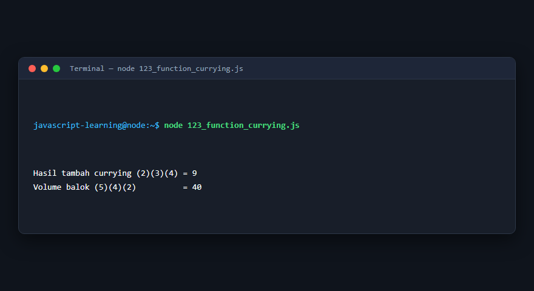

---

### 124. Function composition

**Tujuan Pembelajaran:** Memahami konsep dan implementasi praktis dari materi Function composition.

**Konsep Utama:** Program ini mendemonstrasikan prinsip Function composition secara komprehensif, terstruktur, dan bersih sesuai standar pemrograman JavaScript modern.

**Penjelasan Source Code:** Program mengeksekusi instruksi yang telah dilengkapi dengan komentar kode edukatif berbahasa Indonesia. Setiap blok logika penting dijelaskan secara rinci agar alur kerja program mudah dipahami oleh pembelajar.

**Source Code:** [124_function_composition.js](124_function_composition.js)

**Cara Menjalankan:**
```bash
node 124_function_composition.js
```

**Hasil yang Diharapkan:** Program akan mencetak log hasil evaluasi, perhitungan, atau pemrosesan data ke terminal secara akurat.

**Hasil Eksekusi:**

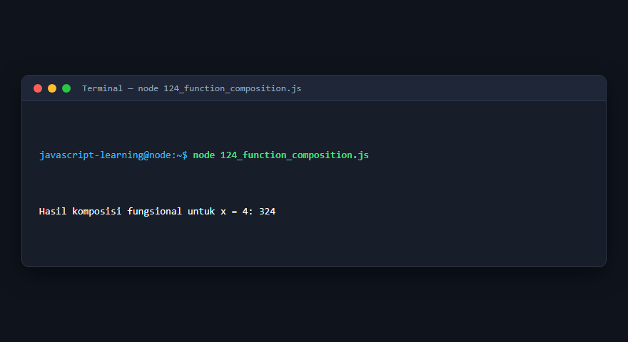

---

### 125. Partial application

**Tujuan Pembelajaran:** Memahami konsep dan implementasi praktis dari materi Partial application.

**Konsep Utama:** Program ini mendemonstrasikan prinsip Partial application secara komprehensif, terstruktur, dan bersih sesuai standar pemrograman JavaScript modern.

**Penjelasan Source Code:** Program mengeksekusi instruksi yang telah dilengkapi dengan komentar kode edukatif berbahasa Indonesia. Setiap blok logika penting dijelaskan secara rinci agar alur kerja program mudah dipahami oleh pembelajar.

**Source Code:** [125_function_partial_application.js](125_function_partial_application.js)

**Cara Menjalankan:**
```bash
node 125_function_partial_application.js
```

**Hasil yang Diharapkan:** Program akan mencetak log hasil evaluasi, perhitungan, atau pemrosesan data ke terminal secara akurat.

**Hasil Eksekusi:**

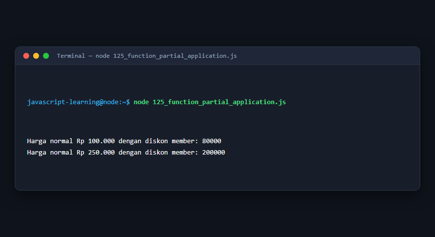

---

### 126. Closure untuk counter

**Tujuan Pembelajaran:** Memahami konsep dan implementasi praktis dari materi Closure untuk counter.

**Konsep Utama:** Program ini mendemonstrasikan prinsip Closure untuk counter secara komprehensif, terstruktur, dan bersih sesuai standar pemrograman JavaScript modern.

**Penjelasan Source Code:** Program mengeksekusi instruksi yang telah dilengkapi dengan komentar kode edukatif berbahasa Indonesia. Setiap blok logika penting dijelaskan secara rinci agar alur kerja program mudah dipahami oleh pembelajar.

**Source Code:** [126_closure_counter.js](126_closure_counter.js)

**Cara Menjalankan:**
```bash
node 126_closure_counter.js
```

**Hasil yang Diharapkan:** Program akan mencetak log hasil evaluasi, perhitungan, atau pemrosesan data ke terminal secara akurat.

**Hasil Eksekusi:**

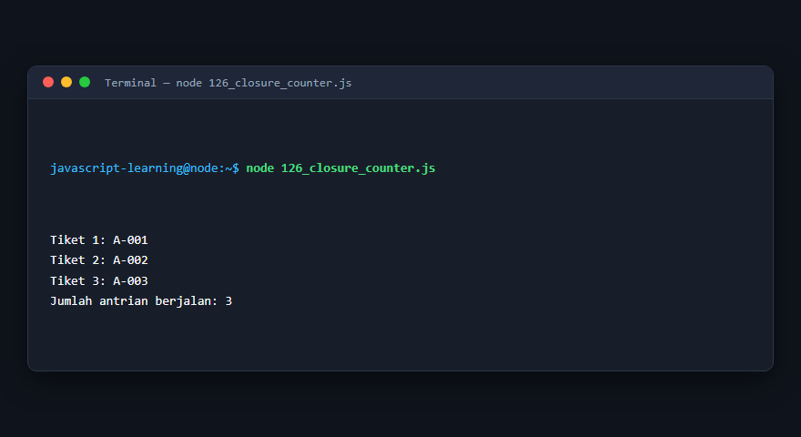

---

### 127. Function factory

**Tujuan Pembelajaran:** Memahami konsep dan implementasi praktis dari materi Function factory.

**Konsep Utama:** Program ini mendemonstrasikan prinsip Function factory secara komprehensif, terstruktur, dan bersih sesuai standar pemrograman JavaScript modern.

**Penjelasan Source Code:** Program mengeksekusi instruksi yang telah dilengkapi dengan komentar kode edukatif berbahasa Indonesia. Setiap blok logika penting dijelaskan secara rinci agar alur kerja program mudah dipahami oleh pembelajar.

**Source Code:** [127_closure_factory.js](127_closure_factory.js)

**Cara Menjalankan:**
```bash
node 127_closure_factory.js
```

**Hasil yang Diharapkan:** Program akan mencetak log hasil evaluasi, perhitungan, atau pemrosesan data ke terminal secara akurat.

**Hasil Eksekusi:**

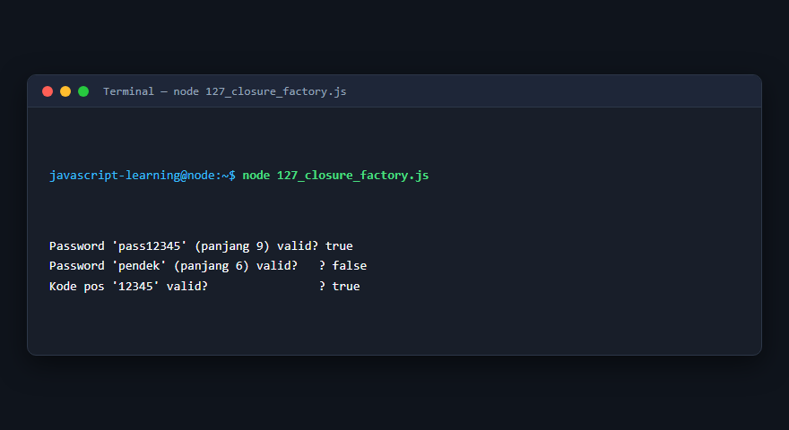

---

### 128. Pola callback

**Tujuan Pembelajaran:** Memahami konsep dan implementasi praktis dari materi Pola callback.

**Konsep Utama:** Program ini mendemonstrasikan prinsip Pola callback secara komprehensif, terstruktur, dan bersih sesuai standar pemrograman JavaScript modern.

**Penjelasan Source Code:** Program mengeksekusi instruksi yang telah dilengkapi dengan komentar kode edukatif berbahasa Indonesia. Setiap blok logika penting dijelaskan secara rinci agar alur kerja program mudah dipahami oleh pembelajar.

**Source Code:** [128_callback_patterns.js](128_callback_patterns.js)

**Cara Menjalankan:**
```bash
node 128_callback_patterns.js
```

**Hasil yang Diharapkan:** Program akan mencetak log hasil evaluasi, perhitungan, atau pemrosesan data ke terminal secara akurat.

**Hasil Eksekusi:**

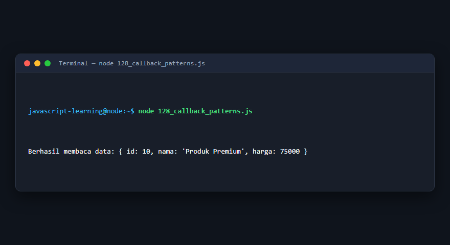

---

### 129. Penanganan error pada callback

**Tujuan Pembelajaran:** Memahami konsep dan implementasi praktis dari materi Penanganan error pada callback.

**Konsep Utama:** Program ini mendemonstrasikan prinsip Penanganan error pada callback secara komprehensif, terstruktur, dan bersih sesuai standar pemrograman JavaScript modern.

**Penjelasan Source Code:** Program mengeksekusi instruksi yang telah dilengkapi dengan komentar kode edukatif berbahasa Indonesia. Setiap blok logika penting dijelaskan secara rinci agar alur kerja program mudah dipahami oleh pembelajar.

**Source Code:** [129_callback_error_handling.js](129_callback_error_handling.js)

**Cara Menjalankan:**
```bash
node 129_callback_error_handling.js
```

**Hasil yang Diharapkan:** Program akan mencetak log hasil evaluasi, perhitungan, atau pemrosesan data ke terminal secara akurat.

**Hasil Eksekusi:**

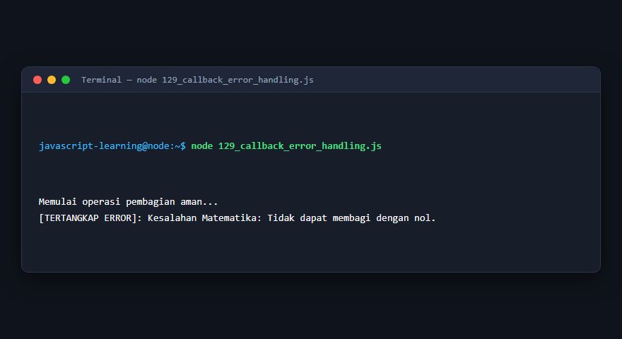

---

### 130. Function memoization

**Tujuan Pembelajaran:** Memahami konsep dan implementasi praktis dari materi Function memoization.

**Konsep Utama:** Program ini mendemonstrasikan prinsip Function memoization secara komprehensif, terstruktur, dan bersih sesuai standar pemrograman JavaScript modern.

**Penjelasan Source Code:** Program mengeksekusi instruksi yang telah dilengkapi dengan komentar kode edukatif berbahasa Indonesia. Setiap blok logika penting dijelaskan secara rinci agar alur kerja program mudah dipahami oleh pembelajar.

**Source Code:** [130_function_memoization.js](130_function_memoization.js)

**Cara Menjalankan:**
```bash
node 130_function_memoization.js
```

**Hasil yang Diharapkan:** Program akan mencetak log hasil evaluasi, perhitungan, atau pemrosesan data ke terminal secara akurat.

**Hasil Eksekusi:**

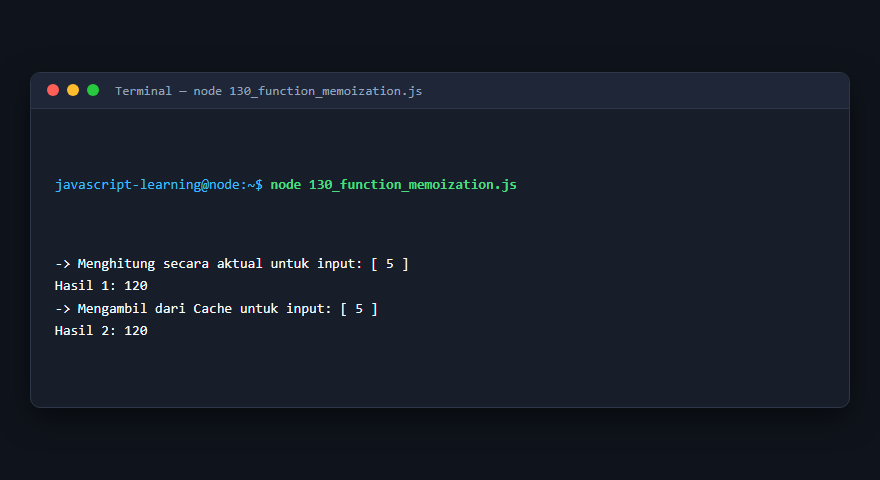

---

### 131. Rekursi dan closure

**Tujuan Pembelajaran:** Memahami konsep dan implementasi praktis dari materi Rekursi dan closure.

**Konsep Utama:** Program ini mendemonstrasikan prinsip Rekursi dan closure secara komprehensif, terstruktur, dan bersih sesuai standar pemrograman JavaScript modern.

**Penjelasan Source Code:** Program mengeksekusi instruksi yang telah dilengkapi dengan komentar kode edukatif berbahasa Indonesia. Setiap blok logika penting dijelaskan secara rinci agar alur kerja program mudah dipahami oleh pembelajar.

**Source Code:** [131_recursive_closures.js](131_recursive_closures.js)

**Cara Menjalankan:**
```bash
node 131_recursive_closures.js
```

**Hasil yang Diharapkan:** Program akan mencetak log hasil evaluasi, perhitungan, atau pemrosesan data ke terminal secara akurat.

**Hasil Eksekusi:**

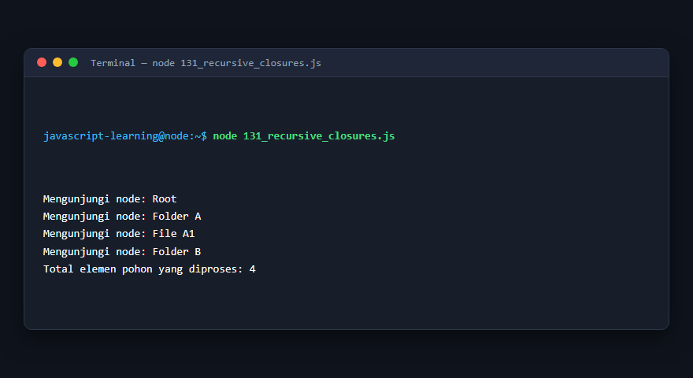

---

### 132. Keyword `this`

**Tujuan Pembelajaran:** Memahami konsep dan implementasi praktis dari materi Keyword `this`.

**Konsep Utama:** Program ini mendemonstrasikan prinsip Keyword `this` secara komprehensif, terstruktur, dan bersih sesuai standar pemrograman JavaScript modern.

**Penjelasan Source Code:** Program mengeksekusi instruksi yang telah dilengkapi dengan komentar kode edukatif berbahasa Indonesia. Setiap blok logika penting dijelaskan secara rinci agar alur kerja program mudah dipahami oleh pembelajar.

**Source Code:** [132_this_keyword.js](132_this_keyword.js)

**Cara Menjalankan:**
```bash
node 132_this_keyword.js
```

**Hasil yang Diharapkan:** Program akan mencetak log hasil evaluasi, perhitungan, atau pemrosesan data ke terminal secara akurat.

**Hasil Eksekusi:**


---

### 133. Binding `this`

**Tujuan Pembelajaran:** Memahami konsep dan implementasi praktis dari materi Binding `this`.

**Konsep Utama:** Program ini mendemonstrasikan prinsip Binding `this` secara komprehensif, terstruktur, dan bersih sesuai standar pemrograman JavaScript modern.

**Penjelasan Source Code:** Program mengeksekusi instruksi yang telah dilengkapi dengan komentar kode edukatif berbahasa Indonesia. Setiap blok logika penting dijelaskan secara rinci agar alur kerja program mudah dipahami oleh pembelajar.

**Source Code:** [133_this_binding.js](133_this_binding.js)

**Cara Menjalankan:**
```bash
node 133_this_binding.js
```

**Hasil yang Diharapkan:** Program akan mencetak log hasil evaluasi, perhitungan, atau pemrosesan data ke terminal secara akurat.

**Hasil Eksekusi:**


---

### 134. `call()`, `apply()`, dan `bind()`

**Tujuan Pembelajaran:** Memahami konsep dan implementasi praktis dari materi `call()`, `apply()`, dan `bind()`.

**Konsep Utama:** Program ini mendemonstrasikan prinsip `call()`, `apply()`, dan `bind()` secara komprehensif, terstruktur, dan bersih sesuai standar pemrograman JavaScript modern.

**Penjelasan Source Code:** Program mengeksekusi instruksi yang telah dilengkapi dengan komentar kode edukatif berbahasa Indonesia. Setiap blok logika penting dijelaskan secara rinci agar alur kerja program mudah dipahami oleh pembelajar.

**Source Code:** [134_call_apply_bind.js](134_call_apply_bind.js)

**Cara Menjalankan:**
```bash
node 134_call_apply_bind.js
```

**Hasil yang Diharapkan:** Program akan mencetak log hasil evaluasi, perhitungan, atau pemrosesan data ke terminal secara akurat.

**Hasil Eksekusi:**


---

### 135. Function prototype

**Tujuan Pembelajaran:** Memahami konsep dan implementasi praktis dari materi Function prototype.

**Konsep Utama:** Program ini mendemonstrasikan prinsip Function prototype secara komprehensif, terstruktur, dan bersih sesuai standar pemrograman JavaScript modern.

**Penjelasan Source Code:** Program mengeksekusi instruksi yang telah dilengkapi dengan komentar kode edukatif berbahasa Indonesia. Setiap blok logika penting dijelaskan secara rinci agar alur kerja program mudah dipahami oleh pembelajar.

**Source Code:** [135_function_prototype.js](135_function_prototype.js)

**Cara Menjalankan:**
```bash
node 135_function_prototype.js
```

**Hasil yang Diharapkan:** Program akan mencetak log hasil evaluasi, perhitungan, atau pemrosesan data ke terminal secara akurat.

**Hasil Eksekusi:**

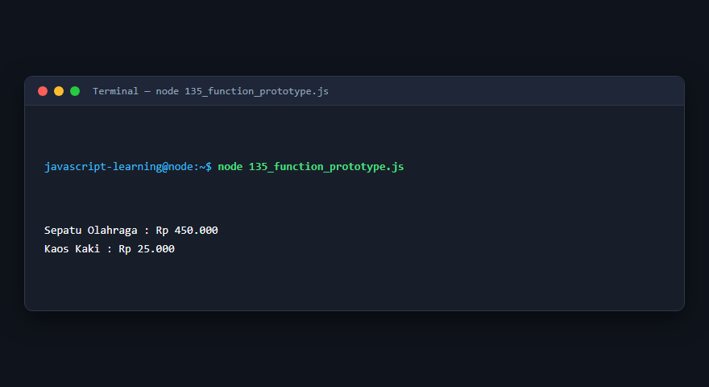

---

### 136. Generator function

**Tujuan Pembelajaran:** Memahami konsep dan implementasi praktis dari materi Generator function.

**Konsep Utama:** Program ini mendemonstrasikan prinsip Generator function secara komprehensif, terstruktur, dan bersih sesuai standar pemrograman JavaScript modern.

**Penjelasan Source Code:** Program mengeksekusi instruksi yang telah dilengkapi dengan komentar kode edukatif berbahasa Indonesia. Setiap blok logika penting dijelaskan secara rinci agar alur kerja program mudah dipahami oleh pembelajar.

**Source Code:** [136_generator_function.js](136_generator_function.js)

**Cara Menjalankan:**
```bash
node 136_generator_function.js
```

**Hasil yang Diharapkan:** Program akan mencetak log hasil evaluasi, perhitungan, atau pemrosesan data ke terminal secara akurat.

**Hasil Eksekusi:**

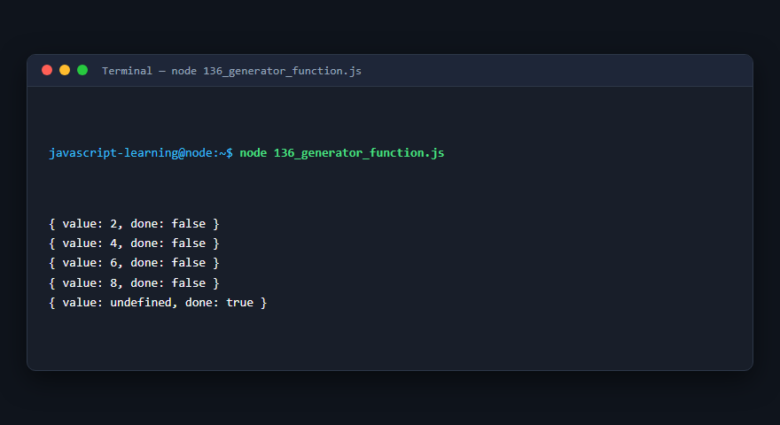

---

### 137. Keyword `yield`

**Tujuan Pembelajaran:** Memahami konsep dan implementasi praktis dari materi Keyword `yield`.

**Konsep Utama:** Program ini mendemonstrasikan prinsip Keyword `yield` secara komprehensif, terstruktur, dan bersih sesuai standar pemrograman JavaScript modern.

**Penjelasan Source Code:** Program mengeksekusi instruksi yang telah dilengkapi dengan komentar kode edukatif berbahasa Indonesia. Setiap blok logika penting dijelaskan secara rinci agar alur kerja program mudah dipahami oleh pembelajar.

**Source Code:** [137_yield_keyword.js](137_yield_keyword.js)

**Cara Menjalankan:**
```bash
node 137_yield_keyword.js
```

**Hasil yang Diharapkan:** Program akan mencetak log hasil evaluasi, perhitungan, atau pemrosesan data ke terminal secara akurat.

**Hasil Eksekusi:**


---

### 138. Iterator protocol

**Tujuan Pembelajaran:** Memahami konsep dan implementasi praktis dari materi Iterator protocol.

**Konsep Utama:** Program ini mendemonstrasikan prinsip Iterator protocol secara komprehensif, terstruktur, dan bersih sesuai standar pemrograman JavaScript modern.

**Penjelasan Source Code:** Program mengeksekusi instruksi yang telah dilengkapi dengan komentar kode edukatif berbahasa Indonesia. Setiap blok logika penting dijelaskan secara rinci agar alur kerja program mudah dipahami oleh pembelajar.

**Source Code:** [138_iterator_protocol.js](138_iterator_protocol.js)

**Cara Menjalankan:**
```bash
node 138_iterator_protocol.js
```

**Hasil yang Diharapkan:** Program akan mencetak log hasil evaluasi, perhitungan, atau pemrosesan data ke terminal secara akurat.

**Hasil Eksekusi:**

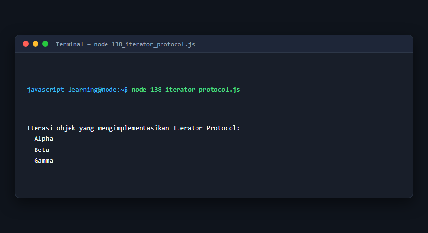

---

### 139. Custom iterator

**Tujuan Pembelajaran:** Memahami konsep dan implementasi praktis dari materi Custom iterator.

**Konsep Utama:** Program ini mendemonstrasikan prinsip Custom iterator secara komprehensif, terstruktur, dan bersih sesuai standar pemrograman JavaScript modern.

**Penjelasan Source Code:** Program mengeksekusi instruksi yang telah dilengkapi dengan komentar kode edukatif berbahasa Indonesia. Setiap blok logika penting dijelaskan secara rinci agar alur kerja program mudah dipahami oleh pembelajar.

**Source Code:** [139_custom_iterator.js](139_custom_iterator.js)

**Cara Menjalankan:**
```bash
node 139_custom_iterator.js
```

**Hasil yang Diharapkan:** Program akan mencetak log hasil evaluasi, perhitungan, atau pemrosesan data ke terminal secara akurat.

**Hasil Eksekusi:**

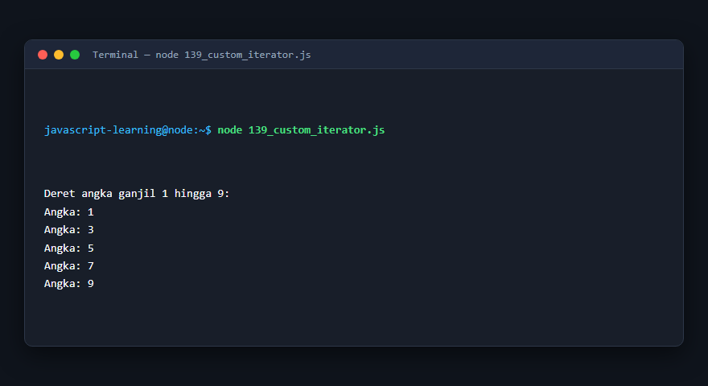

---

### 140. Custom generator

**Tujuan Pembelajaran:** Memahami konsep dan implementasi praktis dari materi Custom generator.

**Konsep Utama:** Program ini mendemonstrasikan prinsip Custom generator secara komprehensif, terstruktur, dan bersih sesuai standar pemrograman JavaScript modern.

**Penjelasan Source Code:** Program mengeksekusi instruksi yang telah dilengkapi dengan komentar kode edukatif berbahasa Indonesia. Setiap blok logika penting dijelaskan secara rinci agar alur kerja program mudah dipahami oleh pembelajar.

**Source Code:** [140_custom_generator.js](140_custom_generator.js)

**Cara Menjalankan:**
```bash
node 140_custom_generator.js
```

**Hasil yang Diharapkan:** Program akan mencetak log hasil evaluasi, perhitungan, atau pemrosesan data ke terminal secara akurat.

**Hasil Eksekusi:**

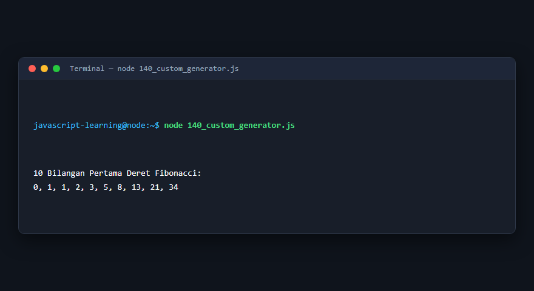

---

## Ringkasan Modul

Modul 9 (Konsep Fungsi Lanjutan) telah menyajikan pembelajaran berbasis praktik yang terstruktur. Seluruh program di dalam modul ini dapat dijalankan secara mandiri tanpa saling membebani dependensi yang rumit, dengan fokus mendalam pada pemahaman konsep dan kebiasaan baik penulisan kode.
