# Modul 10: Object-Oriented Programming (OOP)

## Deskripsi Modul
Modul ini menjelaskan konsep Object-Oriented Programming (OOP) berbasis Prototype dan sintaks Class modern ES6, inheritance, polymorphism, encapsulation, dan mixins.

## Tujuan Pembelajaran
Mampu merancang hierarki kelas perangkat lunak yang terstruktur, maintainable, dan memanfaatkan prinsip-prinsip OOP.

## Daftar Submodul & Materi

- [141_constructor_function.js](141_constructor_function.js) : Constructor function
- [142_object_create.js](142_object_create.js) : `Object.create()`
- [143_prototype_basic.js](143_prototype_basic.js) : Prototype
- [144_prototype_chain.js](144_prototype_chain.js) : Prototype chain
- [145_class_basic.js](145_class_basic.js) : Class dan object
- [146_class_constructor.js](146_class_constructor.js) : Constructor dalam class
- [147_instance_methods.js](147_instance_methods.js) : Instance methods
- [148_static_methods.js](148_static_methods.js) : Static methods
- [149_getters_setters.js](149_getters_setters.js) : Getter dan setter
- [150_private_fields.js](150_private_fields.js) : Private class fields
- [151_class_inheritance.js](151_class_inheritance.js) : Class inheritance
- [152_super_keyword.js](152_super_keyword.js) : Keyword `super`
- [153_method_overriding.js](153_method_overriding.js) : Method overriding
- [154_polymorphism.js](154_polymorphism.js) : Polymorphism
- [155_composition.js](155_composition.js) : Composition
- [156_aggregation.js](156_aggregation.js) : Aggregation
- [157_abstract_class_pattern.js](157_abstract_class_pattern.js) : Pola abstract class
- [158_mixins.js](158_mixins.js) : Mixins
- [159_instanceof_operator.js](159_instanceof_operator.js) : Operator `instanceof`
- [160_symbol_properties.js](160_symbol_properties.js) : Symbol sebagai properti object

---

## Penjelasan Detail Setiap Submodul

### 141. Constructor function

**Tujuan Pembelajaran:** Memahami konsep dan implementasi praktis dari materi Constructor function.

**Konsep Utama:** Program ini mendemonstrasikan prinsip Constructor function secara komprehensif, terstruktur, dan bersih sesuai standar pemrograman JavaScript modern.

**Penjelasan Source Code:** Program mengeksekusi instruksi yang telah dilengkapi dengan komentar kode edukatif berbahasa Indonesia. Setiap blok logika penting dijelaskan secara rinci agar alur kerja program mudah dipahami oleh pembelajar.

**Source Code:** [141_constructor_function.js](141_constructor_function.js)

**Cara Menjalankan:**
```bash
node 141_constructor_function.js
```

**Hasil yang Diharapkan:** Program akan mencetak log hasil evaluasi, perhitungan, atau pemrosesan data ke terminal secara akurat.

**Hasil Eksekusi:**

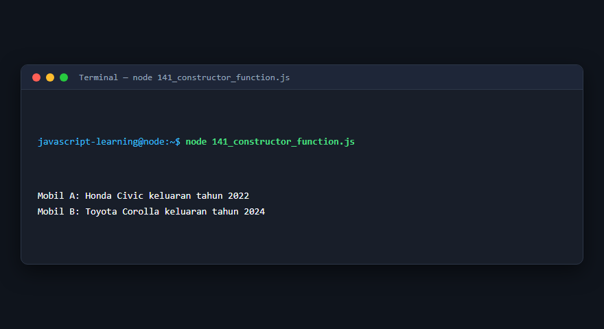

---

### 142. `Object.create()`

**Tujuan Pembelajaran:** Memahami konsep dan implementasi praktis dari materi `Object.create()`.

**Konsep Utama:** Program ini mendemonstrasikan prinsip `Object.create()` secara komprehensif, terstruktur, dan bersih sesuai standar pemrograman JavaScript modern.

**Penjelasan Source Code:** Program mengeksekusi instruksi yang telah dilengkapi dengan komentar kode edukatif berbahasa Indonesia. Setiap blok logika penting dijelaskan secara rinci agar alur kerja program mudah dipahami oleh pembelajar.

**Source Code:** [142_object_create.js](142_object_create.js)

**Cara Menjalankan:**
```bash
node 142_object_create.js
```

**Hasil yang Diharapkan:** Program akan mencetak log hasil evaluasi, perhitungan, atau pemrosesan data ke terminal secara akurat.

**Hasil Eksekusi:**


---

### 143. Prototype

**Tujuan Pembelajaran:** Memahami konsep dan implementasi praktis dari materi Prototype.

**Konsep Utama:** Program ini mendemonstrasikan prinsip Prototype secara komprehensif, terstruktur, dan bersih sesuai standar pemrograman JavaScript modern.

**Penjelasan Source Code:** Program mengeksekusi instruksi yang telah dilengkapi dengan komentar kode edukatif berbahasa Indonesia. Setiap blok logika penting dijelaskan secara rinci agar alur kerja program mudah dipahami oleh pembelajar.

**Source Code:** [143_prototype_basic.js](143_prototype_basic.js)

**Cara Menjalankan:**
```bash
node 143_prototype_basic.js
```

**Hasil yang Diharapkan:** Program akan mencetak log hasil evaluasi, perhitungan, atau pemrosesan data ke terminal secara akurat.

**Hasil Eksekusi:**

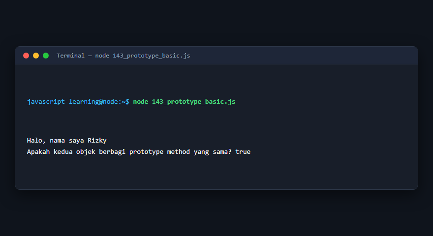

---

### 144. Prototype chain

**Tujuan Pembelajaran:** Memahami konsep dan implementasi praktis dari materi Prototype chain.

**Konsep Utama:** Program ini mendemonstrasikan prinsip Prototype chain secara komprehensif, terstruktur, dan bersih sesuai standar pemrograman JavaScript modern.

**Penjelasan Source Code:** Program mengeksekusi instruksi yang telah dilengkapi dengan komentar kode edukatif berbahasa Indonesia. Setiap blok logika penting dijelaskan secara rinci agar alur kerja program mudah dipahami oleh pembelajar.

**Source Code:** [144_prototype_chain.js](144_prototype_chain.js)

**Cara Menjalankan:**
```bash
node 144_prototype_chain.js
```

**Hasil yang Diharapkan:** Program akan mencetak log hasil evaluasi, perhitungan, atau pemrosesan data ke terminal secara akurat.

**Hasil Eksekusi:**

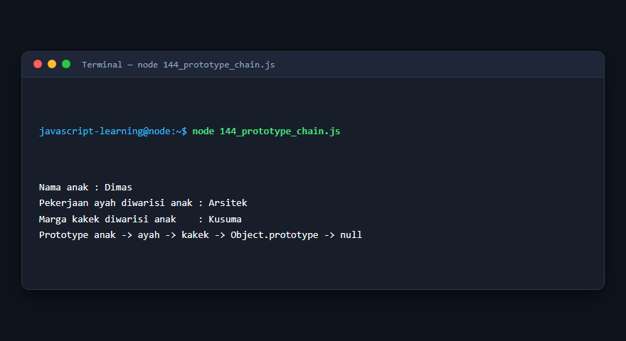

---

### 145. Class dan object

**Tujuan Pembelajaran:** Memahami konsep dan implementasi praktis dari materi Class dan object.

**Konsep Utama:** Program ini mendemonstrasikan prinsip Class dan object secara komprehensif, terstruktur, dan bersih sesuai standar pemrograman JavaScript modern.

**Penjelasan Source Code:** Program mengeksekusi instruksi yang telah dilengkapi dengan komentar kode edukatif berbahasa Indonesia. Setiap blok logika penting dijelaskan secara rinci agar alur kerja program mudah dipahami oleh pembelajar.

**Source Code:** [145_class_basic.js](145_class_basic.js)

**Cara Menjalankan:**
```bash
node 145_class_basic.js
```

**Hasil yang Diharapkan:** Program akan mencetak log hasil evaluasi, perhitungan, atau pemrosesan data ke terminal secara akurat.

**Hasil Eksekusi:**

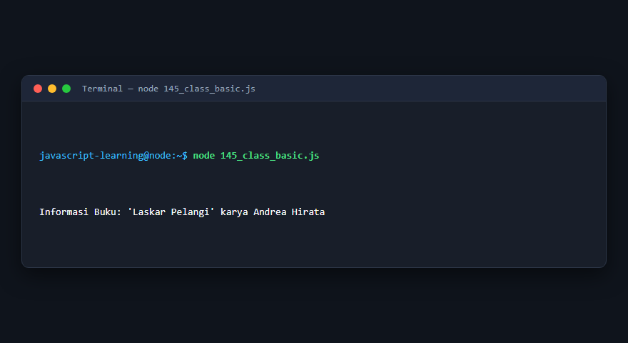

---

### 146. Constructor dalam class

**Tujuan Pembelajaran:** Memahami konsep dan implementasi praktis dari materi Constructor dalam class.

**Konsep Utama:** Program ini mendemonstrasikan prinsip Constructor dalam class secara komprehensif, terstruktur, dan bersih sesuai standar pemrograman JavaScript modern.

**Penjelasan Source Code:** Program mengeksekusi instruksi yang telah dilengkapi dengan komentar kode edukatif berbahasa Indonesia. Setiap blok logika penting dijelaskan secara rinci agar alur kerja program mudah dipahami oleh pembelajar.

**Source Code:** [146_class_constructor.js](146_class_constructor.js)

**Cara Menjalankan:**
```bash
node 146_class_constructor.js
```

**Hasil yang Diharapkan:** Program akan mencetak log hasil evaluasi, perhitungan, atau pemrosesan data ke terminal secara akurat.

**Hasil Eksekusi:**

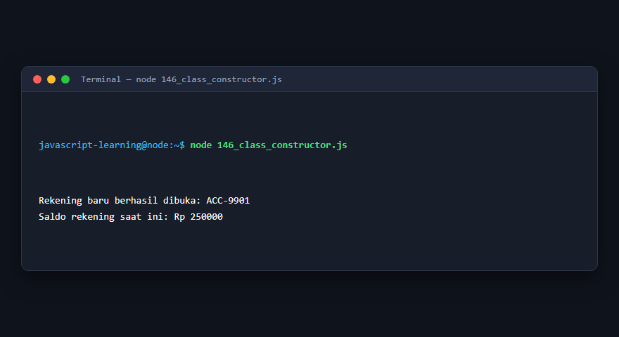

---

### 147. Instance methods

**Tujuan Pembelajaran:** Memahami konsep dan implementasi praktis dari materi Instance methods.

**Konsep Utama:** Program ini mendemonstrasikan prinsip Instance methods secara komprehensif, terstruktur, dan bersih sesuai standar pemrograman JavaScript modern.

**Penjelasan Source Code:** Program mengeksekusi instruksi yang telah dilengkapi dengan komentar kode edukatif berbahasa Indonesia. Setiap blok logika penting dijelaskan secara rinci agar alur kerja program mudah dipahami oleh pembelajar.

**Source Code:** [147_instance_methods.js](147_instance_methods.js)

**Cara Menjalankan:**
```bash
node 147_instance_methods.js
```

**Hasil yang Diharapkan:** Program akan mencetak log hasil evaluasi, perhitungan, atau pemrosesan data ke terminal secara akurat.

**Hasil Eksekusi:**

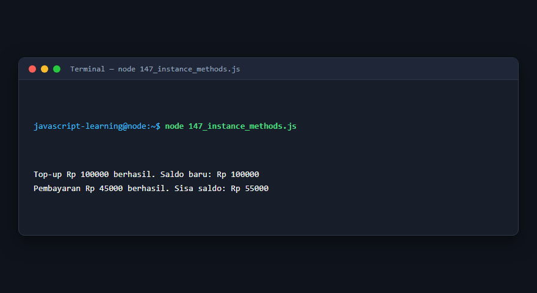

---

### 148. Static methods

**Tujuan Pembelajaran:** Memahami konsep dan implementasi praktis dari materi Static methods.

**Konsep Utama:** Program ini mendemonstrasikan prinsip Static methods secara komprehensif, terstruktur, dan bersih sesuai standar pemrograman JavaScript modern.

**Penjelasan Source Code:** Program mengeksekusi instruksi yang telah dilengkapi dengan komentar kode edukatif berbahasa Indonesia. Setiap blok logika penting dijelaskan secara rinci agar alur kerja program mudah dipahami oleh pembelajar.

**Source Code:** [148_static_methods.js](148_static_methods.js)

**Cara Menjalankan:**
```bash
node 148_static_methods.js
```

**Hasil yang Diharapkan:** Program akan mencetak log hasil evaluasi, perhitungan, atau pemrosesan data ke terminal secara akurat.

**Hasil Eksekusi:**

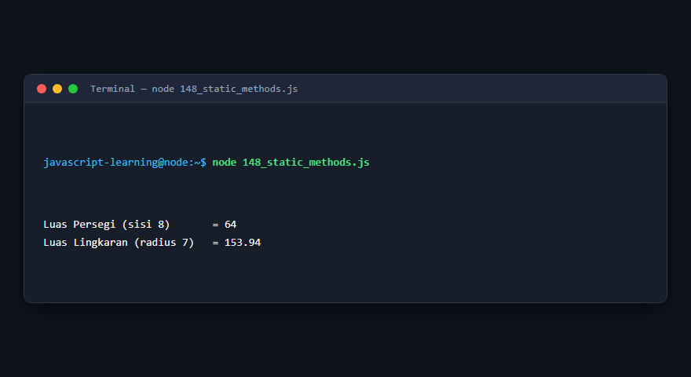

---

### 149. Getter dan setter

**Tujuan Pembelajaran:** Memahami konsep dan implementasi praktis dari materi Getter dan setter.

**Konsep Utama:** Program ini mendemonstrasikan prinsip Getter dan setter secara komprehensif, terstruktur, dan bersih sesuai standar pemrograman JavaScript modern.

**Penjelasan Source Code:** Program mengeksekusi instruksi yang telah dilengkapi dengan komentar kode edukatif berbahasa Indonesia. Setiap blok logika penting dijelaskan secara rinci agar alur kerja program mudah dipahami oleh pembelajar.

**Source Code:** [149_getters_setters.js](149_getters_setters.js)

**Cara Menjalankan:**
```bash
node 149_getters_setters.js
```

**Hasil yang Diharapkan:** Program akan mencetak log hasil evaluasi, perhitungan, atau pemrosesan data ke terminal secara akurat.

**Hasil Eksekusi:**

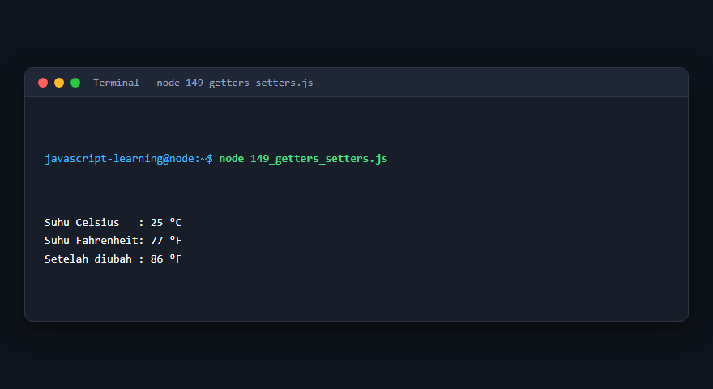

---

### 150. Private class fields

**Tujuan Pembelajaran:** Memahami konsep dan implementasi praktis dari materi Private class fields.

**Konsep Utama:** Program ini mendemonstrasikan prinsip Private class fields secara komprehensif, terstruktur, dan bersih sesuai standar pemrograman JavaScript modern.

**Penjelasan Source Code:** Program mengeksekusi instruksi yang telah dilengkapi dengan komentar kode edukatif berbahasa Indonesia. Setiap blok logika penting dijelaskan secara rinci agar alur kerja program mudah dipahami oleh pembelajar.

**Source Code:** [150_private_fields.js](150_private_fields.js)

**Cara Menjalankan:**
```bash
node 150_private_fields.js
```

**Hasil yang Diharapkan:** Program akan mencetak log hasil evaluasi, perhitungan, atau pemrosesan data ke terminal secara akurat.

**Hasil Eksekusi:**

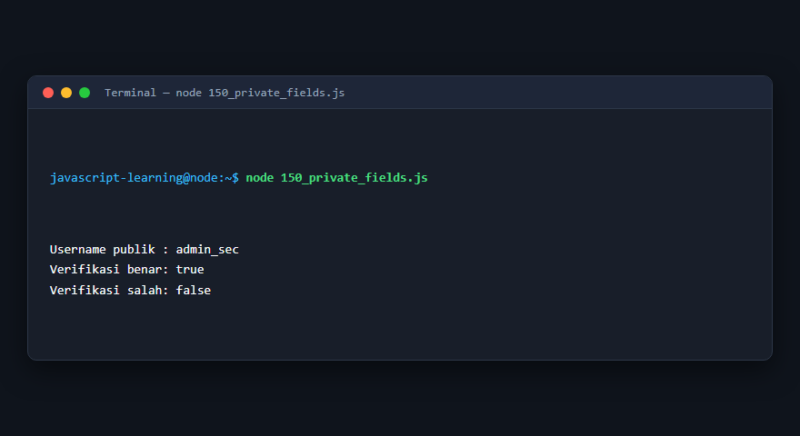

---

### 151. Class inheritance

**Tujuan Pembelajaran:** Memahami konsep dan implementasi praktis dari materi Class inheritance.

**Konsep Utama:** Program ini mendemonstrasikan prinsip Class inheritance secara komprehensif, terstruktur, dan bersih sesuai standar pemrograman JavaScript modern.

**Penjelasan Source Code:** Program mengeksekusi instruksi yang telah dilengkapi dengan komentar kode edukatif berbahasa Indonesia. Setiap blok logika penting dijelaskan secara rinci agar alur kerja program mudah dipahami oleh pembelajar.

**Source Code:** [151_class_inheritance.js](151_class_inheritance.js)

**Cara Menjalankan:**
```bash
node 151_class_inheritance.js
```

**Hasil yang Diharapkan:** Program akan mencetak log hasil evaluasi, perhitungan, atau pemrosesan data ke terminal secara akurat.

**Hasil Eksekusi:**

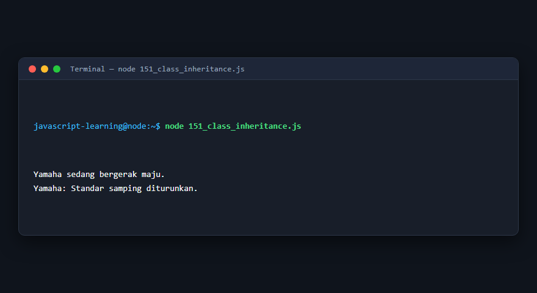

---

### 152. Keyword `super`

**Tujuan Pembelajaran:** Memahami konsep dan implementasi praktis dari materi Keyword `super`.

**Konsep Utama:** Program ini mendemonstrasikan prinsip Keyword `super` secara komprehensif, terstruktur, dan bersih sesuai standar pemrograman JavaScript modern.

**Penjelasan Source Code:** Program mengeksekusi instruksi yang telah dilengkapi dengan komentar kode edukatif berbahasa Indonesia. Setiap blok logika penting dijelaskan secara rinci agar alur kerja program mudah dipahami oleh pembelajar.

**Source Code:** [152_super_keyword.js](152_super_keyword.js)

**Cara Menjalankan:**
```bash
node 152_super_keyword.js
```

**Hasil yang Diharapkan:** Program akan mencetak log hasil evaluasi, perhitungan, atau pemrosesan data ke terminal secara akurat.

**Hasil Eksekusi:**


---

### 153. Method overriding

**Tujuan Pembelajaran:** Memahami konsep dan implementasi praktis dari materi Method overriding.

**Konsep Utama:** Program ini mendemonstrasikan prinsip Method overriding secara komprehensif, terstruktur, dan bersih sesuai standar pemrograman JavaScript modern.

**Penjelasan Source Code:** Program mengeksekusi instruksi yang telah dilengkapi dengan komentar kode edukatif berbahasa Indonesia. Setiap blok logika penting dijelaskan secara rinci agar alur kerja program mudah dipahami oleh pembelajar.

**Source Code:** [153_method_overriding.js](153_method_overriding.js)

**Cara Menjalankan:**
```bash
node 153_method_overriding.js
```

**Hasil yang Diharapkan:** Program akan mencetak log hasil evaluasi, perhitungan, atau pemrosesan data ke terminal secara akurat.

**Hasil Eksekusi:**

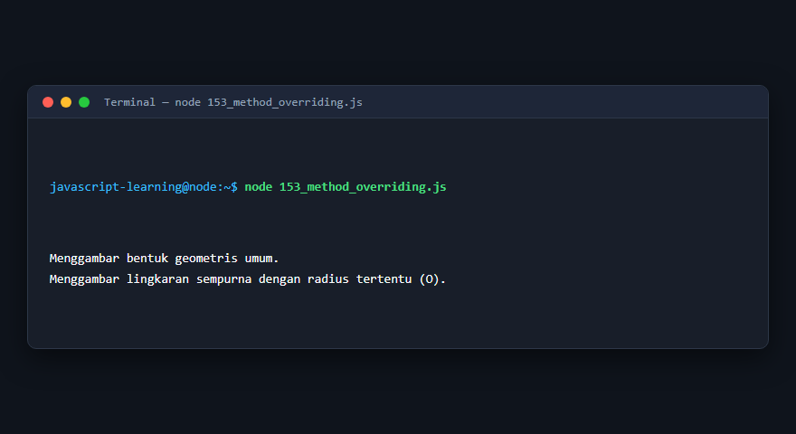

---

### 154. Polymorphism

**Tujuan Pembelajaran:** Memahami konsep dan implementasi praktis dari materi Polymorphism.

**Konsep Utama:** Program ini mendemonstrasikan prinsip Polymorphism secara komprehensif, terstruktur, dan bersih sesuai standar pemrograman JavaScript modern.

**Penjelasan Source Code:** Program mengeksekusi instruksi yang telah dilengkapi dengan komentar kode edukatif berbahasa Indonesia. Setiap blok logika penting dijelaskan secara rinci agar alur kerja program mudah dipahami oleh pembelajar.

**Source Code:** [154_polymorphism.js](154_polymorphism.js)

**Cara Menjalankan:**
```bash
node 154_polymorphism.js
```

**Hasil yang Diharapkan:** Program akan mencetak log hasil evaluasi, perhitungan, atau pemrosesan data ke terminal secara akurat.

**Hasil Eksekusi:**

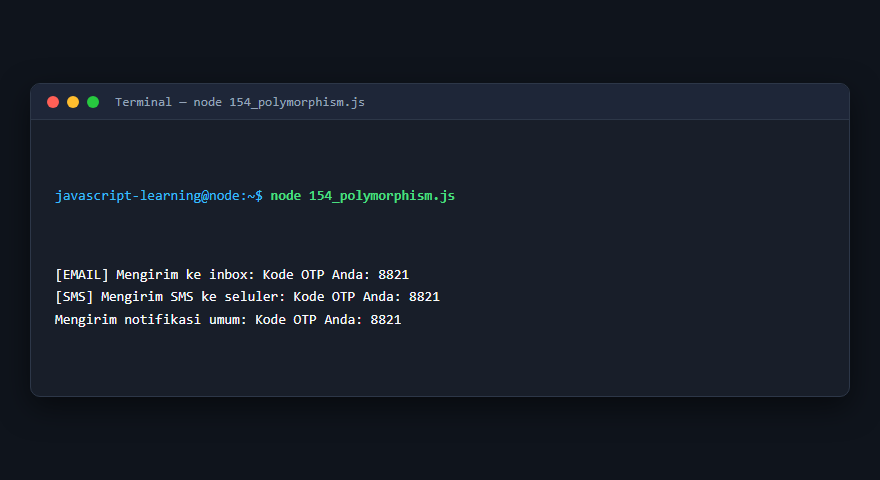

---

### 155. Composition

**Tujuan Pembelajaran:** Memahami konsep dan implementasi praktis dari materi Composition.

**Konsep Utama:** Program ini mendemonstrasikan prinsip Composition secara komprehensif, terstruktur, dan bersih sesuai standar pemrograman JavaScript modern.

**Penjelasan Source Code:** Program mengeksekusi instruksi yang telah dilengkapi dengan komentar kode edukatif berbahasa Indonesia. Setiap blok logika penting dijelaskan secara rinci agar alur kerja program mudah dipahami oleh pembelajar.

**Source Code:** [155_composition.js](155_composition.js)

**Cara Menjalankan:**
```bash
node 155_composition.js
```

**Hasil yang Diharapkan:** Program akan mencetak log hasil evaluasi, perhitungan, atau pemrosesan data ke terminal secara akurat.

**Hasil Eksekusi:**

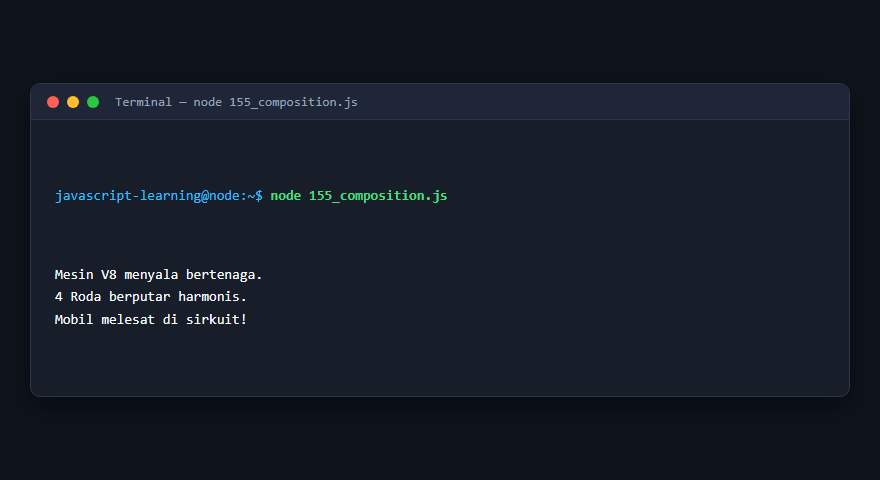

---

### 156. Aggregation

**Tujuan Pembelajaran:** Memahami konsep dan implementasi praktis dari materi Aggregation.

**Konsep Utama:** Program ini mendemonstrasikan prinsip Aggregation secara komprehensif, terstruktur, dan bersih sesuai standar pemrograman JavaScript modern.

**Penjelasan Source Code:** Program mengeksekusi instruksi yang telah dilengkapi dengan komentar kode edukatif berbahasa Indonesia. Setiap blok logika penting dijelaskan secara rinci agar alur kerja program mudah dipahami oleh pembelajar.

**Source Code:** [156_aggregation.js](156_aggregation.js)

**Cara Menjalankan:**
```bash
node 156_aggregation.js
```

**Hasil yang Diharapkan:** Program akan mencetak log hasil evaluasi, perhitungan, atau pemrosesan data ke terminal secara akurat.

**Hasil Eksekusi:**

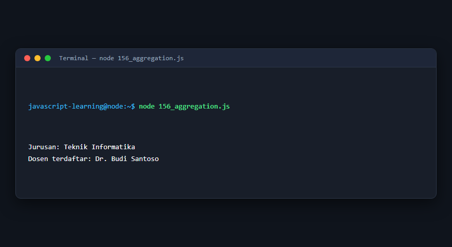

---

### 157. Pola abstract class

**Tujuan Pembelajaran:** Memahami konsep dan implementasi praktis dari materi Pola abstract class.

**Konsep Utama:** Program ini mendemonstrasikan prinsip Pola abstract class secara komprehensif, terstruktur, dan bersih sesuai standar pemrograman JavaScript modern.

**Penjelasan Source Code:** Program mengeksekusi instruksi yang telah dilengkapi dengan komentar kode edukatif berbahasa Indonesia. Setiap blok logika penting dijelaskan secara rinci agar alur kerja program mudah dipahami oleh pembelajar.

**Source Code:** [157_abstract_class_pattern.js](157_abstract_class_pattern.js)

**Cara Menjalankan:**
```bash
node 157_abstract_class_pattern.js
```

**Hasil yang Diharapkan:** Program akan mencetak log hasil evaluasi, perhitungan, atau pemrosesan data ke terminal secara akurat.

**Hasil Eksekusi:**

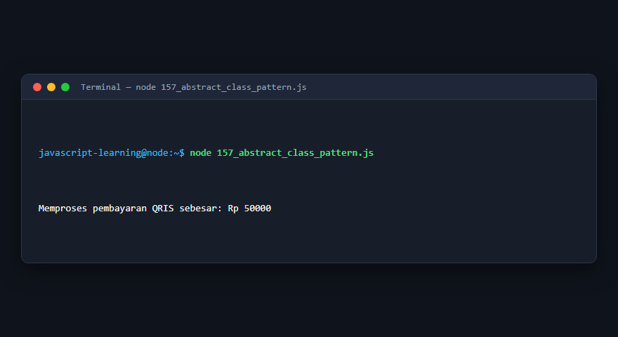

---

### 158. Mixins

**Tujuan Pembelajaran:** Memahami konsep dan implementasi praktis dari materi Mixins.

**Konsep Utama:** Program ini mendemonstrasikan prinsip Mixins secara komprehensif, terstruktur, dan bersih sesuai standar pemrograman JavaScript modern.

**Penjelasan Source Code:** Program mengeksekusi instruksi yang telah dilengkapi dengan komentar kode edukatif berbahasa Indonesia. Setiap blok logika penting dijelaskan secara rinci agar alur kerja program mudah dipahami oleh pembelajar.

**Source Code:** [158_mixins.js](158_mixins.js)

**Cara Menjalankan:**
```bash
node 158_mixins.js
```

**Hasil yang Diharapkan:** Program akan mencetak log hasil evaluasi, perhitungan, atau pemrosesan data ke terminal secara akurat.

**Hasil Eksekusi:**

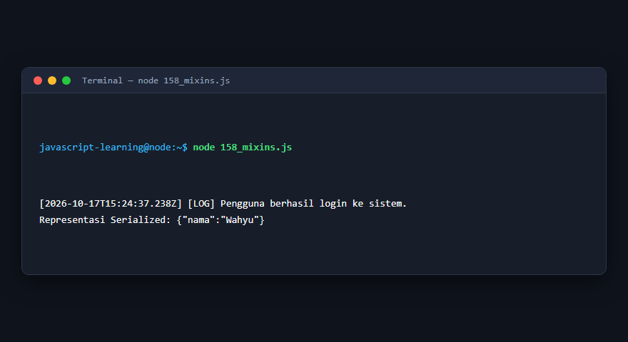

---

### 159. Operator `instanceof`

**Tujuan Pembelajaran:** Memahami konsep dan implementasi praktis dari materi Operator `instanceof`.

**Konsep Utama:** Program ini mendemonstrasikan prinsip Operator `instanceof` secara komprehensif, terstruktur, dan bersih sesuai standar pemrograman JavaScript modern.

**Penjelasan Source Code:** Program mengeksekusi instruksi yang telah dilengkapi dengan komentar kode edukatif berbahasa Indonesia. Setiap blok logika penting dijelaskan secara rinci agar alur kerja program mudah dipahami oleh pembelajar.

**Source Code:** [159_instanceof_operator.js](159_instanceof_operator.js)

**Cara Menjalankan:**
```bash
node 159_instanceof_operator.js
```

**Hasil yang Diharapkan:** Program akan mencetak log hasil evaluasi, perhitungan, atau pemrosesan data ke terminal secara akurat.

**Hasil Eksekusi:**


---

### 160. Symbol sebagai properti object

**Tujuan Pembelajaran:** Memahami konsep dan implementasi praktis dari materi Symbol sebagai properti object.

**Konsep Utama:** Program ini mendemonstrasikan prinsip Symbol sebagai properti object secara komprehensif, terstruktur, dan bersih sesuai standar pemrograman JavaScript modern.

**Penjelasan Source Code:** Program mengeksekusi instruksi yang telah dilengkapi dengan komentar kode edukatif berbahasa Indonesia. Setiap blok logika penting dijelaskan secara rinci agar alur kerja program mudah dipahami oleh pembelajar.

**Source Code:** [160_symbol_properties.js](160_symbol_properties.js)

**Cara Menjalankan:**
```bash
node 160_symbol_properties.js
```

**Hasil yang Diharapkan:** Program akan mencetak log hasil evaluasi, perhitungan, atau pemrosesan data ke terminal secara akurat.

**Hasil Eksekusi:**

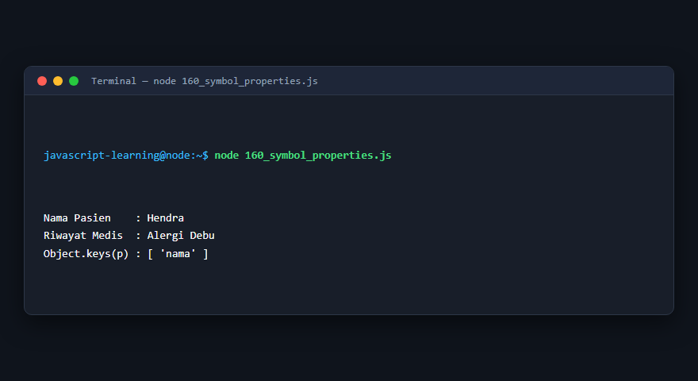

---

## Ringkasan Modul

Modul 10 (Object-Oriented Programming (OOP)) telah menyajikan pembelajaran berbasis praktik yang terstruktur. Seluruh program di dalam modul ini dapat dijalankan secara mandiri tanpa saling membebani dependensi yang rumit, dengan fokus mendalam pada pemahaman konsep dan kebiasaan baik penulisan kode.
