# Modul 11: Built-in Objects dan Fitur Bahasa

## Deskripsi Modul
Modul ini mengulas objek bawaan inti JavaScript (Math, Number, Date, RegExp, JSON), Proxy, Reflect API, dan operator modern.

## Tujuan Pembelajaran
Mampu memanfaatkan library standar JavaScript untuk komputasi matematika, parsing tanggal, validasi regex, dan metaprogramming dengan Proxy.

## Daftar Submodul & Materi

- [161_math_object.js](161_math_object.js) : Object `Math`
- [162_number_object.js](162_number_object.js) : Object `Number`
- [163_bigint_operations.js](163_bigint_operations.js) : Operasi BigInt
- [164_date_object.js](164_date_object.js) : Object `Date`
- [165_regex_basic.js](165_regex_basic.js) : Regular expressions
- [166_regex_groups.js](166_regex_groups.js) : Regex groups
- [167_regex_replacement.js](167_regex_replacement.js) : Regex untuk penggantian teks
- [168_json_parse.js](168_json_parse.js) : `JSON.parse()`
- [169_json_stringify.js](169_json_stringify.js) : `JSON.stringify()`
- [170_map_methods.js](170_map_methods.js) : Metode Map
- [171_set_methods.js](171_set_methods.js) : Metode Set
- [172_weakmap_examples.js](172_weakmap_examples.js) : Penggunaan WeakMap
- [173_weakset_examples.js](173_weakset_examples.js) : Penggunaan WeakSet
- [174_proxy_object.js](174_proxy_object.js) : Object Proxy
- [175_reflect_api.js](175_reflect_api.js) : Reflect API
- [176_property_descriptors.js](176_property_descriptors.js) : Property descriptors
- [177_optional_chaining_advanced.js](177_optional_chaining_advanced.js) : Optional chaining lanjutan
- [178_nullish_assignment.js](178_nullish_assignment.js) : Nullish assignment
- [179_logical_assignment.js](179_logical_assignment.js) : Logical assignment
- [180_structured_clone.js](180_structured_clone.js) : `structuredClone()`

---

## Penjelasan Detail Setiap Submodul

### 161. Object `Math`

**Tujuan Pembelajaran:** Memahami konsep dan implementasi praktis dari materi Object `Math`.

**Konsep Utama:** Program ini mendemonstrasikan prinsip Object `Math` secara komprehensif, terstruktur, dan bersih sesuai standar pemrograman JavaScript modern.

**Penjelasan Source Code:** Program mengeksekusi instruksi yang telah dilengkapi dengan komentar kode edukatif berbahasa Indonesia. Setiap blok logika penting dijelaskan secara rinci agar alur kerja program mudah dipahami oleh pembelajar.

**Source Code:** [161_math_object.js](161_math_object.js)

**Cara Menjalankan:**
```bash
node 161_math_object.js
```

**Hasil yang Diharapkan:** Program akan mencetak log hasil evaluasi, perhitungan, atau pemrosesan data ke terminal secara akurat.

**Hasil Eksekusi:**


---

### 162. Object `Number`

**Tujuan Pembelajaran:** Memahami konsep dan implementasi praktis dari materi Object `Number`.

**Konsep Utama:** Program ini mendemonstrasikan prinsip Object `Number` secara komprehensif, terstruktur, dan bersih sesuai standar pemrograman JavaScript modern.

**Penjelasan Source Code:** Program mengeksekusi instruksi yang telah dilengkapi dengan komentar kode edukatif berbahasa Indonesia. Setiap blok logika penting dijelaskan secara rinci agar alur kerja program mudah dipahami oleh pembelajar.

**Source Code:** [162_number_object.js](162_number_object.js)

**Cara Menjalankan:**
```bash
node 162_number_object.js
```

**Hasil yang Diharapkan:** Program akan mencetak log hasil evaluasi, perhitungan, atau pemrosesan data ke terminal secara akurat.

**Hasil Eksekusi:**


---

### 163. Operasi BigInt

**Tujuan Pembelajaran:** Memahami konsep dan implementasi praktis dari materi Operasi BigInt.

**Konsep Utama:** Program ini mendemonstrasikan prinsip Operasi BigInt secara komprehensif, terstruktur, dan bersih sesuai standar pemrograman JavaScript modern.

**Penjelasan Source Code:** Program mengeksekusi instruksi yang telah dilengkapi dengan komentar kode edukatif berbahasa Indonesia. Setiap blok logika penting dijelaskan secara rinci agar alur kerja program mudah dipahami oleh pembelajar.

**Source Code:** [163_bigint_operations.js](163_bigint_operations.js)

**Cara Menjalankan:**
```bash
node 163_bigint_operations.js
```

**Hasil yang Diharapkan:** Program akan mencetak log hasil evaluasi, perhitungan, atau pemrosesan data ke terminal secara akurat.

**Hasil Eksekusi:**

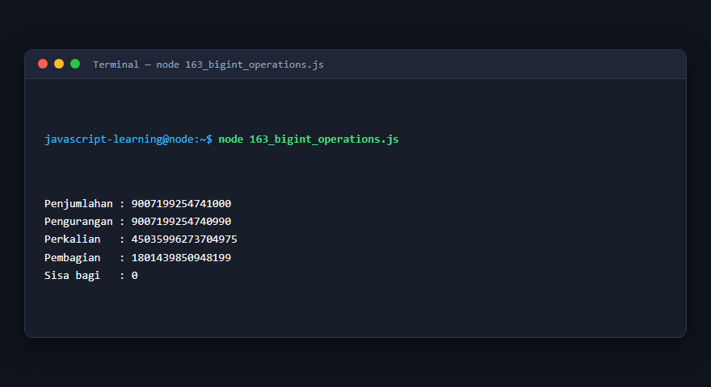

---

### 164. Object `Date`

**Tujuan Pembelajaran:** Memahami konsep dan implementasi praktis dari materi Object `Date`.

**Konsep Utama:** Program ini mendemonstrasikan prinsip Object `Date` secara komprehensif, terstruktur, dan bersih sesuai standar pemrograman JavaScript modern.

**Penjelasan Source Code:** Program mengeksekusi instruksi yang telah dilengkapi dengan komentar kode edukatif berbahasa Indonesia. Setiap blok logika penting dijelaskan secara rinci agar alur kerja program mudah dipahami oleh pembelajar.

**Source Code:** [164_date_object.js](164_date_object.js)

**Cara Menjalankan:**
```bash
node 164_date_object.js
```

**Hasil yang Diharapkan:** Program akan mencetak log hasil evaluasi, perhitungan, atau pemrosesan data ke terminal secara akurat.

**Hasil Eksekusi:**


---

### 165. Regular expressions

**Tujuan Pembelajaran:** Memahami konsep dan implementasi praktis dari materi Regular expressions.

**Konsep Utama:** Program ini mendemonstrasikan prinsip Regular expressions secara komprehensif, terstruktur, dan bersih sesuai standar pemrograman JavaScript modern.

**Penjelasan Source Code:** Program mengeksekusi instruksi yang telah dilengkapi dengan komentar kode edukatif berbahasa Indonesia. Setiap blok logika penting dijelaskan secara rinci agar alur kerja program mudah dipahami oleh pembelajar.

**Source Code:** [165_regex_basic.js](165_regex_basic.js)

**Cara Menjalankan:**
```bash
node 165_regex_basic.js
```

**Hasil yang Diharapkan:** Program akan mencetak log hasil evaluasi, perhitungan, atau pemrosesan data ke terminal secara akurat.

**Hasil Eksekusi:**

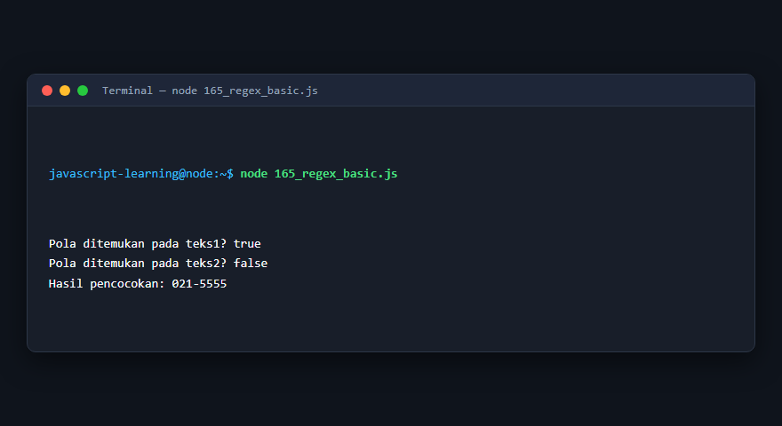

---

### 166. Regex groups

**Tujuan Pembelajaran:** Memahami konsep dan implementasi praktis dari materi Regex groups.

**Konsep Utama:** Program ini mendemonstrasikan prinsip Regex groups secara komprehensif, terstruktur, dan bersih sesuai standar pemrograman JavaScript modern.

**Penjelasan Source Code:** Program mengeksekusi instruksi yang telah dilengkapi dengan komentar kode edukatif berbahasa Indonesia. Setiap blok logika penting dijelaskan secara rinci agar alur kerja program mudah dipahami oleh pembelajar.

**Source Code:** [166_regex_groups.js](166_regex_groups.js)

**Cara Menjalankan:**
```bash
node 166_regex_groups.js
```

**Hasil yang Diharapkan:** Program akan mencetak log hasil evaluasi, perhitungan, atau pemrosesan data ke terminal secara akurat.

**Hasil Eksekusi:**

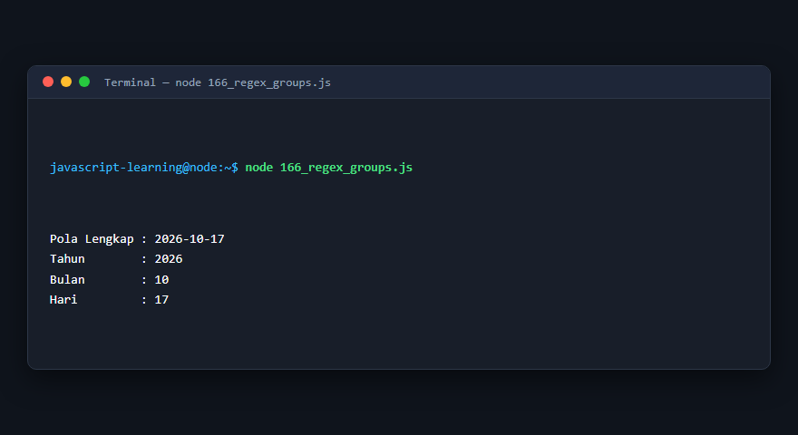

---

### 167. Regex untuk penggantian teks

**Tujuan Pembelajaran:** Memahami konsep dan implementasi praktis dari materi Regex untuk penggantian teks.

**Konsep Utama:** Program ini mendemonstrasikan prinsip Regex untuk penggantian teks secara komprehensif, terstruktur, dan bersih sesuai standar pemrograman JavaScript modern.

**Penjelasan Source Code:** Program mengeksekusi instruksi yang telah dilengkapi dengan komentar kode edukatif berbahasa Indonesia. Setiap blok logika penting dijelaskan secara rinci agar alur kerja program mudah dipahami oleh pembelajar.

**Source Code:** [167_regex_replacement.js](167_regex_replacement.js)

**Cara Menjalankan:**
```bash
node 167_regex_replacement.js
```

**Hasil yang Diharapkan:** Program akan mencetak log hasil evaluasi, perhitungan, atau pemrosesan data ke terminal secara akurat.

**Hasil Eksekusi:**

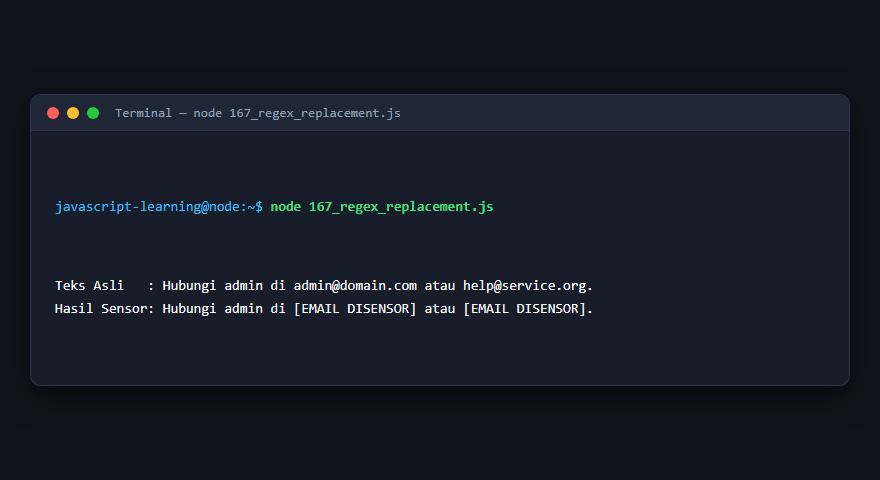

---

### 168. `JSON.parse()`

**Tujuan Pembelajaran:** Memahami konsep dan implementasi praktis dari materi `JSON.parse()`.

**Konsep Utama:** Program ini mendemonstrasikan prinsip `JSON.parse()` secara komprehensif, terstruktur, dan bersih sesuai standar pemrograman JavaScript modern.

**Penjelasan Source Code:** Program mengeksekusi instruksi yang telah dilengkapi dengan komentar kode edukatif berbahasa Indonesia. Setiap blok logika penting dijelaskan secara rinci agar alur kerja program mudah dipahami oleh pembelajar.

**Source Code:** [168_json_parse.js](168_json_parse.js)

**Cara Menjalankan:**
```bash
node 168_json_parse.js
```

**Hasil yang Diharapkan:** Program akan mencetak log hasil evaluasi, perhitungan, atau pemrosesan data ke terminal secara akurat.

**Hasil Eksekusi:**


---

### 169. `JSON.stringify()`

**Tujuan Pembelajaran:** Memahami konsep dan implementasi praktis dari materi `JSON.stringify()`.

**Konsep Utama:** Program ini mendemonstrasikan prinsip `JSON.stringify()` secara komprehensif, terstruktur, dan bersih sesuai standar pemrograman JavaScript modern.

**Penjelasan Source Code:** Program mengeksekusi instruksi yang telah dilengkapi dengan komentar kode edukatif berbahasa Indonesia. Setiap blok logika penting dijelaskan secara rinci agar alur kerja program mudah dipahami oleh pembelajar.

**Source Code:** [169_json_stringify.js](169_json_stringify.js)

**Cara Menjalankan:**
```bash
node 169_json_stringify.js
```

**Hasil yang Diharapkan:** Program akan mencetak log hasil evaluasi, perhitungan, atau pemrosesan data ke terminal secara akurat.

**Hasil Eksekusi:**


---

### 170. Metode Map

**Tujuan Pembelajaran:** Memahami konsep dan implementasi praktis dari materi Metode Map.

**Konsep Utama:** Program ini mendemonstrasikan prinsip Metode Map secara komprehensif, terstruktur, dan bersih sesuai standar pemrograman JavaScript modern.

**Penjelasan Source Code:** Program mengeksekusi instruksi yang telah dilengkapi dengan komentar kode edukatif berbahasa Indonesia. Setiap blok logika penting dijelaskan secara rinci agar alur kerja program mudah dipahami oleh pembelajar.

**Source Code:** [170_map_methods.js](170_map_methods.js)

**Cara Menjalankan:**
```bash
node 170_map_methods.js
```

**Hasil yang Diharapkan:** Program akan mencetak log hasil evaluasi, perhitungan, atau pemrosesan data ke terminal secara akurat.

**Hasil Eksekusi:**

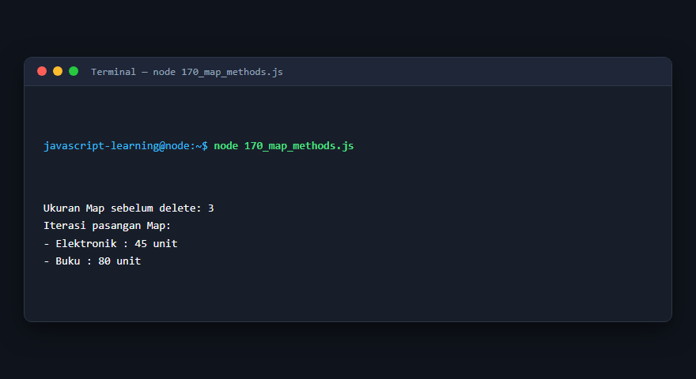

---

### 171. Metode Set

**Tujuan Pembelajaran:** Memahami konsep dan implementasi praktis dari materi Metode Set.

**Konsep Utama:** Program ini mendemonstrasikan prinsip Metode Set secara komprehensif, terstruktur, dan bersih sesuai standar pemrograman JavaScript modern.

**Penjelasan Source Code:** Program mengeksekusi instruksi yang telah dilengkapi dengan komentar kode edukatif berbahasa Indonesia. Setiap blok logika penting dijelaskan secara rinci agar alur kerja program mudah dipahami oleh pembelajar.

**Source Code:** [171_set_methods.js](171_set_methods.js)

**Cara Menjalankan:**
```bash
node 171_set_methods.js
```

**Hasil yang Diharapkan:** Program akan mencetak log hasil evaluasi, perhitungan, atau pemrosesan data ke terminal secara akurat.

**Hasil Eksekusi:**

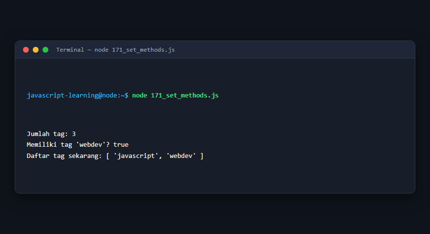

---

### 172. Penggunaan WeakMap

**Tujuan Pembelajaran:** Memahami konsep dan implementasi praktis dari materi Penggunaan WeakMap.

**Konsep Utama:** Program ini mendemonstrasikan prinsip Penggunaan WeakMap secara komprehensif, terstruktur, dan bersih sesuai standar pemrograman JavaScript modern.

**Penjelasan Source Code:** Program mengeksekusi instruksi yang telah dilengkapi dengan komentar kode edukatif berbahasa Indonesia. Setiap blok logika penting dijelaskan secara rinci agar alur kerja program mudah dipahami oleh pembelajar.

**Source Code:** [172_weakmap_examples.js](172_weakmap_examples.js)

**Cara Menjalankan:**
```bash
node 172_weakmap_examples.js
```

**Hasil yang Diharapkan:** Program akan mencetak log hasil evaluasi, perhitungan, atau pemrosesan data ke terminal secara akurat.

**Hasil Eksekusi:**

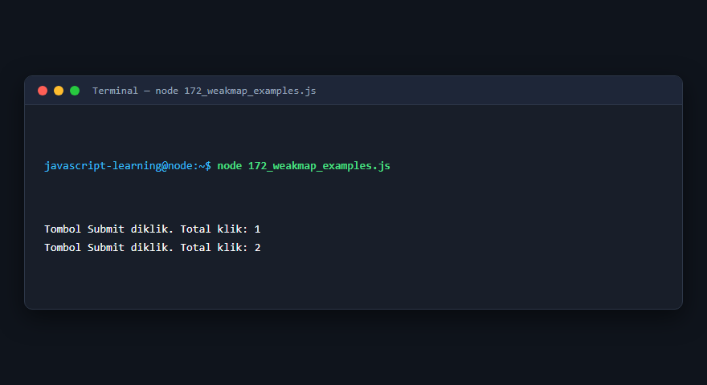

---

### 173. Penggunaan WeakSet

**Tujuan Pembelajaran:** Memahami konsep dan implementasi praktis dari materi Penggunaan WeakSet.

**Konsep Utama:** Program ini mendemonstrasikan prinsip Penggunaan WeakSet secara komprehensif, terstruktur, dan bersih sesuai standar pemrograman JavaScript modern.

**Penjelasan Source Code:** Program mengeksekusi instruksi yang telah dilengkapi dengan komentar kode edukatif berbahasa Indonesia. Setiap blok logika penting dijelaskan secara rinci agar alur kerja program mudah dipahami oleh pembelajar.

**Source Code:** [173_weakset_examples.js](173_weakset_examples.js)

**Cara Menjalankan:**
```bash
node 173_weakset_examples.js
```

**Hasil yang Diharapkan:** Program akan mencetak log hasil evaluasi, perhitungan, atau pemrosesan data ke terminal secara akurat.

**Hasil Eksekusi:**

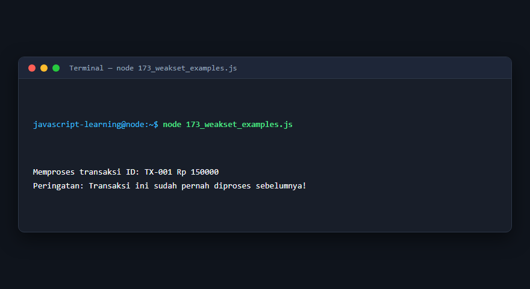

---

### 174. Object Proxy

**Tujuan Pembelajaran:** Memahami konsep dan implementasi praktis dari materi Object Proxy.

**Konsep Utama:** Program ini mendemonstrasikan prinsip Object Proxy secara komprehensif, terstruktur, dan bersih sesuai standar pemrograman JavaScript modern.

**Penjelasan Source Code:** Program mengeksekusi instruksi yang telah dilengkapi dengan komentar kode edukatif berbahasa Indonesia. Setiap blok logika penting dijelaskan secara rinci agar alur kerja program mudah dipahami oleh pembelajar.

**Source Code:** [174_proxy_object.js](174_proxy_object.js)

**Cara Menjalankan:**
```bash
node 174_proxy_object.js
```

**Hasil yang Diharapkan:** Program akan mencetak log hasil evaluasi, perhitungan, atau pemrosesan data ke terminal secara akurat.

**Hasil Eksekusi:**

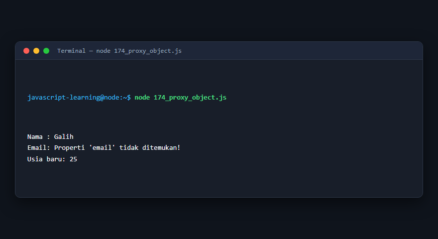

---

### 175. Reflect API

**Tujuan Pembelajaran:** Memahami konsep dan implementasi praktis dari materi Reflect API.

**Konsep Utama:** Program ini mendemonstrasikan prinsip Reflect API secara komprehensif, terstruktur, dan bersih sesuai standar pemrograman JavaScript modern.

**Penjelasan Source Code:** Program mengeksekusi instruksi yang telah dilengkapi dengan komentar kode edukatif berbahasa Indonesia. Setiap blok logika penting dijelaskan secara rinci agar alur kerja program mudah dipahami oleh pembelajar.

**Source Code:** [175_reflect_api.js](175_reflect_api.js)

**Cara Menjalankan:**
```bash
node 175_reflect_api.js
```

**Hasil yang Diharapkan:** Program akan mencetak log hasil evaluasi, perhitungan, atau pemrosesan data ke terminal secara akurat.

**Hasil Eksekusi:**

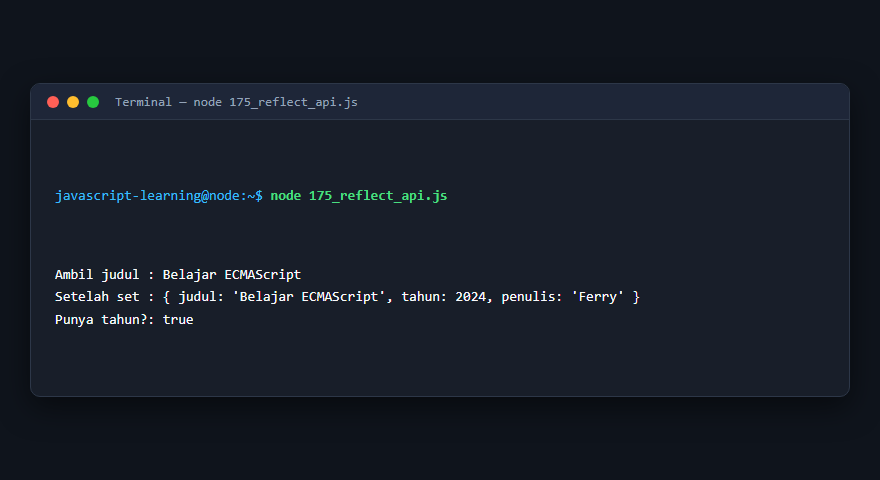

---

### 176. Property descriptors

**Tujuan Pembelajaran:** Memahami konsep dan implementasi praktis dari materi Property descriptors.

**Konsep Utama:** Program ini mendemonstrasikan prinsip Property descriptors secara komprehensif, terstruktur, dan bersih sesuai standar pemrograman JavaScript modern.

**Penjelasan Source Code:** Program mengeksekusi instruksi yang telah dilengkapi dengan komentar kode edukatif berbahasa Indonesia. Setiap blok logika penting dijelaskan secara rinci agar alur kerja program mudah dipahami oleh pembelajar.

**Source Code:** [176_property_descriptors.js](176_property_descriptors.js)

**Cara Menjalankan:**
```bash
node 176_property_descriptors.js
```

**Hasil yang Diharapkan:** Program akan mencetak log hasil evaluasi, perhitungan, atau pemrosesan data ke terminal secara akurat.

**Hasil Eksekusi:**

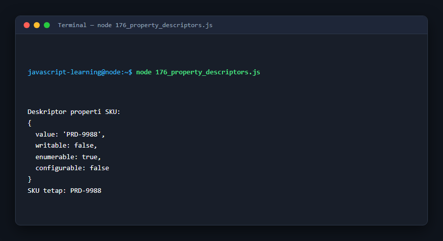

---

### 177. Optional chaining lanjutan

**Tujuan Pembelajaran:** Memahami konsep dan implementasi praktis dari materi Optional chaining lanjutan.

**Konsep Utama:** Program ini mendemonstrasikan prinsip Optional chaining lanjutan secara komprehensif, terstruktur, dan bersih sesuai standar pemrograman JavaScript modern.

**Penjelasan Source Code:** Program mengeksekusi instruksi yang telah dilengkapi dengan komentar kode edukatif berbahasa Indonesia. Setiap blok logika penting dijelaskan secara rinci agar alur kerja program mudah dipahami oleh pembelajar.

**Source Code:** [177_optional_chaining_advanced.js](177_optional_chaining_advanced.js)

**Cara Menjalankan:**
```bash
node 177_optional_chaining_advanced.js
```

**Hasil yang Diharapkan:** Program akan mencetak log hasil evaluasi, perhitungan, atau pemrosesan data ke terminal secara akurat.

**Hasil Eksekusi:**

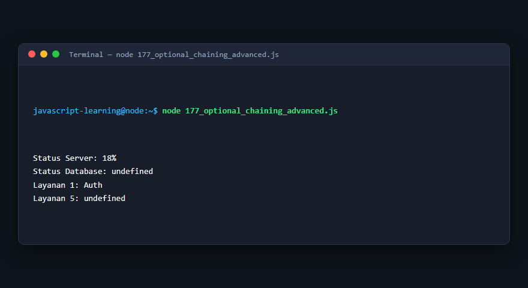

---

### 178. Nullish assignment

**Tujuan Pembelajaran:** Memahami konsep dan implementasi praktis dari materi Nullish assignment.

**Konsep Utama:** Program ini mendemonstrasikan prinsip Nullish assignment secara komprehensif, terstruktur, dan bersih sesuai standar pemrograman JavaScript modern.

**Penjelasan Source Code:** Program mengeksekusi instruksi yang telah dilengkapi dengan komentar kode edukatif berbahasa Indonesia. Setiap blok logika penting dijelaskan secara rinci agar alur kerja program mudah dipahami oleh pembelajar.

**Source Code:** [178_nullish_assignment.js](178_nullish_assignment.js)

**Cara Menjalankan:**
```bash
node 178_nullish_assignment.js
```

**Hasil yang Diharapkan:** Program akan mencetak log hasil evaluasi, perhitungan, atau pemrosesan data ke terminal secara akurat.

**Hasil Eksekusi:**

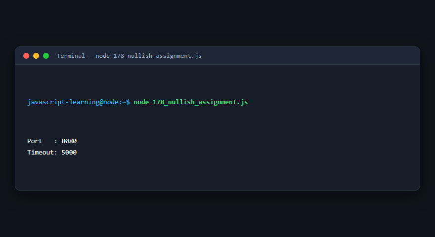

---

### 179. Logical assignment

**Tujuan Pembelajaran:** Memahami konsep dan implementasi praktis dari materi Logical assignment.

**Konsep Utama:** Program ini mendemonstrasikan prinsip Logical assignment secara komprehensif, terstruktur, dan bersih sesuai standar pemrograman JavaScript modern.

**Penjelasan Source Code:** Program mengeksekusi instruksi yang telah dilengkapi dengan komentar kode edukatif berbahasa Indonesia. Setiap blok logika penting dijelaskan secara rinci agar alur kerja program mudah dipahami oleh pembelajar.

**Source Code:** [179_logical_assignment.js](179_logical_assignment.js)

**Cara Menjalankan:**
```bash
node 179_logical_assignment.js
```

**Hasil yang Diharapkan:** Program akan mencetak log hasil evaluasi, perhitungan, atau pemrosesan data ke terminal secara akurat.

**Hasil Eksekusi:**

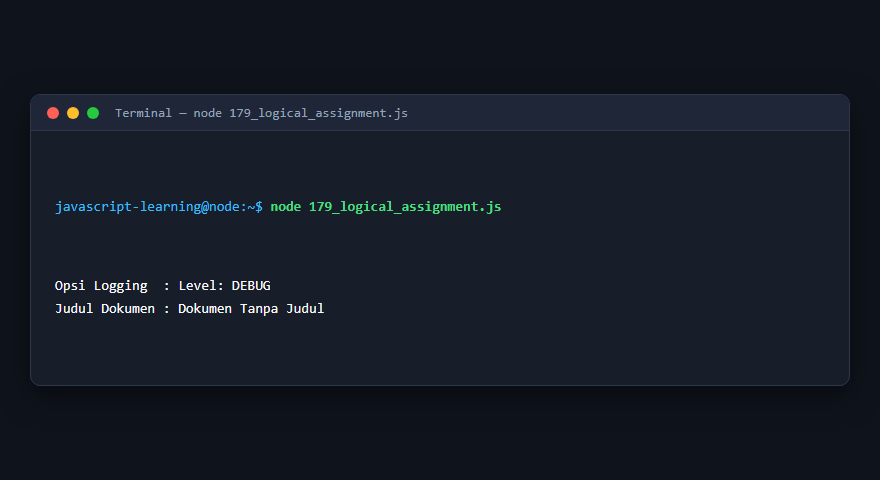

---

### 180. `structuredClone()`

**Tujuan Pembelajaran:** Memahami konsep dan implementasi praktis dari materi `structuredClone()`.

**Konsep Utama:** Program ini mendemonstrasikan prinsip `structuredClone()` secara komprehensif, terstruktur, dan bersih sesuai standar pemrograman JavaScript modern.

**Penjelasan Source Code:** Program mengeksekusi instruksi yang telah dilengkapi dengan komentar kode edukatif berbahasa Indonesia. Setiap blok logika penting dijelaskan secara rinci agar alur kerja program mudah dipahami oleh pembelajar.

**Source Code:** [180_structured_clone.js](180_structured_clone.js)

**Cara Menjalankan:**
```bash
node 180_structured_clone.js
```

**Hasil yang Diharapkan:** Program akan mencetak log hasil evaluasi, perhitungan, atau pemrosesan data ke terminal secara akurat.

**Hasil Eksekusi:**


---

## Ringkasan Modul

Modul 11 (Built-in Objects dan Fitur Bahasa) telah menyajikan pembelajaran berbasis praktik yang terstruktur. Seluruh program di dalam modul ini dapat dijalankan secara mandiri tanpa saling membebani dependensi yang rumit, dengan fokus mendalam pada pemahaman konsep dan kebiasaan baik penulisan kode.
