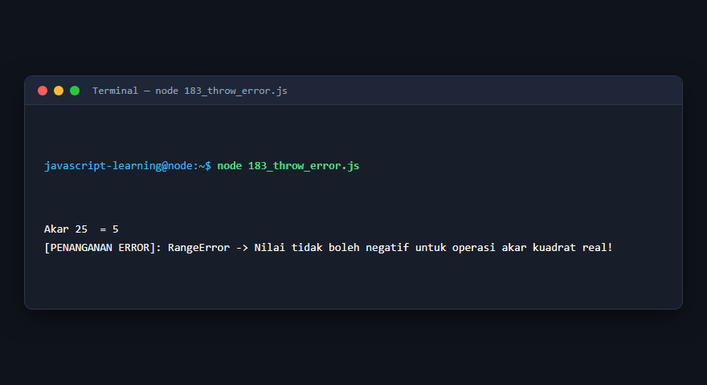
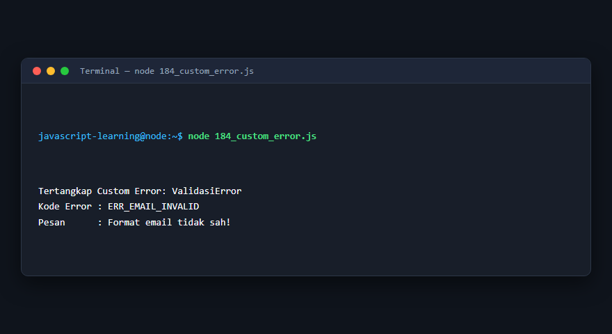
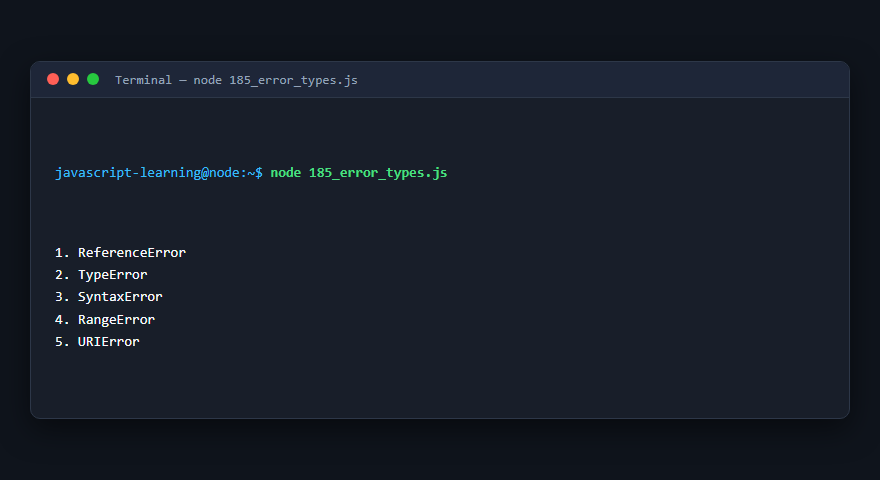
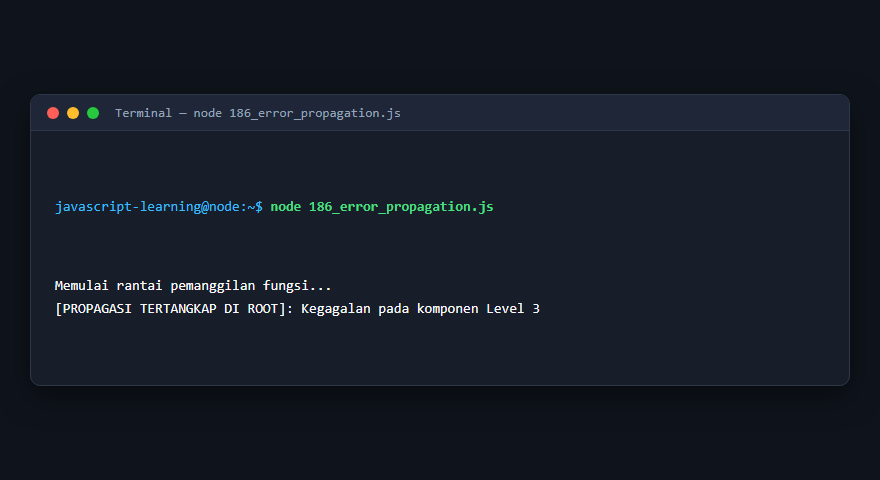
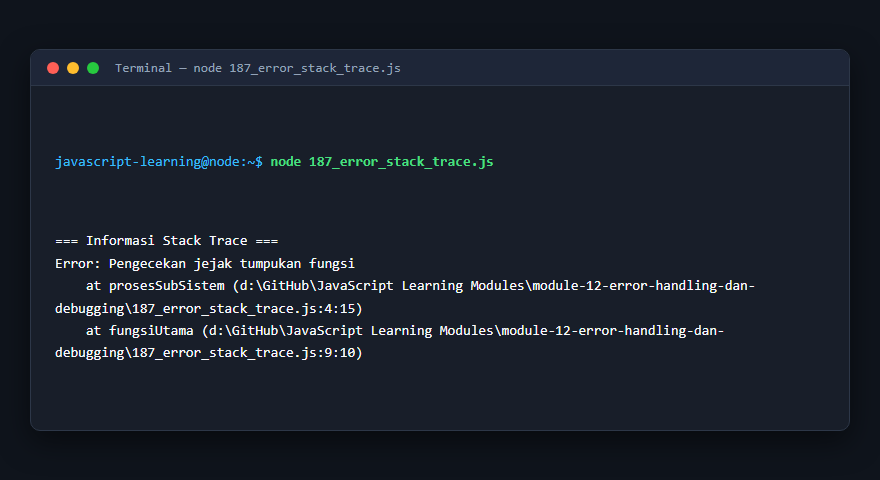
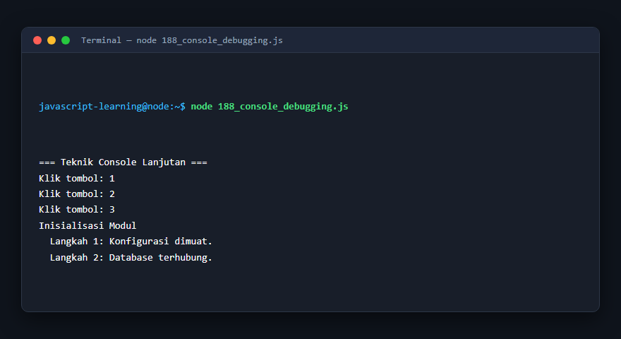
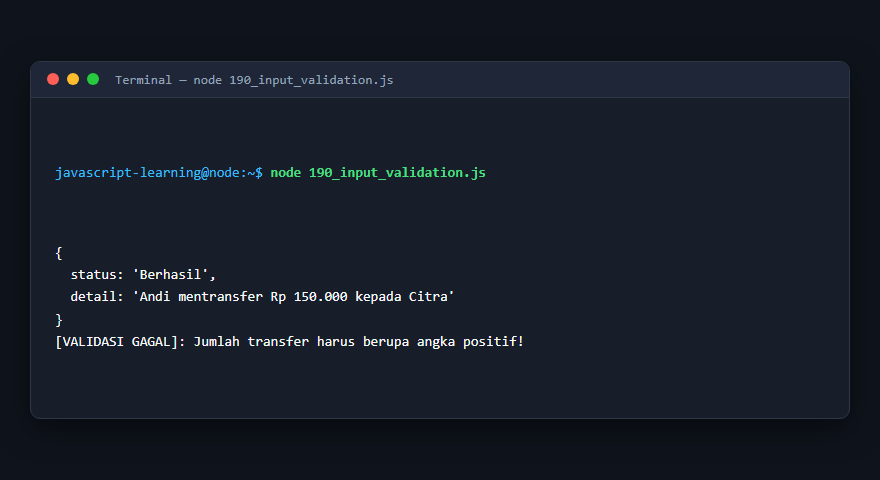
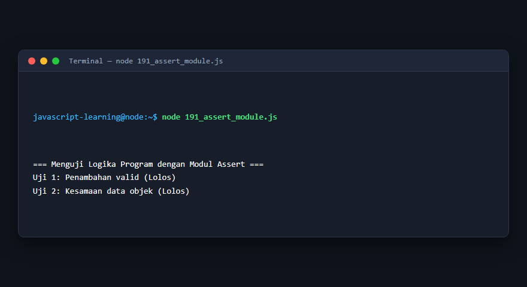
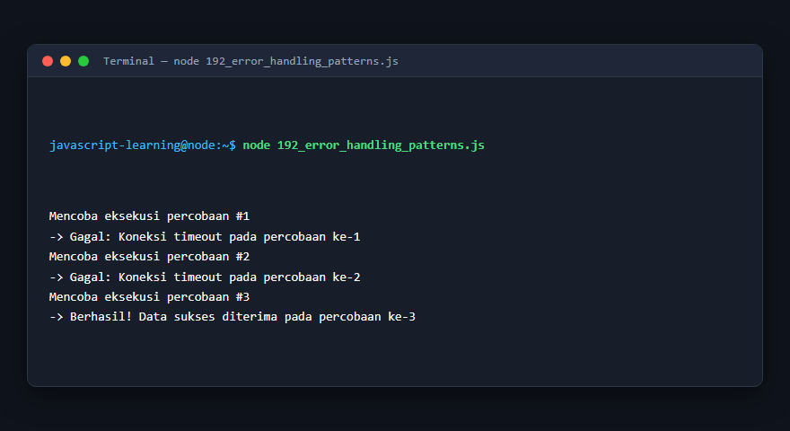

# Modul 12: Error Handling dan Debugging

## Deskripsi Modul
Modul ini membahas teknik penanganan kesalahan (error handling) runtime menggunakan try-catch-finally, custom errors, assert, serta strategi debugging sistematis.

## Tujuan Pembelajaran
Mampu membangun aplikasi yang tangguh terhadap kegagalan (resilient), mampu menangkap bug melalui stack trace, dan menerapkan retry pattern.

## Daftar Submodul & Materi

- [181_try_catch.js](181_try_catch.js) : `try...catch`
- [182_finally_block.js](182_finally_block.js) : Blok `finally`
- [183_throw_error.js](183_throw_error.js) : Melempar error
- [184_custom_error.js](184_custom_error.js) : Custom Error
- [185_error_types.js](185_error_types.js) : Jenis-jenis error
- [186_error_propagation.js](186_error_propagation.js) : Propagasi error
- [187_error_stack_trace.js](187_error_stack_trace.js) : Stack trace
- [188_console_debugging.js](188_console_debugging.js) : Debugging dengan console
- [189_debugger_statement.js](189_debugger_statement.js) : Pernyataan `debugger`
- [190_input_validation.js](190_input_validation.js) : Validasi input
- [191_assert_module.js](191_assert_module.js) : Assertion menggunakan Node.js
- [192_error_handling_patterns.js](192_error_handling_patterns.js) : Pola penanganan error

---

## Penjelasan Detail Setiap Submodul

### 181. `try...catch`

**Tujuan Pembelajaran:** Memahami konsep dan implementasi praktis dari materi `try...catch`.

**Konsep Utama:** Program ini mendemonstrasikan prinsip `try...catch` secara komprehensif, terstruktur, dan bersih sesuai standar pemrograman JavaScript modern.

**Penjelasan Source Code:** Program mengeksekusi instruksi yang telah dilengkapi dengan komentar kode edukatif berbahasa Indonesia. Setiap blok logika penting dijelaskan secara rinci agar alur kerja program mudah dipahami oleh pembelajar.

**Source Code:** [181_try_catch.js](181_try_catch.js)

**Cara Menjalankan:**
```bash
node 181_try_catch.js
```

**Hasil yang Diharapkan:** Program akan mencetak log hasil evaluasi, perhitungan, atau pemrosesan data ke terminal secara akurat.

**Hasil Eksekusi:**


---

### 182. Blok `finally`

**Tujuan Pembelajaran:** Memahami konsep dan implementasi praktis dari materi Blok `finally`.

**Konsep Utama:** Program ini mendemonstrasikan prinsip Blok `finally` secara komprehensif, terstruktur, dan bersih sesuai standar pemrograman JavaScript modern.

**Penjelasan Source Code:** Program mengeksekusi instruksi yang telah dilengkapi dengan komentar kode edukatif berbahasa Indonesia. Setiap blok logika penting dijelaskan secara rinci agar alur kerja program mudah dipahami oleh pembelajar.

**Source Code:** [182_finally_block.js](182_finally_block.js)

**Cara Menjalankan:**
```bash
node 182_finally_block.js
```

**Hasil yang Diharapkan:** Program akan mencetak log hasil evaluasi, perhitungan, atau pemrosesan data ke terminal secara akurat.

**Hasil Eksekusi:**


---

### 183. Melempar error

**Tujuan Pembelajaran:** Memahami konsep dan implementasi praktis dari materi Melempar error.

**Konsep Utama:** Program ini mendemonstrasikan prinsip Melempar error secara komprehensif, terstruktur, dan bersih sesuai standar pemrograman JavaScript modern.

**Penjelasan Source Code:** Program mengeksekusi instruksi yang telah dilengkapi dengan komentar kode edukatif berbahasa Indonesia. Setiap blok logika penting dijelaskan secara rinci agar alur kerja program mudah dipahami oleh pembelajar.

**Source Code:** [183_throw_error.js](183_throw_error.js)

**Cara Menjalankan:**
```bash
node 183_throw_error.js
```

**Hasil yang Diharapkan:** Program akan mencetak log hasil evaluasi, perhitungan, atau pemrosesan data ke terminal secara akurat.

**Hasil Eksekusi:**



---

### 184. Custom Error

**Tujuan Pembelajaran:** Memahami konsep dan implementasi praktis dari materi Custom Error.

**Konsep Utama:** Program ini mendemonstrasikan prinsip Custom Error secara komprehensif, terstruktur, dan bersih sesuai standar pemrograman JavaScript modern.

**Penjelasan Source Code:** Program mengeksekusi instruksi yang telah dilengkapi dengan komentar kode edukatif berbahasa Indonesia. Setiap blok logika penting dijelaskan secara rinci agar alur kerja program mudah dipahami oleh pembelajar.

**Source Code:** [184_custom_error.js](184_custom_error.js)

**Cara Menjalankan:**
```bash
node 184_custom_error.js
```

**Hasil yang Diharapkan:** Program akan mencetak log hasil evaluasi, perhitungan, atau pemrosesan data ke terminal secara akurat.

**Hasil Eksekusi:**



---

### 185. Jenis-jenis error

**Tujuan Pembelajaran:** Memahami konsep dan implementasi praktis dari materi Jenis-jenis error.

**Konsep Utama:** Program ini mendemonstrasikan prinsip Jenis-jenis error secara komprehensif, terstruktur, dan bersih sesuai standar pemrograman JavaScript modern.

**Penjelasan Source Code:** Program mengeksekusi instruksi yang telah dilengkapi dengan komentar kode edukatif berbahasa Indonesia. Setiap blok logika penting dijelaskan secara rinci agar alur kerja program mudah dipahami oleh pembelajar.

**Source Code:** [185_error_types.js](185_error_types.js)

**Cara Menjalankan:**
```bash
node 185_error_types.js
```

**Hasil yang Diharapkan:** Program akan mencetak log hasil evaluasi, perhitungan, atau pemrosesan data ke terminal secara akurat.

**Hasil Eksekusi:**



---

### 186. Propagasi error

**Tujuan Pembelajaran:** Memahami konsep dan implementasi praktis dari materi Propagasi error.

**Konsep Utama:** Program ini mendemonstrasikan prinsip Propagasi error secara komprehensif, terstruktur, dan bersih sesuai standar pemrograman JavaScript modern.

**Penjelasan Source Code:** Program mengeksekusi instruksi yang telah dilengkapi dengan komentar kode edukatif berbahasa Indonesia. Setiap blok logika penting dijelaskan secara rinci agar alur kerja program mudah dipahami oleh pembelajar.

**Source Code:** [186_error_propagation.js](186_error_propagation.js)

**Cara Menjalankan:**
```bash
node 186_error_propagation.js
```

**Hasil yang Diharapkan:** Program akan mencetak log hasil evaluasi, perhitungan, atau pemrosesan data ke terminal secara akurat.

**Hasil Eksekusi:**



---

### 187. Stack trace

**Tujuan Pembelajaran:** Memahami konsep dan implementasi praktis dari materi Stack trace.

**Konsep Utama:** Program ini mendemonstrasikan prinsip Stack trace secara komprehensif, terstruktur, dan bersih sesuai standar pemrograman JavaScript modern.

**Penjelasan Source Code:** Program mengeksekusi instruksi yang telah dilengkapi dengan komentar kode edukatif berbahasa Indonesia. Setiap blok logika penting dijelaskan secara rinci agar alur kerja program mudah dipahami oleh pembelajar.

**Source Code:** [187_error_stack_trace.js](187_error_stack_trace.js)

**Cara Menjalankan:**
```bash
node 187_error_stack_trace.js
```

**Hasil yang Diharapkan:** Program akan mencetak log hasil evaluasi, perhitungan, atau pemrosesan data ke terminal secara akurat.

**Hasil Eksekusi:**



---

### 188. Debugging dengan console

**Tujuan Pembelajaran:** Memahami konsep dan implementasi praktis dari materi Debugging dengan console.

**Konsep Utama:** Program ini mendemonstrasikan prinsip Debugging dengan console secara komprehensif, terstruktur, dan bersih sesuai standar pemrograman JavaScript modern.

**Penjelasan Source Code:** Program mengeksekusi instruksi yang telah dilengkapi dengan komentar kode edukatif berbahasa Indonesia. Setiap blok logika penting dijelaskan secara rinci agar alur kerja program mudah dipahami oleh pembelajar.

**Source Code:** [188_console_debugging.js](188_console_debugging.js)

**Cara Menjalankan:**
```bash
node 188_console_debugging.js
```

**Hasil yang Diharapkan:** Program akan mencetak log hasil evaluasi, perhitungan, atau pemrosesan data ke terminal secara akurat.

**Hasil Eksekusi:**



---

### 189. Pernyataan `debugger`

**Tujuan Pembelajaran:** Memahami konsep dan implementasi praktis dari materi Pernyataan `debugger`.

**Konsep Utama:** Program ini mendemonstrasikan prinsip Pernyataan `debugger` secara komprehensif, terstruktur, dan bersih sesuai standar pemrograman JavaScript modern.

**Penjelasan Source Code:** Program mengeksekusi instruksi yang telah dilengkapi dengan komentar kode edukatif berbahasa Indonesia. Setiap blok logika penting dijelaskan secara rinci agar alur kerja program mudah dipahami oleh pembelajar.

**Source Code:** [189_debugger_statement.js](189_debugger_statement.js)

**Cara Menjalankan:**
```bash
node 189_debugger_statement.js
```

**Hasil yang Diharapkan:** Program akan mencetak log hasil evaluasi, perhitungan, atau pemrosesan data ke terminal secara akurat.

**Hasil Eksekusi:**


---

### 190. Validasi input

**Tujuan Pembelajaran:** Memahami konsep dan implementasi praktis dari materi Validasi input.

**Konsep Utama:** Program ini mendemonstrasikan prinsip Validasi input secara komprehensif, terstruktur, dan bersih sesuai standar pemrograman JavaScript modern.

**Penjelasan Source Code:** Program mengeksekusi instruksi yang telah dilengkapi dengan komentar kode edukatif berbahasa Indonesia. Setiap blok logika penting dijelaskan secara rinci agar alur kerja program mudah dipahami oleh pembelajar.

**Source Code:** [190_input_validation.js](190_input_validation.js)

**Cara Menjalankan:**
```bash
node 190_input_validation.js
```

**Hasil yang Diharapkan:** Program akan mencetak log hasil evaluasi, perhitungan, atau pemrosesan data ke terminal secara akurat.

**Hasil Eksekusi:**



---

### 191. Assertion menggunakan Node.js

**Tujuan Pembelajaran:** Memahami konsep dan implementasi praktis dari materi Assertion menggunakan Node.js.

**Konsep Utama:** Program ini mendemonstrasikan prinsip Assertion menggunakan Node.js secara komprehensif, terstruktur, dan bersih sesuai standar pemrograman JavaScript modern.

**Penjelasan Source Code:** Program mengeksekusi instruksi yang telah dilengkapi dengan komentar kode edukatif berbahasa Indonesia. Setiap blok logika penting dijelaskan secara rinci agar alur kerja program mudah dipahami oleh pembelajar.

**Source Code:** [191_assert_module.js](191_assert_module.js)

**Cara Menjalankan:**
```bash
node 191_assert_module.js
```

**Hasil yang Diharapkan:** Program akan mencetak log hasil evaluasi, perhitungan, atau pemrosesan data ke terminal secara akurat.

**Hasil Eksekusi:**



---

### 192. Pola penanganan error

**Tujuan Pembelajaran:** Memahami konsep dan implementasi praktis dari materi Pola penanganan error.

**Konsep Utama:** Program ini mendemonstrasikan prinsip Pola penanganan error secara komprehensif, terstruktur, dan bersih sesuai standar pemrograman JavaScript modern.

**Penjelasan Source Code:** Program mengeksekusi instruksi yang telah dilengkapi dengan komentar kode edukatif berbahasa Indonesia. Setiap blok logika penting dijelaskan secara rinci agar alur kerja program mudah dipahami oleh pembelajar.

**Source Code:** [192_error_handling_patterns.js](192_error_handling_patterns.js)

**Cara Menjalankan:**
```bash
node 192_error_handling_patterns.js
```

**Hasil yang Diharapkan:** Program akan mencetak log hasil evaluasi, perhitungan, atau pemrosesan data ke terminal secara akurat.

**Hasil Eksekusi:**



---

## Ringkasan Modul

Modul 12 (Error Handling dan Debugging) telah menyajikan pembelajaran berbasis praktik yang terstruktur. Seluruh program di dalam modul ini dapat dijalankan secara mandiri tanpa saling membebani dependensi yang rumit, dengan fokus mendalam pada pemahaman konsep dan kebiasaan baik penulisan kode.
