# Modul 13: Modules, Package, dan Tooling

## Deskripsi Modul
Modul ini mengulas sistem modularisasi kode (ES Modules vs CommonJS), struktur package.json, manajemen paket NPM, environment variables, dan tooling (ESLint & Prettier).

## Tujuan Pembelajaran
Menguasai ekosistem tooling JavaScript modern, memisahkan modul kode, dan mengelola dependensi proyek.

## Daftar Submodul & Materi

- [193_es_modules_export.js](193_es_modules_export.js) : Export pada ES Modules
- [194_es_modules_import.js](194_es_modules_import.js) : Import pada ES Modules
- [195_named_exports.js](195_named_exports.js) : Named exports
- [196_default_exports.js](196_default_exports.js) : Default exports
- [197_dynamic_import.js](197_dynamic_import.js) : Dynamic import
- [198_module_scope.js](198_module_scope.js) : Module scope
- [199_commonjs_require.js](199_commonjs_require.js) : CommonJS dengan `require()`
- [200_commonjs_exports.js](200_commonjs_exports.js) : CommonJS exports
- [201_package_json.js](201_package_json.js) : Struktur `package.json`
- [202_npm_packages.js](202_npm_packages.js) : Penggunaan npm packages
- [203_npm_scripts.js](203_npm_scripts.js) : npm scripts
- [204_environment_variables.js](204_environment_variables.js) : Environment variables
- [205_eslint_basic.js](205_eslint_basic.js) : Pemeriksaan kode dengan ESLint
- [206_prettier_formatting.js](206_prettier_formatting.js) : Format kode dengan Prettier

---

## Penjelasan Detail Setiap Submodul

### 193. Export pada ES Modules

**Tujuan Pembelajaran:** Memahami konsep dan implementasi praktis dari materi Export pada ES Modules.

**Konsep Utama:** Program ini mendemonstrasikan prinsip Export pada ES Modules secara komprehensif, terstruktur, dan bersih sesuai standar pemrograman JavaScript modern.

**Penjelasan Source Code:** Program mengeksekusi instruksi yang telah dilengkapi dengan komentar kode edukatif berbahasa Indonesia. Setiap blok logika penting dijelaskan secara rinci agar alur kerja program mudah dipahami oleh pembelajar.

**Source Code:** [193_es_modules_export.js](193_es_modules_export.js)

**Cara Menjalankan:**
```bash
node 193_es_modules_export.js
```

**Hasil yang Diharapkan:** Program akan mencetak log hasil evaluasi, perhitungan, atau pemrosesan data ke terminal secara akurat.

**Hasil Eksekusi:**

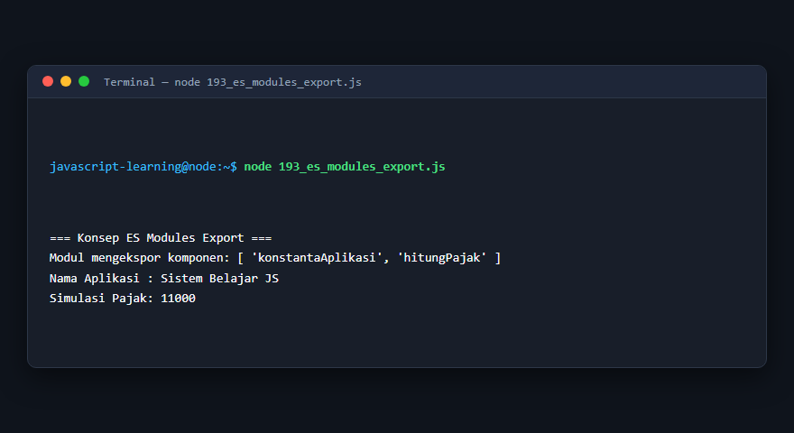

---

### 194. Import pada ES Modules

**Tujuan Pembelajaran:** Memahami konsep dan implementasi praktis dari materi Import pada ES Modules.

**Konsep Utama:** Program ini mendemonstrasikan prinsip Import pada ES Modules secara komprehensif, terstruktur, dan bersih sesuai standar pemrograman JavaScript modern.

**Penjelasan Source Code:** Program mengeksekusi instruksi yang telah dilengkapi dengan komentar kode edukatif berbahasa Indonesia. Setiap blok logika penting dijelaskan secara rinci agar alur kerja program mudah dipahami oleh pembelajar.

**Source Code:** [194_es_modules_import.js](194_es_modules_import.js)

**Cara Menjalankan:**
```bash
node 194_es_modules_import.js
```

**Hasil yang Diharapkan:** Program akan mencetak log hasil evaluasi, perhitungan, atau pemrosesan data ke terminal secara akurat.

**Hasil Eksekusi:**

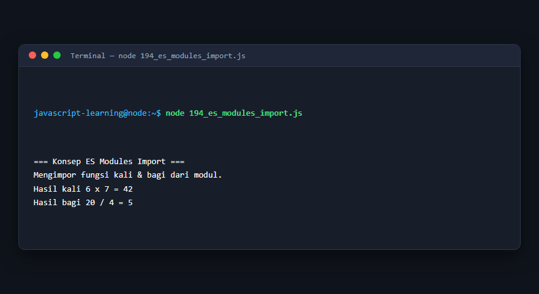

---

### 195. Named exports

**Tujuan Pembelajaran:** Memahami konsep dan implementasi praktis dari materi Named exports.

**Konsep Utama:** Program ini mendemonstrasikan prinsip Named exports secara komprehensif, terstruktur, dan bersih sesuai standar pemrograman JavaScript modern.

**Penjelasan Source Code:** Program mengeksekusi instruksi yang telah dilengkapi dengan komentar kode edukatif berbahasa Indonesia. Setiap blok logika penting dijelaskan secara rinci agar alur kerja program mudah dipahami oleh pembelajar.

**Source Code:** [195_named_exports.js](195_named_exports.js)

**Cara Menjalankan:**
```bash
node 195_named_exports.js
```

**Hasil yang Diharapkan:** Program akan mencetak log hasil evaluasi, perhitungan, atau pemrosesan data ke terminal secara akurat.

**Hasil Eksekusi:**

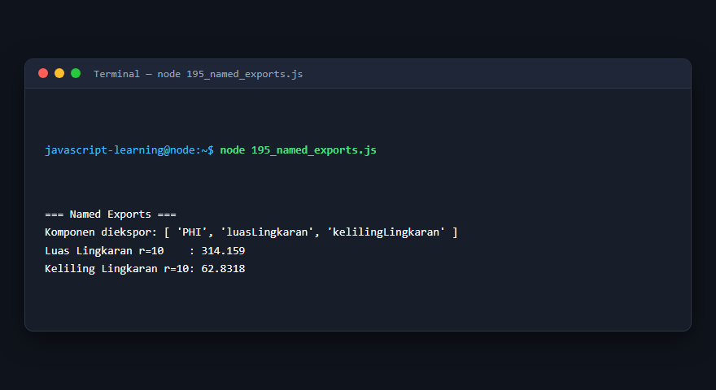

---

### 196. Default exports

**Tujuan Pembelajaran:** Memahami konsep dan implementasi praktis dari materi Default exports.

**Konsep Utama:** Program ini mendemonstrasikan prinsip Default exports secara komprehensif, terstruktur, dan bersih sesuai standar pemrograman JavaScript modern.

**Penjelasan Source Code:** Program mengeksekusi instruksi yang telah dilengkapi dengan komentar kode edukatif berbahasa Indonesia. Setiap blok logika penting dijelaskan secara rinci agar alur kerja program mudah dipahami oleh pembelajar.

**Source Code:** [196_default_exports.js](196_default_exports.js)

**Cara Menjalankan:**
```bash
node 196_default_exports.js
```

**Hasil yang Diharapkan:** Program akan mencetak log hasil evaluasi, perhitungan, atau pemrosesan data ke terminal secara akurat.

**Hasil Eksekusi:**

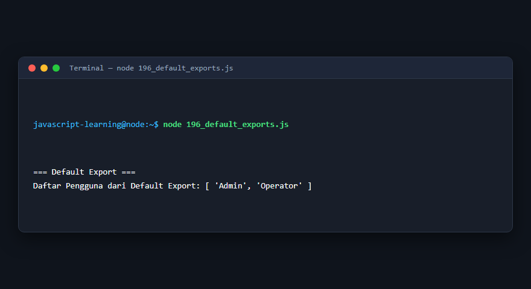

---

### 197. Dynamic import

**Tujuan Pembelajaran:** Memahami konsep dan implementasi praktis dari materi Dynamic import.

**Konsep Utama:** Program ini mendemonstrasikan prinsip Dynamic import secara komprehensif, terstruktur, dan bersih sesuai standar pemrograman JavaScript modern.

**Penjelasan Source Code:** Program mengeksekusi instruksi yang telah dilengkapi dengan komentar kode edukatif berbahasa Indonesia. Setiap blok logika penting dijelaskan secara rinci agar alur kerja program mudah dipahami oleh pembelajar.

**Source Code:** [197_dynamic_import.js](197_dynamic_import.js)

**Cara Menjalankan:**
```bash
node 197_dynamic_import.js
```

**Hasil yang Diharapkan:** Program akan mencetak log hasil evaluasi, perhitungan, atau pemrosesan data ke terminal secara akurat.

**Hasil Eksekusi:**

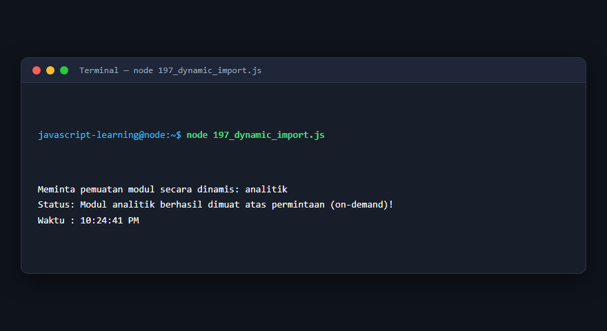

---

### 198. Module scope

**Tujuan Pembelajaran:** Memahami konsep dan implementasi praktis dari materi Module scope.

**Konsep Utama:** Program ini mendemonstrasikan prinsip Module scope secara komprehensif, terstruktur, dan bersih sesuai standar pemrograman JavaScript modern.

**Penjelasan Source Code:** Program mengeksekusi instruksi yang telah dilengkapi dengan komentar kode edukatif berbahasa Indonesia. Setiap blok logika penting dijelaskan secara rinci agar alur kerja program mudah dipahami oleh pembelajar.

**Source Code:** [198_module_scope.js](198_module_scope.js)

**Cara Menjalankan:**
```bash
node 198_module_scope.js
```

**Hasil yang Diharapkan:** Program akan mencetak log hasil evaluasi, perhitungan, atau pemrosesan data ke terminal secara akurat.

**Hasil Eksekusi:**

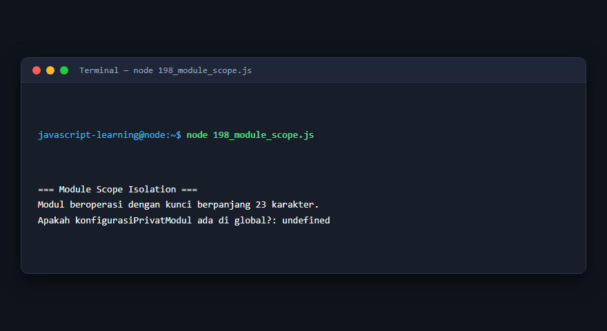

---

### 199. CommonJS dengan `require()`

**Tujuan Pembelajaran:** Memahami konsep dan implementasi praktis dari materi CommonJS dengan `require()`.

**Konsep Utama:** Program ini mendemonstrasikan prinsip CommonJS dengan `require()` secara komprehensif, terstruktur, dan bersih sesuai standar pemrograman JavaScript modern.

**Penjelasan Source Code:** Program mengeksekusi instruksi yang telah dilengkapi dengan komentar kode edukatif berbahasa Indonesia. Setiap blok logika penting dijelaskan secara rinci agar alur kerja program mudah dipahami oleh pembelajar.

**Source Code:** [199_commonjs_require.js](199_commonjs_require.js)

**Cara Menjalankan:**
```bash
node 199_commonjs_require.js
```

**Hasil yang Diharapkan:** Program akan mencetak log hasil evaluasi, perhitungan, atau pemrosesan data ke terminal secara akurat.

**Hasil Eksekusi:**


---

### 200. CommonJS exports

**Tujuan Pembelajaran:** Memahami konsep dan implementasi praktis dari materi CommonJS exports.

**Konsep Utama:** Program ini mendemonstrasikan prinsip CommonJS exports secara komprehensif, terstruktur, dan bersih sesuai standar pemrograman JavaScript modern.

**Penjelasan Source Code:** Program mengeksekusi instruksi yang telah dilengkapi dengan komentar kode edukatif berbahasa Indonesia. Setiap blok logika penting dijelaskan secara rinci agar alur kerja program mudah dipahami oleh pembelajar.

**Source Code:** [200_commonjs_exports.js](200_commonjs_exports.js)

**Cara Menjalankan:**
```bash
node 200_commonjs_exports.js
```

**Hasil yang Diharapkan:** Program akan mencetak log hasil evaluasi, perhitungan, atau pemrosesan data ke terminal secara akurat.

**Hasil Eksekusi:**

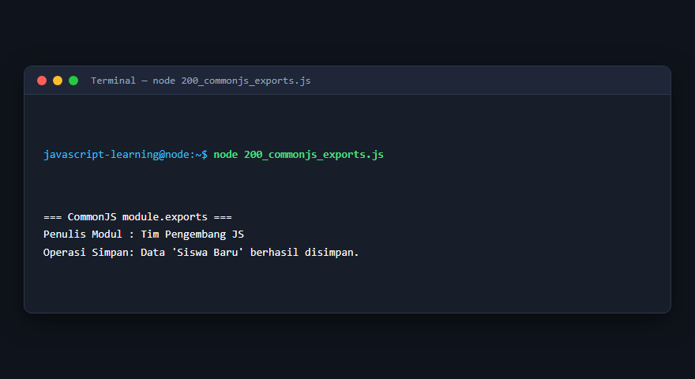

---

### 201. Struktur `package.json`

**Tujuan Pembelajaran:** Memahami konsep dan implementasi praktis dari materi Struktur `package.json`.

**Konsep Utama:** Program ini mendemonstrasikan prinsip Struktur `package.json` secara komprehensif, terstruktur, dan bersih sesuai standar pemrograman JavaScript modern.

**Penjelasan Source Code:** Program mengeksekusi instruksi yang telah dilengkapi dengan komentar kode edukatif berbahasa Indonesia. Setiap blok logika penting dijelaskan secara rinci agar alur kerja program mudah dipahami oleh pembelajar.

**Source Code:** [201_package_json.js](201_package_json.js)

**Cara Menjalankan:**
```bash
node 201_package_json.js
```

**Hasil yang Diharapkan:** Program akan mencetak log hasil evaluasi, perhitungan, atau pemrosesan data ke terminal secara akurat.

**Hasil Eksekusi:**


---

### 202. Penggunaan npm packages

**Tujuan Pembelajaran:** Memahami konsep dan implementasi praktis dari materi Penggunaan npm packages.

**Konsep Utama:** Program ini mendemonstrasikan prinsip Penggunaan npm packages secara komprehensif, terstruktur, dan bersih sesuai standar pemrograman JavaScript modern.

**Penjelasan Source Code:** Program mengeksekusi instruksi yang telah dilengkapi dengan komentar kode edukatif berbahasa Indonesia. Setiap blok logika penting dijelaskan secara rinci agar alur kerja program mudah dipahami oleh pembelajar.

**Source Code:** [202_npm_packages.js](202_npm_packages.js)

**Cara Menjalankan:**
```bash
node 202_npm_packages.js
```

**Hasil yang Diharapkan:** Program akan mencetak log hasil evaluasi, perhitungan, atau pemrosesan data ke terminal secara akurat.

**Hasil Eksekusi:**

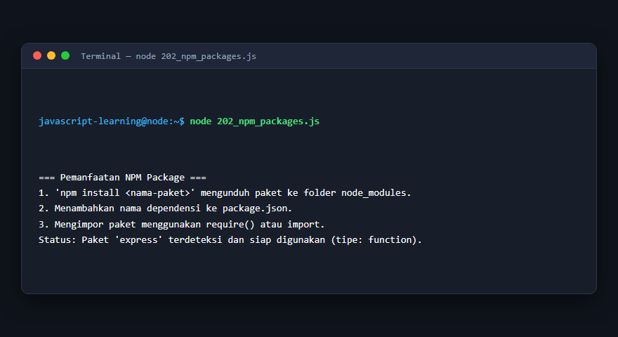

---

### 203. npm scripts

**Tujuan Pembelajaran:** Memahami konsep dan implementasi praktis dari materi npm scripts.

**Konsep Utama:** Program ini mendemonstrasikan prinsip npm scripts secara komprehensif, terstruktur, dan bersih sesuai standar pemrograman JavaScript modern.

**Penjelasan Source Code:** Program mengeksekusi instruksi yang telah dilengkapi dengan komentar kode edukatif berbahasa Indonesia. Setiap blok logika penting dijelaskan secara rinci agar alur kerja program mudah dipahami oleh pembelajar.

**Source Code:** [203_npm_scripts.js](203_npm_scripts.js)

**Cara Menjalankan:**
```bash
node 203_npm_scripts.js
```

**Hasil yang Diharapkan:** Program akan mencetak log hasil evaluasi, perhitungan, atau pemrosesan data ke terminal secara akurat.

**Hasil Eksekusi:**

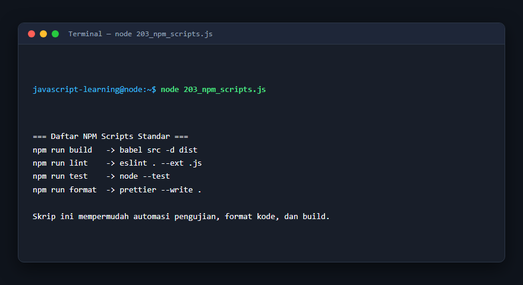

---

### 204. Environment variables

**Tujuan Pembelajaran:** Memahami konsep dan implementasi praktis dari materi Environment variables.

**Konsep Utama:** Program ini mendemonstrasikan prinsip Environment variables secara komprehensif, terstruktur, dan bersih sesuai standar pemrograman JavaScript modern.

**Penjelasan Source Code:** Program mengeksekusi instruksi yang telah dilengkapi dengan komentar kode edukatif berbahasa Indonesia. Setiap blok logika penting dijelaskan secara rinci agar alur kerja program mudah dipahami oleh pembelajar.

**Source Code:** [204_environment_variables.js](204_environment_variables.js)

**Cara Menjalankan:**
```bash
node 204_environment_variables.js
```

**Hasil yang Diharapkan:** Program akan mencetak log hasil evaluasi, perhitungan, atau pemrosesan data ke terminal secara akurat.

**Hasil Eksekusi:**

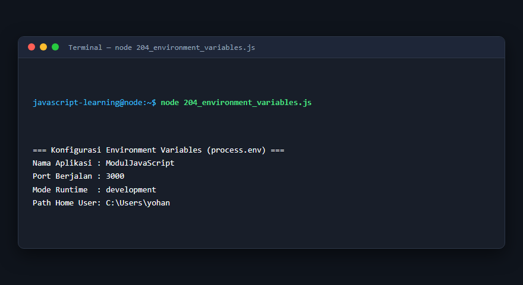

---

### 205. Pemeriksaan kode dengan ESLint

**Tujuan Pembelajaran:** Memahami konsep dan implementasi praktis dari materi Pemeriksaan kode dengan ESLint.

**Konsep Utama:** Program ini mendemonstrasikan prinsip Pemeriksaan kode dengan ESLint secara komprehensif, terstruktur, dan bersih sesuai standar pemrograman JavaScript modern.

**Penjelasan Source Code:** Program mengeksekusi instruksi yang telah dilengkapi dengan komentar kode edukatif berbahasa Indonesia. Setiap blok logika penting dijelaskan secara rinci agar alur kerja program mudah dipahami oleh pembelajar.

**Source Code:** [205_eslint_basic.js](205_eslint_basic.js)

**Cara Menjalankan:**
```bash
node 205_eslint_basic.js
```

**Hasil yang Diharapkan:** Program akan mencetak log hasil evaluasi, perhitungan, atau pemrosesan data ke terminal secara akurat.

**Hasil Eksekusi:**

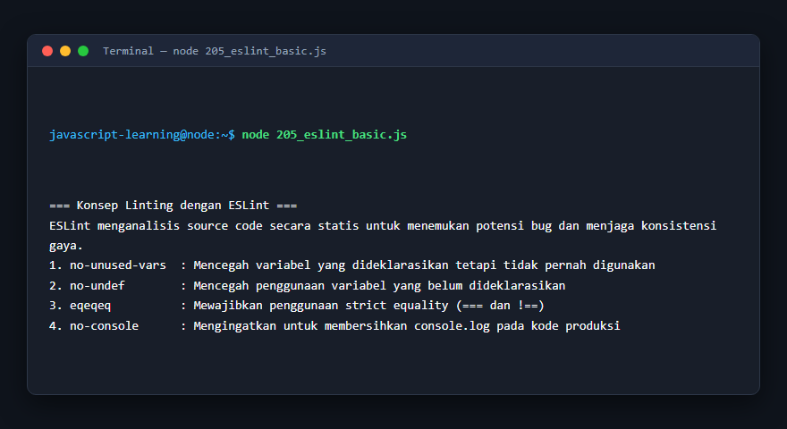

---

### 206. Format kode dengan Prettier

**Tujuan Pembelajaran:** Memahami konsep dan implementasi praktis dari materi Format kode dengan Prettier.

**Konsep Utama:** Program ini mendemonstrasikan prinsip Format kode dengan Prettier secara komprehensif, terstruktur, dan bersih sesuai standar pemrograman JavaScript modern.

**Penjelasan Source Code:** Program mengeksekusi instruksi yang telah dilengkapi dengan komentar kode edukatif berbahasa Indonesia. Setiap blok logika penting dijelaskan secara rinci agar alur kerja program mudah dipahami oleh pembelajar.

**Source Code:** [206_prettier_formatting.js](206_prettier_formatting.js)

**Cara Menjalankan:**
```bash
node 206_prettier_formatting.js
```

**Hasil yang Diharapkan:** Program akan mencetak log hasil evaluasi, perhitungan, atau pemrosesan data ke terminal secara akurat.

**Hasil Eksekusi:**

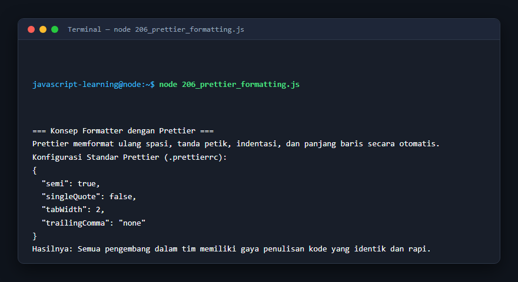

---

## Ringkasan Modul

Modul 13 (Modules, Package, dan Tooling) telah menyajikan pembelajaran berbasis praktik yang terstruktur. Seluruh program di dalam modul ini dapat dijalankan secara mandiri tanpa saling membebani dependensi yang rumit, dengan fokus mendalam pada pemahaman konsep dan kebiasaan baik penulisan kode.
