# Modul 14: DOM dan Browser Programming

## Deskripsi Modul
Modul ini mempelajari interaksi dengan Document Object Model (DOM), event handling, manipulasi class & style, storage browser, serta modern Web APIs.

## Tujuan Pembelajaran
Mampu memanipulasi elemen halaman web, menangani event pengguna, dan mengelola persistensi data di browser.

## Daftar Submodul & Materi

- [207_dom_selection.js](207_dom_selection.js) : Memilih elemen DOM
- [208_dom_query_selector.js](208_dom_query_selector.js) : `querySelector()` dan `querySelectorAll()`
- [209_dom_text_content.js](209_dom_text_content.js) : Manipulasi `textContent`
- [210_dom_inner_html.js](210_dom_inner_html.js) : Manipulasi `innerHTML`
- [211_dom_attributes.js](211_dom_attributes.js) : Manipulasi atribut
- [212_dom_class_list.js](212_dom_class_list.js) : Manipulasi class CSS
- [213_dom_style.js](213_dom_style.js) : Manipulasi style
- [214_dom_create_element.js](214_dom_create_element.js) : Membuat elemen DOM
- [215_dom_append_remove.js](215_dom_append_remove.js) : Menambah dan menghapus elemen
- [216_dom_traversal.js](216_dom_traversal.js) : DOM traversal
- [217_dom_event_listener.js](217_dom_event_listener.js) : Event listener
- [218_dom_event_object.js](218_dom_event_object.js) : Event object
- [219_event_bubbling.js](219_event_bubbling.js) : Event bubbling
- [220_event_delegation.js](220_event_delegation.js) : Event delegation
- [221_form_validation.js](221_form_validation.js) : Validasi formulir
- [222_form_data.js](222_form_data.js) : FormData
- [223_keyboard_events.js](223_keyboard_events.js) : Keyboard events
- [224_mouse_events.js](224_mouse_events.js) : Mouse events
- [225_local_storage.js](225_local_storage.js) : Local Storage
- [226_session_storage.js](226_session_storage.js) : Session Storage
- [227_browser_history.js](227_browser_history.js) : History API
- [228_url_api.js](228_url_api.js) : URL API
- [229_intersection_observer.js](229_intersection_observer.js) : Intersection Observer
- [230_mutation_observer.js](230_mutation_observer.js) : Mutation Observer

---

## Penjelasan Detail Setiap Submodul

### 207. Memilih elemen DOM

**Tujuan Pembelajaran:** Memahami konsep dan implementasi praktis dari materi Memilih elemen DOM.

**Konsep Utama:** Program ini mendemonstrasikan prinsip Memilih elemen DOM secara komprehensif, terstruktur, dan bersih sesuai standar pemrograman JavaScript modern.

**Penjelasan Source Code:** Program mengeksekusi instruksi yang telah dilengkapi dengan komentar kode edukatif berbahasa Indonesia. Setiap blok logika penting dijelaskan secara rinci agar alur kerja program mudah dipahami oleh pembelajar.

**Source Code:** [207_dom_selection.js](207_dom_selection.js)

**Cara Menjalankan:**
```bash
node 207_dom_selection.js
```

**Hasil yang Diharapkan:** Program akan mencetak log hasil evaluasi, perhitungan, atau pemrosesan data ke terminal secara akurat.

**Hasil Eksekusi:**

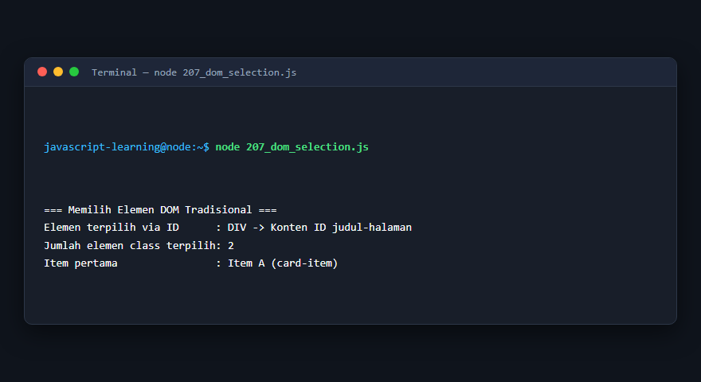

---

### 208. `querySelector()` dan `querySelectorAll()`

**Tujuan Pembelajaran:** Memahami konsep dan implementasi praktis dari materi `querySelector()` dan `querySelectorAll()`.

**Konsep Utama:** Program ini mendemonstrasikan prinsip `querySelector()` dan `querySelectorAll()` secara komprehensif, terstruktur, dan bersih sesuai standar pemrograman JavaScript modern.

**Penjelasan Source Code:** Program mengeksekusi instruksi yang telah dilengkapi dengan komentar kode edukatif berbahasa Indonesia. Setiap blok logika penting dijelaskan secara rinci agar alur kerja program mudah dipahami oleh pembelajar.

**Source Code:** [208_dom_query_selector.js](208_dom_query_selector.js)

**Cara Menjalankan:**
```bash
node 208_dom_query_selector.js
```

**Hasil yang Diharapkan:** Program akan mencetak log hasil evaluasi, perhitungan, atau pemrosesan data ke terminal secara akurat.

**Hasil Eksekusi:**


---

### 209. Manipulasi `textContent`

**Tujuan Pembelajaran:** Memahami konsep dan implementasi praktis dari materi Manipulasi `textContent`.

**Konsep Utama:** Program ini mendemonstrasikan prinsip Manipulasi `textContent` secara komprehensif, terstruktur, dan bersih sesuai standar pemrograman JavaScript modern.

**Penjelasan Source Code:** Program mengeksekusi instruksi yang telah dilengkapi dengan komentar kode edukatif berbahasa Indonesia. Setiap blok logika penting dijelaskan secara rinci agar alur kerja program mudah dipahami oleh pembelajar.

**Source Code:** [209_dom_text_content.js](209_dom_text_content.js)

**Cara Menjalankan:**
```bash
node 209_dom_text_content.js
```

**Hasil yang Diharapkan:** Program akan mencetak log hasil evaluasi, perhitungan, atau pemrosesan data ke terminal secara akurat.

**Hasil Eksekusi:**


---

### 210. Manipulasi `innerHTML`

**Tujuan Pembelajaran:** Memahami konsep dan implementasi praktis dari materi Manipulasi `innerHTML`.

**Konsep Utama:** Program ini mendemonstrasikan prinsip Manipulasi `innerHTML` secara komprehensif, terstruktur, dan bersih sesuai standar pemrograman JavaScript modern.

**Penjelasan Source Code:** Program mengeksekusi instruksi yang telah dilengkapi dengan komentar kode edukatif berbahasa Indonesia. Setiap blok logika penting dijelaskan secara rinci agar alur kerja program mudah dipahami oleh pembelajar.

**Source Code:** [210_dom_inner_html.js](210_dom_inner_html.js)

**Cara Menjalankan:**
```bash
node 210_dom_inner_html.js
```

**Hasil yang Diharapkan:** Program akan mencetak log hasil evaluasi, perhitungan, atau pemrosesan data ke terminal secara akurat.

**Hasil Eksekusi:**


---

### 211. Manipulasi atribut

**Tujuan Pembelajaran:** Memahami konsep dan implementasi praktis dari materi Manipulasi atribut.

**Konsep Utama:** Program ini mendemonstrasikan prinsip Manipulasi atribut secara komprehensif, terstruktur, dan bersih sesuai standar pemrograman JavaScript modern.

**Penjelasan Source Code:** Program mengeksekusi instruksi yang telah dilengkapi dengan komentar kode edukatif berbahasa Indonesia. Setiap blok logika penting dijelaskan secara rinci agar alur kerja program mudah dipahami oleh pembelajar.

**Source Code:** [211_dom_attributes.js](211_dom_attributes.js)

**Cara Menjalankan:**
```bash
node 211_dom_attributes.js
```

**Hasil yang Diharapkan:** Program akan mencetak log hasil evaluasi, perhitungan, atau pemrosesan data ke terminal secara akurat.

**Hasil Eksekusi:**

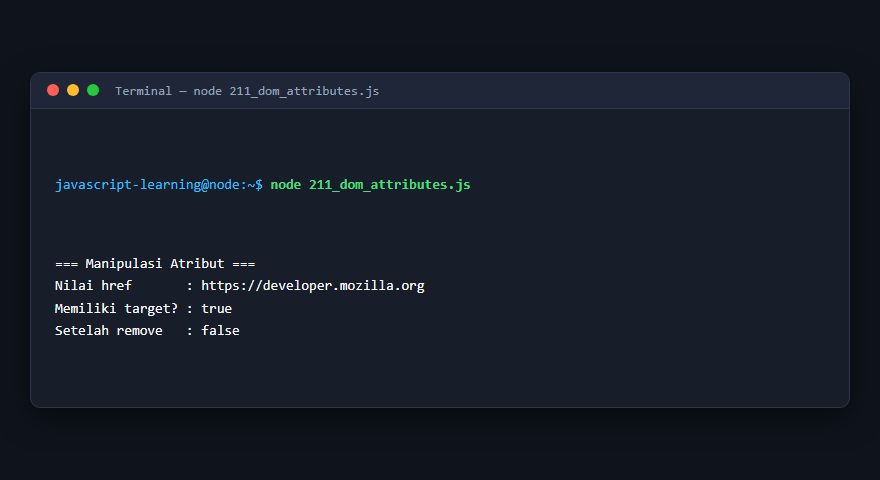

---

### 212. Manipulasi class CSS

**Tujuan Pembelajaran:** Memahami konsep dan implementasi praktis dari materi Manipulasi class CSS.

**Konsep Utama:** Program ini mendemonstrasikan prinsip Manipulasi class CSS secara komprehensif, terstruktur, dan bersih sesuai standar pemrograman JavaScript modern.

**Penjelasan Source Code:** Program mengeksekusi instruksi yang telah dilengkapi dengan komentar kode edukatif berbahasa Indonesia. Setiap blok logika penting dijelaskan secara rinci agar alur kerja program mudah dipahami oleh pembelajar.

**Source Code:** [212_dom_class_list.js](212_dom_class_list.js)

**Cara Menjalankan:**
```bash
node 212_dom_class_list.js
```

**Hasil yang Diharapkan:** Program akan mencetak log hasil evaluasi, perhitungan, atau pemrosesan data ke terminal secara akurat.

**Hasil Eksekusi:**

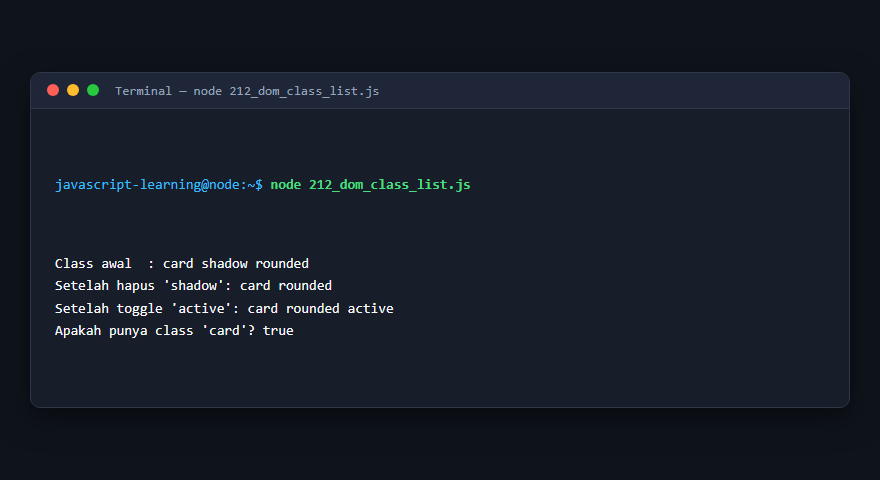

---

### 213. Manipulasi style

**Tujuan Pembelajaran:** Memahami konsep dan implementasi praktis dari materi Manipulasi style.

**Konsep Utama:** Program ini mendemonstrasikan prinsip Manipulasi style secara komprehensif, terstruktur, dan bersih sesuai standar pemrograman JavaScript modern.

**Penjelasan Source Code:** Program mengeksekusi instruksi yang telah dilengkapi dengan komentar kode edukatif berbahasa Indonesia. Setiap blok logika penting dijelaskan secara rinci agar alur kerja program mudah dipahami oleh pembelajar.

**Source Code:** [213_dom_style.js](213_dom_style.js)

**Cara Menjalankan:**
```bash
node 213_dom_style.js
```

**Hasil yang Diharapkan:** Program akan mencetak log hasil evaluasi, perhitungan, atau pemrosesan data ke terminal secara akurat.

**Hasil Eksekusi:**

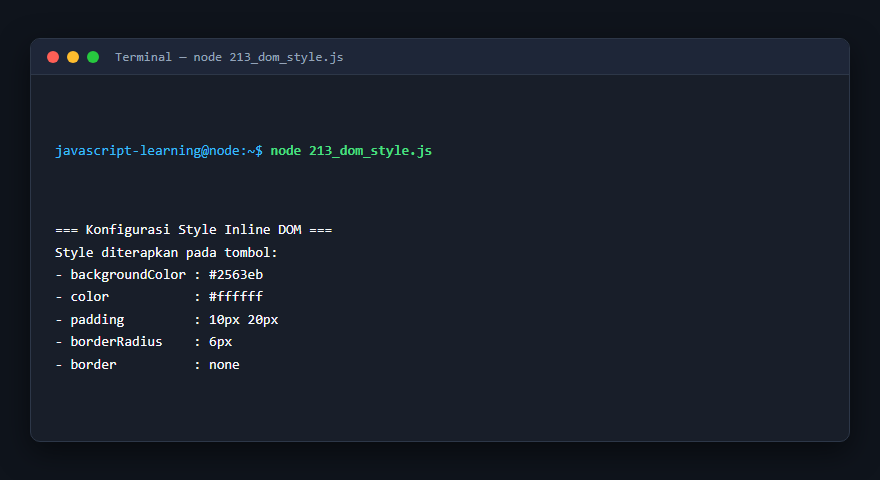

---

### 214. Membuat elemen DOM

**Tujuan Pembelajaran:** Memahami konsep dan implementasi praktis dari materi Membuat elemen DOM.

**Konsep Utama:** Program ini mendemonstrasikan prinsip Membuat elemen DOM secara komprehensif, terstruktur, dan bersih sesuai standar pemrograman JavaScript modern.

**Penjelasan Source Code:** Program mengeksekusi instruksi yang telah dilengkapi dengan komentar kode edukatif berbahasa Indonesia. Setiap blok logika penting dijelaskan secara rinci agar alur kerja program mudah dipahami oleh pembelajar.

**Source Code:** [214_dom_create_element.js](214_dom_create_element.js)

**Cara Menjalankan:**
```bash
node 214_dom_create_element.js
```

**Hasil yang Diharapkan:** Program akan mencetak log hasil evaluasi, perhitungan, atau pemrosesan data ke terminal secara akurat.

**Hasil Eksekusi:**

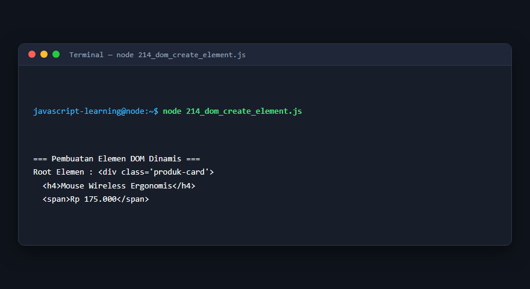

---

### 215. Menambah dan menghapus elemen

**Tujuan Pembelajaran:** Memahami konsep dan implementasi praktis dari materi Menambah dan menghapus elemen.

**Konsep Utama:** Program ini mendemonstrasikan prinsip Menambah dan menghapus elemen secara komprehensif, terstruktur, dan bersih sesuai standar pemrograman JavaScript modern.

**Penjelasan Source Code:** Program mengeksekusi instruksi yang telah dilengkapi dengan komentar kode edukatif berbahasa Indonesia. Setiap blok logika penting dijelaskan secara rinci agar alur kerja program mudah dipahami oleh pembelajar.

**Source Code:** [215_dom_append_remove.js](215_dom_append_remove.js)

**Cara Menjalankan:**
```bash
node 215_dom_append_remove.js
```

**Hasil yang Diharapkan:** Program akan mencetak log hasil evaluasi, perhitungan, atau pemrosesan data ke terminal secara akurat.

**Hasil Eksekusi:**

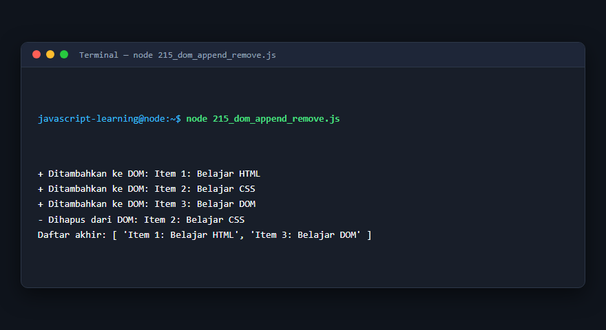

---

### 216. DOM traversal

**Tujuan Pembelajaran:** Memahami konsep dan implementasi praktis dari materi DOM traversal.

**Konsep Utama:** Program ini mendemonstrasikan prinsip DOM traversal secara komprehensif, terstruktur, dan bersih sesuai standar pemrograman JavaScript modern.

**Penjelasan Source Code:** Program mengeksekusi instruksi yang telah dilengkapi dengan komentar kode edukatif berbahasa Indonesia. Setiap blok logika penting dijelaskan secara rinci agar alur kerja program mudah dipahami oleh pembelajar.

**Source Code:** [216_dom_traversal.js](216_dom_traversal.js)

**Cara Menjalankan:**
```bash
node 216_dom_traversal.js
```

**Hasil yang Diharapkan:** Program akan mencetak log hasil evaluasi, perhitungan, atau pemrosesan data ke terminal secara akurat.

**Hasil Eksekusi:**

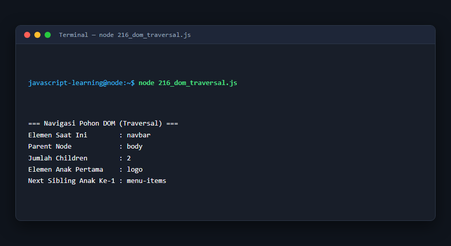

---

### 217. Event listener

**Tujuan Pembelajaran:** Memahami konsep dan implementasi praktis dari materi Event listener.

**Konsep Utama:** Program ini mendemonstrasikan prinsip Event listener secara komprehensif, terstruktur, dan bersih sesuai standar pemrograman JavaScript modern.

**Penjelasan Source Code:** Program mengeksekusi instruksi yang telah dilengkapi dengan komentar kode edukatif berbahasa Indonesia. Setiap blok logika penting dijelaskan secara rinci agar alur kerja program mudah dipahami oleh pembelajar.

**Source Code:** [217_dom_event_listener.js](217_dom_event_listener.js)

**Cara Menjalankan:**
```bash
node 217_dom_event_listener.js
```

**Hasil yang Diharapkan:** Program akan mencetak log hasil evaluasi, perhitungan, atau pemrosesan data ke terminal secara akurat.

**Hasil Eksekusi:**

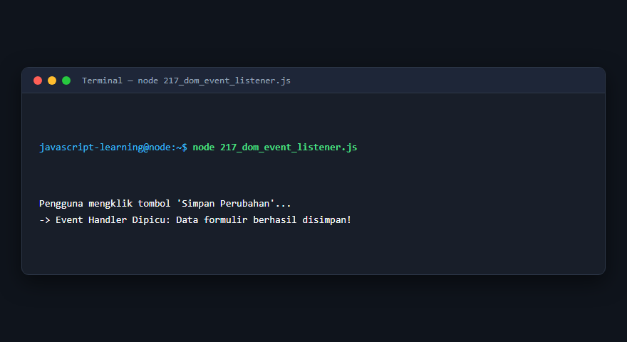

---

### 218. Event object

**Tujuan Pembelajaran:** Memahami konsep dan implementasi praktis dari materi Event object.

**Konsep Utama:** Program ini mendemonstrasikan prinsip Event object secara komprehensif, terstruktur, dan bersih sesuai standar pemrograman JavaScript modern.

**Penjelasan Source Code:** Program mengeksekusi instruksi yang telah dilengkapi dengan komentar kode edukatif berbahasa Indonesia. Setiap blok logika penting dijelaskan secara rinci agar alur kerja program mudah dipahami oleh pembelajar.

**Source Code:** [218_dom_event_object.js](218_dom_event_object.js)

**Cara Menjalankan:**
```bash
node 218_dom_event_object.js
```

**Hasil yang Diharapkan:** Program akan mencetak log hasil evaluasi, perhitungan, atau pemrosesan data ke terminal secara akurat.

**Hasil Eksekusi:**

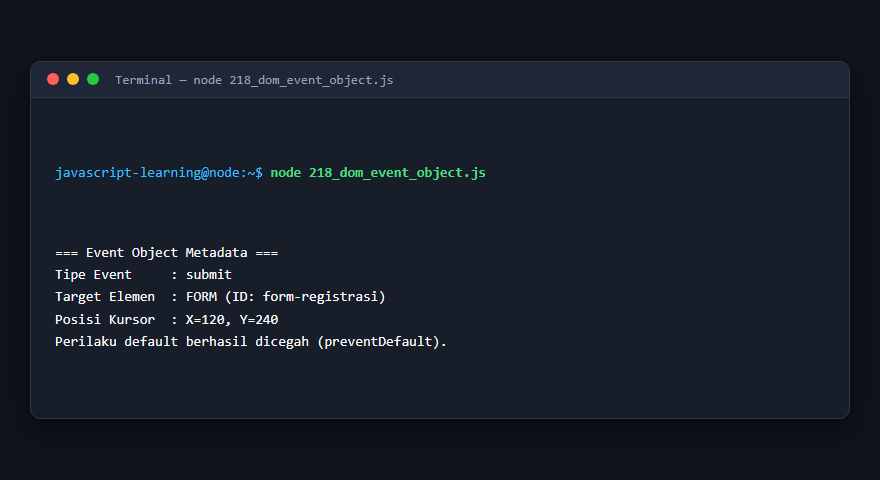

---

### 219. Event bubbling

**Tujuan Pembelajaran:** Memahami konsep dan implementasi praktis dari materi Event bubbling.

**Konsep Utama:** Program ini mendemonstrasikan prinsip Event bubbling secara komprehensif, terstruktur, dan bersih sesuai standar pemrograman JavaScript modern.

**Penjelasan Source Code:** Program mengeksekusi instruksi yang telah dilengkapi dengan komentar kode edukatif berbahasa Indonesia. Setiap blok logika penting dijelaskan secara rinci agar alur kerja program mudah dipahami oleh pembelajar.

**Source Code:** [219_event_bubbling.js](219_event_bubbling.js)

**Cara Menjalankan:**
```bash
node 219_event_bubbling.js
```

**Hasil yang Diharapkan:** Program akan mencetak log hasil evaluasi, perhitungan, atau pemrosesan data ke terminal secara akurat.

**Hasil Eksekusi:**

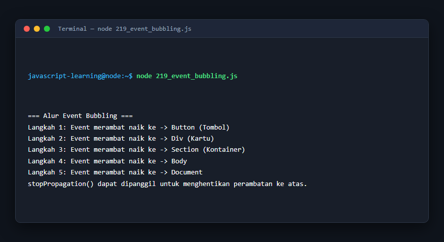

---

### 220. Event delegation

**Tujuan Pembelajaran:** Memahami konsep dan implementasi praktis dari materi Event delegation.

**Konsep Utama:** Program ini mendemonstrasikan prinsip Event delegation secara komprehensif, terstruktur, dan bersih sesuai standar pemrograman JavaScript modern.

**Penjelasan Source Code:** Program mengeksekusi instruksi yang telah dilengkapi dengan komentar kode edukatif berbahasa Indonesia. Setiap blok logika penting dijelaskan secara rinci agar alur kerja program mudah dipahami oleh pembelajar.

**Source Code:** [220_event_delegation.js](220_event_delegation.js)

**Cara Menjalankan:**
```bash
node 220_event_delegation.js
```

**Hasil yang Diharapkan:** Program akan mencetak log hasil evaluasi, perhitungan, atau pemrosesan data ke terminal secara akurat.

**Hasil Eksekusi:**

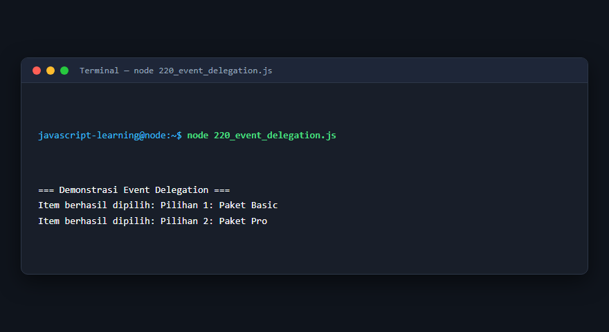

---

### 221. Validasi formulir

**Tujuan Pembelajaran:** Memahami konsep dan implementasi praktis dari materi Validasi formulir.

**Konsep Utama:** Program ini mendemonstrasikan prinsip Validasi formulir secara komprehensif, terstruktur, dan bersih sesuai standar pemrograman JavaScript modern.

**Penjelasan Source Code:** Program mengeksekusi instruksi yang telah dilengkapi dengan komentar kode edukatif berbahasa Indonesia. Setiap blok logika penting dijelaskan secara rinci agar alur kerja program mudah dipahami oleh pembelajar.

**Source Code:** [221_form_validation.js](221_form_validation.js)

**Cara Menjalankan:**
```bash
node 221_form_validation.js
```

**Hasil yang Diharapkan:** Program akan mencetak log hasil evaluasi, perhitungan, atau pemrosesan data ke terminal secara akurat.

**Hasil Eksekusi:**

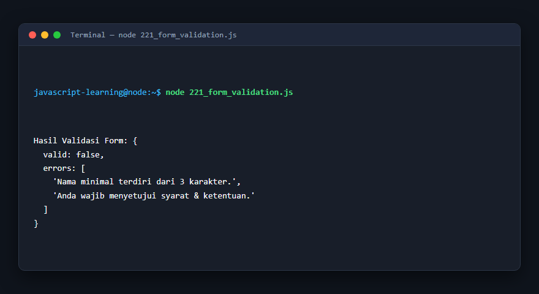

---

### 222. FormData

**Tujuan Pembelajaran:** Memahami konsep dan implementasi praktis dari materi FormData.

**Konsep Utama:** Program ini mendemonstrasikan prinsip FormData secara komprehensif, terstruktur, dan bersih sesuai standar pemrograman JavaScript modern.

**Penjelasan Source Code:** Program mengeksekusi instruksi yang telah dilengkapi dengan komentar kode edukatif berbahasa Indonesia. Setiap blok logika penting dijelaskan secara rinci agar alur kerja program mudah dipahami oleh pembelajar.

**Source Code:** [222_form_data.js](222_form_data.js)

**Cara Menjalankan:**
```bash
node 222_form_data.js
```

**Hasil yang Diharapkan:** Program akan mencetak log hasil evaluasi, perhitungan, atau pemrosesan data ke terminal secara akurat.

**Hasil Eksekusi:**

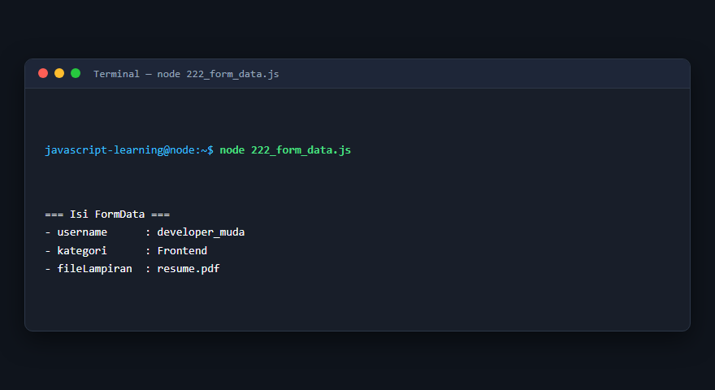

---

### 223. Keyboard events

**Tujuan Pembelajaran:** Memahami konsep dan implementasi praktis dari materi Keyboard events.

**Konsep Utama:** Program ini mendemonstrasikan prinsip Keyboard events secara komprehensif, terstruktur, dan bersih sesuai standar pemrograman JavaScript modern.

**Penjelasan Source Code:** Program mengeksekusi instruksi yang telah dilengkapi dengan komentar kode edukatif berbahasa Indonesia. Setiap blok logika penting dijelaskan secara rinci agar alur kerja program mudah dipahami oleh pembelajar.

**Source Code:** [223_keyboard_events.js](223_keyboard_events.js)

**Cara Menjalankan:**
```bash
node 223_keyboard_events.js
```

**Hasil yang Diharapkan:** Program akan mencetak log hasil evaluasi, perhitungan, atau pemrosesan data ke terminal secara akurat.

**Hasil Eksekusi:**

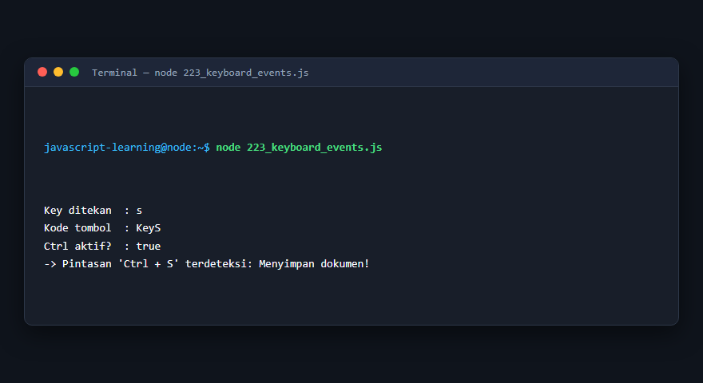

---

### 224. Mouse events

**Tujuan Pembelajaran:** Memahami konsep dan implementasi praktis dari materi Mouse events.

**Konsep Utama:** Program ini mendemonstrasikan prinsip Mouse events secara komprehensif, terstruktur, dan bersih sesuai standar pemrograman JavaScript modern.

**Penjelasan Source Code:** Program mengeksekusi instruksi yang telah dilengkapi dengan komentar kode edukatif berbahasa Indonesia. Setiap blok logika penting dijelaskan secara rinci agar alur kerja program mudah dipahami oleh pembelajar.

**Source Code:** [224_mouse_events.js](224_mouse_events.js)

**Cara Menjalankan:**
```bash
node 224_mouse_events.js
```

**Hasil yang Diharapkan:** Program akan mencetak log hasil evaluasi, perhitungan, atau pemrosesan data ke terminal secara akurat.

**Hasil Eksekusi:**

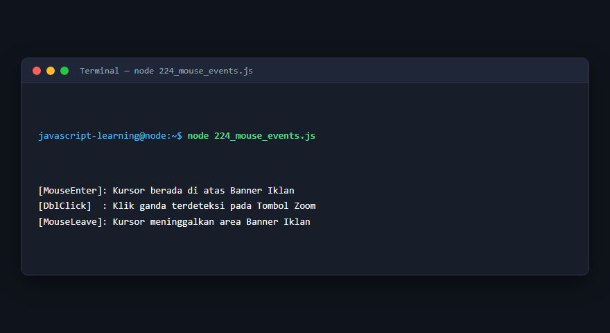

---

### 225. Local Storage

**Tujuan Pembelajaran:** Memahami konsep dan implementasi praktis dari materi Local Storage.

**Konsep Utama:** Program ini mendemonstrasikan prinsip Local Storage secara komprehensif, terstruktur, dan bersih sesuai standar pemrograman JavaScript modern.

**Penjelasan Source Code:** Program mengeksekusi instruksi yang telah dilengkapi dengan komentar kode edukatif berbahasa Indonesia. Setiap blok logika penting dijelaskan secara rinci agar alur kerja program mudah dipahami oleh pembelajar.

**Source Code:** [225_local_storage.js](225_local_storage.js)

**Cara Menjalankan:**
```bash
node 225_local_storage.js
```

**Hasil yang Diharapkan:** Program akan mencetak log hasil evaluasi, perhitungan, atau pemrosesan data ke terminal secara akurat.

**Hasil Eksekusi:**

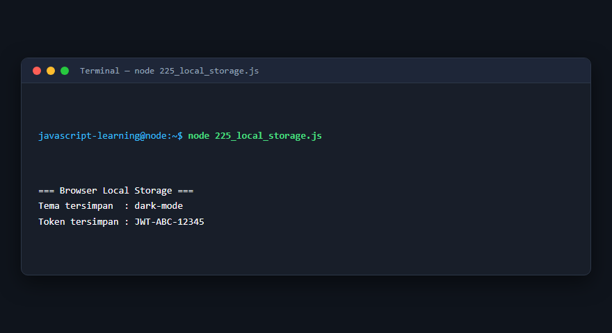

---

### 226. Session Storage

**Tujuan Pembelajaran:** Memahami konsep dan implementasi praktis dari materi Session Storage.

**Konsep Utama:** Program ini mendemonstrasikan prinsip Session Storage secara komprehensif, terstruktur, dan bersih sesuai standar pemrograman JavaScript modern.

**Penjelasan Source Code:** Program mengeksekusi instruksi yang telah dilengkapi dengan komentar kode edukatif berbahasa Indonesia. Setiap blok logika penting dijelaskan secara rinci agar alur kerja program mudah dipahami oleh pembelajar.

**Source Code:** [226_session_storage.js](226_session_storage.js)

**Cara Menjalankan:**
```bash
node 226_session_storage.js
```

**Hasil yang Diharapkan:** Program akan mencetak log hasil evaluasi, perhitungan, atau pemrosesan data ke terminal secara akurat.

**Hasil Eksekusi:**

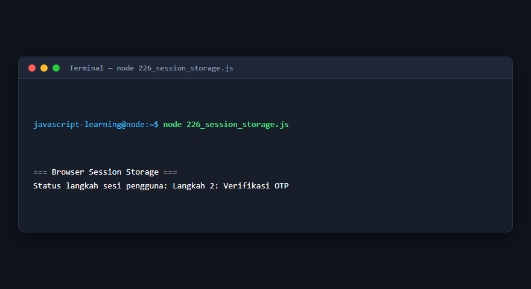

---

### 227. History API

**Tujuan Pembelajaran:** Memahami konsep dan implementasi praktis dari materi History API.

**Konsep Utama:** Program ini mendemonstrasikan prinsip History API secara komprehensif, terstruktur, dan bersih sesuai standar pemrograman JavaScript modern.

**Penjelasan Source Code:** Program mengeksekusi instruksi yang telah dilengkapi dengan komentar kode edukatif berbahasa Indonesia. Setiap blok logika penting dijelaskan secara rinci agar alur kerja program mudah dipahami oleh pembelajar.

**Source Code:** [227_browser_history.js](227_browser_history.js)

**Cara Menjalankan:**
```bash
node 227_browser_history.js
```

**Hasil yang Diharapkan:** Program akan mencetak log hasil evaluasi, perhitungan, atau pemrosesan data ke terminal secara akurat.

**Hasil Eksekusi:**

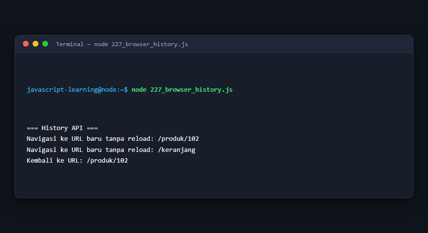

---

### 228. URL API

**Tujuan Pembelajaran:** Memahami konsep dan implementasi praktis dari materi URL API.

**Konsep Utama:** Program ini mendemonstrasikan prinsip URL API secara komprehensif, terstruktur, dan bersih sesuai standar pemrograman JavaScript modern.

**Penjelasan Source Code:** Program mengeksekusi instruksi yang telah dilengkapi dengan komentar kode edukatif berbahasa Indonesia. Setiap blok logika penting dijelaskan secara rinci agar alur kerja program mudah dipahami oleh pembelajar.

**Source Code:** [228_url_api.js](228_url_api.js)

**Cara Menjalankan:**
```bash
node 228_url_api.js
```

**Hasil yang Diharapkan:** Program akan mencetak log hasil evaluasi, perhitungan, atau pemrosesan data ke terminal secara akurat.

**Hasil Eksekusi:**

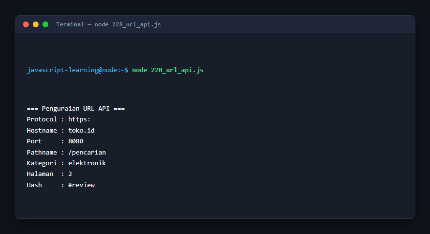

---

### 229. Intersection Observer

**Tujuan Pembelajaran:** Memahami konsep dan implementasi praktis dari materi Intersection Observer.

**Konsep Utama:** Program ini mendemonstrasikan prinsip Intersection Observer secara komprehensif, terstruktur, dan bersih sesuai standar pemrograman JavaScript modern.

**Penjelasan Source Code:** Program mengeksekusi instruksi yang telah dilengkapi dengan komentar kode edukatif berbahasa Indonesia. Setiap blok logika penting dijelaskan secara rinci agar alur kerja program mudah dipahami oleh pembelajar.

**Source Code:** [229_intersection_observer.js](229_intersection_observer.js)

**Cara Menjalankan:**
```bash
node 229_intersection_observer.js
```

**Hasil yang Diharapkan:** Program akan mencetak log hasil evaluasi, perhitungan, atau pemrosesan data ke terminal secara akurat.

**Hasil Eksekusi:**

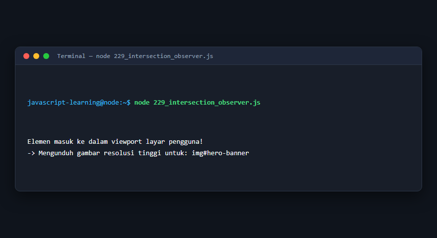

---

### 230. Mutation Observer

**Tujuan Pembelajaran:** Memahami konsep dan implementasi praktis dari materi Mutation Observer.

**Konsep Utama:** Program ini mendemonstrasikan prinsip Mutation Observer secara komprehensif, terstruktur, dan bersih sesuai standar pemrograman JavaScript modern.

**Penjelasan Source Code:** Program mengeksekusi instruksi yang telah dilengkapi dengan komentar kode edukatif berbahasa Indonesia. Setiap blok logika penting dijelaskan secara rinci agar alur kerja program mudah dipahami oleh pembelajar.

**Source Code:** [230_mutation_observer.js](230_mutation_observer.js)

**Cara Menjalankan:**
```bash
node 230_mutation_observer.js
```

**Hasil yang Diharapkan:** Program akan mencetak log hasil evaluasi, perhitungan, atau pemrosesan data ke terminal secara akurat.

**Hasil Eksekusi:**

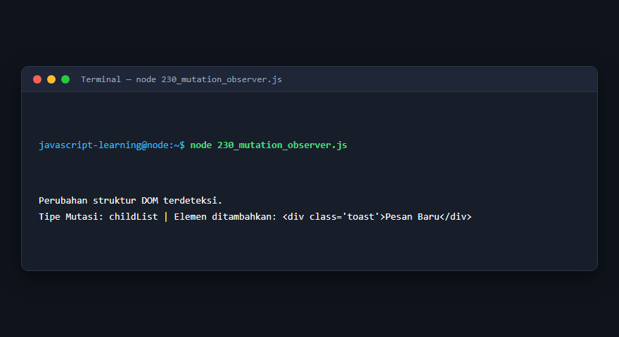

---

## Ringkasan Modul

Modul 14 (DOM dan Browser Programming) telah menyajikan pembelajaran berbasis praktik yang terstruktur. Seluruh program di dalam modul ini dapat dijalankan secara mandiri tanpa saling membebani dependensi yang rumit, dengan fokus mendalam pada pemahaman konsep dan kebiasaan baik penulisan kode.
