# Modul 15: Asynchronous JavaScript dan Web API

## Deskripsi Modul
Modul ini mendalami eksekusi asinkron, Event Loop, Microtask Queue, Promise, async/await, Fetch API, hingga komunikasi real-time WebSocket.

## Tujuan Pembelajaran
Menguasai pemrosesan operasi non-blocking, integrasi REST API eksternal, dan penanganan asynchronous concurrency.

## Daftar Submodul & Materi

- [231_set_timeout.js](231_set_timeout.js) : `setTimeout()`
- [232_set_interval.js](232_set_interval.js) : `setInterval()`
- [233_event_loop.js](233_event_loop.js) : Event loop
- [234_call_stack.js](234_call_stack.js) : Call stack
- [235_microtask_queue.js](235_microtask_queue.js) : Microtask queue
- [236_promise_basic.js](236_promise_basic.js) : Promise
- [237_promise_then_catch.js](237_promise_then_catch.js) : `.then()` dan `.catch()`
- [238_promise_all.js](238_promise_all.js) : `Promise.all()`
- [239_promise_all_settled.js](239_promise_all_settled.js) : `Promise.allSettled()`
- [240_promise_race.js](240_promise_race.js) : `Promise.race()`
- [241_async_function.js](241_async_function.js) : Async function
- [242_await_keyword.js](242_await_keyword.js) : Keyword `await`
- [243_async_error_handling.js](243_async_error_handling.js) : Error handling asynchronous
- [244_fetch_api.js](244_fetch_api.js) : Fetch API
- [245_fetch_get_request.js](245_fetch_get_request.js) : HTTP GET request
- [246_fetch_post_request.js](246_fetch_post_request.js) : HTTP POST request
- [247_abort_controller.js](247_abort_controller.js) : AbortController
- [248_web_workers.js](248_web_workers.js) : Web Workers
- [249_web_socket_client.js](249_web_socket_client.js) : WebSocket client
- [250_async_iteration.js](250_async_iteration.js) : Asynchronous iteration

---

## Penjelasan Detail Setiap Submodul

### 231. `setTimeout()`

**Tujuan Pembelajaran:** Memahami konsep dan implementasi praktis dari materi `setTimeout()`.

**Konsep Utama:** Program ini mendemonstrasikan prinsip `setTimeout()` secara komprehensif, terstruktur, dan bersih sesuai standar pemrograman JavaScript modern.

**Penjelasan Source Code:** Program mengeksekusi instruksi yang telah dilengkapi dengan komentar kode edukatif berbahasa Indonesia. Setiap blok logika penting dijelaskan secara rinci agar alur kerja program mudah dipahami oleh pembelajar.

**Source Code:** [231_set_timeout.js](231_set_timeout.js)

**Cara Menjalankan:**
```bash
node 231_set_timeout.js
```

**Hasil yang Diharapkan:** Program akan mencetak log hasil evaluasi, perhitungan, atau pemrosesan data ke terminal secara akurat.

**Hasil Eksekusi:**


---

### 232. `setInterval()`

**Tujuan Pembelajaran:** Memahami konsep dan implementasi praktis dari materi `setInterval()`.

**Konsep Utama:** Program ini mendemonstrasikan prinsip `setInterval()` secara komprehensif, terstruktur, dan bersih sesuai standar pemrograman JavaScript modern.

**Penjelasan Source Code:** Program mengeksekusi instruksi yang telah dilengkapi dengan komentar kode edukatif berbahasa Indonesia. Setiap blok logika penting dijelaskan secara rinci agar alur kerja program mudah dipahami oleh pembelajar.

**Source Code:** [232_set_interval.js](232_set_interval.js)

**Cara Menjalankan:**
```bash
node 232_set_interval.js
```

**Hasil yang Diharapkan:** Program akan mencetak log hasil evaluasi, perhitungan, atau pemrosesan data ke terminal secara akurat.

**Hasil Eksekusi:**


---

### 233. Event loop

**Tujuan Pembelajaran:** Memahami konsep dan implementasi praktis dari materi Event loop.

**Konsep Utama:** Program ini mendemonstrasikan prinsip Event loop secara komprehensif, terstruktur, dan bersih sesuai standar pemrograman JavaScript modern.

**Penjelasan Source Code:** Program mengeksekusi instruksi yang telah dilengkapi dengan komentar kode edukatif berbahasa Indonesia. Setiap blok logika penting dijelaskan secara rinci agar alur kerja program mudah dipahami oleh pembelajar.

**Source Code:** [233_event_loop.js](233_event_loop.js)

**Cara Menjalankan:**
```bash
node 233_event_loop.js
```

**Hasil yang Diharapkan:** Program akan mencetak log hasil evaluasi, perhitungan, atau pemrosesan data ke terminal secara akurat.

**Hasil Eksekusi:**

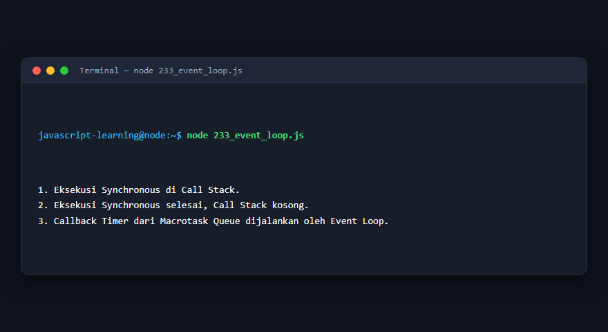

---

### 234. Call stack

**Tujuan Pembelajaran:** Memahami konsep dan implementasi praktis dari materi Call stack.

**Konsep Utama:** Program ini mendemonstrasikan prinsip Call stack secara komprehensif, terstruktur, dan bersih sesuai standar pemrograman JavaScript modern.

**Penjelasan Source Code:** Program mengeksekusi instruksi yang telah dilengkapi dengan komentar kode edukatif berbahasa Indonesia. Setiap blok logika penting dijelaskan secara rinci agar alur kerja program mudah dipahami oleh pembelajar.

**Source Code:** [234_call_stack.js](234_call_stack.js)

**Cara Menjalankan:**
```bash
node 234_call_stack.js
```

**Hasil yang Diharapkan:** Program akan mencetak log hasil evaluasi, perhitungan, atau pemrosesan data ke terminal secara akurat.

**Hasil Eksekusi:**

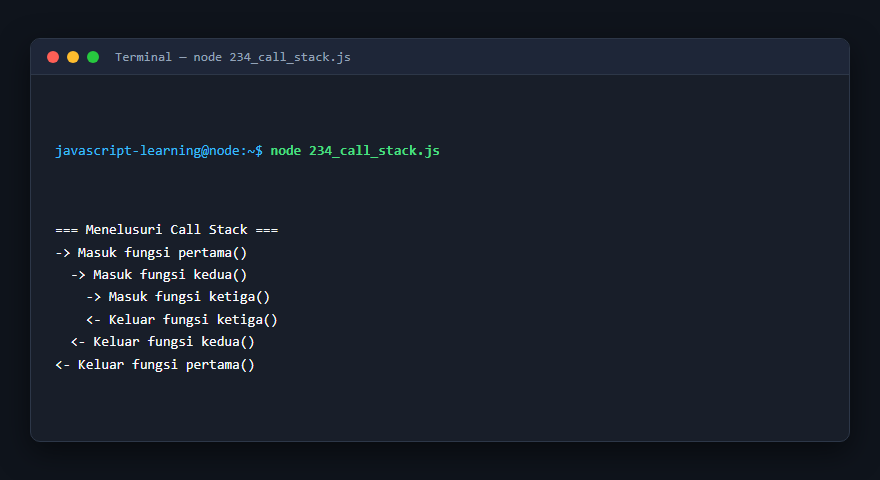

---

### 235. Microtask queue

**Tujuan Pembelajaran:** Memahami konsep dan implementasi praktis dari materi Microtask queue.

**Konsep Utama:** Program ini mendemonstrasikan prinsip Microtask queue secara komprehensif, terstruktur, dan bersih sesuai standar pemrograman JavaScript modern.

**Penjelasan Source Code:** Program mengeksekusi instruksi yang telah dilengkapi dengan komentar kode edukatif berbahasa Indonesia. Setiap blok logika penting dijelaskan secara rinci agar alur kerja program mudah dipahami oleh pembelajar.

**Source Code:** [235_microtask_queue.js](235_microtask_queue.js)

**Cara Menjalankan:**
```bash
node 235_microtask_queue.js
```

**Hasil yang Diharapkan:** Program akan mencetak log hasil evaluasi, perhitungan, atau pemrosesan data ke terminal secara akurat.

**Hasil Eksekusi:**

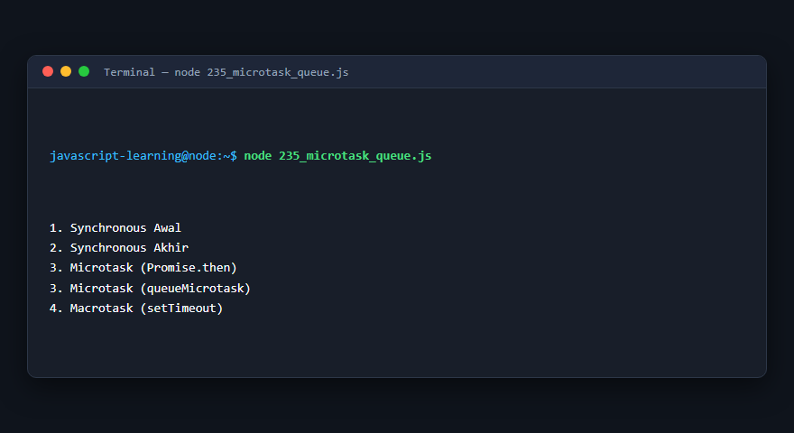

---

### 236. Promise

**Tujuan Pembelajaran:** Memahami konsep dan implementasi praktis dari materi Promise.

**Konsep Utama:** Program ini mendemonstrasikan prinsip Promise secara komprehensif, terstruktur, dan bersih sesuai standar pemrograman JavaScript modern.

**Penjelasan Source Code:** Program mengeksekusi instruksi yang telah dilengkapi dengan komentar kode edukatif berbahasa Indonesia. Setiap blok logika penting dijelaskan secara rinci agar alur kerja program mudah dipahami oleh pembelajar.

**Source Code:** [236_promise_basic.js](236_promise_basic.js)

**Cara Menjalankan:**
```bash
node 236_promise_basic.js
```

**Hasil yang Diharapkan:** Program akan mencetak log hasil evaluasi, perhitungan, atau pemrosesan data ke terminal secara akurat.

**Hasil Eksekusi:**

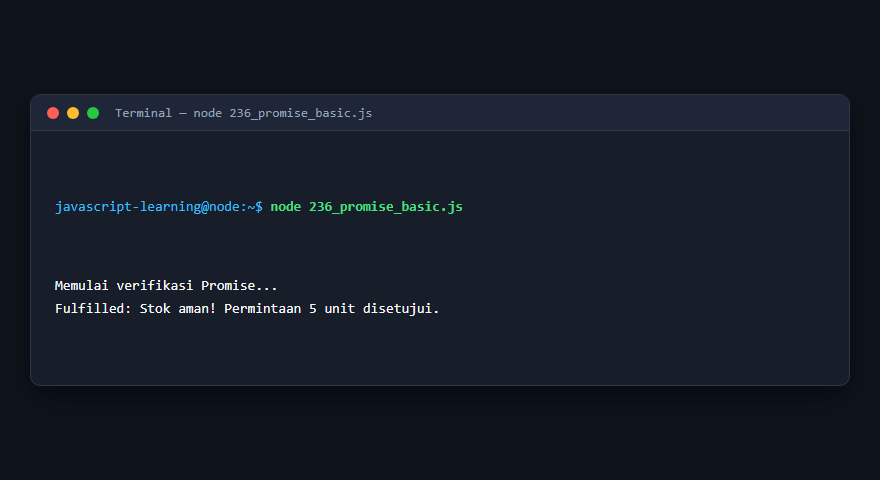

---

### 237. `.then()` dan `.catch()`

**Tujuan Pembelajaran:** Memahami konsep dan implementasi praktis dari materi `.then()` dan `.catch()`.

**Konsep Utama:** Program ini mendemonstrasikan prinsip `.then()` dan `.catch()` secara komprehensif, terstruktur, dan bersih sesuai standar pemrograman JavaScript modern.

**Penjelasan Source Code:** Program mengeksekusi instruksi yang telah dilengkapi dengan komentar kode edukatif berbahasa Indonesia. Setiap blok logika penting dijelaskan secara rinci agar alur kerja program mudah dipahami oleh pembelajar.

**Source Code:** [237_promise_then_catch.js](237_promise_then_catch.js)

**Cara Menjalankan:**
```bash
node 237_promise_then_catch.js
```

**Hasil yang Diharapkan:** Program akan mencetak log hasil evaluasi, perhitungan, atau pemrosesan data ke terminal secara akurat.

**Hasil Eksekusi:**


---

### 238. `Promise.all()`

**Tujuan Pembelajaran:** Memahami konsep dan implementasi praktis dari materi `Promise.all()`.

**Konsep Utama:** Program ini mendemonstrasikan prinsip `Promise.all()` secara komprehensif, terstruktur, dan bersih sesuai standar pemrograman JavaScript modern.

**Penjelasan Source Code:** Program mengeksekusi instruksi yang telah dilengkapi dengan komentar kode edukatif berbahasa Indonesia. Setiap blok logika penting dijelaskan secara rinci agar alur kerja program mudah dipahami oleh pembelajar.

**Source Code:** [238_promise_all.js](238_promise_all.js)

**Cara Menjalankan:**
```bash
node 238_promise_all.js
```

**Hasil yang Diharapkan:** Program akan mencetak log hasil evaluasi, perhitungan, atau pemrosesan data ke terminal secara akurat.

**Hasil Eksekusi:**


---

### 239. `Promise.allSettled()`

**Tujuan Pembelajaran:** Memahami konsep dan implementasi praktis dari materi `Promise.allSettled()`.

**Konsep Utama:** Program ini mendemonstrasikan prinsip `Promise.allSettled()` secara komprehensif, terstruktur, dan bersih sesuai standar pemrograman JavaScript modern.

**Penjelasan Source Code:** Program mengeksekusi instruksi yang telah dilengkapi dengan komentar kode edukatif berbahasa Indonesia. Setiap blok logika penting dijelaskan secara rinci agar alur kerja program mudah dipahami oleh pembelajar.

**Source Code:** [239_promise_all_settled.js](239_promise_all_settled.js)

**Cara Menjalankan:**
```bash
node 239_promise_all_settled.js
```

**Hasil yang Diharapkan:** Program akan mencetak log hasil evaluasi, perhitungan, atau pemrosesan data ke terminal secara akurat.

**Hasil Eksekusi:**


---

### 240. `Promise.race()`

**Tujuan Pembelajaran:** Memahami konsep dan implementasi praktis dari materi `Promise.race()`.

**Konsep Utama:** Program ini mendemonstrasikan prinsip `Promise.race()` secara komprehensif, terstruktur, dan bersih sesuai standar pemrograman JavaScript modern.

**Penjelasan Source Code:** Program mengeksekusi instruksi yang telah dilengkapi dengan komentar kode edukatif berbahasa Indonesia. Setiap blok logika penting dijelaskan secara rinci agar alur kerja program mudah dipahami oleh pembelajar.

**Source Code:** [240_promise_race.js](240_promise_race.js)

**Cara Menjalankan:**
```bash
node 240_promise_race.js
```

**Hasil yang Diharapkan:** Program akan mencetak log hasil evaluasi, perhitungan, atau pemrosesan data ke terminal secara akurat.

**Hasil Eksekusi:**


---

### 241. Async function

**Tujuan Pembelajaran:** Memahami konsep dan implementasi praktis dari materi Async function.

**Konsep Utama:** Program ini mendemonstrasikan prinsip Async function secara komprehensif, terstruktur, dan bersih sesuai standar pemrograman JavaScript modern.

**Penjelasan Source Code:** Program mengeksekusi instruksi yang telah dilengkapi dengan komentar kode edukatif berbahasa Indonesia. Setiap blok logika penting dijelaskan secara rinci agar alur kerja program mudah dipahami oleh pembelajar.

**Source Code:** [241_async_function.js](241_async_function.js)

**Cara Menjalankan:**
```bash
node 241_async_function.js
```

**Hasil yang Diharapkan:** Program akan mencetak log hasil evaluasi, perhitungan, atau pemrosesan data ke terminal secara akurat.

**Hasil Eksekusi:**

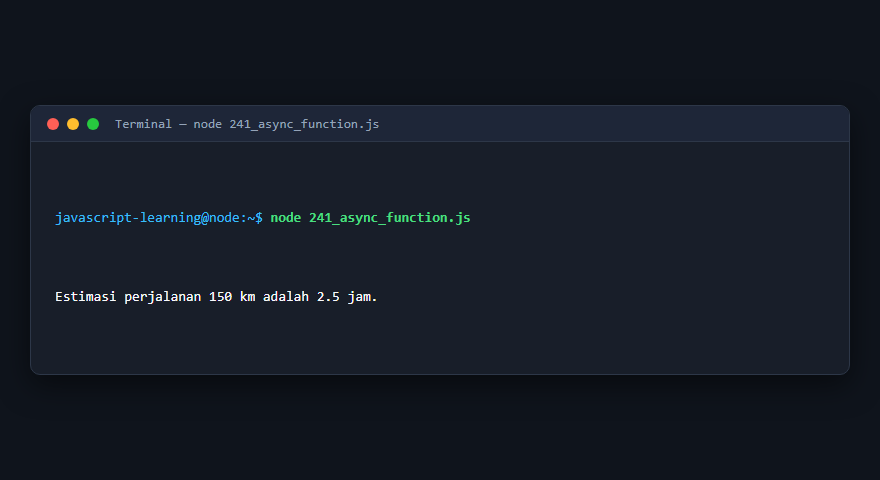

---

### 242. Keyword `await`

**Tujuan Pembelajaran:** Memahami konsep dan implementasi praktis dari materi Keyword `await`.

**Konsep Utama:** Program ini mendemonstrasikan prinsip Keyword `await` secara komprehensif, terstruktur, dan bersih sesuai standar pemrograman JavaScript modern.

**Penjelasan Source Code:** Program mengeksekusi instruksi yang telah dilengkapi dengan komentar kode edukatif berbahasa Indonesia. Setiap blok logika penting dijelaskan secara rinci agar alur kerja program mudah dipahami oleh pembelajar.

**Source Code:** [242_await_keyword.js](242_await_keyword.js)

**Cara Menjalankan:**
```bash
node 242_await_keyword.js
```

**Hasil yang Diharapkan:** Program akan mencetak log hasil evaluasi, perhitungan, atau pemrosesan data ke terminal secara akurat.

**Hasil Eksekusi:**


---

### 243. Error handling asynchronous

**Tujuan Pembelajaran:** Memahami konsep dan implementasi praktis dari materi Error handling asynchronous.

**Konsep Utama:** Program ini mendemonstrasikan prinsip Error handling asynchronous secara komprehensif, terstruktur, dan bersih sesuai standar pemrograman JavaScript modern.

**Penjelasan Source Code:** Program mengeksekusi instruksi yang telah dilengkapi dengan komentar kode edukatif berbahasa Indonesia. Setiap blok logika penting dijelaskan secara rinci agar alur kerja program mudah dipahami oleh pembelajar.

**Source Code:** [243_async_error_handling.js](243_async_error_handling.js)

**Cara Menjalankan:**
```bash
node 243_async_error_handling.js
```

**Hasil yang Diharapkan:** Program akan mencetak log hasil evaluasi, perhitungan, atau pemrosesan data ke terminal secara akurat.

**Hasil Eksekusi:**

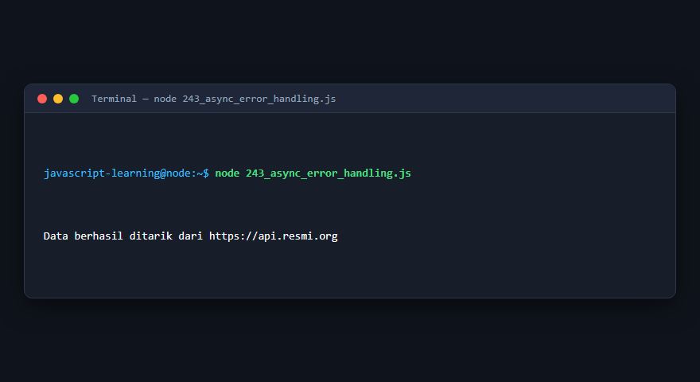

---

### 244. Fetch API

**Tujuan Pembelajaran:** Memahami konsep dan implementasi praktis dari materi Fetch API.

**Konsep Utama:** Program ini mendemonstrasikan prinsip Fetch API secara komprehensif, terstruktur, dan bersih sesuai standar pemrograman JavaScript modern.

**Penjelasan Source Code:** Program mengeksekusi instruksi yang telah dilengkapi dengan komentar kode edukatif berbahasa Indonesia. Setiap blok logika penting dijelaskan secara rinci agar alur kerja program mudah dipahami oleh pembelajar.

**Source Code:** [244_fetch_api.js](244_fetch_api.js)

**Cara Menjalankan:**
```bash
node 244_fetch_api.js
```

**Hasil yang Diharapkan:** Program akan mencetak log hasil evaluasi, perhitungan, atau pemrosesan data ke terminal secara akurat.

**Hasil Eksekusi:**

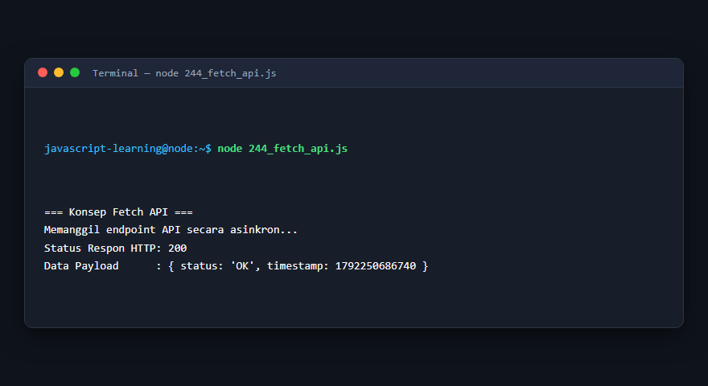

---

### 245. HTTP GET request

**Tujuan Pembelajaran:** Memahami konsep dan implementasi praktis dari materi HTTP GET request.

**Konsep Utama:** Program ini mendemonstrasikan prinsip HTTP GET request secara komprehensif, terstruktur, dan bersih sesuai standar pemrograman JavaScript modern.

**Penjelasan Source Code:** Program mengeksekusi instruksi yang telah dilengkapi dengan komentar kode edukatif berbahasa Indonesia. Setiap blok logika penting dijelaskan secara rinci agar alur kerja program mudah dipahami oleh pembelajar.

**Source Code:** [245_fetch_get_request.js](245_fetch_get_request.js)

**Cara Menjalankan:**
```bash
node 245_fetch_get_request.js
```

**Hasil yang Diharapkan:** Program akan mencetak log hasil evaluasi, perhitungan, atau pemrosesan data ke terminal secara akurat.

**Hasil Eksekusi:**

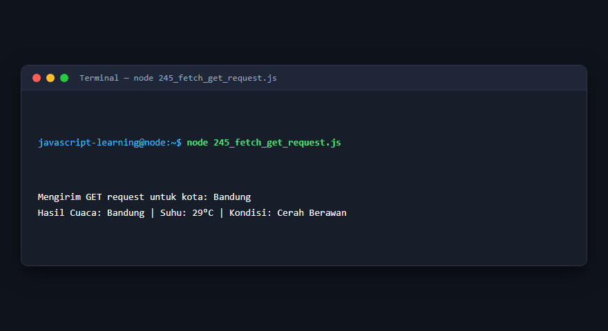

---

### 246. HTTP POST request

**Tujuan Pembelajaran:** Memahami konsep dan implementasi praktis dari materi HTTP POST request.

**Konsep Utama:** Program ini mendemonstrasikan prinsip HTTP POST request secara komprehensif, terstruktur, dan bersih sesuai standar pemrograman JavaScript modern.

**Penjelasan Source Code:** Program mengeksekusi instruksi yang telah dilengkapi dengan komentar kode edukatif berbahasa Indonesia. Setiap blok logika penting dijelaskan secara rinci agar alur kerja program mudah dipahami oleh pembelajar.

**Source Code:** [246_fetch_post_request.js](246_fetch_post_request.js)

**Cara Menjalankan:**
```bash
node 246_fetch_post_request.js
```

**Hasil yang Diharapkan:** Program akan mencetak log hasil evaluasi, perhitungan, atau pemrosesan data ke terminal secara akurat.

**Hasil Eksekusi:**

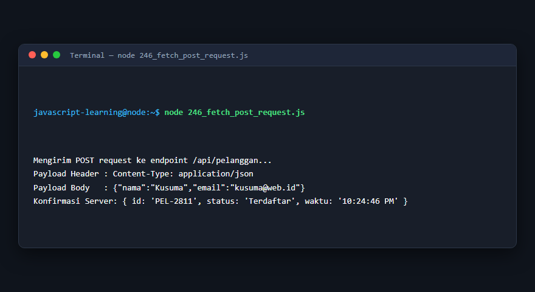

---

### 247. AbortController

**Tujuan Pembelajaran:** Memahami konsep dan implementasi praktis dari materi AbortController.

**Konsep Utama:** Program ini mendemonstrasikan prinsip AbortController secara komprehensif, terstruktur, dan bersih sesuai standar pemrograman JavaScript modern.

**Penjelasan Source Code:** Program mengeksekusi instruksi yang telah dilengkapi dengan komentar kode edukatif berbahasa Indonesia. Setiap blok logika penting dijelaskan secara rinci agar alur kerja program mudah dipahami oleh pembelajar.

**Source Code:** [247_abort_controller.js](247_abort_controller.js)

**Cara Menjalankan:**
```bash
node 247_abort_controller.js
```

**Hasil yang Diharapkan:** Program akan mencetak log hasil evaluasi, perhitungan, atau pemrosesan data ke terminal secara akurat.

**Hasil Eksekusi:**

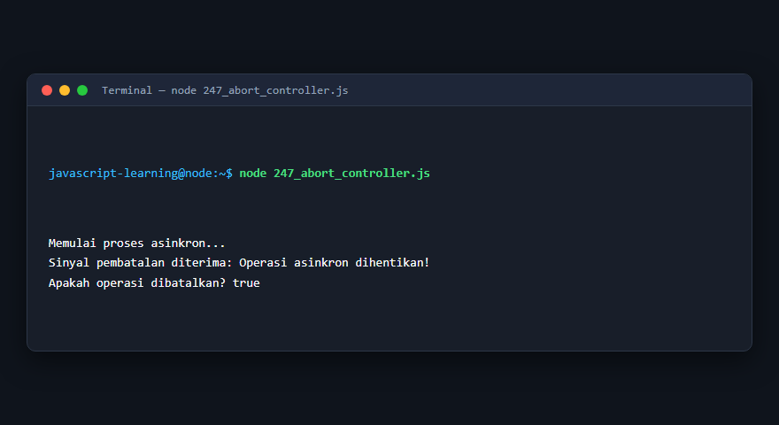

---

### 248. Web Workers

**Tujuan Pembelajaran:** Memahami konsep dan implementasi praktis dari materi Web Workers.

**Konsep Utama:** Program ini mendemonstrasikan prinsip Web Workers secara komprehensif, terstruktur, dan bersih sesuai standar pemrograman JavaScript modern.

**Penjelasan Source Code:** Program mengeksekusi instruksi yang telah dilengkapi dengan komentar kode edukatif berbahasa Indonesia. Setiap blok logika penting dijelaskan secara rinci agar alur kerja program mudah dipahami oleh pembelajar.

**Source Code:** [248_web_workers.js](248_web_workers.js)

**Cara Menjalankan:**
```bash
node 248_web_workers.js
```

**Hasil yang Diharapkan:** Program akan mencetak log hasil evaluasi, perhitungan, atau pemrosesan data ke terminal secara akurat.

**Hasil Eksekusi:**

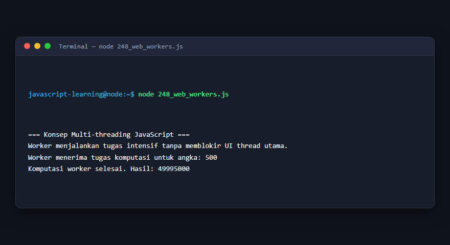

---

### 249. WebSocket client

**Tujuan Pembelajaran:** Memahami konsep dan implementasi praktis dari materi WebSocket client.

**Konsep Utama:** Program ini mendemonstrasikan prinsip WebSocket client secara komprehensif, terstruktur, dan bersih sesuai standar pemrograman JavaScript modern.

**Penjelasan Source Code:** Program mengeksekusi instruksi yang telah dilengkapi dengan komentar kode edukatif berbahasa Indonesia. Setiap blok logika penting dijelaskan secara rinci agar alur kerja program mudah dipahami oleh pembelajar.

**Source Code:** [249_web_socket_client.js](249_web_socket_client.js)

**Cara Menjalankan:**
```bash
node 249_web_socket_client.js
```

**Hasil yang Diharapkan:** Program akan mencetak log hasil evaluasi, perhitungan, atau pemrosesan data ke terminal secara akurat.

**Hasil Eksekusi:**

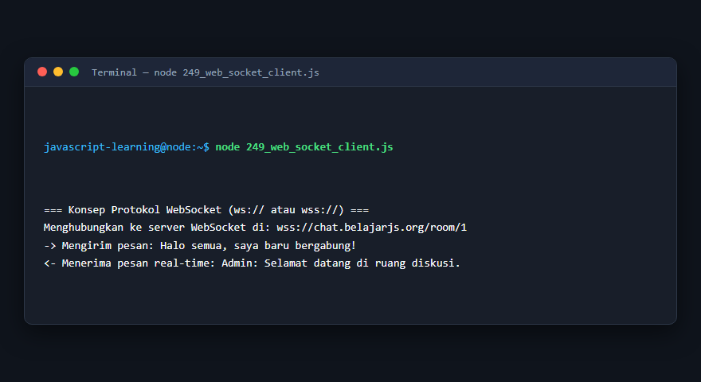

---

### 250. Asynchronous iteration

**Tujuan Pembelajaran:** Memahami konsep dan implementasi praktis dari materi Asynchronous iteration.

**Konsep Utama:** Program ini mendemonstrasikan prinsip Asynchronous iteration secara komprehensif, terstruktur, dan bersih sesuai standar pemrograman JavaScript modern.

**Penjelasan Source Code:** Program mengeksekusi instruksi yang telah dilengkapi dengan komentar kode edukatif berbahasa Indonesia. Setiap blok logika penting dijelaskan secara rinci agar alur kerja program mudah dipahami oleh pembelajar.

**Source Code:** [250_async_iteration.js](250_async_iteration.js)

**Cara Menjalankan:**
```bash
node 250_async_iteration.js
```

**Hasil yang Diharapkan:** Program akan mencetak log hasil evaluasi, perhitungan, atau pemrosesan data ke terminal secara akurat.

**Hasil Eksekusi:**

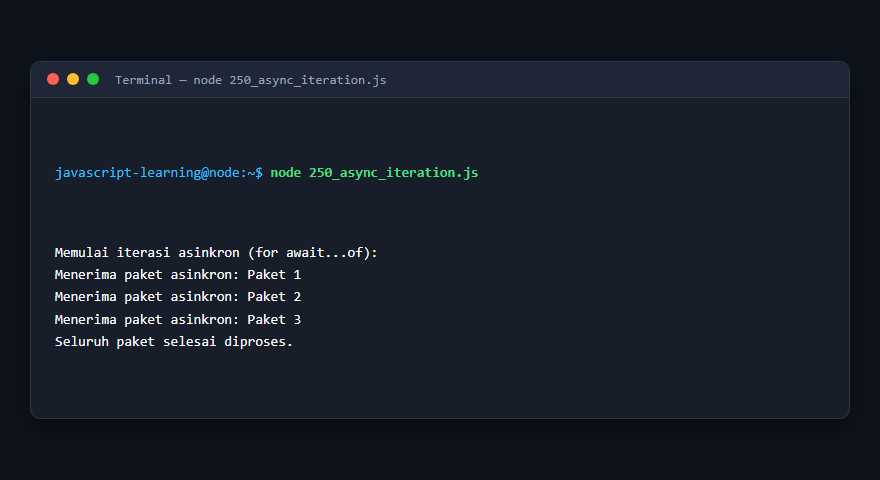

---

## Ringkasan Modul

Modul 15 (Asynchronous JavaScript dan Web API) telah menyajikan pembelajaran berbasis praktik yang terstruktur. Seluruh program di dalam modul ini dapat dijalankan secara mandiri tanpa saling membebani dependensi yang rumit, dengan fokus mendalam pada pemahaman konsep dan kebiasaan baik penulisan kode.
