# Modul 16: Node.js dan Backend Programming

## Deskripsi Modul
Modul ini membahas pemrograman backend menggunakan runtime Node.js, file system, HTTP server, modul OS, crypto, serta framework Express.

## Tujuan Pembelajaran
Mampu membangun server backend mandiri, mengelola routing, middleware, dan mengekspos endpoint RESTful API.

## Daftar Submodul & Materi

- [251_nodejs_hello_world.js](251_nodejs_hello_world.js) : Program Node.js pertama
- [252_nodejs_process.js](252_nodejs_process.js) : Process object
- [253_nodejs_command_line.js](253_nodejs_command_line.js) : Command-line arguments
- [254_nodejs_file_read.js](254_nodejs_file_read.js) : Membaca file
- [255_nodejs_file_write.js](255_nodejs_file_write.js) : Menulis file
- [256_nodejs_file_system.js](256_nodejs_file_system.js) : File System API
- [257_nodejs_path.js](257_nodejs_path.js) : Path module
- [258_nodejs_os.js](258_nodejs_os.js) : OS module
- [259_nodejs_events.js](259_nodejs_events.js) : EventEmitter
- [260_nodejs_streams.js](260_nodejs_streams.js) : Streams
- [261_nodejs_buffer.js](261_nodejs_buffer.js) : Buffer
- [262_nodejs_http_server.js](262_nodejs_http_server.js) : HTTP server
- [263_nodejs_http_client.js](263_nodejs_http_client.js) : HTTP client
- [264_nodejs_url.js](264_nodejs_url.js) : URL dan URLSearchParams
- [265_nodejs_crypto.js](265_nodejs_crypto.js) : Crypto module
- [266_nodejs_environment.js](266_nodejs_environment.js) : Environment configuration
- [267_express_server.js](267_express_server.js) : Server menggunakan Express
- [268_express_routes.js](268_express_routes.js) : Routing Express
- [269_express_middleware.js](269_express_middleware.js) : Middleware Express
- [270_express_rest_api.js](270_express_rest_api.js) : REST API menggunakan Express

---

## Penjelasan Detail Setiap Submodul

### 251. Program Node.js pertama

**Tujuan Pembelajaran:** Memahami konsep dan implementasi praktis dari materi Program Node.js pertama.

**Konsep Utama:** Program ini mendemonstrasikan prinsip Program Node.js pertama secara komprehensif, terstruktur, dan bersih sesuai standar pemrograman JavaScript modern.

**Penjelasan Source Code:** Program mengeksekusi instruksi yang telah dilengkapi dengan komentar kode edukatif berbahasa Indonesia. Setiap blok logika penting dijelaskan secara rinci agar alur kerja program mudah dipahami oleh pembelajar.

**Source Code:** [251_nodejs_hello_world.js](251_nodejs_hello_world.js)

**Cara Menjalankan:**
```bash
node 251_nodejs_hello_world.js
```

**Hasil yang Diharapkan:** Program akan mencetak log hasil evaluasi, perhitungan, atau pemrosesan data ke terminal secara akurat.

**Hasil Eksekusi:**

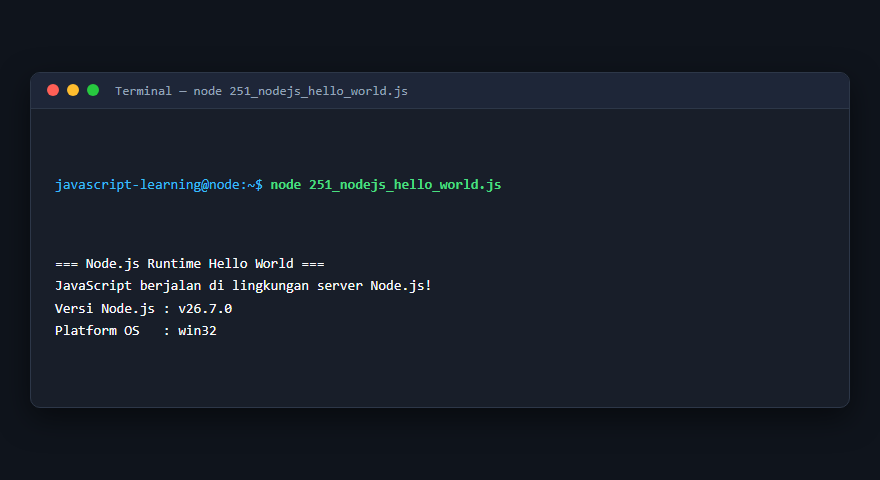

---

### 252. Process object

**Tujuan Pembelajaran:** Memahami konsep dan implementasi praktis dari materi Process object.

**Konsep Utama:** Program ini mendemonstrasikan prinsip Process object secara komprehensif, terstruktur, dan bersih sesuai standar pemrograman JavaScript modern.

**Penjelasan Source Code:** Program mengeksekusi instruksi yang telah dilengkapi dengan komentar kode edukatif berbahasa Indonesia. Setiap blok logika penting dijelaskan secara rinci agar alur kerja program mudah dipahami oleh pembelajar.

**Source Code:** [252_nodejs_process.js](252_nodejs_process.js)

**Cara Menjalankan:**
```bash
node 252_nodejs_process.js
```

**Hasil yang Diharapkan:** Program akan mencetak log hasil evaluasi, perhitungan, atau pemrosesan data ke terminal secara akurat.

**Hasil Eksekusi:**

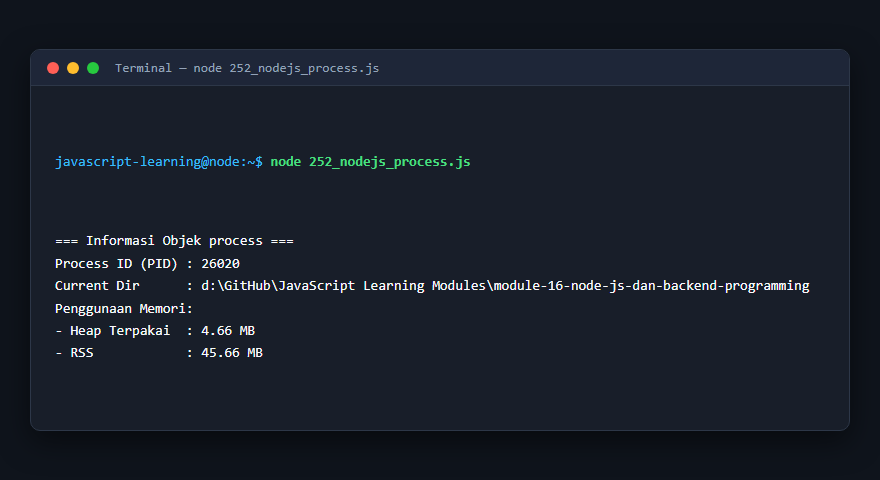

---

### 253. Command-line arguments

**Tujuan Pembelajaran:** Memahami konsep dan implementasi praktis dari materi Command-line arguments.

**Konsep Utama:** Program ini mendemonstrasikan prinsip Command-line arguments secara komprehensif, terstruktur, dan bersih sesuai standar pemrograman JavaScript modern.

**Penjelasan Source Code:** Program mengeksekusi instruksi yang telah dilengkapi dengan komentar kode edukatif berbahasa Indonesia. Setiap blok logika penting dijelaskan secara rinci agar alur kerja program mudah dipahami oleh pembelajar.

**Source Code:** [253_nodejs_command_line.js](253_nodejs_command_line.js)

**Cara Menjalankan:**
```bash
node 253_nodejs_command_line.js
```

**Hasil yang Diharapkan:** Program akan mencetak log hasil evaluasi, perhitungan, atau pemrosesan data ke terminal secara akurat.

**Hasil Eksekusi:**

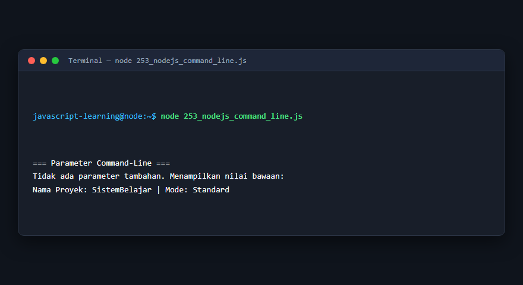

---

### 254. Membaca file

**Tujuan Pembelajaran:** Memahami konsep dan implementasi praktis dari materi Membaca file.

**Konsep Utama:** Program ini mendemonstrasikan prinsip Membaca file secara komprehensif, terstruktur, dan bersih sesuai standar pemrograman JavaScript modern.

**Penjelasan Source Code:** Program mengeksekusi instruksi yang telah dilengkapi dengan komentar kode edukatif berbahasa Indonesia. Setiap blok logika penting dijelaskan secara rinci agar alur kerja program mudah dipahami oleh pembelajar.

**Source Code:** [254_nodejs_file_read.js](254_nodejs_file_read.js)

**Cara Menjalankan:**
```bash
node 254_nodejs_file_read.js
```

**Hasil yang Diharapkan:** Program akan mencetak log hasil evaluasi, perhitungan, atau pemrosesan data ke terminal secara akurat.

**Hasil Eksekusi:**

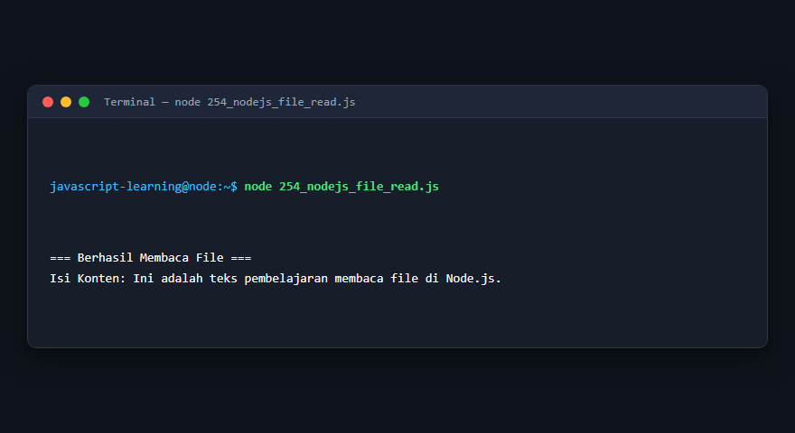

---

### 255. Menulis file

**Tujuan Pembelajaran:** Memahami konsep dan implementasi praktis dari materi Menulis file.

**Konsep Utama:** Program ini mendemonstrasikan prinsip Menulis file secara komprehensif, terstruktur, dan bersih sesuai standar pemrograman JavaScript modern.

**Penjelasan Source Code:** Program mengeksekusi instruksi yang telah dilengkapi dengan komentar kode edukatif berbahasa Indonesia. Setiap blok logika penting dijelaskan secara rinci agar alur kerja program mudah dipahami oleh pembelajar.

**Source Code:** [255_nodejs_file_write.js](255_nodejs_file_write.js)

**Cara Menjalankan:**
```bash
node 255_nodejs_file_write.js
```

**Hasil yang Diharapkan:** Program akan mencetak log hasil evaluasi, perhitungan, atau pemrosesan data ke terminal secara akurat.

**Hasil Eksekusi:**

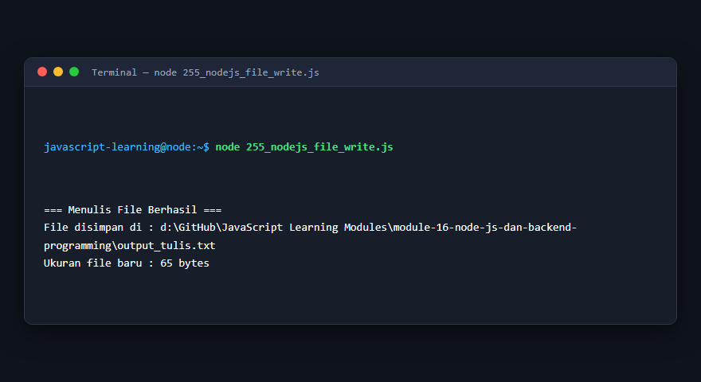

---

### 256. File System API

**Tujuan Pembelajaran:** Memahami konsep dan implementasi praktis dari materi File System API.

**Konsep Utama:** Program ini mendemonstrasikan prinsip File System API secara komprehensif, terstruktur, dan bersih sesuai standar pemrograman JavaScript modern.

**Penjelasan Source Code:** Program mengeksekusi instruksi yang telah dilengkapi dengan komentar kode edukatif berbahasa Indonesia. Setiap blok logika penting dijelaskan secara rinci agar alur kerja program mudah dipahami oleh pembelajar.

**Source Code:** [256_nodejs_file_system.js](256_nodejs_file_system.js)

**Cara Menjalankan:**
```bash
node 256_nodejs_file_system.js
```

**Hasil yang Diharapkan:** Program akan mencetak log hasil evaluasi, perhitungan, atau pemrosesan data ke terminal secara akurat.

**Hasil Eksekusi:**

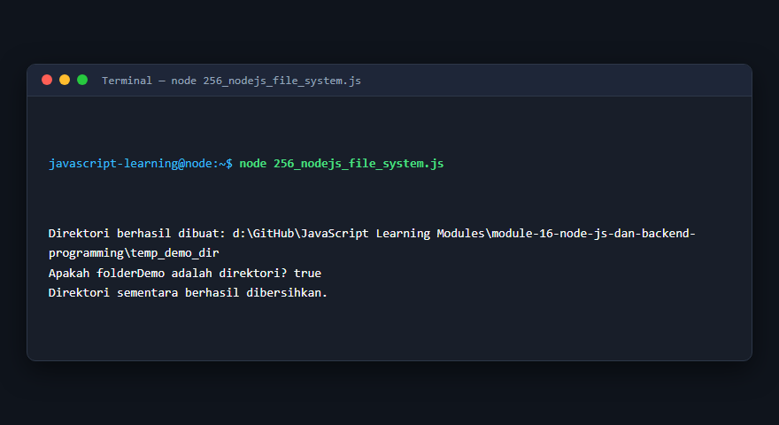

---

### 257. Path module

**Tujuan Pembelajaran:** Memahami konsep dan implementasi praktis dari materi Path module.

**Konsep Utama:** Program ini mendemonstrasikan prinsip Path module secara komprehensif, terstruktur, dan bersih sesuai standar pemrograman JavaScript modern.

**Penjelasan Source Code:** Program mengeksekusi instruksi yang telah dilengkapi dengan komentar kode edukatif berbahasa Indonesia. Setiap blok logika penting dijelaskan secara rinci agar alur kerja program mudah dipahami oleh pembelajar.

**Source Code:** [257_nodejs_path.js](257_nodejs_path.js)

**Cara Menjalankan:**
```bash
node 257_nodejs_path.js
```

**Hasil yang Diharapkan:** Program akan mencetak log hasil evaluasi, perhitungan, atau pemrosesan data ke terminal secara akurat.

**Hasil Eksekusi:**

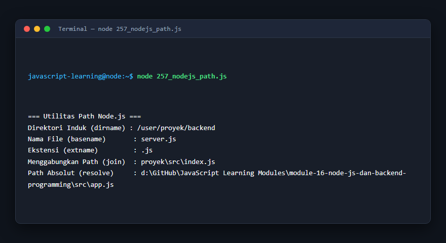

---

### 258. OS module

**Tujuan Pembelajaran:** Memahami konsep dan implementasi praktis dari materi OS module.

**Konsep Utama:** Program ini mendemonstrasikan prinsip OS module secara komprehensif, terstruktur, dan bersih sesuai standar pemrograman JavaScript modern.

**Penjelasan Source Code:** Program mengeksekusi instruksi yang telah dilengkapi dengan komentar kode edukatif berbahasa Indonesia. Setiap blok logika penting dijelaskan secara rinci agar alur kerja program mudah dipahami oleh pembelajar.

**Source Code:** [258_nodejs_os.js](258_nodejs_os.js)

**Cara Menjalankan:**
```bash
node 258_nodejs_os.js
```

**Hasil yang Diharapkan:** Program akan mencetak log hasil evaluasi, perhitungan, atau pemrosesan data ke terminal secara akurat.

**Hasil Eksekusi:**

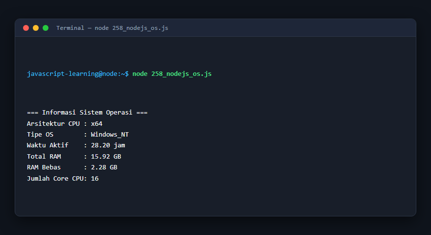

---

### 259. EventEmitter

**Tujuan Pembelajaran:** Memahami konsep dan implementasi praktis dari materi EventEmitter.

**Konsep Utama:** Program ini mendemonstrasikan prinsip EventEmitter secara komprehensif, terstruktur, dan bersih sesuai standar pemrograman JavaScript modern.

**Penjelasan Source Code:** Program mengeksekusi instruksi yang telah dilengkapi dengan komentar kode edukatif berbahasa Indonesia. Setiap blok logika penting dijelaskan secara rinci agar alur kerja program mudah dipahami oleh pembelajar.

**Source Code:** [259_nodejs_events.js](259_nodejs_events.js)

**Cara Menjalankan:**
```bash
node 259_nodejs_events.js
```

**Hasil yang Diharapkan:** Program akan mencetak log hasil evaluasi, perhitungan, atau pemrosesan data ke terminal secara akurat.

**Hasil Eksekusi:**

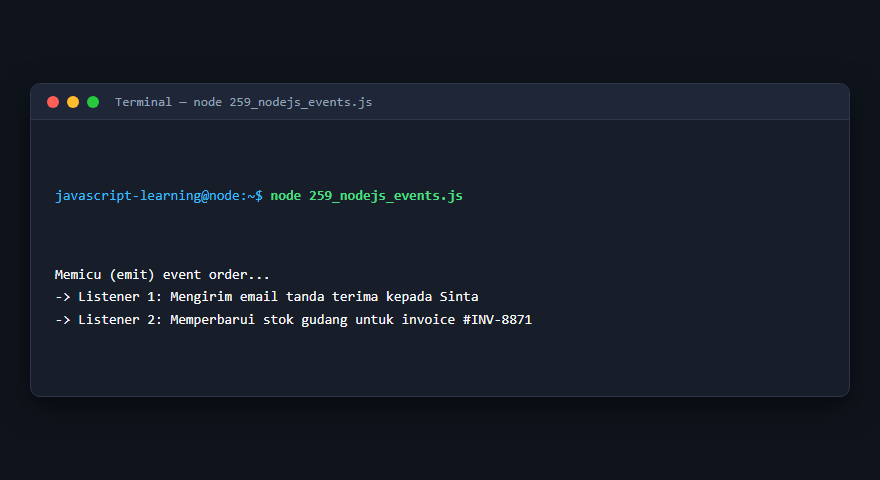

---

### 260. Streams

**Tujuan Pembelajaran:** Memahami konsep dan implementasi praktis dari materi Streams.

**Konsep Utama:** Program ini mendemonstrasikan prinsip Streams secara komprehensif, terstruktur, dan bersih sesuai standar pemrograman JavaScript modern.

**Penjelasan Source Code:** Program mengeksekusi instruksi yang telah dilengkapi dengan komentar kode edukatif berbahasa Indonesia. Setiap blok logika penting dijelaskan secara rinci agar alur kerja program mudah dipahami oleh pembelajar.

**Source Code:** [260_nodejs_streams.js](260_nodejs_streams.js)

**Cara Menjalankan:**
```bash
node 260_nodejs_streams.js
```

**Hasil yang Diharapkan:** Program akan mencetak log hasil evaluasi, perhitungan, atau pemrosesan data ke terminal secara akurat.

**Hasil Eksekusi:**

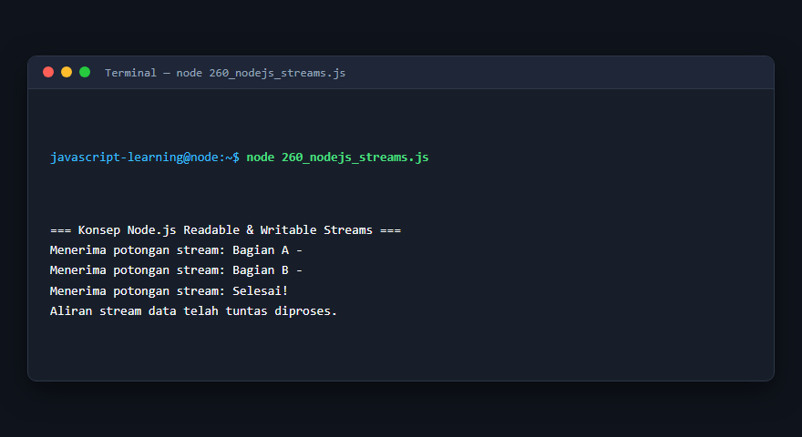

---

### 261. Buffer

**Tujuan Pembelajaran:** Memahami konsep dan implementasi praktis dari materi Buffer.

**Konsep Utama:** Program ini mendemonstrasikan prinsip Buffer secara komprehensif, terstruktur, dan bersih sesuai standar pemrograman JavaScript modern.

**Penjelasan Source Code:** Program mengeksekusi instruksi yang telah dilengkapi dengan komentar kode edukatif berbahasa Indonesia. Setiap blok logika penting dijelaskan secara rinci agar alur kerja program mudah dipahami oleh pembelajar.

**Source Code:** [261_nodejs_buffer.js](261_nodejs_buffer.js)

**Cara Menjalankan:**
```bash
node 261_nodejs_buffer.js
```

**Hasil yang Diharapkan:** Program akan mencetak log hasil evaluasi, perhitungan, atau pemrosesan data ke terminal secara akurat.

**Hasil Eksekusi:**

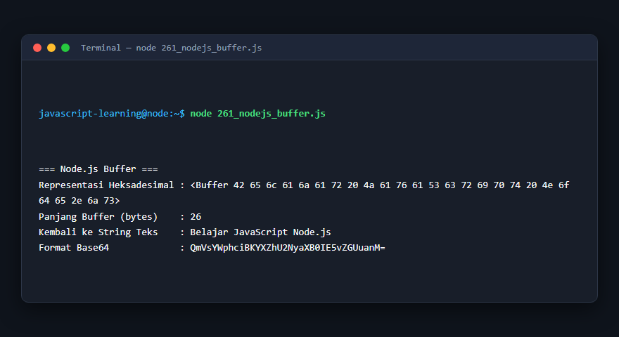

---

### 262. HTTP server

**Tujuan Pembelajaran:** Memahami konsep dan implementasi praktis dari materi HTTP server.

**Konsep Utama:** Program ini mendemonstrasikan prinsip HTTP server secara komprehensif, terstruktur, dan bersih sesuai standar pemrograman JavaScript modern.

**Penjelasan Source Code:** Program mengeksekusi instruksi yang telah dilengkapi dengan komentar kode edukatif berbahasa Indonesia. Setiap blok logika penting dijelaskan secara rinci agar alur kerja program mudah dipahami oleh pembelajar.

**Source Code:** [262_nodejs_http_server.js](262_nodejs_http_server.js)

**Cara Menjalankan:**
```bash
node 262_nodejs_http_server.js
```

**Hasil yang Diharapkan:** Program akan mencetak log hasil evaluasi, perhitungan, atau pemrosesan data ke terminal secara akurat.

**Hasil Eksekusi:**

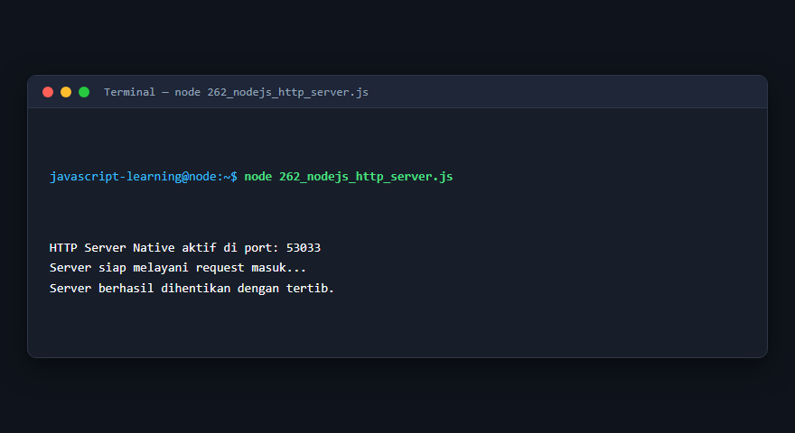

---

### 263. HTTP client

**Tujuan Pembelajaran:** Memahami konsep dan implementasi praktis dari materi HTTP client.

**Konsep Utama:** Program ini mendemonstrasikan prinsip HTTP client secara komprehensif, terstruktur, dan bersih sesuai standar pemrograman JavaScript modern.

**Penjelasan Source Code:** Program mengeksekusi instruksi yang telah dilengkapi dengan komentar kode edukatif berbahasa Indonesia. Setiap blok logika penting dijelaskan secara rinci agar alur kerja program mudah dipahami oleh pembelajar.

**Source Code:** [263_nodejs_http_client.js](263_nodejs_http_client.js)

**Cara Menjalankan:**
```bash
node 263_nodejs_http_client.js
```

**Hasil yang Diharapkan:** Program akan mencetak log hasil evaluasi, perhitungan, atau pemrosesan data ke terminal secara akurat.

**Hasil Eksekusi:**

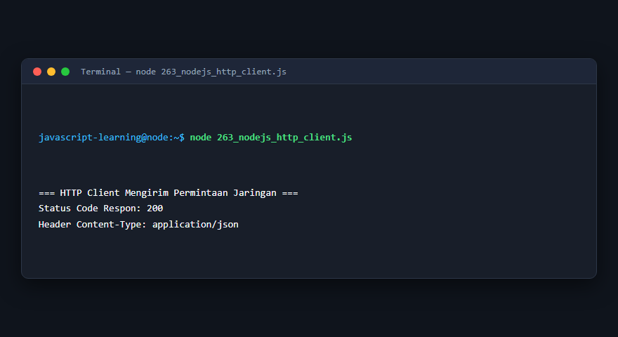

---

### 264. URL dan URLSearchParams

**Tujuan Pembelajaran:** Memahami konsep dan implementasi praktis dari materi URL dan URLSearchParams.

**Konsep Utama:** Program ini mendemonstrasikan prinsip URL dan URLSearchParams secara komprehensif, terstruktur, dan bersih sesuai standar pemrograman JavaScript modern.

**Penjelasan Source Code:** Program mengeksekusi instruksi yang telah dilengkapi dengan komentar kode edukatif berbahasa Indonesia. Setiap blok logika penting dijelaskan secara rinci agar alur kerja program mudah dipahami oleh pembelajar.

**Source Code:** [264_nodejs_url.js](264_nodejs_url.js)

**Cara Menjalankan:**
```bash
node 264_nodejs_url.js
```

**Hasil yang Diharapkan:** Program akan mencetak log hasil evaluasi, perhitungan, atau pemrosesan data ke terminal secara akurat.

**Hasil Eksekusi:**

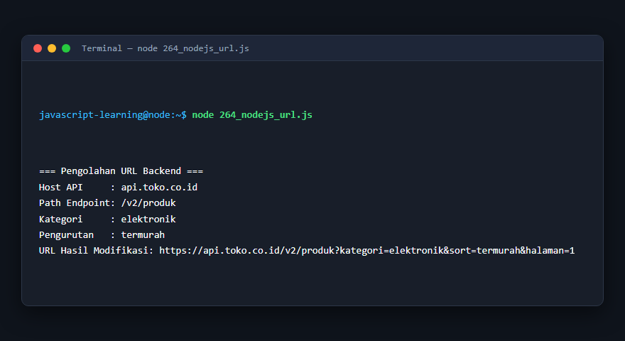

---

### 265. Crypto module

**Tujuan Pembelajaran:** Memahami konsep dan implementasi praktis dari materi Crypto module.

**Konsep Utama:** Program ini mendemonstrasikan prinsip Crypto module secara komprehensif, terstruktur, dan bersih sesuai standar pemrograman JavaScript modern.

**Penjelasan Source Code:** Program mengeksekusi instruksi yang telah dilengkapi dengan komentar kode edukatif berbahasa Indonesia. Setiap blok logika penting dijelaskan secara rinci agar alur kerja program mudah dipahami oleh pembelajar.

**Source Code:** [265_nodejs_crypto.js](265_nodejs_crypto.js)

**Cara Menjalankan:**
```bash
node 265_nodejs_crypto.js
```

**Hasil yang Diharapkan:** Program akan mencetak log hasil evaluasi, perhitungan, atau pemrosesan data ke terminal secara akurat.

**Hasil Eksekusi:**

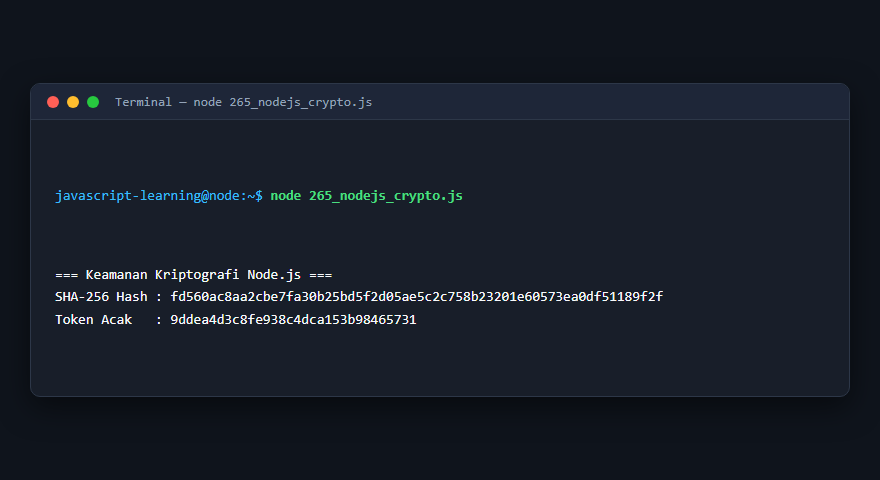

---

### 266. Environment configuration

**Tujuan Pembelajaran:** Memahami konsep dan implementasi praktis dari materi Environment configuration.

**Konsep Utama:** Program ini mendemonstrasikan prinsip Environment configuration secara komprehensif, terstruktur, dan bersih sesuai standar pemrograman JavaScript modern.

**Penjelasan Source Code:** Program mengeksekusi instruksi yang telah dilengkapi dengan komentar kode edukatif berbahasa Indonesia. Setiap blok logika penting dijelaskan secara rinci agar alur kerja program mudah dipahami oleh pembelajar.

**Source Code:** [266_nodejs_environment.js](266_nodejs_environment.js)

**Cara Menjalankan:**
```bash
node 266_nodejs_environment.js
```

**Hasil yang Diharapkan:** Program akan mencetak log hasil evaluasi, perhitungan, atau pemrosesan data ke terminal secara akurat.

**Hasil Eksekusi:**

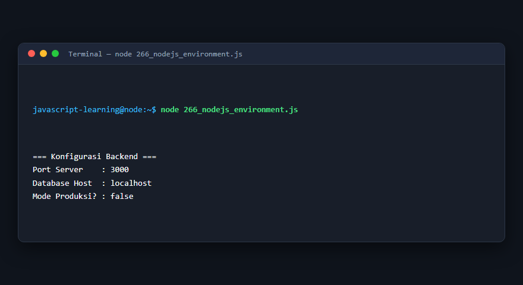

---

### 267. Server menggunakan Express

**Tujuan Pembelajaran:** Memahami konsep dan implementasi praktis dari materi Server menggunakan Express.

**Konsep Utama:** Program ini mendemonstrasikan prinsip Server menggunakan Express secara komprehensif, terstruktur, dan bersih sesuai standar pemrograman JavaScript modern.

**Penjelasan Source Code:** Program mengeksekusi instruksi yang telah dilengkapi dengan komentar kode edukatif berbahasa Indonesia. Setiap blok logika penting dijelaskan secara rinci agar alur kerja program mudah dipahami oleh pembelajar.

**Source Code:** [267_express_server.js](267_express_server.js)

**Cara Menjalankan:**
```bash
node 267_express_server.js
```

**Hasil yang Diharapkan:** Program akan mencetak log hasil evaluasi, perhitungan, atau pemrosesan data ke terminal secara akurat.

**Hasil Eksekusi:**

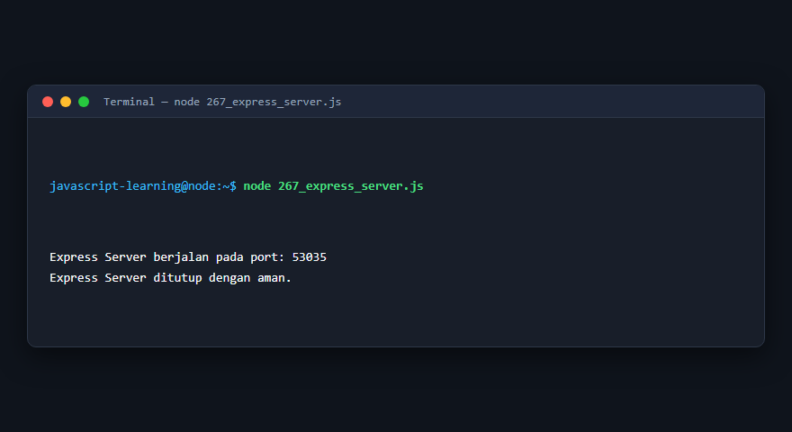

---

### 268. Routing Express

**Tujuan Pembelajaran:** Memahami konsep dan implementasi praktis dari materi Routing Express.

**Konsep Utama:** Program ini mendemonstrasikan prinsip Routing Express secara komprehensif, terstruktur, dan bersih sesuai standar pemrograman JavaScript modern.

**Penjelasan Source Code:** Program mengeksekusi instruksi yang telah dilengkapi dengan komentar kode edukatif berbahasa Indonesia. Setiap blok logika penting dijelaskan secara rinci agar alur kerja program mudah dipahami oleh pembelajar.

**Source Code:** [268_express_routes.js](268_express_routes.js)

**Cara Menjalankan:**
```bash
node 268_express_routes.js
```

**Hasil yang Diharapkan:** Program akan mencetak log hasil evaluasi, perhitungan, atau pemrosesan data ke terminal secara akurat.

**Hasil Eksekusi:**

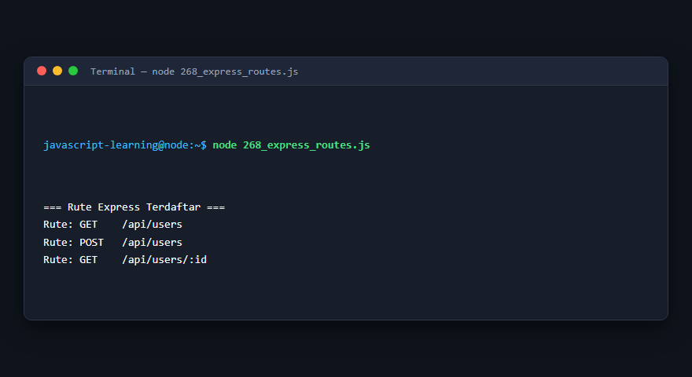

---

### 269. Middleware Express

**Tujuan Pembelajaran:** Memahami konsep dan implementasi praktis dari materi Middleware Express.

**Konsep Utama:** Program ini mendemonstrasikan prinsip Middleware Express secara komprehensif, terstruktur, dan bersih sesuai standar pemrograman JavaScript modern.

**Penjelasan Source Code:** Program mengeksekusi instruksi yang telah dilengkapi dengan komentar kode edukatif berbahasa Indonesia. Setiap blok logika penting dijelaskan secara rinci agar alur kerja program mudah dipahami oleh pembelajar.

**Source Code:** [269_express_middleware.js](269_express_middleware.js)

**Cara Menjalankan:**
```bash
node 269_express_middleware.js
```

**Hasil yang Diharapkan:** Program akan mencetak log hasil evaluasi, perhitungan, atau pemrosesan data ke terminal secara akurat.

**Hasil Eksekusi:**

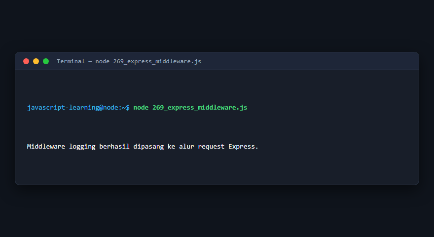

---

### 270. REST API menggunakan Express

**Tujuan Pembelajaran:** Memahami konsep dan implementasi praktis dari materi REST API menggunakan Express.

**Konsep Utama:** Program ini mendemonstrasikan prinsip REST API menggunakan Express secara komprehensif, terstruktur, dan bersih sesuai standar pemrograman JavaScript modern.

**Penjelasan Source Code:** Program mengeksekusi instruksi yang telah dilengkapi dengan komentar kode edukatif berbahasa Indonesia. Setiap blok logika penting dijelaskan secara rinci agar alur kerja program mudah dipahami oleh pembelajar.

**Source Code:** [270_express_rest_api.js](270_express_rest_api.js)

**Cara Menjalankan:**
```bash
node 270_express_rest_api.js
```

**Hasil yang Diharapkan:** Program akan mencetak log hasil evaluasi, perhitungan, atau pemrosesan data ke terminal secara akurat.

**Hasil Eksekusi:**

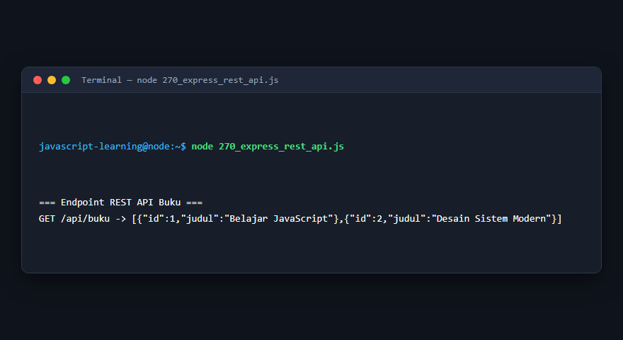

---

## Ringkasan Modul

Modul 16 (Node.js dan Backend Programming) telah menyajikan pembelajaran berbasis praktik yang terstruktur. Seluruh program di dalam modul ini dapat dijalankan secara mandiri tanpa saling membebani dependensi yang rumit, dengan fokus mendalam pada pemahaman konsep dan kebiasaan baik penulisan kode.
