# Modul 17: Algoritma, Testing, dan Keamanan

## Deskripsi Modul
Modul ini mengulas algoritma fundamental (pencarian, pengurutan, graf, pohon), struktur data klasik, unit testing, dan pencegahan celah keamanan web seperti XSS.

## Tujuan Pembelajaran
Memahami analisis efisiensi algoritma, implementasi struktur data LIFO/FIFO, penulisan automated test, dan sanitasi input aman.

## Daftar Submodul & Materi

- [271_linear_search.js](271_linear_search.js) : Linear search
- [272_binary_search.js](272_binary_search.js) : Binary search
- [273_bubble_sort.js](273_bubble_sort.js) : Bubble sort
- [274_selection_sort.js](274_selection_sort.js) : Selection sort
- [275_insertion_sort.js](275_insertion_sort.js) : Insertion sort
- [276_merge_sort.js](276_merge_sort.js) : Merge sort
- [277_quick_sort.js](277_quick_sort.js) : Quick sort
- [278_stack_implementation.js](278_stack_implementation.js) : Implementasi stack
- [279_queue_implementation.js](279_queue_implementation.js) : Implementasi queue
- [280_linked_list.js](280_linked_list.js) : Linked list
- [281_binary_tree.js](281_binary_tree.js) : Binary tree
- [282_graph_bfs.js](282_graph_bfs.js) : Breadth-First Search
- [283_graph_dfs.js](283_graph_dfs.js) : Depth-First Search
- [284_dynamic_programming.js](284_dynamic_programming.js) : Dynamic programming
- [285_unit_testing.js](285_unit_testing.js) : Unit testing
- [286_integration_testing.js](286_integration_testing.js) : Integration testing
- [287_xss_prevention.js](287_xss_prevention.js) : Pencegahan Cross-Site Scripting
- [288_secure_input_validation.js](288_secure_input_validation.js) : Validasi input yang aman

---

## Penjelasan Detail Setiap Submodul

### 271. Linear search

**Tujuan Pembelajaran:** Memahami konsep dan implementasi praktis dari materi Linear search.

**Konsep Utama:** Program ini mendemonstrasikan prinsip Linear search secara komprehensif, terstruktur, dan bersih sesuai standar pemrograman JavaScript modern.

**Penjelasan Source Code:** Program mengeksekusi instruksi yang telah dilengkapi dengan komentar kode edukatif berbahasa Indonesia. Setiap blok logika penting dijelaskan secara rinci agar alur kerja program mudah dipahami oleh pembelajar.

**Source Code:** [271_linear_search.js](271_linear_search.js)

**Cara Menjalankan:**
```bash
node 271_linear_search.js
```

**Hasil yang Diharapkan:** Program akan mencetak log hasil evaluasi, perhitungan, atau pemrosesan data ke terminal secara akurat.

**Hasil Eksekusi:**

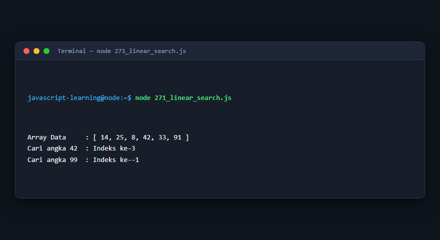

---

### 272. Binary search

**Tujuan Pembelajaran:** Memahami konsep dan implementasi praktis dari materi Binary search.

**Konsep Utama:** Program ini mendemonstrasikan prinsip Binary search secara komprehensif, terstruktur, dan bersih sesuai standar pemrograman JavaScript modern.

**Penjelasan Source Code:** Program mengeksekusi instruksi yang telah dilengkapi dengan komentar kode edukatif berbahasa Indonesia. Setiap blok logika penting dijelaskan secara rinci agar alur kerja program mudah dipahami oleh pembelajar.

**Source Code:** [272_binary_search.js](272_binary_search.js)

**Cara Menjalankan:**
```bash
node 272_binary_search.js
```

**Hasil yang Diharapkan:** Program akan mencetak log hasil evaluasi, perhitungan, atau pemrosesan data ke terminal secara akurat.

**Hasil Eksekusi:**

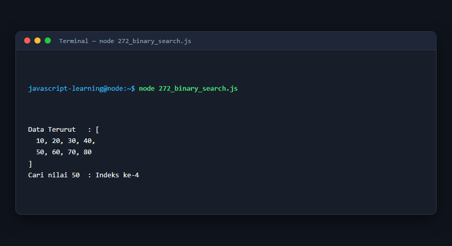

---

### 273. Bubble sort

**Tujuan Pembelajaran:** Memahami konsep dan implementasi praktis dari materi Bubble sort.

**Konsep Utama:** Program ini mendemonstrasikan prinsip Bubble sort secara komprehensif, terstruktur, dan bersih sesuai standar pemrograman JavaScript modern.

**Penjelasan Source Code:** Program mengeksekusi instruksi yang telah dilengkapi dengan komentar kode edukatif berbahasa Indonesia. Setiap blok logika penting dijelaskan secara rinci agar alur kerja program mudah dipahami oleh pembelajar.

**Source Code:** [273_bubble_sort.js](273_bubble_sort.js)

**Cara Menjalankan:**
```bash
node 273_bubble_sort.js
```

**Hasil yang Diharapkan:** Program akan mencetak log hasil evaluasi, perhitungan, atau pemrosesan data ke terminal secara akurat.

**Hasil Eksekusi:**

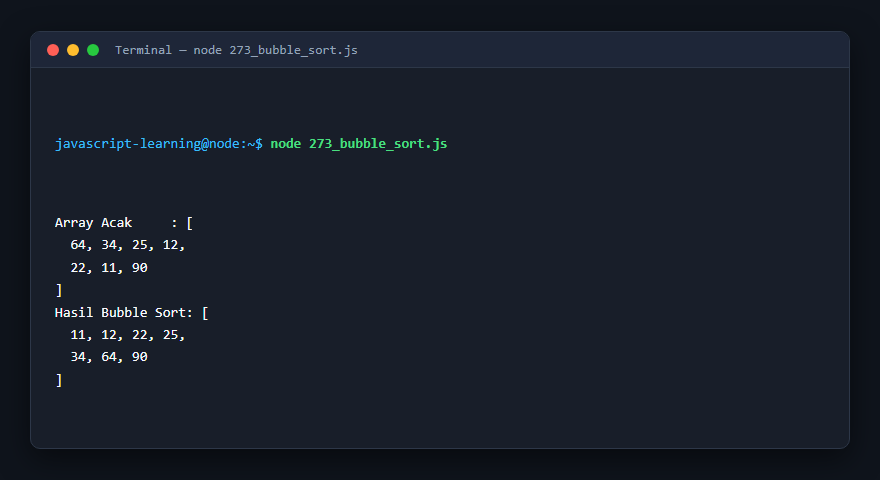

---

### 274. Selection sort

**Tujuan Pembelajaran:** Memahami konsep dan implementasi praktis dari materi Selection sort.

**Konsep Utama:** Program ini mendemonstrasikan prinsip Selection sort secara komprehensif, terstruktur, dan bersih sesuai standar pemrograman JavaScript modern.

**Penjelasan Source Code:** Program mengeksekusi instruksi yang telah dilengkapi dengan komentar kode edukatif berbahasa Indonesia. Setiap blok logika penting dijelaskan secara rinci agar alur kerja program mudah dipahami oleh pembelajar.

**Source Code:** [274_selection_sort.js](274_selection_sort.js)

**Cara Menjalankan:**
```bash
node 274_selection_sort.js
```

**Hasil yang Diharapkan:** Program akan mencetak log hasil evaluasi, perhitungan, atau pemrosesan data ke terminal secara akurat.

**Hasil Eksekusi:**

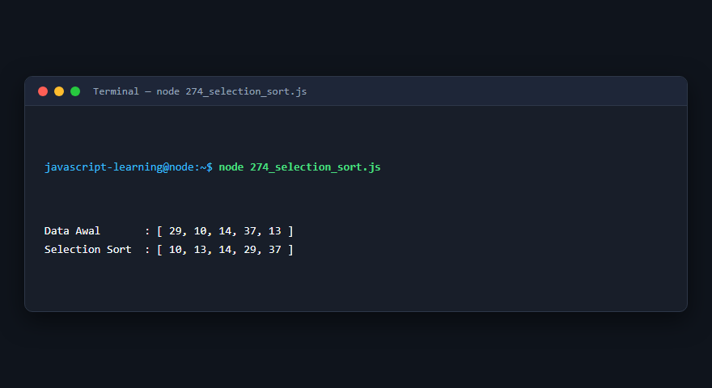

---

### 275. Insertion sort

**Tujuan Pembelajaran:** Memahami konsep dan implementasi praktis dari materi Insertion sort.

**Konsep Utama:** Program ini mendemonstrasikan prinsip Insertion sort secara komprehensif, terstruktur, dan bersih sesuai standar pemrograman JavaScript modern.

**Penjelasan Source Code:** Program mengeksekusi instruksi yang telah dilengkapi dengan komentar kode edukatif berbahasa Indonesia. Setiap blok logika penting dijelaskan secara rinci agar alur kerja program mudah dipahami oleh pembelajar.

**Source Code:** [275_insertion_sort.js](275_insertion_sort.js)

**Cara Menjalankan:**
```bash
node 275_insertion_sort.js
```

**Hasil yang Diharapkan:** Program akan mencetak log hasil evaluasi, perhitungan, atau pemrosesan data ke terminal secara akurat.

**Hasil Eksekusi:**

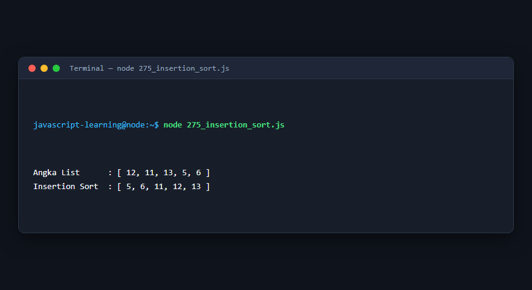

---

### 276. Merge sort

**Tujuan Pembelajaran:** Memahami konsep dan implementasi praktis dari materi Merge sort.

**Konsep Utama:** Program ini mendemonstrasikan prinsip Merge sort secara komprehensif, terstruktur, dan bersih sesuai standar pemrograman JavaScript modern.

**Penjelasan Source Code:** Program mengeksekusi instruksi yang telah dilengkapi dengan komentar kode edukatif berbahasa Indonesia. Setiap blok logika penting dijelaskan secara rinci agar alur kerja program mudah dipahami oleh pembelajar.

**Source Code:** [276_merge_sort.js](276_merge_sort.js)

**Cara Menjalankan:**
```bash
node 276_merge_sort.js
```

**Hasil yang Diharapkan:** Program akan mencetak log hasil evaluasi, perhitungan, atau pemrosesan data ke terminal secara akurat.

**Hasil Eksekusi:**

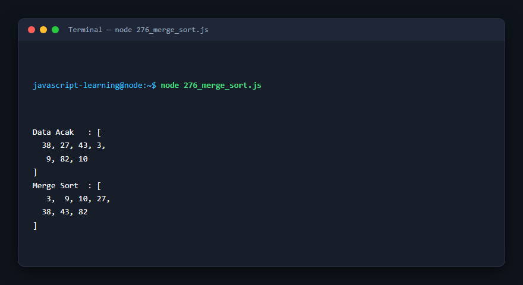

---

### 277. Quick sort

**Tujuan Pembelajaran:** Memahami konsep dan implementasi praktis dari materi Quick sort.

**Konsep Utama:** Program ini mendemonstrasikan prinsip Quick sort secara komprehensif, terstruktur, dan bersih sesuai standar pemrograman JavaScript modern.

**Penjelasan Source Code:** Program mengeksekusi instruksi yang telah dilengkapi dengan komentar kode edukatif berbahasa Indonesia. Setiap blok logika penting dijelaskan secara rinci agar alur kerja program mudah dipahami oleh pembelajar.

**Source Code:** [277_quick_sort.js](277_quick_sort.js)

**Cara Menjalankan:**
```bash
node 277_quick_sort.js
```

**Hasil yang Diharapkan:** Program akan mencetak log hasil evaluasi, perhitungan, atau pemrosesan data ke terminal secara akurat.

**Hasil Eksekusi:**


---

### 278. Implementasi stack

**Tujuan Pembelajaran:** Memahami konsep dan implementasi praktis dari materi Implementasi stack.

**Konsep Utama:** Program ini mendemonstrasikan prinsip Implementasi stack secara komprehensif, terstruktur, dan bersih sesuai standar pemrograman JavaScript modern.

**Penjelasan Source Code:** Program mengeksekusi instruksi yang telah dilengkapi dengan komentar kode edukatif berbahasa Indonesia. Setiap blok logika penting dijelaskan secara rinci agar alur kerja program mudah dipahami oleh pembelajar.

**Source Code:** [278_stack_implementation.js](278_stack_implementation.js)

**Cara Menjalankan:**
```bash
node 278_stack_implementation.js
```

**Hasil yang Diharapkan:** Program akan mencetak log hasil evaluasi, perhitungan, atau pemrosesan data ke terminal secara akurat.

**Hasil Eksekusi:**

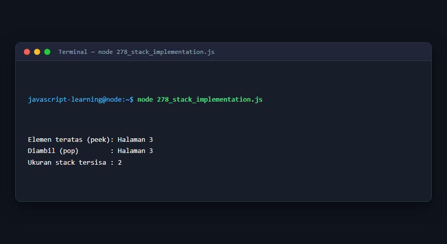

---

### 279. Implementasi queue

**Tujuan Pembelajaran:** Memahami konsep dan implementasi praktis dari materi Implementasi queue.

**Konsep Utama:** Program ini mendemonstrasikan prinsip Implementasi queue secara komprehensif, terstruktur, dan bersih sesuai standar pemrograman JavaScript modern.

**Penjelasan Source Code:** Program mengeksekusi instruksi yang telah dilengkapi dengan komentar kode edukatif berbahasa Indonesia. Setiap blok logika penting dijelaskan secara rinci agar alur kerja program mudah dipahami oleh pembelajar.

**Source Code:** [279_queue_implementation.js](279_queue_implementation.js)

**Cara Menjalankan:**
```bash
node 279_queue_implementation.js
```

**Hasil yang Diharapkan:** Program akan mencetak log hasil evaluasi, perhitungan, atau pemrosesan data ke terminal secara akurat.

**Hasil Eksekusi:**

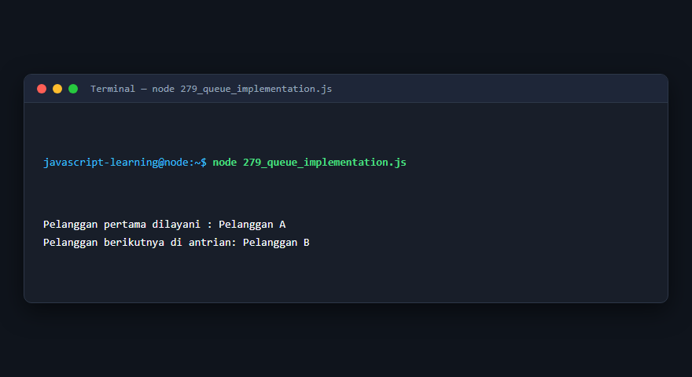

---

### 280. Linked list

**Tujuan Pembelajaran:** Memahami konsep dan implementasi praktis dari materi Linked list.

**Konsep Utama:** Program ini mendemonstrasikan prinsip Linked list secara komprehensif, terstruktur, dan bersih sesuai standar pemrograman JavaScript modern.

**Penjelasan Source Code:** Program mengeksekusi instruksi yang telah dilengkapi dengan komentar kode edukatif berbahasa Indonesia. Setiap blok logika penting dijelaskan secara rinci agar alur kerja program mudah dipahami oleh pembelajar.

**Source Code:** [280_linked_list.js](280_linked_list.js)

**Cara Menjalankan:**
```bash
node 280_linked_list.js
```

**Hasil yang Diharapkan:** Program akan mencetak log hasil evaluasi, perhitungan, atau pemrosesan data ke terminal secara akurat.

**Hasil Eksekusi:**

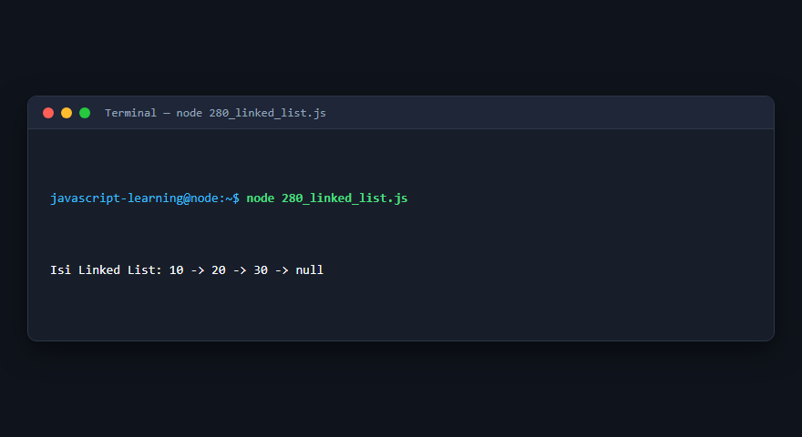

---

### 281. Binary tree

**Tujuan Pembelajaran:** Memahami konsep dan implementasi praktis dari materi Binary tree.

**Konsep Utama:** Program ini mendemonstrasikan prinsip Binary tree secara komprehensif, terstruktur, dan bersih sesuai standar pemrograman JavaScript modern.

**Penjelasan Source Code:** Program mengeksekusi instruksi yang telah dilengkapi dengan komentar kode edukatif berbahasa Indonesia. Setiap blok logika penting dijelaskan secara rinci agar alur kerja program mudah dipahami oleh pembelajar.

**Source Code:** [281_binary_tree.js](281_binary_tree.js)

**Cara Menjalankan:**
```bash
node 281_binary_tree.js
```

**Hasil yang Diharapkan:** Program akan mencetak log hasil evaluasi, perhitungan, atau pemrosesan data ke terminal secara akurat.

**Hasil Eksekusi:**

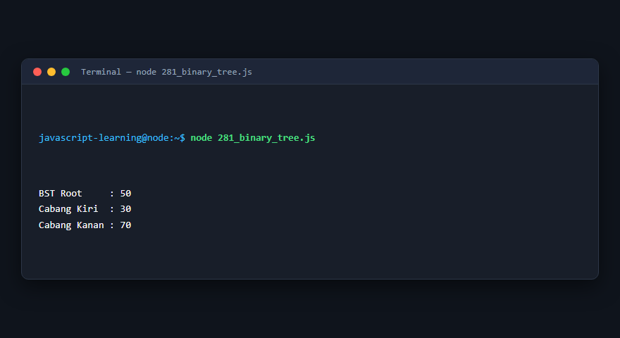

---

### 282. Breadth-First Search

**Tujuan Pembelajaran:** Memahami konsep dan implementasi praktis dari materi Breadth-First Search.

**Konsep Utama:** Program ini mendemonstrasikan prinsip Breadth-First Search secara komprehensif, terstruktur, dan bersih sesuai standar pemrograman JavaScript modern.

**Penjelasan Source Code:** Program mengeksekusi instruksi yang telah dilengkapi dengan komentar kode edukatif berbahasa Indonesia. Setiap blok logika penting dijelaskan secara rinci agar alur kerja program mudah dipahami oleh pembelajar.

**Source Code:** [282_graph_bfs.js](282_graph_bfs.js)

**Cara Menjalankan:**
```bash
node 282_graph_bfs.js
```

**Hasil yang Diharapkan:** Program akan mencetak log hasil evaluasi, perhitungan, atau pemrosesan data ke terminal secara akurat.

**Hasil Eksekusi:**

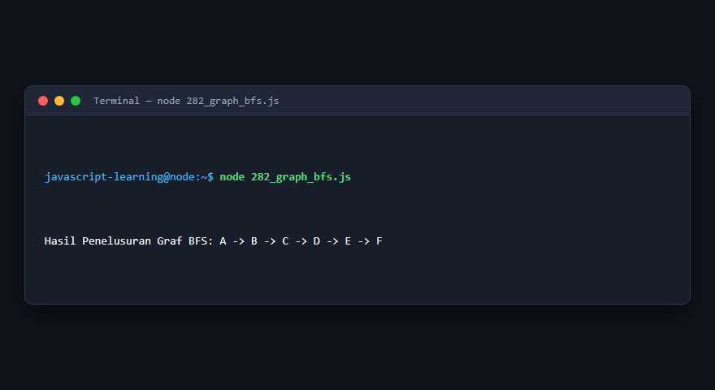

---

### 283. Depth-First Search

**Tujuan Pembelajaran:** Memahami konsep dan implementasi praktis dari materi Depth-First Search.

**Konsep Utama:** Program ini mendemonstrasikan prinsip Depth-First Search secara komprehensif, terstruktur, dan bersih sesuai standar pemrograman JavaScript modern.

**Penjelasan Source Code:** Program mengeksekusi instruksi yang telah dilengkapi dengan komentar kode edukatif berbahasa Indonesia. Setiap blok logika penting dijelaskan secara rinci agar alur kerja program mudah dipahami oleh pembelajar.

**Source Code:** [283_graph_dfs.js](283_graph_dfs.js)

**Cara Menjalankan:**
```bash
node 283_graph_dfs.js
```

**Hasil yang Diharapkan:** Program akan mencetak log hasil evaluasi, perhitungan, atau pemrosesan data ke terminal secara akurat.

**Hasil Eksekusi:**

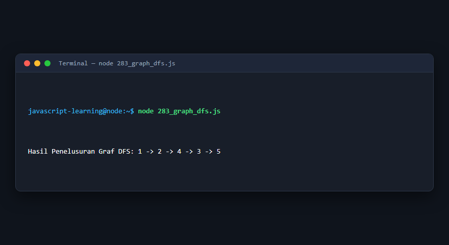

---

### 284. Dynamic programming

**Tujuan Pembelajaran:** Memahami konsep dan implementasi praktis dari materi Dynamic programming.

**Konsep Utama:** Program ini mendemonstrasikan prinsip Dynamic programming secara komprehensif, terstruktur, dan bersih sesuai standar pemrograman JavaScript modern.

**Penjelasan Source Code:** Program mengeksekusi instruksi yang telah dilengkapi dengan komentar kode edukatif berbahasa Indonesia. Setiap blok logika penting dijelaskan secara rinci agar alur kerja program mudah dipahami oleh pembelajar.

**Source Code:** [284_dynamic_programming.js](284_dynamic_programming.js)

**Cara Menjalankan:**
```bash
node 284_dynamic_programming.js
```

**Hasil yang Diharapkan:** Program akan mencetak log hasil evaluasi, perhitungan, atau pemrosesan data ke terminal secara akurat.

**Hasil Eksekusi:**

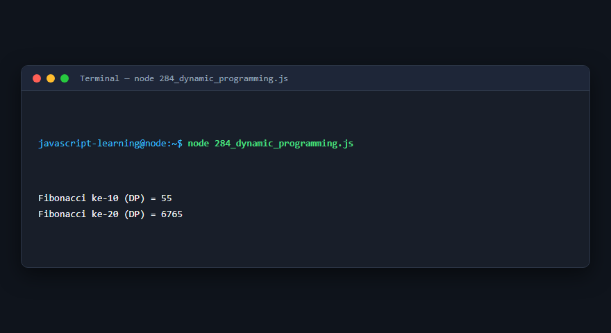

---

### 285. Unit testing

**Tujuan Pembelajaran:** Memahami konsep dan implementasi praktis dari materi Unit testing.

**Konsep Utama:** Program ini mendemonstrasikan prinsip Unit testing secara komprehensif, terstruktur, dan bersih sesuai standar pemrograman JavaScript modern.

**Penjelasan Source Code:** Program mengeksekusi instruksi yang telah dilengkapi dengan komentar kode edukatif berbahasa Indonesia. Setiap blok logika penting dijelaskan secara rinci agar alur kerja program mudah dipahami oleh pembelajar.

**Source Code:** [285_unit_testing.js](285_unit_testing.js)

**Cara Menjalankan:**
```bash
node 285_unit_testing.js
```

**Hasil yang Diharapkan:** Program akan mencetak log hasil evaluasi, perhitungan, atau pemrosesan data ke terminal secara akurat.

**Hasil Eksekusi:**

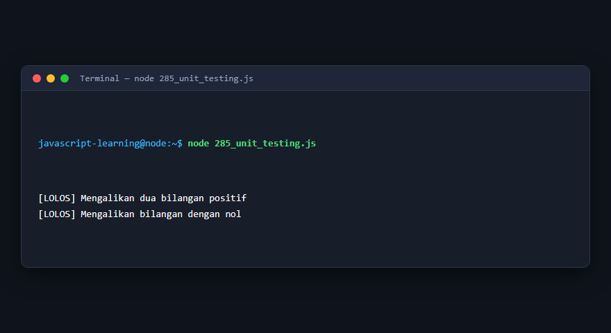

---

### 286. Integration testing

**Tujuan Pembelajaran:** Memahami konsep dan implementasi praktis dari materi Integration testing.

**Konsep Utama:** Program ini mendemonstrasikan prinsip Integration testing secara komprehensif, terstruktur, dan bersih sesuai standar pemrograman JavaScript modern.

**Penjelasan Source Code:** Program mengeksekusi instruksi yang telah dilengkapi dengan komentar kode edukatif berbahasa Indonesia. Setiap blok logika penting dijelaskan secara rinci agar alur kerja program mudah dipahami oleh pembelajar.

**Source Code:** [286_integration_testing.js](286_integration_testing.js)

**Cara Menjalankan:**
```bash
node 286_integration_testing.js
```

**Hasil yang Diharapkan:** Program akan mencetak log hasil evaluasi, perhitungan, atau pemrosesan data ke terminal secara akurat.

**Hasil Eksekusi:**

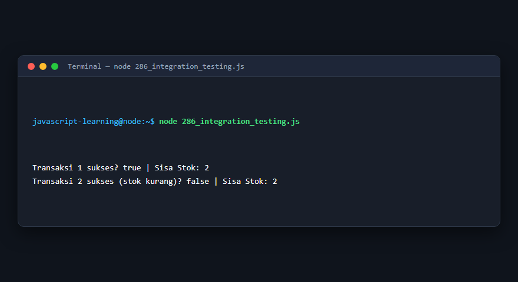

---

### 287. Pencegahan Cross-Site Scripting

**Tujuan Pembelajaran:** Memahami konsep dan implementasi praktis dari materi Pencegahan Cross-Site Scripting.

**Konsep Utama:** Program ini mendemonstrasikan prinsip Pencegahan Cross-Site Scripting secara komprehensif, terstruktur, dan bersih sesuai standar pemrograman JavaScript modern.

**Penjelasan Source Code:** Program mengeksekusi instruksi yang telah dilengkapi dengan komentar kode edukatif berbahasa Indonesia. Setiap blok logika penting dijelaskan secara rinci agar alur kerja program mudah dipahami oleh pembelajar.

**Source Code:** [287_xss_prevention.js](287_xss_prevention.js)

**Cara Menjalankan:**
```bash
node 287_xss_prevention.js
```

**Hasil yang Diharapkan:** Program akan mencetak log hasil evaluasi, perhitungan, atau pemrosesan data ke terminal secara akurat.

**Hasil Eksekusi:**

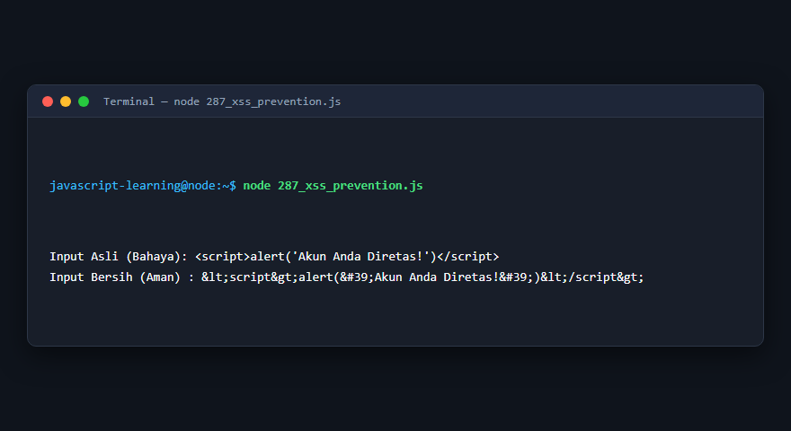

---

### 288. Validasi input yang aman

**Tujuan Pembelajaran:** Memahami konsep dan implementasi praktis dari materi Validasi input yang aman.

**Konsep Utama:** Program ini mendemonstrasikan prinsip Validasi input yang aman secara komprehensif, terstruktur, dan bersih sesuai standar pemrograman JavaScript modern.

**Penjelasan Source Code:** Program mengeksekusi instruksi yang telah dilengkapi dengan komentar kode edukatif berbahasa Indonesia. Setiap blok logika penting dijelaskan secara rinci agar alur kerja program mudah dipahami oleh pembelajar.

**Source Code:** [288_secure_input_validation.js](288_secure_input_validation.js)

**Cara Menjalankan:**
```bash
node 288_secure_input_validation.js
```

**Hasil yang Diharapkan:** Program akan mencetak log hasil evaluasi, perhitungan, atau pemrosesan data ke terminal secara akurat.

**Hasil Eksekusi:**

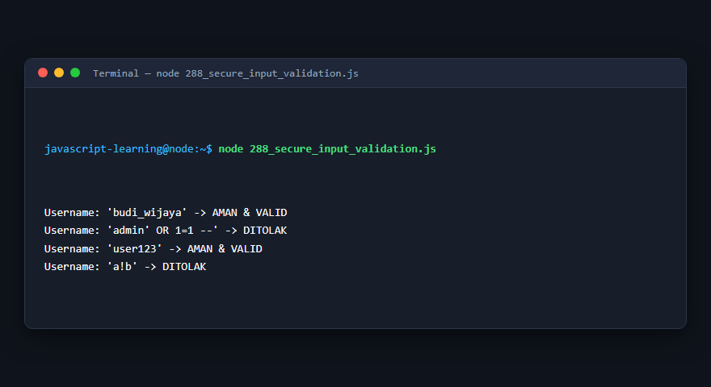

---

## Ringkasan Modul

Modul 17 (Algoritma, Testing, dan Keamanan) telah menyajikan pembelajaran berbasis praktik yang terstruktur. Seluruh program di dalam modul ini dapat dijalankan secara mandiri tanpa saling membebani dependensi yang rumit, dengan fokus mendalam pada pemahaman konsep dan kebiasaan baik penulisan kode.
