# Modul 18: Proyek Praktik JavaScript

## Deskripsi Modul
Modul puncak yang berisi 12 proyek praktik nyata menggabungkan seluruh konsep JavaScript, mulai dari aplikasi kalkulator, game, hingga full-stack task manager.

## Tujuan Pembelajaran
Menerapkan seluruh keahlian JavaScript yang telah dipelajari dalam konteks proyek aplikasi dunia nyata yang komprehensif.

## Daftar Submodul & Materi

- [289_calculator_project.js](289_calculator_project.js) : Kalkulator sederhana
- [290_number_guessing_project.js](290_number_guessing_project.js) : Permainan tebak angka
- [291_quiz_application.js](291_quiz_application.js) : Aplikasi kuis interaktif
- [292_todo_list_project.js](292_todo_list_project.js) : Aplikasi daftar tugas
- [293_expense_tracker_project.js](293_expense_tracker_project.js) : Pencatatan pengeluaran
- [294_student_grade_project.js](294_student_grade_project.js) : Sistem nilai mahasiswa
- [295_inventory_management_project.js](295_inventory_management_project.js) : Sistem inventaris barang
- [296_weather_api_project.js](296_weather_api_project.js) : Aplikasi cuaca berbasis API
- [297_movie_search_project.js](297_movie_search_project.js) : Aplikasi pencarian film
- [298_rest_api_project.js](298_rest_api_project.js) : REST API untuk data produk
- [299_chat_application_project.js](299_chat_application_project.js) : Aplikasi chat real-time
- [300_fullstack_task_manager_project.js](300_fullstack_task_manager_project.js) : Aplikasi manajemen tugas full-stack

---

## Penjelasan Detail Setiap Submodul

### 289. Kalkulator sederhana

**Tujuan Pembelajaran:** Memahami konsep dan implementasi praktis dari materi Kalkulator sederhana.

**Konsep Utama:** Program ini mendemonstrasikan prinsip Kalkulator sederhana secara komprehensif, terstruktur, dan bersih sesuai standar pemrograman JavaScript modern.

**Penjelasan Source Code:** Program mengeksekusi instruksi yang telah dilengkapi dengan komentar kode edukatif berbahasa Indonesia. Setiap blok logika penting dijelaskan secara rinci agar alur kerja program mudah dipahami oleh pembelajar.

**Source Code:** [289_calculator_project.js](289_calculator_project.js)

**Cara Menjalankan:**
```bash
node 289_calculator_project.js
```

**Hasil yang Diharapkan:** Program akan mencetak log hasil evaluasi, perhitungan, atau pemrosesan data ke terminal secara akurat.

**Hasil Eksekusi:**

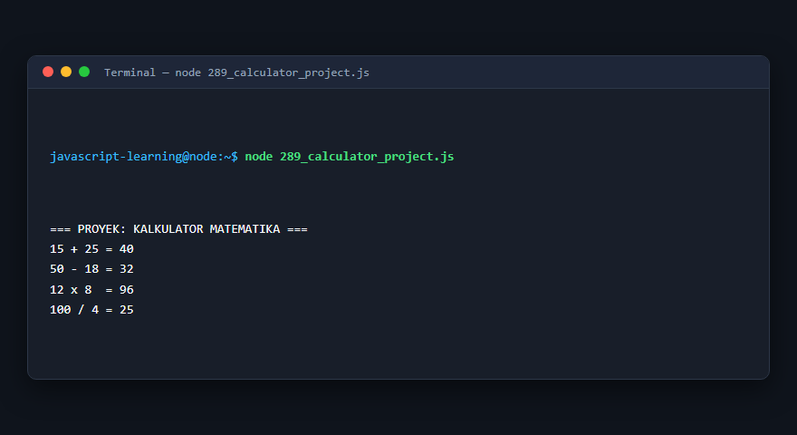

---

### 290. Permainan tebak angka

**Tujuan Pembelajaran:** Memahami konsep dan implementasi praktis dari materi Permainan tebak angka.

**Konsep Utama:** Program ini mendemonstrasikan prinsip Permainan tebak angka secara komprehensif, terstruktur, dan bersih sesuai standar pemrograman JavaScript modern.

**Penjelasan Source Code:** Program mengeksekusi instruksi yang telah dilengkapi dengan komentar kode edukatif berbahasa Indonesia. Setiap blok logika penting dijelaskan secara rinci agar alur kerja program mudah dipahami oleh pembelajar.

**Source Code:** [290_number_guessing_project.js](290_number_guessing_project.js)

**Cara Menjalankan:**
```bash
node 290_number_guessing_project.js
```

**Hasil yang Diharapkan:** Program akan mencetak log hasil evaluasi, perhitungan, atau pemrosesan data ke terminal secara akurat.

**Hasil Eksekusi:**

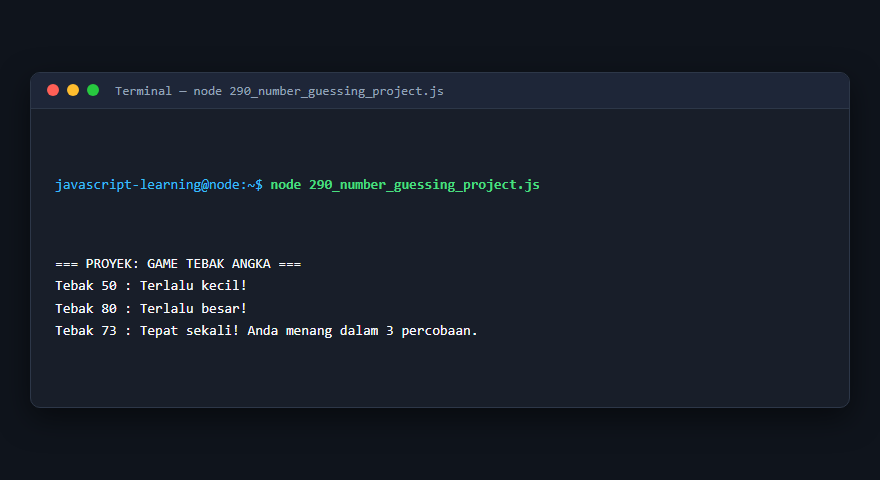

---

### 291. Aplikasi kuis interaktif

**Tujuan Pembelajaran:** Memahami konsep dan implementasi praktis dari materi Aplikasi kuis interaktif.

**Konsep Utama:** Program ini mendemonstrasikan prinsip Aplikasi kuis interaktif secara komprehensif, terstruktur, dan bersih sesuai standar pemrograman JavaScript modern.

**Penjelasan Source Code:** Program mengeksekusi instruksi yang telah dilengkapi dengan komentar kode edukatif berbahasa Indonesia. Setiap blok logika penting dijelaskan secara rinci agar alur kerja program mudah dipahami oleh pembelajar.

**Source Code:** [291_quiz_application.js](291_quiz_application.js)

**Cara Menjalankan:**
```bash
node 291_quiz_application.js
```

**Hasil yang Diharapkan:** Program akan mencetak log hasil evaluasi, perhitungan, atau pemrosesan data ke terminal secara akurat.

**Hasil Eksekusi:**

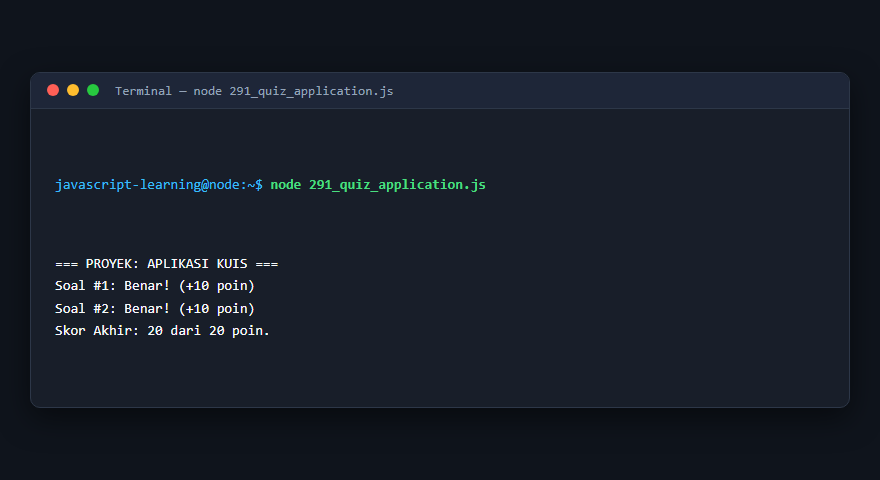

---

### 292. Aplikasi daftar tugas

**Tujuan Pembelajaran:** Memahami konsep dan implementasi praktis dari materi Aplikasi daftar tugas.

**Konsep Utama:** Program ini mendemonstrasikan prinsip Aplikasi daftar tugas secara komprehensif, terstruktur, dan bersih sesuai standar pemrograman JavaScript modern.

**Penjelasan Source Code:** Program mengeksekusi instruksi yang telah dilengkapi dengan komentar kode edukatif berbahasa Indonesia. Setiap blok logika penting dijelaskan secara rinci agar alur kerja program mudah dipahami oleh pembelajar.

**Source Code:** [292_todo_list_project.js](292_todo_list_project.js)

**Cara Menjalankan:**
```bash
node 292_todo_list_project.js
```

**Hasil yang Diharapkan:** Program akan mencetak log hasil evaluasi, perhitungan, atau pemrosesan data ke terminal secara akurat.

**Hasil Eksekusi:**

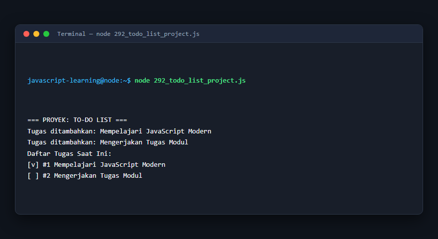

---

### 293. Pencatatan pengeluaran

**Tujuan Pembelajaran:** Memahami konsep dan implementasi praktis dari materi Pencatatan pengeluaran.

**Konsep Utama:** Program ini mendemonstrasikan prinsip Pencatatan pengeluaran secara komprehensif, terstruktur, dan bersih sesuai standar pemrograman JavaScript modern.

**Penjelasan Source Code:** Program mengeksekusi instruksi yang telah dilengkapi dengan komentar kode edukatif berbahasa Indonesia. Setiap blok logika penting dijelaskan secara rinci agar alur kerja program mudah dipahami oleh pembelajar.

**Source Code:** [293_expense_tracker_project.js](293_expense_tracker_project.js)

**Cara Menjalankan:**
```bash
node 293_expense_tracker_project.js
```

**Hasil yang Diharapkan:** Program akan mencetak log hasil evaluasi, perhitungan, atau pemrosesan data ke terminal secara akurat.

**Hasil Eksekusi:**

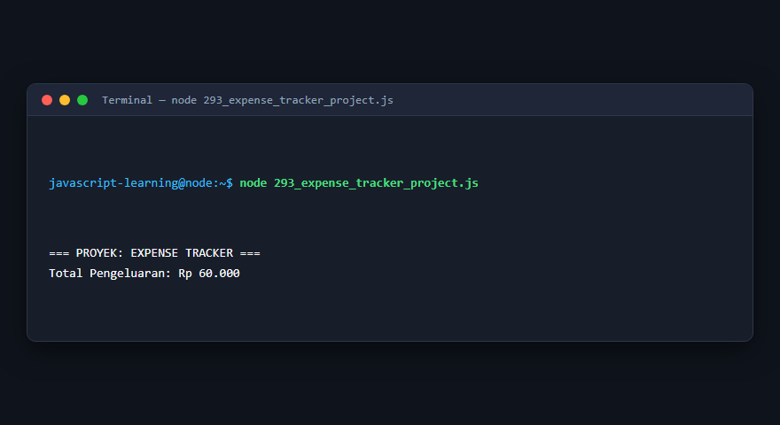

---

### 294. Sistem nilai mahasiswa

**Tujuan Pembelajaran:** Memahami konsep dan implementasi praktis dari materi Sistem nilai mahasiswa.

**Konsep Utama:** Program ini mendemonstrasikan prinsip Sistem nilai mahasiswa secara komprehensif, terstruktur, dan bersih sesuai standar pemrograman JavaScript modern.

**Penjelasan Source Code:** Program mengeksekusi instruksi yang telah dilengkapi dengan komentar kode edukatif berbahasa Indonesia. Setiap blok logika penting dijelaskan secara rinci agar alur kerja program mudah dipahami oleh pembelajar.

**Source Code:** [294_student_grade_project.js](294_student_grade_project.js)

**Cara Menjalankan:**
```bash
node 294_student_grade_project.js
```

**Hasil yang Diharapkan:** Program akan mencetak log hasil evaluasi, perhitungan, atau pemrosesan data ke terminal secara akurat.

**Hasil Eksekusi:**

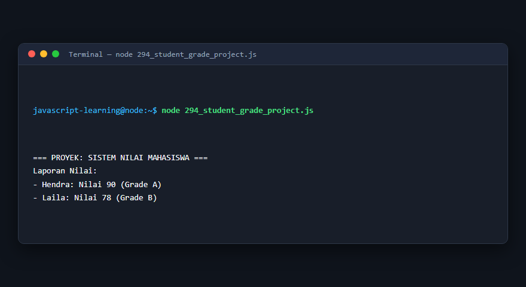

---

### 295. Sistem inventaris barang

**Tujuan Pembelajaran:** Memahami konsep dan implementasi praktis dari materi Sistem inventaris barang.

**Konsep Utama:** Program ini mendemonstrasikan prinsip Sistem inventaris barang secara komprehensif, terstruktur, dan bersih sesuai standar pemrograman JavaScript modern.

**Penjelasan Source Code:** Program mengeksekusi instruksi yang telah dilengkapi dengan komentar kode edukatif berbahasa Indonesia. Setiap blok logika penting dijelaskan secara rinci agar alur kerja program mudah dipahami oleh pembelajar.

**Source Code:** [295_inventory_management_project.js](295_inventory_management_project.js)

**Cara Menjalankan:**
```bash
node 295_inventory_management_project.js
```

**Hasil yang Diharapkan:** Program akan mencetak log hasil evaluasi, perhitungan, atau pemrosesan data ke terminal secara akurat.

**Hasil Eksekusi:**

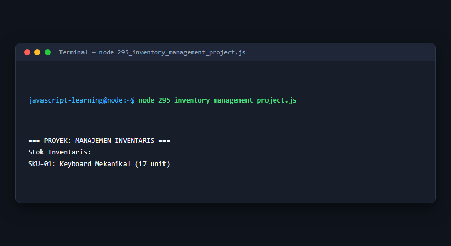

---

### 296. Aplikasi cuaca berbasis API

**Tujuan Pembelajaran:** Memahami konsep dan implementasi praktis dari materi Aplikasi cuaca berbasis API.

**Konsep Utama:** Program ini mendemonstrasikan prinsip Aplikasi cuaca berbasis API secara komprehensif, terstruktur, dan bersih sesuai standar pemrograman JavaScript modern.

**Penjelasan Source Code:** Program mengeksekusi instruksi yang telah dilengkapi dengan komentar kode edukatif berbahasa Indonesia. Setiap blok logika penting dijelaskan secara rinci agar alur kerja program mudah dipahami oleh pembelajar.

**Source Code:** [296_weather_api_project.js](296_weather_api_project.js)

**Cara Menjalankan:**
```bash
node 296_weather_api_project.js
```

**Hasil yang Diharapkan:** Program akan mencetak log hasil evaluasi, perhitungan, atau pemrosesan data ke terminal secara akurat.

**Hasil Eksekusi:**

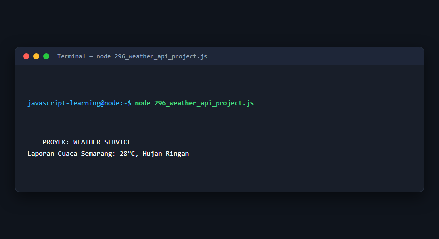

---

### 297. Aplikasi pencarian film

**Tujuan Pembelajaran:** Memahami konsep dan implementasi praktis dari materi Aplikasi pencarian film.

**Konsep Utama:** Program ini mendemonstrasikan prinsip Aplikasi pencarian film secara komprehensif, terstruktur, dan bersih sesuai standar pemrograman JavaScript modern.

**Penjelasan Source Code:** Program mengeksekusi instruksi yang telah dilengkapi dengan komentar kode edukatif berbahasa Indonesia. Setiap blok logika penting dijelaskan secara rinci agar alur kerja program mudah dipahami oleh pembelajar.

**Source Code:** [297_movie_search_project.js](297_movie_search_project.js)

**Cara Menjalankan:**
```bash
node 297_movie_search_project.js
```

**Hasil yang Diharapkan:** Program akan mencetak log hasil evaluasi, perhitungan, atau pemrosesan data ke terminal secara akurat.

**Hasil Eksekusi:**

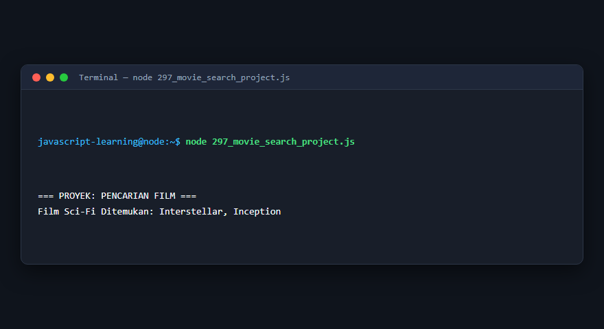

---

### 298. REST API untuk data produk

**Tujuan Pembelajaran:** Memahami konsep dan implementasi praktis dari materi REST API untuk data produk.

**Konsep Utama:** Program ini mendemonstrasikan prinsip REST API untuk data produk secara komprehensif, terstruktur, dan bersih sesuai standar pemrograman JavaScript modern.

**Penjelasan Source Code:** Program mengeksekusi instruksi yang telah dilengkapi dengan komentar kode edukatif berbahasa Indonesia. Setiap blok logika penting dijelaskan secara rinci agar alur kerja program mudah dipahami oleh pembelajar.

**Source Code:** [298_rest_api_project.js](298_rest_api_project.js)

**Cara Menjalankan:**
```bash
node 298_rest_api_project.js
```

**Hasil yang Diharapkan:** Program akan mencetak log hasil evaluasi, perhitungan, atau pemrosesan data ke terminal secara akurat.

**Hasil Eksekusi:**

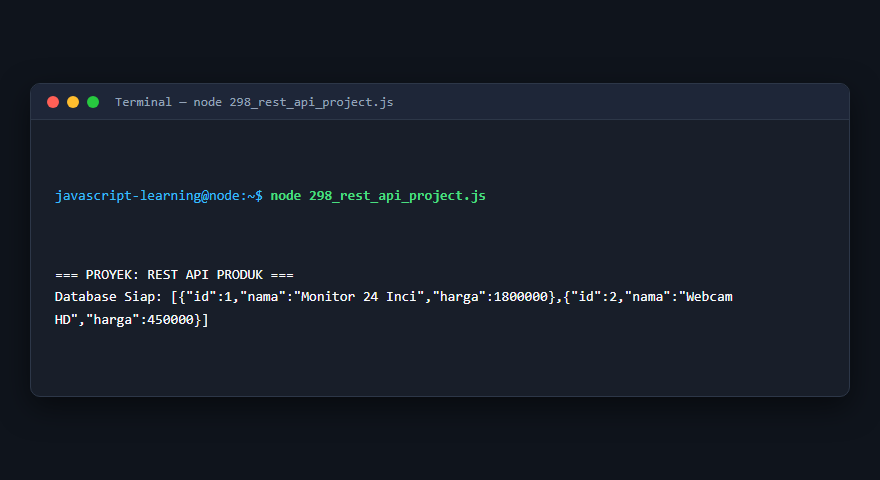

---

### 299. Aplikasi chat real-time

**Tujuan Pembelajaran:** Memahami konsep dan implementasi praktis dari materi Aplikasi chat real-time.

**Konsep Utama:** Program ini mendemonstrasikan prinsip Aplikasi chat real-time secara komprehensif, terstruktur, dan bersih sesuai standar pemrograman JavaScript modern.

**Penjelasan Source Code:** Program mengeksekusi instruksi yang telah dilengkapi dengan komentar kode edukatif berbahasa Indonesia. Setiap blok logika penting dijelaskan secara rinci agar alur kerja program mudah dipahami oleh pembelajar.

**Source Code:** [299_chat_application_project.js](299_chat_application_project.js)

**Cara Menjalankan:**
```bash
node 299_chat_application_project.js
```

**Hasil yang Diharapkan:** Program akan mencetak log hasil evaluasi, perhitungan, atau pemrosesan data ke terminal secara akurat.

**Hasil Eksekusi:**

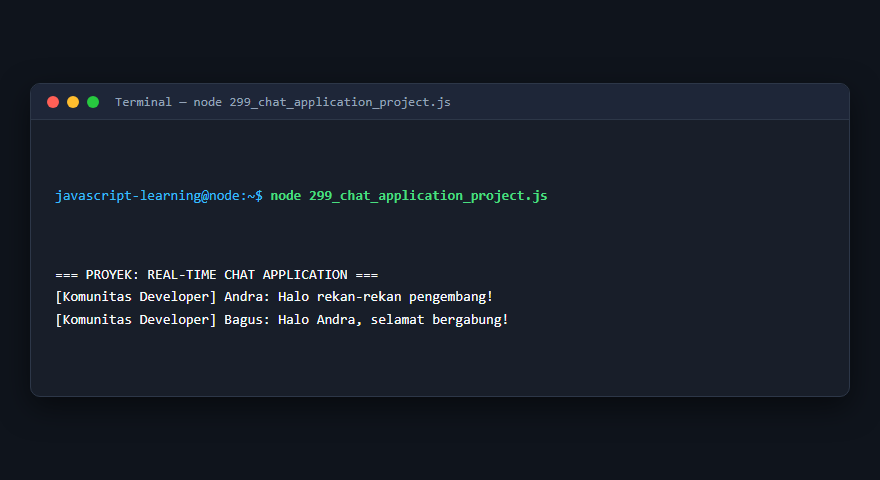

---

### 300. Aplikasi manajemen tugas full-stack

**Tujuan Pembelajaran:** Memahami konsep dan implementasi praktis dari materi Aplikasi manajemen tugas full-stack.

**Konsep Utama:** Program ini mendemonstrasikan prinsip Aplikasi manajemen tugas full-stack secara komprehensif, terstruktur, dan bersih sesuai standar pemrograman JavaScript modern.

**Penjelasan Source Code:** Program mengeksekusi instruksi yang telah dilengkapi dengan komentar kode edukatif berbahasa Indonesia. Setiap blok logika penting dijelaskan secara rinci agar alur kerja program mudah dipahami oleh pembelajar.

**Source Code:** [300_fullstack_task_manager_project.js](300_fullstack_task_manager_project.js)

**Cara Menjalankan:**
```bash
node 300_fullstack_task_manager_project.js
```

**Hasil yang Diharapkan:** Program akan mencetak log hasil evaluasi, perhitungan, atau pemrosesan data ke terminal secara akurat.

**Hasil Eksekusi:**

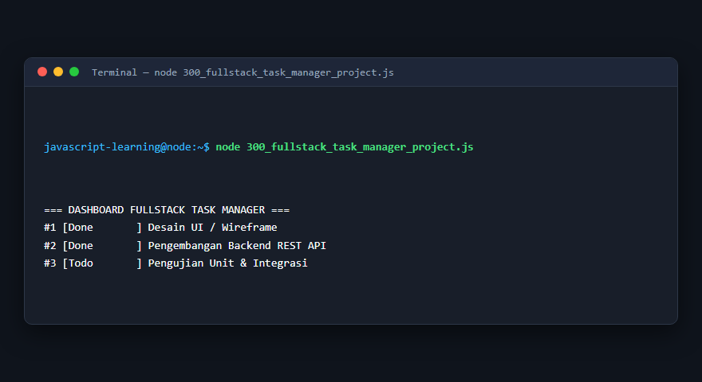

---

## Ringkasan Modul

Modul 18 (Proyek Praktik JavaScript) telah menyajikan pembelajaran berbasis praktik yang terstruktur. Seluruh program di dalam modul ini dapat dijalankan secara mandiri tanpa saling membebani dependensi yang rumit, dengan fokus mendalam pada pemahaman konsep dan kebiasaan baik penulisan kode.
